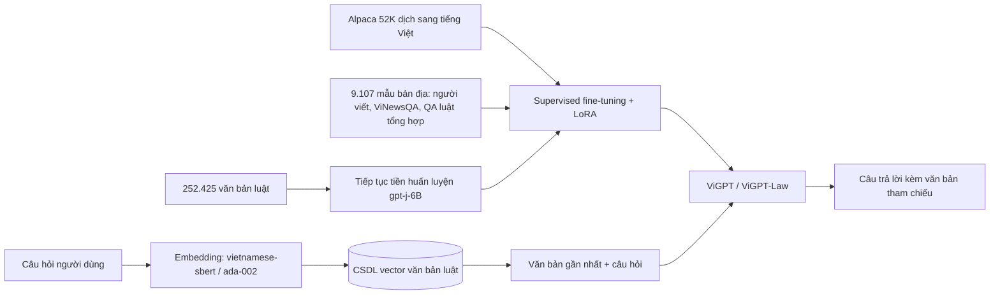

# Paper 01 Summary

## Citation

Tên bài: ViGPTQA – State-of-the-Art LLMs for Vietnamese Question Answering: System Overview, Core Models Training, and Evaluations
Tác giả: Minh-Thuan Nguyen, Khanh-Tung Tran, Vincent Nguyen, Xuan-Son Vu
Năm: 2023
Nguồn: Proceedings of the 2023 Conference on Empirical Methods in Natural Language Processing: Industry Track (EMNLP 2023), trang 754–764 — hội nghị có bình duyệt (peer-reviewed), ACL Anthology
DOI/Link: https://aclanthology.org/2023.emnlp-industry.70/ (DOI: 10.18653/v1/2023.emnlp-industry.70)

## Problem

**Tóm tắt tổng quan.** Bài báo xây dựng ViGPTQA – một hệ thống hỏi đáp tiếng Việt chạy thực tế dựa trên LLM – và đề xuất ViGPT, một LLM đơn ngữ tiếng Việt được tinh chỉnh theo chỉ dẫn (instruction-tuned), cùng biến thể chuyên miền pháp luật ViGPT-Law. Nhóm tác giả công bố thêm các bộ dữ liệu đánh giá mới (ViLawsQA, ViTruthfulQA) và mã nguồn, trọng số mô hình. Kết quả chính: trên ViLawsQA, khi có ngữ cảnh truy xuất, ViGPT-Law-v2 đạt điểm người đánh giá 2,17–2,24/4 (2,52/4 với ngữ cảnh chuẩn), trong khi không có ngữ cảnh chỉ đạt tối đa 1,23/4.

**Bối cảnh và động lực.** Theo bài báo, LLM cho các ngôn ngữ ít tài nguyên như tiếng Việt bị hạn chế do thiếu dữ liệu huấn luyện và bộ đánh giá chuẩn; các nỗ lực đánh giá LLM đa ngôn ngữ chủ yếu tập trung vào tiếng Anh và tiếng Trung. Các mô hình tiếng Việt trước đó (PhoBERT, ViT5, ViDeBERTa…) mạnh ở tác vụ NLP truyền thống nhưng chưa có LLM chỉ dẫn quy mô tỷ tham số dành riêng cho tiếng Việt kèm đánh giá đầy đủ. Khoảng trống bài báo nhắm tới: một LLM tiếng Việt có thể triển khai riêng tư (open-source) và một bộ benchmark cho LLM tiếng Việt.

## Method

Phương pháp gồm ba khối:

1. **Tinh chỉnh ViGPT.** Mô hình nền là VietAI/gpt-j-6B. Dữ liệu chỉ dẫn gồm 52K mẫu Alpaca được dịch sang tiếng Việt bằng gpt-3.5-turbo (ViGPT-v1). Vì dữ liệu dịch có thể bỏ sót đặc thù tiếng Việt, tác giả bổ sung 9.107 mẫu “bản địa”: 1.107 cặp hỏi-đáp do người Việt viết (lịch sử, địa lý, văn học), 3.000 mẫu từ ViNewsQA và 5.000 mẫu hỏi-đáp tóm lược tổng hợp về pháp luật (ViGPT-v2). Huấn luyện dùng Hugging Face với FSDP, mixed precision và LoRA.
2. **Thích nghi miền pháp luật (ViGPT-Law).** Thu thập văn bản pháp luật Việt Nam, loại trùng và loại văn bản dưới 100 token, còn 252.425 văn bản; tiếp tục tiền huấn luyện (next-word prediction) trên kho này. 5.000 cặp hỏi-đáp tổng hợp được sinh bằng gpt-3.5-turbo từ 1.000 văn bản cắt thành 5.000 đoạn 4.000 ký tự. Tinh chỉnh tiếp với Alpaca dịch (ViGPT-Law-v1) hoặc Alpaca + 5.000 mẫu pháp luật (ViGPT-Law-v2).
3. **Hệ thống ViGPTQA.** Một module nhúng (embedding) tìm văn bản luật gần nhất trong cơ sở dữ liệu vector, ghép với câu hỏi rồi đưa vào ViGPT để sinh câu trả lời có dẫn chiếu.

## Dataset

- **ViLawsQA** (mới): 1.020 bộ ngữ cảnh–câu hỏi–câu trả lời thuộc 27 lĩnh vực luật, lấy từ trang thông tin pháp luật chính thức.
- **ViTruthfulQA** (mới): câu hỏi về lịch sử, địa lý, văn học Việt Nam, được lọc đối kháng qua gpt-3.5-turbo.
- MRC trích xuất: ViCoQA, ViNewsQA, ViWikiQA, ViQuAD 2.0; NER: PhoNER (100 mẫu huấn luyện); Vicuna-Instructions-80 bản dịch.
- Bài báo **không** công bố kích thước tập test chi tiết cho từng bộ MRC và không có dữ liệu thủ tục hành chính.

## Evaluation

ROUGE-1 (tokenizer tiếng Việt và bản “Non-Unicode” của thư viện rouge-score), BLEU-1, BLEU-4; F1 và Similarity (vietnamese-sbert) cho MRC; F1 cho NER; đánh giá người (3 người chú thích, thang Likert 0–4 trên 200 mẫu); điểm do GPT-4 chấm trên Vicuna-80. Baseline gồm vi_mrclarge, gpt-3.5-turbo, BingAI, vilm/vietcuna-3b, VietAI/gpt-neo-1.3B, VietAI/gpt-j-6B và các mô hình NER (PhoBERT, ViT5, ViDeBERTa…).

## Results

- **ViLawsQA không ngữ cảnh:** gpt-3.5-turbo đạt điểm người cao nhất 2,11/4; tốt nhất trong các mô hình của tác giả là ViGPT-Law-v2 với 1,23/4. Tác giả nhận định phần lớn câu trả lời khi không có ngữ cảnh “không hữu ích” với người dùng.
- **Có ngữ cảnh:** ViGPT-Law-v2 + vietnamese-sbert đạt ROUGE-1 42,10, điểm người 2,17; + embedding-ada-002 đạt 43,22 và 2,24; với ngữ cảnh chuẩn đạt 45,33 và 2,52. vi_mrclarge với ngữ cảnh chuẩn chỉ đạt ROUGE-1 14,85.
- **MRC:** ViGPT-v2 (huấn luyện đủ) tiệm cận vi_mrclarge trên ba bộ và vượt trên ViWikiQA (F1 51,55 so với 54,15 nhưng Similarity 63,25 so với 61,52; điểm người 2,67 so với 2,73 — tức không vượt ở mọi chỉ số như tác giả viết).
- **NER few-shot (100 mẫu):** ViGPT-v1 F1 69,31, thấp xa các mô hình huấn luyện đầy đủ (ViDeBERTa 95,3).
- **ViTruthfulQA:** ViGPT-v2 đạt 25,45 điểm người, so với gpt-3.5-turbo 29,91 và BingAI (có Internet) 74,08.
- Không có thí nghiệm ablation riêng cho từng nguồn dữ liệu; so sánh v1/v2 đóng vai trò ablation gián tiếp.

**Điểm mạnh.**

- Mô tả quy trình đầy đủ từ dữ liệu, tiền huấn luyện miền đến hệ thống triển khai thực tế; công bố mã, dữ liệu, trọng số.
- Chứng minh định lượng vai trò của truy xuất ngữ cảnh: điểm người tăng từ 1,23 lên 2,17–2,52 khi có ngữ cảnh.
- Chỉ ra vấn đề đo lường đặc thù tiếng Việt: thư viện ROUGE phổ biến loại bỏ ký tự Unicode, làm sai lệch điểm số.

## Limitations

**(a) Bài báo thừa nhận:** dữ liệu chỉ dẫn tiếng Việt còn chất lượng thấp, không đủ để một mô hình xử lý tốt nhiều tác vụ; tính trung thực còn cách xa mức tuyệt đối; cần thêm thí nghiệm về công bằng và thiên kiến; khoảng cách lớn với gpt-3.5-turbo do chênh lệch quy mô (6B so với 175B).

**(b) Quan sát từ kết quả:** cải thiện không đồng đều — ViGPT-v2 kém vi_mrclarge về F1 trên ba bộ MRC; dữ liệu hỏi-đáp pháp luật là tổng hợp bằng gpt-3.5-turbo, có thể mang lỗi của mô hình sinh; đánh giá người chỉ trên 200 mẫu, bài không báo cáo độ đồng thuận giữa người chấm. Bài **không đề cập** đến kiểm chứng số liệu sau sinh, độ trễ hay chi phí triển khai, và không đánh giá trên văn bản thủ tục hành chính.

## Relevance to our topic

Đây là công trình gần nhất về hỏi đáp pháp luật tiếng Việt bằng LLM có truy xuất. Kết quả “không ngữ cảnh → câu trả lời phần lớn vô dụng” củng cố thiết kế của Sys_3_4: không để LLM trả lời từ trí nhớ tham số mà luôn dựa vào bản ghi thủ tục truy xuất được. Phát hiện về ROUGE bỏ ký tự Unicode cũng là cảnh báo trực tiếp cho phần đánh giá tiếng Việt của nhóm.

**Kết luận.** ViGPTQA cho thấy một LLM 6B tiếng Việt có thích nghi miền pháp luật kết hợp truy xuất có thể tạo câu trả lời hữu ích ở mức trung bình (≈2,2–2,5/4 theo đánh giá người), nhưng vẫn kém mô hình đa ngôn ngữ lớn và phụ thuộc mạnh vào chất lượng ngữ cảnh. Hướng tiếp theo bài báo nêu là mở rộng quy mô mô hình và nâng cao chất lượng dữ liệu chỉ dẫn tiếng Việt.

## Possible improvement

- Sys_3_4 có thể đặt bộ kiểm chứng hậu kỳ (verifier) sau bước sinh để kiểm tra số tiền, thời hạn, căn cứ pháp lý — phần ViGPTQA không có.
- Khi báo cáo chỉ số tự động cho tiếng Việt, nhóm cần dùng tokenizer giữ dấu (theo cảnh báo của bài) và kèm đánh giá người có báo cáo độ đồng thuận.
- Mở rộng đánh giá sang dữ liệu thủ tục hành chính cấp xã, nơi bài báo chưa phủ.
