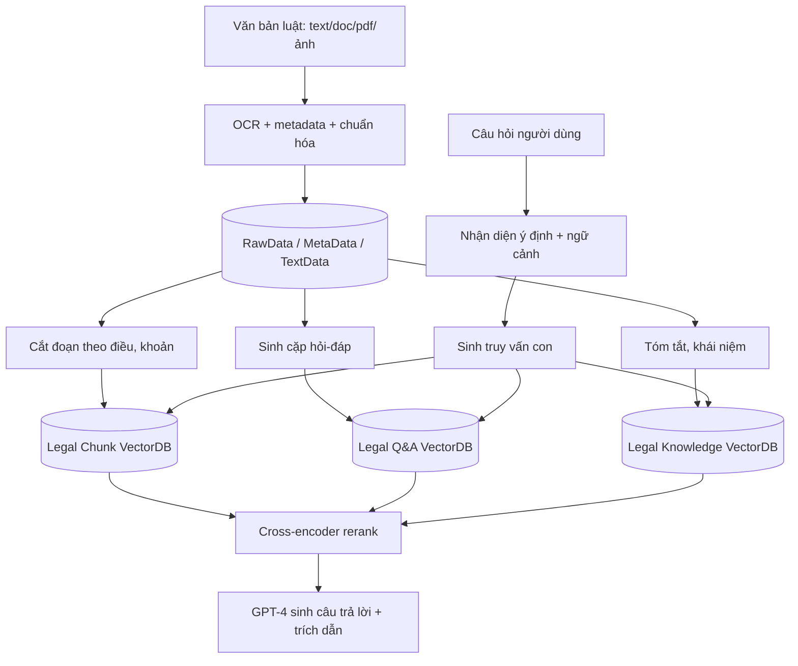

# Paper 02 Summary

## Citation

Tên bài: Integrating Information Retrieval and Large Language Models for Vietnamese Legal Document Query Systems
Tác giả: Pham Thi Xuan Hien, Duong Ngoc Thao Nhi, Pham Thi Ngoc Huyen
Năm: 2025
Nguồn: Proceedings of the 17th International Joint Conference on Knowledge Discovery, Knowledge Engineering and Knowledge Management (IC3K 2025) – Vol. 2: KEOD và KMIS, trang 290–300, SCITEPRESS — hội nghị có bình duyệt
DOI/Link: https://doi.org/10.5220/0013751200004000

## Problem

**Tóm tắt tổng quan.** Bài báo đề xuất một hệ thống hỏi đáp văn bản pháp luật Việt Nam theo kiến trúc RAG, kết hợp truy xuất vector với LLM (GPT-4) để sinh câu trả lời có trích dẫn. Đóng góp chính là kiến trúc ba tầng xử lý và “tri-vector database” gồm ba chỉ mục riêng: đoạn văn bản luật, cặp hỏi-đáp và tóm tắt tri thức. Theo bài báo, hệ thống đạt Context Recall 0,847, độ chính xác trích dẫn pháp lý 94,2% và điểm hài lòng người dùng trung bình 4,23/5.

**Bối cảnh và động lực.** Hệ thống pháp luật Việt Nam có cấu trúc thứ bậc phức tạp (Hiến pháp, luật, nghị định, thông tư, quyết định) và thay đổi thường xuyên. Các nền tảng hiện có (Thuvienphapluat.vn, VBQPPL) chủ yếu dựa trên tìm kiếm từ khóa, đòi hỏi người dùng có kiến thức chuyên môn. LLM đứng một mình có tri thức tĩnh và dễ sinh nội dung “nghe hợp lý nhưng sai”; chatbot dựa trên luật thì cứng nhắc và khó cập nhật. Khoảng trống bài báo nhắm tới là một hệ thống RAG cho luật thành văn (civil law) tiếng Việt, phục vụ cả người không chuyên.

## Method

Kiến trúc ba tầng:

1. **Tầng xử lý dữ liệu pháp lý:** thu thập văn bản (text, doc, pdf, ảnh) từ Cơ sở dữ liệu quốc gia về văn bản pháp luật; OCR, gắn metadata (cơ quan ban hành, cấp hiệu lực), chuẩn hóa thuật ngữ; lưu ba kho RawData, MetaData, TextData.
2. **Tầng xử lý tri thức:** ba luồng song song — cắt đoạn theo ranh giới tự nhiên của văn bản luật (điều, khoản), sinh cặp hỏi-đáp tự động theo mẫu, và trích xuất tóm tắt/khái niệm — đổ vào ba cơ sở dữ liệu vector (Legal Chunk, Legal Q&A, Legal Knowledge) trên Milvus, embedding 768 chiều từ BERT tiếng Việt tinh chỉnh.
3. **Tầng xử lý thông minh:** nhận diện ý định (bao gồm phân loại câu hỏi ngoài phạm vi để chuyển cho chuyên gia), hiểu ngữ cảnh hội thoại, sinh truy vấn con, truy xuất từ ba cơ sở dữ liệu, xếp hạng lại bằng cross-encoder, rồi GPT-4 sinh câu trả lời kèm trích dẫn và lời khuyến cáo pháp lý.

## Dataset

- Kho 45.000 văn bản pháp luật thuộc 12 lĩnh vực (hiến pháp, dân sự, hình sự, hành chính, lao động, thương mại, môi trường, thuế, sở hữu trí tuệ, tố tụng, quốc tế, tuân thủ).
- Tập đánh giá 2.000 cặp hỏi-đáp do chuyên gia pháp lý xác nhận, có trích dẫn kỳ vọng và mức độ phức tạp.
- Phần tóm tắt nêu 350.000 cặp hỏi-đáp pháp lý, nhưng thân bài **không mô tả** nguồn gốc, cách xây dựng hay vai trò cụ thể của tập này. Dữ liệu không được công bố công khai.

## Evaluation

Context Precision, Context Recall, MRR (truy xuất); ROUGE-1, ROUGE-L, BLEU, Legal Citation Accuracy (sinh); Legal Terminology Accuracy, Regulatory Compliance Rate (tỷ lệ có khuyến cáo pháp lý); thời gian phản hồi, mức hài lòng, tỷ lệ hoàn thành tác vụ. Baseline: tìm kiếm từ khóa TF-IDF, RAG tổng quát, BERT-QA pháp lý không truy xuất, và IR lai có xếp hạng nơ-ron cơ bản.

## Results

- Hệ thống đề xuất: Context Precision 0,792; Context Recall 0,847; MRR 0,783; ROUGE-1 0,834; Legal Citation Accuracy 94,2%. Baseline tốt nhất về trích dẫn (Hybrid Legal IR) đạt 81,2%; tìm kiếm truyền thống đạt 23,4%.
- ROUGE-L 0,756; độ chính xác thuật ngữ 91,7%; tỷ lệ tuân thủ khuyến cáo 96,8%.
- Theo độ phức tạp: câu hỏi đơn giản 94,1% chính xác (723 ms), trung bình 89,7% (1.089 ms), phức tạp 85,7% (1.456 ms), rất phức tạp 79,3% (2.134 ms).
- Nghiên cứu người dùng (N=75: 25 chuyên gia, 25 sinh viên luật, 25 công dân): hài lòng trung bình 4,23/5 (chuyên gia 4,41; sinh viên 4,18; công dân 4,11).
- Bài **không có** thí nghiệm ablation tách riêng đóng góp của từng cơ sở dữ liệu vector hay của bước rerank.

**Điểm mạnh.**

- Kiến trúc mô tả rõ ràng, sát bối cảnh văn bản pháp luật Việt Nam; cắt đoạn theo cấu trúc điều/khoản và có metadata cấp hiệu lực.
- Đánh giá đa chiều: chỉ số truy xuất, chỉ số sinh, chỉ số chuyên ngành và nghiên cứu người dùng phân theo ba nhóm đối tượng.
- Có bước phân loại câu hỏi ngoài phạm vi để chuyển chuyên gia — một cơ chế an toàn thực tế.

## Limitations

**(a) Bài báo thừa nhận:** phụ thuộc vào tập văn bản đã xử lý nên thiếu cập nhật ở lĩnh vực mới; khó xử lý quy định mâu thuẫn và thứ bậc án lệ; không thay thế được phán đoán của luật sư; khó khăn với câu hỏi không trang trọng hoặc từ ngữ địa phương; chưa bao gồm hướng dẫn hành chính và giải thích tư pháp.

**(b) Quan sát từ văn bản:** con số “giảm 58% thời gian phản hồi” được nêu ở tóm tắt nhưng thân bài không trình bày thí nghiệm so sánh tương ứng; có điểm không nhất quán khi tỷ lệ hoàn thành 78,4% được mô tả là “vẫn trên ngưỡng mục tiêu 80%”. Mô hình sinh là GPT-4 qua API, nên chi phí và tính riêng tư khi triển khai cho cơ quan nhà nước không được bàn. Không có thống kê ý nghĩa hay độ đồng thuận giữa người chấm; tập đánh giá không công khai nên khó tái lập.

## Relevance to our topic

Đây là bài gần nhất với Sys_3_4 về phạm vi (văn bản pháp luật Việt Nam, phục vụ cả công dân) và về thành phần (cắt đoạn theo cấu trúc, metadata, phân loại ngoài phạm vi, trích dẫn nguồn). Bài cũng cung cấp baseline và bộ chỉ số (Context Recall, MRR, Citation Accuracy) mà nhóm có thể dùng để định vị kết quả của mình.

**Kết luận.** Bài báo cho thấy một kiến trúc RAG ba chỉ mục cho luật Việt Nam có thể cải thiện rõ các chỉ số truy xuất và trích dẫn so với tìm kiếm từ khóa và RAG tổng quát, đồng thời được người dùng đánh giá tích cực. Tuy vậy, mức độ tin cậy của một số khẳng định định lượng còn hạn chế do thiếu ablation và chi tiết thực nghiệm. Hướng tiếp theo tác giả nêu: tích hợp án lệ, suy luận theo thời gian về hiệu lực văn bản, và mở rộng phân tích so sánh pháp luật.

## Possible improvement

- Sys_3_4 thay GPT-4 qua API bằng mô hình chạy cục bộ, phù hợp yêu cầu dữ liệu không rời cơ quan.
- Bổ sung kiểm chứng tất định cho số liệu (lệ phí, thời hạn) — bài báo đo “độ chính xác trích dẫn” nhưng không kiểm tra từng con số trong câu trả lời.
- Thực hiện ablation từng thành phần và công bố tập đánh giá để khắc phục điểm yếu về khả năng tái lập của bài.
