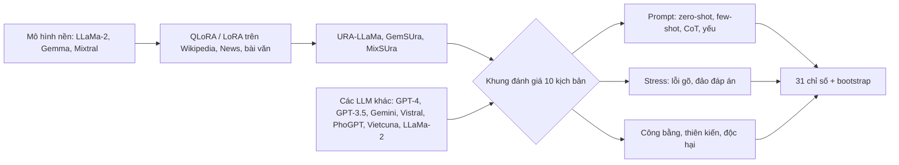

# Paper 03 Summary

## Citation

Tên bài: Crossing Linguistic Horizons: Finetuning and Comprehensive Evaluation of Vietnamese Large Language Models
Tác giả: Sang T. Truong, Duc Q. Nguyen, Toan Nguyen, Dong D. Le, Nhi N. Truong, Tho Quan, Sanmi Koyejo (Stanford University; Trường ĐH Bách khoa – ĐHQG TP.HCM)
Năm: 2024
Nguồn: Findings of the Association for Computational Linguistics: NAACL 2024, trang 2849–2900 — hội nghị có bình duyệt, ACL Anthology
DOI/Link: https://aclanthology.org/2024.findings-naacl.182/ (DOI: 10.18653/v1/2024.findings-naacl.182)

## Problem

**Tóm tắt tổng quan.** Bài báo tinh chỉnh và công bố năm LLM tiếng Việt mã nguồn mở (URA-LLaMa 7B/13B/70B dựa trên LLaMa-2, MixSUra dựa trên Mixtral 8×7B, GemSUra 7B dựa trên Gemma 7B), đồng thời xây dựng khung đánh giá toàn diện gồm 10 kịch bản và 31 chỉ số, áp dụng cho 14 LLM. Kết luận chính: tinh chỉnh giúp chuyển giao tri thức giữa các ngôn ngữ; mô hình lớn hơn có thể thiên kiến và kém hiệu chỉnh (calibration) hơn; chất lượng dữ liệu tinh chỉnh là yếu tố then chốt hơn số tham số.

**Bối cảnh và động lực.** Theo tác giả, các LLM mã nguồn mở dù huấn luyện đa ngôn ngữ vẫn xử lý tiếng Việt hạn chế, và chưa có khung đánh giá hệ thống cho LLM tiếng Việt: các nghiên cứu trước chỉ đánh giá hỏi đáp đóng hoặc các bộ dữ liệu riêng lẻ (luật, vật lý, sinh học). Một số năng lực như suy luận toán học chưa được đánh giá do thiếu dữ liệu tiếng Việt. Bài báo lấp khoảng trống bằng mô hình mở quy mô lớn và bộ đánh giá đa chiều (độ chính xác, độ bền, công bằng, thiên kiến, độc hại).

## Method

1. **Tinh chỉnh có giám sát (QLoRA/LoRA).** URA-LLaMa được tinh chỉnh từ LLaMa-2 bằng QLoRA (4-bit NF4) trên Vietnamese Wikipedia (1GB) và Vietnamese News-Corpus (22GB) — bản 7B dùng cả hai, bản 13B và 70B chỉ dùng Wikipedia; LoRA rank 128/256/1024. GemSUra và MixSUra dùng LoRA trên Wikipedia và tuyển tập bài văn THPT.
2. **Khung đánh giá theo kịch bản.** Mười kịch bản, mỗi kịch bản hai bộ dữ liệu tiếng Việt: hỏi đáp, tóm tắt, phân tích cảm xúc, phân loại văn bản, tri thức, phát hiện độc hại, truy xuất thông tin, mô hình hóa ngôn ngữ, suy luận, dịch.
3. **Thiết kế prompt và stress test.** Prompt cơ bản zero-shot, few-shot, chain-of-thought; prompt yếu/trung bình; nhiễu lỗi gõ (10% từ, gồm bỏ dấu tiếng Việt), đổi khoảng trắng, chữ thường, số thành chữ; đảo thứ tự đáp án; thay tên/giới tính để đo công bằng; đo thiên kiến và độc hại bằng bộ phân loại ViT5 tự huấn luyện. Độ lệch chuẩn tính bằng bootstrap 1.000 lần.

## Dataset

Dữ liệu tinh chỉnh: Vietnamese Wikipedia, Vietnamese News-Corpus, Vietnamese Highschool Essays. Dữ liệu đánh giá (tập test có sẵn): XQuAD, MLQA; VietNews (22.644 bài test), WikiLingua; VLSP 2016, UiT-VSFC; UiT-VSMEC, PhoATIS; ZaloE2E, UiT-ViMMRC; UiT-ViCTSD, UiT-ViHSD; mMARCO, mRobust04; MLQA (che 10% từ), VSEC; Synthetic reasoning và MATH bản dịch tiếng Việt (đóng góp mới); OPUS100, PhoMT. Không có bộ dữ liệu pháp luật hay hành chính trong khung đánh giá.

## Evaluation

EM, F1 (hỏi đáp, tri thức, suy luận); ROUGE-1/2/L, SummaC, BERTScore, Coverage, Density, Compression (tóm tắt); Accuracy, F1, AUC-ROC, ECE, A@10% (phân loại); M@10, N@10 (truy xuất); EM, CER, WER, CED, WED, Perplexity (mô hình hóa ngôn ngữ); BLEU, hLEPOR (dịch); biểu diễn nhân khẩu học và xác suất độc hại. GPT và Gemini không được đánh giá ở kịch bản truy xuất vì API không trả xác suất.

## Results

Phần thân bài trình bày kết quả chủ yếu bằng biểu đồ; các nhận định định tính được báo cáo gồm:
- GPT-4 tốt nhất trên mọi tác vụ, nhưng họ GPT thể hiện nhiều thiên kiến hơn và có sai số hiệu chỉnh cao hơn.
- Các mô hình tinh chỉnh vượt mô hình nền LLaMa-2; URA-LLaMa 70B tốt nhất trong nhóm mã nguồn mở với prompt zero-shot.
- Kích thước không quyết định: URA-LLaMa 7B và 70B gần như ngang nhau ở tóm tắt; 13B có tỷ lệ lỗi thấp hơn 70B ở mô hình hóa ngôn ngữ.
- Chỉ dùng Wikipedia tiếng Việt đã cho kết quả đáng kể với URA-LLaMa 70B và MixSUra. PhoGPT (từ vựng huấn luyện từ đầu) và Vistral (mở rộng từ vựng) tốt ở hỏi đáp và tóm tắt nhưng yếu ở các kịch bản công bằng, độ bền, độc hại.
- Few-shot làm GPT-3.5 gần bằng GPT-4 nhưng tăng sai số hiệu chỉnh ở mô hình lớn; CoT cải thiện mạnh trên MATH; prompt yếu đôi khi cho điểm cao hơn prompt có ràng buộc an toàn.
- Lỗi gõ ảnh hưởng mọi mô hình trừ họ GPT; mô hình lớn hơn nhạy hơn một chút với lỗi gõ và khó kiểm soát độc hại hơn.
- Chi phí: 867 giờ trên 6 GPU A100 80GB (~900 kg CO2e) cho URA-LLaMa; 289 giờ trên 4 A100 (~200 kg CO2e) cho GemSUra và MixSUra.
- Không có ablation tách riêng ảnh hưởng của từng bộ dữ liệu tinh chỉnh.

**Điểm mạnh.**

- Khung đánh giá tiếng Việt rộng nhất trong nhóm tài liệu: đa kịch bản, đa chỉ số, có độ bền, công bằng, độc hại và độ lệch chuẩn bootstrap.
- Công bố mô hình, mã đánh giá và hai bộ dữ liệu suy luận tiếng Việt.
- Đo trực tiếp tác động của lỗi gõ và mất dấu tiếng Việt — loại nhiễu phổ biến với người dùng thật.

## Limitations

**(a) Bài báo thừa nhận:** có thể nhiễm dữ liệu (contamination) với mô hình đóng hoặc mô hình không công bố dữ liệu; chỉ giới hạn tiếng Việt; chất lượng và độ đa dạng của dữ liệu tiếng Việt còn hạn chế; chi phí tính toán lớn ảnh hưởng tính tái lập; tri thức mô hình dừng ở dữ liệu trước 2022; không đảm bảo hết thiên kiến/độc hại khi triển khai thực tế, cần kiểm chứng câu trả lời.

**(b) Quan sát:** kết quả chính đặt trong biểu đồ nên khó trích số cụ thể từ thân bài; dữ liệu suy luận là bản dịch máy; không đánh giá miền pháp luật hay hành chính và không đo độ trễ suy luận.

## Relevance to our topic

Bài cung cấp bằng chứng cho hai quyết định của Sys_3_4: (1) tinh chỉnh tiếp từ một mô hình nền tốt (thay vì huấn luyện từ đầu) là lựa chọn hợp lý cho tiếng Việt; (2) LLM nhạy với lỗi gõ và mất dấu — củng cố thiết kế chuẩn hóa truy vấn, xử lý lỗi gõ và phạt lệch dấu trong Strict Engine trước khi tới bước mô hình.

**Kết luận.** Bài báo đóng góp mô hình mở và khung đánh giá toàn diện cho LLM tiếng Việt, cho thấy chất lượng dữ liệu và chiến lược tinh chỉnh quan trọng hơn quy mô thuần túy, đồng thời chỉ ra rủi ro thiên kiến, hiệu chỉnh và độ nhạy với nhiễu đầu vào. Hướng tiếp theo: mở rộng sang ngôn ngữ ít tài nguyên khác, xây dựng dữ liệu tiếng Việt giàu văn hóa hơn và phương pháp tinh chỉnh tiết kiệm hơn.

## Possible improvement

- Áp dụng phương pháp stress test của bài (lỗi gõ, bỏ dấu, chữ thường, số thành chữ) để kiểm tra độ bền của bộ truy hồi thủ tục.
- Bổ sung bootstrap và ECE vào báo cáo kết quả của nhóm.
- Đánh giá Friendly Engine theo các trục công bằng/độc hại tiếng Việt mà bài đề xuất.
