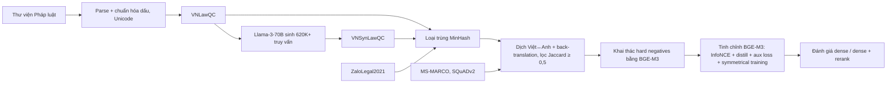

# Paper 04 Summary

## Citation

Tên bài: Improving Vietnamese-English Cross-Lingual Retrieval for Legal and General Domains
Tác giả: Toan Ngoc Nguyen, Nam Le Hai, Nguyen Doan Hieu, Dai An Nguyen, Linh Ngo Van, Thien Huu Nguyen, Sang Dinh (BKAI – ĐH Bách khoa Hà Nội; University of Oregon)
Năm: 2025
Nguồn: Proceedings of NAACL 2025 (Volume 2: Short Papers), trang 142–153 — hội nghị có bình duyệt, ACL Anthology
DOI/Link: https://aclanthology.org/2025.naacl-short.12/ (DOI: 10.18653/v1/2025.naacl-short.12)

## Problem

**Tóm tắt tổng quan.** Bài báo xây dựng bộ dữ liệu truy xuất văn bản pháp luật tiếng Việt VNLawQC (từ Thư viện Pháp luật), bộ dữ liệu tổng hợp VNSynLawQC và bộ dữ liệu truy xuất xuyên ngôn ngữ Việt–Anh cho cả miền pháp luật và miền tổng quát. Tác giả đề xuất hàm mất mát phụ (auxiliary loss) và chiến lược huấn luyện đối xứng (symmetrical training) để tinh chỉnh BGE-M3. Kết quả: trên VNLawQC (truy vấn tiếng Anh, văn bản tiếng Việt), điểm trung bình tăng từ 42,99 (BGE-M3 gốc, dense) lên 69,75 (tinh chỉnh xuyên ngôn ngữ + đối xứng).

**Bối cảnh và động lực.** Phần lớn hệ thống và bộ dữ liệu truy xuất tập trung vào một ngôn ngữ giàu tài nguyên (tiếng Anh, tiếng Trung) và miền tổng quát với văn bản ngắn. Theo bài báo, tiếng Việt chiếm dưới 1% dữ liệu tiền huấn luyện của BGE-M3; văn bản pháp luật lại dài và chuyên ngành. Khoảng trống: thiếu dữ liệu và phương pháp truy xuất văn bản pháp luật tiếng Việt, đặc biệt trong kịch bản xuyên ngôn ngữ.

## Method

1. **Xây dựng VNLawQC:** câu hỏi lấy trực tiếp từ các bài hỏi-đáp trên thuvienphapluat.vn; đoạn văn bản liên quan lấy theo siêu liên kết tới văn bản luật được dẫn. Làm sạch HTML, viết hoa thuật ngữ (“Điều”, “Khoản”), chuẩn hóa Unicode và dấu thanh.
2. **VNSynLawQC:** dùng Llama-3-70B sinh câu hỏi từ 140K đoạn văn; prompt yêu cầu xác định 1–5 khía cạnh của đoạn văn và đặt một câu hỏi cho mỗi khía cạnh, thu được hơn 620.000 truy vấn. Loại trùng bằng MinHash để tránh rò rỉ dữ liệu.
3. **Dữ liệu xuyên ngôn ngữ:** dịch Việt→Anh bằng VinAI Translate, Anh→Việt bằng Google Translate; dịch ngược và loại cặp có độ tương đồng Jaccard < 0,5; kiểm tra thủ công 100 mẫu ngẫu nhiên.
4. **Hard negatives:** dùng BGE-M3 tìm văn bản tương tự kèm ngưỡng để chọn 5 mẫu âm cho mỗi truy vấn.
5. **Mô hình:** nền BGE-M3 (dense, lexical, multi-vector; ngữ cảnh 8.192 token). Hàm mất mát L = L_InfoNCE + L_distill + L_aux, trong đó L_aux kéo truy vấn gần bản dịch của chính nó. Huấn luyện đối xứng coi một văn bản/truy vấn và bản dịch của nó là cặp liên quan, lấy mẫu với xác suất p_sym = 0,3.

## Dataset

VNLawQC: 165.347 mẫu huấn luyện, 9.992 mẫu đánh giá, kho 224.008 văn bản. VNSynLawQC: 503.068 mẫu huấn luyện, kho 140.291. Dữ liệu sẵn có: MS-MARCO, SQuADv2 (tiếng Anh), ZaloLegal2021 (640 mẫu đánh giá), ZaloWikipediaQA (4.399 mẫu đánh giá). Đánh giá trên VNLawQC, ZaloLegal2021 (pháp luật) và ZaloWikipediaQA (tổng quát).

## Evaluation

Trung bình cộng của Recall@10, MRR@10, MAP@10 và nDCG@10 (tác giả nêu điểm trung bình tương quan mạnh với từng chỉ số; chi tiết ở phụ lục). Hai kịch bản: Việt–Anh (truy vấn tiếng Anh, văn bản tiếng Việt) và Anh–Việt. Hai chế độ: dense (D) và dense + rerank (D+R). Baseline: BGE-M3 không tinh chỉnh và BGE-M3 tinh chỉnh chỉ với dữ liệu tiếng Việt.

## Results

- **Kịch bản Việt–Anh, VNLawQC (D / D+R):** không tinh chỉnh 42,99 / 44,92; tinh chỉnh tiếng Việt + dữ liệu tổng hợp 56,18 / 58,32; xuyên ngôn ngữ + tổng hợp 69,44 / 71,58; + aux loss 68,60 / 71,46; + symmetrical 69,75 / 71,71.
- **ZaloLegal2021 (Việt–Anh):** cao nhất 80,55 (xuyên ngôn ngữ + dữ liệu tổng hợp, D+R), so với 53,63 khi không tinh chỉnh.
- **ZaloWikipediaQA (Việt–Anh):** cao nhất 74,18 với aux loss (D+R); huấn luyện đối xứng chỉ đạt 65,64 / 68,75 — thấp hơn cấu hình không dùng nó.
- **Phân tích theo tác giả:** dữ liệu xuyên ngôn ngữ cải thiện hơn 10% ở pháp luật và hơn 3% ở miền tổng quát; dữ liệu tổng hợp cải thiện gần 3% trên ZaloLegal2021; reranking luôn tốt hơn dense nhưng tốn thêm chi phí.
- Các hàng của Bảng 2 đóng vai trò ablation theo từng thành phần (dữ liệu, aux loss, đối xứng, rerank).

**Điểm mạnh.**

- Công bố bộ dữ liệu truy xuất pháp luật tiếng Việt quy mô lớn từ nguồn thực, có bước loại trùng và kiểm soát chất lượng dịch.
- Thiết kế thí nghiệm dạng ablation rõ ràng, tách riêng tác động của từng loại dữ liệu và kỹ thuật huấn luyện.
- Cho thấy tiền xử lý đặc thù tiếng Việt (chuẩn hóa dấu thanh, Unicode) là một phần của pipeline.

## Limitations

**(a) Bài báo thừa nhận:** dữ liệu xuyên ngôn ngữ dựa vào dịch máy nên có thể có lỗi dịch và không phản ánh dữ liệu thực; chỉ thử nghiệm trên một mô hình nền (BGE-M3).

**(b) Quan sát:** cải thiện từ aux loss và huấn luyện đối xứng không đồng đều — đối xứng tốt cho pháp luật nhưng làm giảm điểm miền tổng quát, aux loss làm giảm nhẹ trên VNLawQC; chênh lệch giữa các cấu hình cuối thường dưới 1–2 điểm và không có kiểm định thống kê. Dữ liệu tổng hợp do LLM sinh. Bài **không** đánh giá chất lượng câu trả lời cuối (chỉ truy xuất), không đo độ trễ và không xét thủ tục hành chính.

## Relevance to our topic

Friendly Engine của Sys_3_4 dùng BGE-M3 — đúng mô hình nền của bài. Bài cung cấp bằng chứng định lượng rằng BGE-M3 gốc còn yếu với văn bản pháp luật tiếng Việt (≈43–54 điểm) và tinh chỉnh trên dữ liệu pháp luật có thể cải thiện đáng kể; đồng thời cho thấy rerank luôn có lợi, phù hợp với pipeline RRF + reranker của nhóm.

**Kết luận.** Bài báo đóng góp tài nguyên và phương pháp cho truy xuất văn bản pháp luật tiếng Việt, đơn ngữ và xuyên ngôn ngữ, với mức cải thiện lớn nhờ dữ liệu xuyên ngôn ngữ và dữ liệu tổng hợp; các kỹ thuật huấn luyện mới cho lợi ích nhỏ hơn và phụ thuộc miền. Hướng tiếp theo tác giả nêu là mở rộng sang nhiều mô hình nền và sử dụng dữ liệu thực hoặc có kiểm duyệt của con người.

## Possible improvement

- Tinh chỉnh BGE-M3 trên dữ liệu thủ tục hành chính của nhóm theo quy trình của bài (truy vấn tổng hợp theo khía cạnh, hard negatives, MinHash chống rò rỉ).
- Kết hợp với cơ chế phạt lệch dấu của Strict Engine để xử lý các cặp từ dễ nhầm mà embedding chưa phân biệt tốt.
- Báo cáo Recall@10, MRR@10, nDCG@10 để so sánh trực tiếp với các con số của bài.
