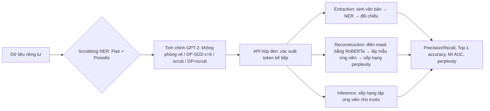

# Paper 05 Summary

## Citation

Tên bài: Analyzing Leakage of Personally Identifiable Information in Language Models
Tác giả: Nils Lukas, Ahmed Salem, Robert Sim, Shruti Tople, Lukas Wutschitz, Santiago Zanella-Béguelin (University of Waterloo; Microsoft)
Năm: 2023
Nguồn: 2023 IEEE Symposium on Security and Privacy (IEEE S&P 2023) — hội nghị bảo mật hàng đầu, có bình duyệt
DOI/Link: https://doi.org/10.1109/SP46215.2023.10179300 (bản mở: https://arxiv.org/abs/2302.00539)

## Problem

**Tóm tắt tổng quan.** Bài báo nghiên cứu rủi ro mô hình ngôn ngữ (LM) làm rò rỉ thông tin định danh cá nhân (PII) từ dữ liệu tinh chỉnh. Tác giả đưa ra định nghĩa dạng trò chơi (game-based) cho ba loại tấn công hộp đen — trích xuất (extraction), tái dựng (reconstruction) và suy luận (inference) PII — đề xuất thuật toán tấn công mới và đo hiệu quả của hai biện pháp phòng vệ: che PII bằng NER (scrubbing) và huấn luyện riêng tư vi phân (DP). Kết quả chính: tấn công tái dựng mới tìm lại được tới 10× nhiều PII hơn tấn công trước; DP ở mức câu giảm mạnh rò rỉ nhưng vẫn lộ khoảng 3% chuỗi PII.

**Bối cảnh và động lực.** Các nghiên cứu ghi nhớ dữ liệu trước đây tìm cận dưới của mọi loại ghi nhớ mà không phân biệt thông tin công khai và riêng tư. Thực tế, scrubbing dựa trên NER không hoàn hảo (bài dẫn mức recall 97% cho tên và 80% cho số phòng bệnh trên dữ liệu y tế), còn DP bảo vệ “ai đóng góp bản ghi” chứ không bảo vệ “bản ghi nói về ai” khi PII lặp lại ở nhiều bản ghi. Chưa có thước đo định lượng rò rỉ PII trong một pipeline có cả scrubbing và DP — đây là khoảng trống bài báo lấp vào.

## Method

1. **Mô hình đe dọa:** kẻ tấn công chỉ có quyền truy cập API trả về vector xác suất token kế tiếp. Extraction: không biết gì về dữ liệu; Reconstruction: biết câu đã bị che PII (có tiền tố và hậu tố); Inference: biết thêm tập ứng viên chứa PII đúng.
2. **Extraction:** sinh văn bản từ prompt rỗng (top-k, k=40), gắn nhãn PII bằng NER, đối chiếu với dữ liệu huấn luyện; đề xuất ước lượng “lazy extractability” — thay PII cùng lớp vào câu sinh ra và cộng dồn xác suất — để không phải lấy mẫu vét cạn.
3. **Reconstruction/Inference:** điền các mask còn lại bằng RoBERTa công khai, lấy mẫu N câu từ mô hình đích để thu ứng viên (hoặc dùng tập ứng viên cho trước), chèn từng ứng viên vào câu và chọn ứng viên có perplexity toàn câu thấp nhất — tức tận dụng cả hậu tố thay vì chỉ tiền tố như tấn công TAB.
4. **Loại trừ rò rỉ nền (baseline leakage):** bỏ các PII mà mô hình trước khi tinh chỉnh đã sinh/đoán được.

## Dataset

ECHR (hồ sơ án của Tòa án Nhân quyền châu Âu, chứa thông tin cá nhân bị cáo), Enron (email doanh nghiệp), Yelp-Health (đánh giá cơ sở y tế lọc từ Yelp). Mô hình: GPT-2 Small (124M), Medium (355M), Large (774M), XL (1.557M). Che 21 lớp thực thể PII. Bài **không** thử với LLM hiện đại cỡ hàng tỷ tham số trở lên hay dữ liệu ngoài tiếng Anh.

## Evaluation

Perplexity trên tập test (độ hữu dụng); ROC AUC của tấn công suy luận thành viên (membership inference – MI); Precision và Recall của PII trích xuất; độ chính xác top-1 cho tái dựng và suy luận PII. Baseline tấn công: TAB.

## Results

- **Extraction (ECHR, GPT-2 Large, ~4 triệu token, 15K truy vấn):** precision 29,56%, recall 22,96% khi không phòng vệ; với DP ε=8 còn khoảng 3%/3%. Precision giảm từ 50% (500K token) xuống 30% (4 triệu token) khi lấy mẫu nhiều hơn.
- **Lặp lại dữ liệu:** quan hệ tuyến tính giữa số lần PII xuất hiện và tần suất bị rò rỉ; mô hình DP rò rỉ thấp hơn khoảng một bậc độ lớn và không rò rỉ PII chỉ xuất hiện một lần.
- **Reconstruction (lớp “person”):** trên ECHR/GPT-2 Large, TAB đạt 5,81%, tấn công mới đạt 18,27%; trên Enron cải thiện ít nhất 7,5×. Với DP, rò rỉ ≤ 1%.
- **Inference (GPT-2 Large, 100 ứng viên):** 70,11% (ECHR), 50,50% (Enron), 28,31% (Yelp-Health) khi không phòng vệ; 8,32% / 3,78% / 4,29% với DP.
- **Tổng hợp trên ECHR (Bảng VI):** không phòng vệ — perplexity 14 (9 khi che PII sinh ra), MI AUC 0,96; DP — PII inference 8%, MI AUC 0,5; chỉ scrub — rò rỉ PII ~0% nhưng MI AUC 0,82; DP + scrub — chặn mọi tấn công nhưng perplexity tăng lên 16.
- **Ablation:** theo kích thước mô hình (mô hình lớn rò rỉ nhiều hơn), độ dài token của PII, số token lấy mẫu và độ dài ngữ cảnh.

**Điểm mạnh.**

- Khung định nghĩa hình thức rõ ràng, phân tách ba mức hiểu biết của kẻ tấn công.
- Thực nghiệm có hệ thống trên ba miền, bốn kích thước mô hình và bốn cấu hình phòng vệ; công bố mã.
- Kết luận thực tiễn: scrubbing và DP bổ sung cho nhau, không thay thế nhau.

## Limitations

**(a) Bài báo thừa nhận:** thiếu benchmark có chú thích PII đủ lớn nên dùng cùng một NER cho cả scrubbing lẫn đo rò rỉ — kết quả là cận dưới; chỉ xét khớp nguyên văn PII; chưa xét tấn công high-precision/low-recall; cần mở rộng sang mô hình và dữ liệu khác.

**(b) Quan sát:** chỉ thử GPT-2 (tối đa 1,5B tham số) và tiếng Anh; ngưỡng DP cố định ε=8. Bài tập trung vào rò rỉ từ dữ liệu huấn luyện, **không đề cập** rò rỉ PII qua ngữ cảnh truy xuất (RAG), log hội thoại hoặc prompt.

## Relevance to our topic

Sys_3_4 xử lý câu hỏi của công dân có thể chứa thông tin cá nhân (họ tên, địa chỉ, số giấy tờ). Bài cung cấp cơ sở định lượng cho thiết kế của nhóm: không đưa dữ liệu người dùng vào huấn luyện mô hình, che PII ở tầng policy, và chạy mô hình cục bộ để giảm bề mặt tấn công qua API. Đồng thời, bài cảnh báo rằng che PII bằng NER là không đủ tuyệt đối.

**Kết luận.** Bài báo chứng minh LM tinh chỉnh trên dữ liệu nhạy cảm rò rỉ PII đáng kể. DP giảm mạnh nhưng không loại bỏ hoàn toàn rò rỉ, còn scrubbing chặn rò rỉ PII nhưng làm giảm độ hữu dụng và không ngăn suy luận thành viên. Hướng tiếp theo tác giả đề xuất: scrubbing ít quyết liệt hơn, có tính đến mức bảo vệ của DP, và xây dựng benchmark PII tốt hơn.

## Possible improvement

- Nếu sau này tinh chỉnh Qwen trên log hội thoại, cần kết hợp scrubbing + DP và loại trùng PII như bài khuyến nghị.
- Đánh giá recall của bộ che PII tiếng Việt của nhóm (CCCD, số điện thoại, địa chỉ) theo tinh thần “scrubbing không hoàn hảo”.
- Mở rộng đo rò rỉ sang bộ nhớ hội thoại và trace — nơi bài báo chưa xét.
