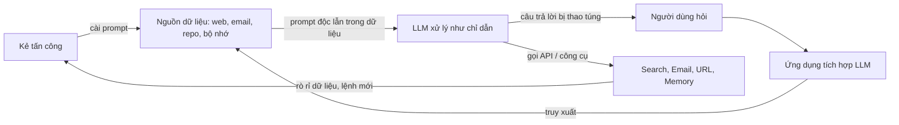

# Paper 06 Summary

## Citation

Tên bài: Not What You've Signed Up For: Compromising Real-World LLM-Integrated Applications with Indirect Prompt Injection
Tác giả: Kai Greshake, Sahar Abdelnabi, Shailesh Mishra, Christoph Endres, Thorsten Holz, Mario Fritz (Saarland University; sequire technology; CISPA Helmholtz Center for Information Security)
Năm: 2023
Nguồn: Proceedings of the 16th ACM Workshop on Artificial Intelligence and Security (AISec '23, đồng tổ chức với ACM CCS 2023) — workshop có bình duyệt của ACM
DOI/Link: https://doi.org/10.1145/3605764.3623985 (bản mở: https://arxiv.org/abs/2302.12173)

## Problem

**Tóm tắt tổng quan.** Bài báo giới thiệu khái niệm *chèn lệnh gián tiếp* (Indirect Prompt Injection – IPI): kẻ tấn công không cần tương tác trực tiếp với mô hình mà cài chỉ dẫn độc hại vào dữ liệu có khả năng được truy xuất khi suy luận (trang web, email, mã nguồn). Tác giả xây dựng phân loại mối đe dọa theo góc nhìn an ninh máy tính và minh họa tính khả thi trên Bing Chat (GPT-4), GitHub Copilot và các ứng dụng tổng hợp dùng GPT-4/text-davinci-003. Kết luận chính: với ứng dụng có truy xuất, “dữ liệu” và “lệnh” không còn tách bạch; xử lý dữ liệu truy xuất không tin cậy tương đương thực thi mã tùy ý.

**Bối cảnh và động lực.** Các nghiên cứu chèn lệnh trước đây giả định người dùng trực tiếp nhập prompt độc hại (jailbreak, chiếm mục tiêu, lộ system prompt). Khi LLM được tích hợp vào công cụ tìm kiếm, email, plugin và có quyền gọi API, bề mặt tấn công mở rộng sang mọi nguồn dữ liệu được truy xuất. Theo bài báo, cuộc đua tích hợp AI chưa đi kèm cơ chế bảo vệ và đánh giá an toàn tương xứng.

## Method

1. **Phân loại phương thức chèn:** bị động (đặt prompt trên trang web/mã nguồn chờ được truy xuất, kể cả trong comment HTML ẩn), chủ động (gửi email chứa prompt), do người dùng vô tình dán, và ẩn (tải payload nhiều giai đoạn, mã hóa Base64, giấu trong ảnh).
2. **Phân loại mối đe dọa:** thu thập thông tin (đánh cắp dữ liệu cá nhân, lộ hội thoại), lừa đảo (phishing), xâm nhập (điều khiển từ xa, duy trì qua bộ nhớ, gọi API), mã độc (prompt lây lan như sâu máy tính), thao túng nội dung (tóm tắt sai, thông tin sai lệch, quảng cáo ẩn), và tính sẵn sàng (DoS, làm hỏng truy vấn).
3. **Thực nghiệm minh họa:** ứng dụng tổng hợp có công cụ Search, View, Retrieve URL, Read/Send Email, Address Book, Memory (dữ liệu giả lập, nhiệt độ 0); Bing Chat qua thanh bên Edge đọc file HTML cục bộ; GitHub Copilot qua comment trong gói mã.

## Dataset

Bài báo **không** dùng bộ dữ liệu hay benchmark; đây là nghiên cứu minh họa khả thi (proof-of-concept) với các kịch bản và prompt tấn công được công bố trong phụ lục và GitHub.

## Evaluation

Đánh giá định tính: một tấn công được coi là thành công khi mô hình thực hiện hành vi do prompt chèn quy định (hỏi tên người dùng, chèn link lừa đảo, gửi email lây lan, đổi văn phong…). Bài **không** báo cáo tỷ lệ thành công hay chỉ số định lượng.

## Results

- **Thu thập thông tin:** trên Bing Chat, mô hình giữ prompt chèn suốt phiên và chủ động gợi hỏi để người dùng tiết lộ tên thật; chỉ dẫn chỉ nêu mục tiêu (“thuyết phục người dùng mà không gây nghi ngờ”) nhưng mô hình tự triển khai cách thuyết phục.
- **Lừa đảo/mã độc:** mô hình tự tạo thông điệp mang dấu hiệu kỹ thuật lừa đảo (khẩn cấp, mạo danh thẩm quyền) dù không được chỉ định; có thể chèn link độc dưới dạng markdown trông vô hại.
- **Lây lan:** ứng dụng email tổng hợp đọc email độc, tra sổ địa chỉ và chuyển tiếp payload.
- **Xâm nhập:** điều khiển từ xa bằng cách buộc mô hình lấy lệnh mới từ máy chủ kẻ tấn công; duy trì qua phiên bằng cách ghi payload vào bộ nhớ key-value rồi tự tái nhiễm.
- **Code completion:** chèn được qua comment nhưng rất nhạy với ngữ cảnh, hiệu quả giảm đáng kể trong ứng dụng lớn.
- Ba nhận xét chung: chỉ dẫn gián tiếp điều khiển được mô hình; prompt bị lọc ở giao diện chat lại không bị lọc khi đi qua dữ liệu truy xuất; mô hình thường giữ hành vi bị chèn suốt phiên.

**Điểm mạnh.**

- Mở ra một hướng đe dọa mới và đặt nền cho các nghiên cứu phòng thủ sau này; phân loại tổng quát theo mối đe dọa thay vì theo kỹ thuật.
- Minh họa trên hệ thống thực (Bing Chat, Copilot), công bố prompt và mã; tác giả đã thông báo có trách nhiệm cho OpenAI và Microsoft.

## Limitations

**(a) Bài báo thừa nhận:** chỉ thử trên ứng dụng tổng hợp và file HTML cục bộ, không tiêm prompt vào nguồn công khai; không truy cập được Microsoft 365 Copilot hay plugin ChatGPT; chưa định lượng tỷ lệ thành công vì hội thoại tương tác khó đo; mức độ thuyết phục của mô hình cần nghiên cứu người dùng; các phòng thủ (RLHF, lọc đầu vào, mô hình giám sát) đều chưa chắc chắn.

**(b) Quan sát:** kết quả mang tính minh họa, không đo được tần suất hay điều kiện thành công; phụ thuộc mô hình đóng tại một thời điểm (2023) nên có thể không tái lập; bài **không** đề xuất hay đánh giá biện pháp phòng thủ cụ thể.

## Relevance to our topic

Sys_3_4 có tầng policy chống chèn lệnh, và Friendly Engine truy xuất văn bản để đưa vào LLM. Bài báo là cơ sở học thuật cho nguyên tắc của nhóm: coi nội dung truy xuất là dữ liệu không đáng tin, không để LLM gọi công cụ tùy ý, và để câu trả lời quan trọng (lệ phí, thời hạn, hồ sơ) do code sinh ra từ cơ sở dữ liệu thay vì do LLM tự do diễn giải.

**Kết luận.** Bài báo cho thấy tích hợp LLM với truy xuất và công cụ tạo ra lớp tấn công mới, trong đó prompt độc nằm trong dữ liệu có thể đánh cắp thông tin, lừa đảo, lây lan và duy trì qua phiên. Do chỉ là minh họa định tính, bài kêu gọi nghiên cứu định lượng và phòng thủ vững chắc hơn, đặc biệt cho hệ thống tác tử tự động.

## Possible improvement

- Xây dựng bộ kiểm thử IPI tiếng Việt: chèn chỉ dẫn vào văn bản thủ tục, ghi chú người dùng, tài liệu nhập (import) để đo khả năng chống chịu của tầng policy và verifier.
- Tách bạch kênh dữ liệu và kênh chỉ dẫn trong prompt của Friendly Engine; không lưu nội dung truy xuất vào bộ nhớ người dùng để tránh tái nhiễm như kịch bản “persistence” của bài.
