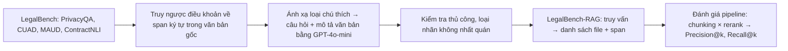

# Paper 08 Summary

## Citation

Tên bài: LegalBench-RAG: A Benchmark for Retrieval-Augmented Generation in the Legal Domain
Tác giả: Nicholas Pipitone, Ghita Houir Alami (ZeroEntropy)
Năm: 2024
Nguồn: arXiv preprint arXiv:2408.10343 [cs.AI] — **chưa có công bố tại hội nghị/tạp chí có bình duyệt** tại thời điểm kiểm tra. Nhóm giữ lại vì đây là benchmark truy xuất pháp lý mở, được cộng đồng RAG pháp lý sử dụng và trích dẫn rộng rãi; dữ liệu nguồn (CUAD, MAUD, ContractNLI, PrivacyQA, LegalBench) đều là các bộ dữ liệu đã công bố có bình duyệt.
DOI/Link: https://arxiv.org/abs/2408.10343 (DOI arXiv: 10.48550/arXiv.2408.10343)

## Problem

**Tóm tắt tổng quan.** Bài báo giới thiệu LegalBench-RAG, benchmark đầu tiên (theo tác giả) chuyên đánh giá bước *truy xuất* của pipeline RAG trong miền pháp lý. Benchmark yêu cầu truy xuất chính xác các đoạn văn ngắn (span ký tự) thay vì chỉ ID văn bản hay đoạn lớn. Bộ dữ liệu gồm khoảng 6.858–6.889 cặp truy vấn–đáp án (bài báo ghi cả hai con số) trên kho gần 80 triệu ký tự (714 văn bản), kèm phiên bản rút gọn LegalBench-RAG-mini (776 truy vấn). Thí nghiệm mẫu cho thấy chia đoạn RCTS không rerank cho kết quả tốt nhất, và reranker tổng quát của Cohere làm kết quả kém đi.

**Bối cảnh và động lực.** LegalBench đánh giá năng lực suy luận pháp lý của LLM khi *đã được cấp sẵn* ngữ cảnh đúng, nên không đo khả năng tìm ngữ cảnh đó trong kho lớn. Các benchmark RAG tổng quát (RGB, RECALL, MultiHop-RAG) không nắm được đặc thù văn bản pháp lý và thường chỉ đo recall, không phân biệt truy xuất đoạn rộng với đoạn chính xác. Theo tác giả, ngữ cảnh thừa làm tăng chi phí, độ trễ và rủi ro ảo giác, trong khi đoạn chính xác giúp trích dẫn và kiểm chứng.

## Method

1. **Truy ngược nguồn:** từ bốn bộ dữ liệu gốc của LegalBench, tìm lại vị trí ký tự của từng điều khoản được chú thích trong văn bản gốc.
2. **Tạo truy vấn:** ánh xạ thủ công mỗi loại chú thích thành một câu hỏi; GPT-4o-mini sinh mô tả ngắn cho từng văn bản (kiểm tra bằng regex và đọc thủ công; loại các cặp mô tả không phân biệt được). Truy vấn có dạng “Consider (mô tả văn bản); (câu hỏi)”; nhãn là danh sách (tên file, khoảng ký tự).
3. **Kiểm soát chất lượng:** loại các loại chú thích có độ chính xác không nhất quán; kiểm tra thủ công toàn bộ điểm dữ liệu.
4. **Thí nghiệm mẫu:** embedding text-embedding-3-large, SQLite Vec, so sánh chia đoạn cố định 500 ký tự với Recursive Character Text Splitter (RCTS), có hoặc không dùng Cohere rerank-english-v3.0.

## Dataset

Bốn nguồn: ContractNLI (95 văn bản NDA, 977 truy vấn), CUAD (462 hợp đồng, 4.042 truy vấn), MAUD (150 văn bản M&A, 1.676 truy vấn, độ dài trung bình 351.476 ký tự), PrivacyQA (7 chính sách quyền riêng tư, 194 truy vấn). Bản mini: 194 truy vấn mỗi bộ, 72 văn bản. Dữ liệu công khai trên GitHub.

## Evaluation

Precision@k và Recall@k với k = 1…64, tính theo mức chồng lấn với span đúng, lấy trung bình đều trên bốn bộ. Mọi thí nghiệm chạy trên bản mini. Bài **không** đánh giá bước sinh câu trả lời (để LegalBench gốc đảm nhận) và chỉ so sánh 4 cấu hình nội bộ, không có baseline từ công trình khác.

## Results

- **Chia đoạn cố định, không rerank (Bảng 4), tổng hợp ALL:** Precision@1 = 2,40%, Recall@64 = 76,39%.
- **Cấu hình mà tác giả gọi là tốt nhất (RCTS, không rerank):** Precision@1 = 6,41%, Recall@64 = 62,22%. PrivacyQA dễ nhất (Precision@1 14,38%, Recall@64 84,19%); MAUD khó nhất (Recall@64 28,28%).
- **RCTS + Cohere rerank (Bảng 7):** Precision@1 = 6,13%, Recall@64 = 61,06% — kém hơn không rerank; tác giả giải thích reranker tổng quát không phù hợp văn bản pháp lý.
- Recall tăng và precision giảm khi k tăng; precision thấp do đáp án đúng rất ngắn.

**Điểm mạnh.**

- Đặt đúng trọng tâm vào bước truy xuất ở mức span — điều kiện tiên quyết cho trích dẫn chính xác.
- Dữ liệu gốc do chuyên gia pháp lý chú thích, quy trình kiểm soát chất lượng rõ ràng, công bố mã và dữ liệu.
- Cung cấp bản mini giúp thử nghiệm nhanh.

## Limitations

**(a) Bài báo thừa nhận:** chỉ gồm NDA, M&A, hợp đồng thương mại và chính sách quyền riêng tư; không đánh giá dữ liệu số có cấu trúc hay hồ sơ y tế; mỗi truy vấn chỉ có đáp án trong một văn bản nên không đo suy luận đa bước (multi-hop).

**(b) Quan sát từ văn bản:** có bất nhất nội bộ — tổng số cặp ghi 6.858 ở tóm tắt nhưng 6.889 ở mục thống kê; Bảng 5 (gắn nhãn RCTS) có số liệu trùng gần như hoàn toàn với Bảng 6 (gắn nhãn chia đoạn cố định + Cohere), khiến kết luận “RCTS không rerank tốt nhất” khó kiểm chứng; nếu đối chiếu Bảng 4 thì chia đoạn cố định có Recall@64 cao hơn (76,39% so với 62,22%). Thí nghiệm chỉ dùng một embedding và một reranker, chưa qua bình duyệt. Toàn bộ dữ liệu là văn bản pháp lý tiếng Anh thuộc hệ thống thông luật/hợp đồng, không phải luật thành văn hay thủ tục hành chính.

## Relevance to our topic

Bài cung cấp phương pháp đánh giá truy xuất ở mức đoạn/span — tương ứng với cách Sys_3_4 truy xuất theo trường (field_chunks) và trả trích dẫn. Phát hiện “reranker tổng quát có thể làm hại trong miền chuyên biệt” là cảnh báo cần kiểm chứng cho pipeline RRF + reranker của Friendly Engine.

**Kết luận.** LegalBench-RAG lấp khoảng trống về benchmark truy xuất pháp lý ở mức span, cho thấy truy xuất chính xác trong văn bản pháp lý dài còn rất khó (Precision@1 dưới 7%). Đây là tài nguyên hữu ích nhưng cần đọc kết quả thực nghiệm thận trọng do một số bất nhất trong bảng số liệu và việc chưa qua bình duyệt. Tác giả kỳ vọng benchmark giúp cộng đồng so sánh và cải tiến các kỹ thuật RAG pháp lý.

## Possible improvement

- Xây dựng bộ đánh giá kiểu LegalBench-RAG cho thủ tục hành chính: mỗi câu hỏi gắn với thủ tục và trường dữ liệu chính xác (lệ phí, thời hạn, hồ sơ), đo Precision@k/Recall@k.
- Đo riêng tác động của reranker trên dữ liệu tiếng Việt thay vì mặc định dùng.
- Bổ sung truy vấn đa bước (so sánh hai thủ tục) — loại bài báo chưa có.
