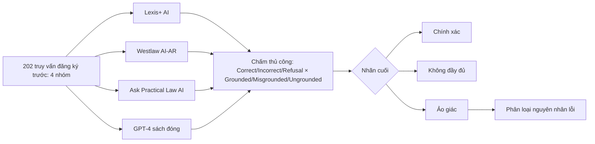

# Paper 09 Summary

## Citation

Tên bài: Hallucination-Free? Assessing the Reliability of Leading AI Legal Research Tools
Tác giả: Varun Magesh, Faiz Surani, Matthew Dahl, Mirac Suzgun, Christopher D. Manning, Daniel E. Ho (Stanford University; Yale University)
Năm: 2025
Nguồn: Journal of Empirical Legal Studies, Vol. 22, No. 2 (2025), trang 216–242 (Wiley/Cornell Law School) — tạp chí có bình duyệt, open access
DOI/Link: https://doi.org/10.1111/jels.12413 (bản preprint: https://arxiv.org/abs/2405.20362)

## Problem

**Tóm tắt tổng quan.** Bài báo là đánh giá thực nghiệm *có đăng ký trước* (preregistered) đầu tiên đối với các công cụ nghiên cứu pháp lý thương mại dựa trên RAG: Lexis+ AI (LexisNexis), Westlaw AI-Assisted Research và Ask Practical Law AI (Thomson Reuters), so với GPT-4. Tác giả đề xuất khung phân loại ảo giác theo hai chiều *tính đúng* (correctness) và *tính có căn cứ* (groundedness). Kết luận: các công cụ RAG thương mại ít ảo giác hơn GPT-4 nhưng vẫn ảo giác khoảng 17%–33% số câu hỏi, trái với tuyên bố “không ảo giác” của nhà cung cấp.

**Bối cảnh và động lực.** Các nhà cung cấp pháp lý quảng bá RAG là giải pháp “gần như loại bỏ” ảo giác, nhưng không công bố bằng chứng; thuật ngữ “hallucination” cũng được dùng không thống nhất. Nghiên cứu trước (Dahl và cộng sự, 2024) cho thấy LLM tổng quát ảo giác 58%–82% với câu hỏi pháp lý, nhưng chưa xét công cụ chuyên dụng có RAG. Theo tác giả, RAG pháp lý khó vì: truy xuất cần suy luận pháp lý, mức độ liên quan phụ thuộc thẩm quyền và thời điểm, và việc sinh văn bản đòi hỏi tổng hợp phức tạp.

## Method

1. **Khung đánh giá:** *Correct* (đúng và liên quan), *Incorrect* (có thông tin sai), *Refusal* (từ chối/không liên quan). Với câu đúng, xét *Grounded* (dẫn chiếu hợp lệ), *Misgrounded* (dẫn nguồn không hỗ trợ hoặc không áp dụng), *Ungrounded* (không dẫn). **Ảo giác** = sai hoặc dẫn sai nguồn; **chính xác** = đúng và có căn cứ; **không đầy đủ** = từ chối hoặc không dẫn nguồn.
2. **Bộ truy vấn (202 câu, đăng ký trước trên OSF ngày 22/3/2024):** nghiên cứu pháp lý tổng quát (80), theo thẩm quyền/thời điểm (70), tiền đề sai (22), hỏi sự kiện (30); gồm 20 câu Rule QA của LegalBench và 20 câu ôn thi luật sư BARBRI.
3. **Thực thi:** dán thủ công vào giao diện từng công cụ; GPT-4 (gpt-4-turbo-2024-04-09) chạy “sách đóng” với prompt yêu cầu trích dẫn án lệ.
4. **Chấm điểm thủ công** bởi người có chuyên môn luật; người chấm thứ tư độc lập chấm lại 48 câu.
5. **Phân loại nguyên nhân lỗi:** truy xuất ngây thơ (naive retrieval), nguồn không áp dụng, lỗi suy luận, chiều theo người dùng (sycophancy).

## Dataset

202 truy vấn pháp lý Hoa Kỳ do nhóm tác giả xây dựng và đăng ký trước. Bài **không** dùng kho tài liệu riêng vì các công cụ là hệ thống đóng truy xuất từ cơ sở dữ liệu của nhà cung cấp.

## Evaluation

Tỷ lệ chính xác, không đầy đủ và ảo giác (kèm khoảng tin cậy 95%), tỷ lệ ảo giác khi có trả lời, độ dài câu trả lời, và độ tin cậy giữa người chấm (Cohen's kappa).

## Results

- **Ảo giác:** Lexis+ AI và Ask Practical Law AI ảo giác ở hơn 1/6 số câu; Westlaw AI-AR khoảng 1/3. Các công cụ đều ít ảo giác hơn GPT-4 (tỷ lệ của GPT-4 thể hiện trên biểu đồ, thân bài không nêu số).
- **Chính xác:** Lexis+ AI 65%, Westlaw 41–42%, Practical Law 19%.
- **Không đầy đủ:** 18% (Lexis+ AI), 25% (Westlaw), 62% (Practical Law — do kho tài liệu hẹp).
- **Độ dài trả lời (bỏ câu từ chối):** Westlaw trung bình 350 từ, Lexis+ AI 219 từ, Practical Law 175 từ; câu dài hơn có nhiều mệnh đề có thể sai hơn.
- **Độ tin cậy chấm điểm:** Cohen's kappa 0,77; đồng thuận 85,4%.
- **Nguyên nhân lỗi (Bảng 6, tỷ lệ trong các câu ảo giác):** lỗi suy luận chiếm 0,61 ở Westlaw; truy xuất ngây thơ 0,47 ở Lexis+ AI.
- **Dạng lỗi điển hình:** hiểu sai phán quyết, nhầm lập luận của đương sự với kết luận của tòa, không tôn trọng thứ bậc hiệu lực (dẫn án đã bị hủy).

**Điểm mạnh.**

- Thiết kế nghiêm ngặt: đăng ký trước để tránh thiên lệch chọn câu hỏi, chấm điểm có kiểm tra độ đồng thuận, báo cáo khoảng tin cậy.
- Khung correctness × groundedness phân biệt rõ “trích dẫn có thật” với “trích dẫn thực sự hỗ trợ câu trả lời”.
- Phân loại nguyên nhân lỗi đặc thù pháp lý (nguồn không áp dụng, thứ bậc hiệu lực) mà các phân tích RAG tổng quát chưa có.

## Limitations

**(a) Bài báo thừa nhận:** chỉ ba sản phẩm thương mại; kết quả là ảnh chụp tại một thời điểm và hệ thống thay đổi trong lúc nghiên cứu; có nguy cơ rò rỉ dữ liệu kiểm tra; 202 câu là cỡ mẫu nhỏ; groundedness có thể là phổ liên tục; bộ câu hỏi cố ý khó nên tỷ lệ ảo giác không phải ước lượng của tổng thể; chưa đánh giá các tác vụ soạn thảo.

**(b) Quan sát:** chỉ áp dụng cho luật Hoa Kỳ (thông luật); hệ thống đóng nên không phân tích được từng thành phần. Bài **không** đề xuất giải pháp kỹ thuật giảm ảo giác.

## Relevance to our topic

Bài cung cấp bằng chứng mạnh, đã qua bình duyệt, rằng *RAG không đủ để loại bỏ ảo giác* trong miền pháp lý — đây chính là lý do Sys_3_4 tách Strict Engine (trả lời bằng code, nguyên văn từ cơ sở dữ liệu) khỏi phần sinh của LLM và đặt verifier sau mọi câu trả lời sinh. Khung correctness/groundedness có thể dùng trực tiếp để chấm câu trả lời của Friendly Engine.

**Kết luận.** Các công cụ nghiên cứu pháp lý dùng RAG giảm ảo giác so với GPT-4 nhưng chưa “không ảo giác”, với tỷ lệ 17%–33% và khác biệt lớn giữa các hệ thống. Người dùng vẫn phải kiểm chứng từng mệnh đề và trích dẫn. Tác giả kêu gọi đánh giá công khai, độc lập và minh bạch cho AI pháp lý.

## Possible improvement

- Áp dụng nhãn Correct/Misgrounded/Ungrounded và quy trình chấm hai người (kèm kappa) cho bộ HOLDOUT của nhóm.
- Thêm nhóm câu hỏi “tiền đề sai” và “hiệu lực theo thời điểm” (thủ tục đã thay thế, mức phí đã thay đổi) — hai loại bài báo cho thấy dễ gây lỗi.
- Đăng ký trước bộ câu hỏi đánh giá trước khi chạy thực nghiệm để tăng độ tin cậy.
