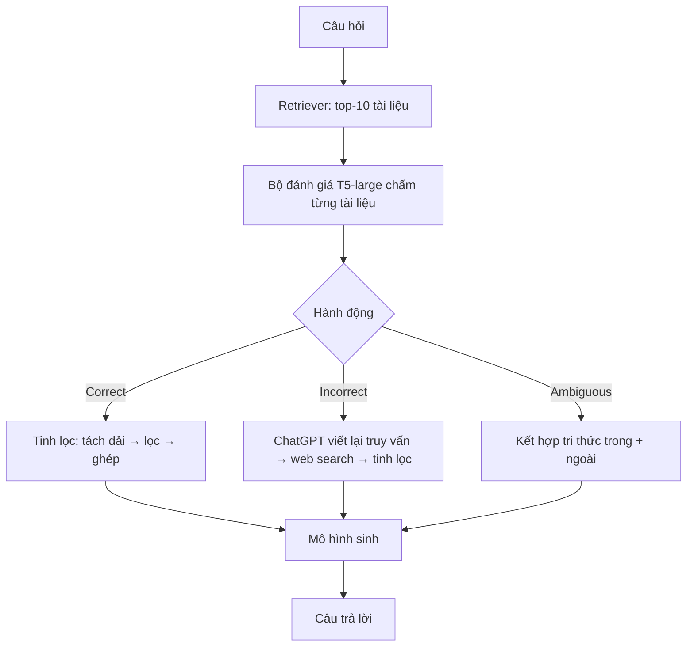

# Paper 10 Summary — CRAG2024

Nhóm khuôn B2: **model / phương pháp AI**. Kiểm chứng 25/10/2026: các con số trong tệp đã đối chiếu với PDF trong docs/research paper. Phần nội dung bài gốc chép từ tóm tắt cũ (docs/research paper/paper_summaries/paper_18.md); hai mục cuối viết lại cho bài 1.

## Citation

Tên bài: Corrective Retrieval Augmented Generation (CRAG)
Tác giả: Shi-Qi Yan, Jia-Chen Gu, Yun Zhu, Zhen-Hua Ling (University of Science and Technology of China; UCLA; Google DeepMind)
Năm: 2024
Nguồn: arXiv preprint arXiv:2401.15884 (bản v3, 10/2024) — **chưa có công bố tại hội nghị/tạp chí có bình duyệt** tại thời điểm kiểm tra. Nhóm giữ lại vì đây là phương pháp nền tảng, được trích dẫn rộng rãi và triển khai phổ biến (ví dụ trong các framework RAG); mã nguồn công khai.
DOI/Link: https://arxiv.org/abs/2401.15884 (DOI arXiv: 10.48550/arXiv.2401.15884)

## Problem

**Tóm tắt tổng quan.** CRAG giải quyết tình huống bộ truy xuất trả về tài liệu sai hoặc không liên quan. Một bộ đánh giá truy xuất nhẹ (T5-large, 0,77B tham số) chấm mức liên quan của từng tài liệu và kích hoạt một trong ba hành động: *Correct* (tinh lọc tri thức trong tài liệu), *Incorrect* (bỏ tài liệu, chuyển sang tìm kiếm web), *Ambiguous* (kết hợp cả hai). Tài liệu được tinh lọc theo cách “tách rồi ghép lại” (decompose-then-recompose). CRAG “cắm vào là chạy” với RAG và Self-RAG; ví dụ với SelfRAG-LLaMA2-7b, CRAG vượt RAG chuẩn 7,0 điểm trên PopQA và 36,6 điểm trên PubHealth.

**Bối cảnh và động lực.** RAG phụ thuộc mạnh vào chất lượng truy xuất: nếu truy xuất sai, mô hình có thể bị dẫn sai và ảo giác. Phần lớn RAG đưa tài liệu vào một cách không phân biệt, và coi toàn bộ tài liệu là tri thức tham chiếu dù nhiều đoạn không cần thiết. Self-RAG quyết định *có cần truy xuất không*, còn CRAG tập trung vào câu hỏi *nếu truy xuất sai thì làm gì* — theo tác giả, đây là nỗ lực đầu tiên thiết kế chiến lược sửa sai cho RAG.

## Method

1. **Bộ đánh giá truy xuất:** T5-large tinh chỉnh; mẫu dương lấy từ tiêu đề Wikipedia vàng của PopQA, mẫu âm lấy ngẫu nhiên từ kết quả truy xuất. Mỗi cặp (câu hỏi, tài liệu) được chấm điểm liên quan; thường có 10 tài liệu mỗi câu hỏi.
2. **Kích hoạt hành động theo hai ngưỡng:** ít nhất một tài liệu vượt ngưỡng trên → Correct; mọi tài liệu dưới ngưỡng dưới → Incorrect; còn lại → Ambiguous. Thử nghiệm sơ bộ chỉ với hai hành động cho thấy hệ thống quá phụ thuộc vào độ chính xác của bộ đánh giá, nên thêm Ambiguous.
3. **Tinh lọc tri thức:** chia tài liệu thành các “dải tri thức” (vài câu), chấm điểm từng dải bằng bộ đánh giá, loại dải không liên quan, ghép các dải còn lại theo thứ tự.
4. **Tìm kiếm web:** ChatGPT viết lại câu hỏi thành truy vấn từ khóa, gọi Google Search API, ưu tiên trang có thẩm quyền như Wikipedia, rồi tinh lọc như bước 3.
5. **Sinh câu trả lời:** bất kỳ mô hình sinh nào nhận câu hỏi và tri thức đã xử lý.

## Dataset

PopQA (câu trả lời ngắn về thực thể), Biography (sinh văn bản dài, đo bằng FactScore), PubHealth (đúng/sai), ARC-Challenge (trắc nghiệm). Dùng cùng kết quả truy xuất Contriever như Self-RAG để so sánh công bằng.

## Evaluation

Accuracy (PopQA, PubHealth, ARC) và FactScore (Biography). Baseline: LLaMA2, Alpaca, CoVE65B, LLaMA2-chat, ChatGPT (có/không truy xuất), Perplexity.ai, SAIL, RAG chuẩn, Self-RAG. Thêm phân tích chi phí tính toán (TFLOPs mỗi token, thời gian mỗi mẫu).

## Results

- **Với SelfRAG-LLaMA2-7b:** RAG → CRAG: PopQA 52,8 → 59,8; Biography 59,2 → 74,1; PubHealth 39,0 → 75,6; ARC 53,2 → 68,6. Self-RAG → Self-CRAG: PopQA 54,9 → 61,8; Biography 81,2 → 86,2; PubHealth 72,4 → 74,8; ARC 67,3 → 67,2 (giảm nhẹ).
- **Với LLaMA2-hf-7b:** RAG → CRAG: PopQA 50,5 → 54,9; ARC 43,4 → 53,7. Self-RAG → Self-CRAG: PopQA 29,0 → 49,0; Biography 32,2 → 69,1. Ở PubHealth, Self-RAG và Self-CRAG với mô hình này chỉ đạt 0,7 và 0,6.
- **Ablation (PopQA):** bỏ bất kỳ hành động nào (Correct, Incorrect, Ambiguous) hoặc bất kỳ thao tác nào (tinh lọc, viết lại truy vấn, chọn lọc tri thức web) đều làm giảm accuracy; ví dụ Self-CRAG (LLaMA2-hf-7b) bỏ chọn lọc tri thức web giảm từ 49,0 xuống 24,9.
- **Bộ đánh giá:** T5 đạt độ chính xác 84,3% trong đánh giá chất lượng truy xuất, so với ChatGPT 58,0–64,7%.
- **Tách bạch nguồn lợi ích:** bổ sung web search cho RAG/Self-RAG chỉ cải thiện hạn chế (RAG 50,5 → 52,2) so với CRAG (54,9), cho thấy lợi ích chủ yếu đến từ cơ chế tự sửa.
- **Chi phí:** thời gian sinh mỗi mẫu 0,363 giây (RAG) → 0,512 giây (CRAG); ước lượng chưa gồm bước truy xuất và tìm kiếm web.

**Điểm mạnh.**

- Bộ đánh giá nhỏ (0,77B) nhưng vượt ChatGPT trong đánh giá mức liên quan — rẻ và nhanh.
- Thiết kế ba hành động mềm giúp giảm phụ thuộc vào độ chính xác tuyệt đối của bộ đánh giá.
- Ablation đầy đủ cho từng hành động và thao tác; có phân tích độ bền khi chất lượng truy xuất giảm và phân tích chi phí.

## Limitations

**(a) Bài báo thừa nhận:** cần tinh chỉnh một bộ đánh giá truy xuất bên ngoài; muốn loại bỏ bộ đánh giá này và trang bị khả năng đánh giá truy xuất cho LLM trong tương lai.

**(b) Quan sát:** cải thiện không đồng đều giữa các mô hình nền và tác vụ (ví dụ ARC giảm nhẹ; PubHealth gần 0 với LLaMA2-hf-7b ở cấu hình Self-); bộ đánh giá được huấn luyện bằng tín hiệu từ PopQA nên khả năng tổng quát sang miền khác chưa rõ; dùng web search và ChatGPT viết lại truy vấn — không phù hợp với hệ thống bắt buộc chạy cục bộ; chưa qua bình duyệt. Bài **không** xét miền pháp lý hay ngôn ngữ ngoài tiếng Anh.

## Relevance to our topic

CRAG dùng một bộ đánh giá truy hồi nhẹ để chọn hành động (dùng, bỏ, hay tìm thêm). Phương án B của bài 1 tương tự: điểm của cross-encoder quyết định từ chối hoặc thay thủ tục. Bài 1 cho thấy trên câu hỏi thật, ngưỡng điểm như vậy kém hơn lớp luật.

## Possible improvement

- Vẽ đường rủi ro theo độ phủ cho điểm reranker để thấy giới hạn của mọi ngưỡng (gợi ý, chưa làm).
