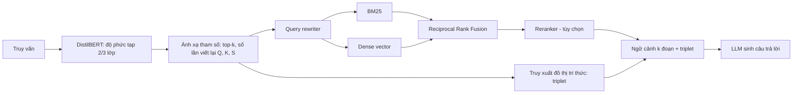

# Paper 10 Summary

## Citation

Tên bài: HyPA-RAG: A Hybrid Parameter Adaptive Retrieval-Augmented Generation System for AI Legal and Policy Applications
Tác giả: Rishi Kalra, Zekun Wu, Ayesha Gulley, Airlie Hilliard, Xin Guan, Adriano Koshiyama, Philip Treleaven (Holistic AI; University College London)
Năm: 2025 (preprint đầu tiên 9/2024)
Nguồn: Proceedings of NAACL 2025 – Industry Track, ACL Anthology (2025.naacl-industry.79) — hội nghị có bình duyệt
DOI/Link: https://aclanthology.org/2025.naacl-industry.79/ (bản mở: https://arxiv.org/abs/2409.09046)

## Problem

**Tóm tắt tổng quan.** Bài báo đề xuất HyPA-RAG cho hỏi đáp chính sách và pháp luật về AI, lấy Luật địa phương số 144 của New York (LL144, về công cụ ra quyết định tuyển dụng tự động) làm tình huống thử nghiệm. Hệ thống gồm: bộ phân loại độ phức tạp truy vấn để chọn tham số truy xuất thích ứng; truy xuất lai dense + sparse (BM25) + đồ thị tri thức (knowledge graph); và khung đánh giá với các loại câu hỏi riêng. Kết quả: cấu hình thích ứng tốt nhất đạt Faithfulness 0,9044 (so với 0,8480 của cấu hình top-k cố định tốt nhất); trong ablation, Correctness cao nhất đạt 0,8402.

**Bối cảnh và động lực.** LLM trong miền luật/chính sách gặp vấn đề tri thức lỗi thời, ảo giác và suy luận kém. RAG giúp nhưng gặp lỗi thiếu nội dung, tích hợp ngữ cảnh kém và nhiễu; các kỹ thuật nâng cao (viết lại truy vấn, kiểm tra bằng LLM) lại tăng chi phí token. Văn bản như LL144 kết hợp định nghĩa, thủ tục và chỉ số định lượng, đòi hỏi suy luận nhiều bước mà tương đồng ngữ nghĩa đơn thuần không nắm được.

## Method

1. **Chia đoạn:** so sánh theo câu, theo ngữ nghĩa, và theo mẫu (dấu “\n§” của LL144); chọn chia theo câu 512 token, chồng lấn 200 token cho các thí nghiệm sau.
2. **Bộ phân loại độ phức tạp:** gán truy vấn vào 2 hoặc 3 lớp theo số đoạn ngữ cảnh cần (1, 2, ≥3). Dữ liệu huấn luyện do GPT-4o sinh, có tăng cường nhiễu (làm mơ hồ, thêm nhiễu chữ/dấu, lỗi chính tả, đảo cụm). Mô hình DistilBERT tinh chỉnh.
3. **Ánh xạ tham số:** lớp đơn giản dùng top-k=5 và 3 lần viết lại truy vấn; lớp phức tạp dùng k=10 và 5 lần viết lại; lớp phức tạp nhất (3 lớp) dùng k=7 và 7 lần viết lại. HyPA điều chỉnh thêm số từ khóa tối đa (K) và độ sâu đồ thị (S).
4. **Truy xuất lai:** BM25 + vector, hợp nhất bằng Reciprocal Rank Fusion; bộ truy xuất đồ thị tri thức trả về các bộ ba (triplet) do GPT-4o trích xuất; tùy chọn query rewriter và reranker (bge-reranker-large). PA-RAG là biến thể không dùng đồ thị tri thức.

## Dataset

Văn bản LL144 dài 15 trang (luật gốc kèm quy tắc thực thi của DCWP). Bộ đánh giá “gold” sinh bằng GPT-3.5-Turbo và Giskard với các loại câu hỏi: đơn giản, phức tạp, tình huống, so sánh, tình huống phức tạp, mơ hồ, rule-conclusion; đã loại trùng và qua chuyên gia rà soát. Dữ liệu phân loại do GPT-4o sinh. Bài **không** nêu số lượng câu hỏi đánh giá trong thân bài.

## Evaluation

Các chỉ số RAGAS dựa trên LLM-as-a-judge: Faithfulness, Answer Relevancy, Context Precision, Context Recall; thêm Absolute Correctness (thang 1–5) và Correctness Score (tỷ lệ câu đạt ≥ 4). Độ tương quan Spearman giữa giám khảo LLM và người được dùng để chọn prompt chấm. Baseline: LLM không truy xuất (GPT-3.5-Turbo, GPT-4o-Mini) và RAG top-k cố định (k = 3, 5, 7, 10). Bộ phân loại so với nhãn ngẫu nhiên, zero-shot BART/DeBERTa, LR và SVM trên TF-IDF.

## Results

- **Chia đoạn:** chia theo mẫu đạt Context Recall 0,9046, Faithfulness 0,8430, Correctness 0,7918; chia theo câu có Context Precision và F1 cao nhất.
- **Bộ phân loại:** DistilBERT F1 = 0,90 (3 lớp) và 0,92 (2 lớp); SVM TF-IDF 0,86; zero-shot chỉ 0,29–0,38.
- **LLM không truy xuất:** Correctness 0,1973 (GPT-3.5) và 0,4572 (GPT-4o-Mini).
- **Top-k cố định:** Correctness 0,7546–0,7658; Faithfulness tốt nhất 0,8480 (k=10).
- **Thích ứng:** PA (2 lớp) Faithfulness 0,9044; PA (3 lớp) Correctness 0,8141, Absolute Correctness 4,2528. HyPA kém ổn định hơn: HyPA (2 lớp) Correctness 0,7770, chỉ hơn k=7 cố định 0,0112.
- **Ablation:** thêm reranker vào PA (k, Q) cho Faithfulness 0,9098 và Correctness 0,8178; HyPA (k, K, S, Q + reranker) đạt Correctness cao nhất 0,8402. Thêm đồ thị tri thức giữ nguyên Correctness nhưng giảm Absolute Correctness.

**Điểm mạnh.**

- Ý tưởng điều chỉnh tham số truy xuất theo độ phức tạp câu hỏi giúp cân bằng chất lượng và chi phí token.
- Có ablation chi tiết từng thành phần (k, Q, KG, reranker), có baseline không truy xuất và top-k cố định.
- Đánh giá căn chỉnh giám khảo LLM với người bằng tương quan Spearman.

## Limitations

**(a) Bài báo thừa nhận (phụ lục A.13):** đánh giá tính đúng dựa vào một người chấm duy nhất; cách xây dựng đồ thị tri thức còn thô; ánh xạ tham số chưa được kiểm chứng định lượng chặt chẽ; bộ phân loại huấn luyện trên dữ liệu tổng hợp nên có thể mang thiên kiến của LLM; LL144 có trong dữ liệu huấn luyện của GPT nên ảnh hưởng baseline.

**(b) Quan sát:** chỉ một văn bản 15 trang tiếng Anh — phạm vi rất hẹp; dữ liệu đánh giá do LLM sinh và LLM chấm; cải thiện của đồ thị tri thức không nhất quán; không báo cáo độ trễ hay chi phí dù đây là động lực nêu ra. Khoảng chênh của nhiều cấu hình chỉ ở mức vài phần trăm và không có kiểm định thống kê.

## Relevance to our topic

Friendly Engine của Sys_3_4 dùng truy xuất lai BGE-M3/Qdrant với RRF và reranker — đúng nhóm kỹ thuật mà HyPA-RAG phân tích. Bài cho thấy RAG cải thiện mạnh so với LLM không truy xuất (Correctness từ 0,20–0,46 lên khoảng 0,8), và chia đoạn theo cấu trúc văn bản luật giúp tăng recall — phù hợp cách nhóm cắt dữ liệu theo trường.

**Kết luận.** HyPA-RAG cho thấy chọn tham số truy xuất thích ứng theo độ phức tạp truy vấn và kết hợp reranker cải thiện faithfulness và correctness so với RAG cố định trên một văn bản luật AI. Đóng góp của đồ thị tri thức còn chưa rõ. Hướng tiếp theo: cải thiện đồ thị tri thức, tăng số lớp phân loại, đưa phản hồi người dùng vào đánh giá và tinh chỉnh LLM bằng phương pháp tối ưu theo sở thích.

## Possible improvement

- Thêm bộ định tuyến theo độ phức tạp cho Friendly Engine: câu tra cứu một thủ tục dùng ít ngữ cảnh; câu so sánh nhiều thủ tục tăng top-k — tương tự router Strict/Friendly hiện có.
- Đo chi phí token và độ trễ cho từng cấu hình — phần bài báo bỏ ngỏ.
- Dùng nhiều người chấm và kiểm định thống kê khi so sánh các cấu hình.
