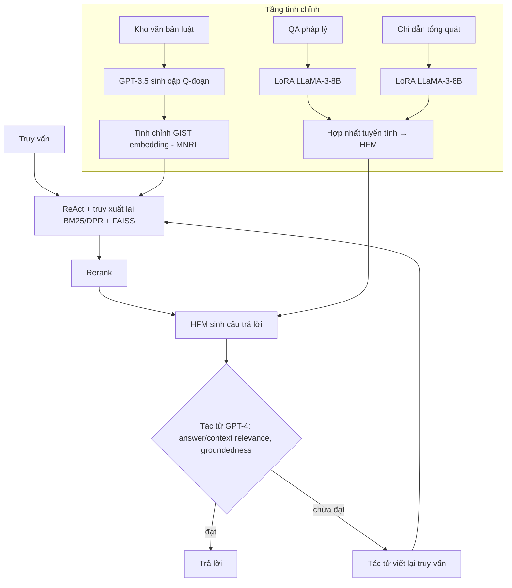

# Paper 11 Summary

## Citation

Tên bài: Legal Query RAG (LQ-RAG)
Tác giả: Rahman S. M. Wahidur, Sumin Kim, Haeung Choi, David S. Bhatti, Heung-No Lee (Gwangju Institute of Science and Technology – GIST, Hàn Quốc)
Năm: 2025
Nguồn: IEEE Access, Vol. 13 (2025), trang 36978–36994 — tạp chí có bình duyệt (nhận bài 14/1/2025, chấp nhận 31/1/2025, xuất bản 14/2/2025), open access CC BY 4.0
DOI/Link: https://doi.org/10.1109/ACCESS.2025.3542125

## Problem

**Tóm tắt tổng quan.** Bài báo đề xuất LQ-RAG, một khung RAG cho truy vấn pháp lý có vòng phản hồi đệ quy. Khung gồm bốn thành phần: mô hình embedding tinh chỉnh cho luật (GIST-Law-Embed), mô hình sinh tinh chỉnh lai (HFM – hợp nhất hai bản LoRA của LLaMA-3-8B), tác tử đánh giá dùng GPT-4, và tác tử viết lại prompt. Kết quả: embedding tinh chỉnh tăng Hit Rate 13% và MRR 15%; HFM cải thiện 24% so với LLM tổng quát; LQ-RAG đạt điểm liên quan trung bình 80%, cao hơn RAG thường 23% và RAG với mô hình tinh chỉnh (FTM) 14%.

**Bối cảnh và động lực.** Các LLM pháp lý trước đó (HanFei, LawGPT, LexiLaw, Lawyer LLaMA) dù được tiền huấn luyện hoặc tinh chỉnh trên dữ liệu luật vẫn ảo giác và bị giới hạn bởi mốc tri thức. RAG thông thường có thể đưa vào đoạn không liên quan vì bộ truy xuất không xét độ liên quan theo miền, còn mô hình sinh thiếu tri thức miền và khả năng tuân thủ chỉ dẫn. Bài báo dẫn số liệu LLM tổng quát ảo giác 58%–82% với câu hỏi pháp lý.

## Method

1. **Tầng tinh chỉnh (FT Layer):**
   - *Embedding:* dùng GPT-3.5-turbo sinh cặp câu hỏi–đoạn văn từ một phần kho sách luật (lấy từ Library Genesis); tinh chỉnh GIST Large Embedding v0 với Multiple Negatives Ranking Loss.
   - *Mô hình sinh:* LLaMA-3-8B tinh chỉnh LoRA riêng trên bộ hỏi-đáp pháp lý và bộ chỉ dẫn tổng quát (lượng tử 4-bit, PEFT, SFTTrainer), sau đó hợp nhất tuyến tính thành HFM.
2. **Tầng RAG:** chỉ mục FAISS trên phần kho còn lại; tác tử ReAct chọn công cụ truy vấn; truy xuất lai BM25 + DPR rồi rerank.
3. **Vòng phản hồi:** tác tử đánh giá GPT-4 chấm answer relevance, context relevance và groundedness theo chuỗi suy luận (CoT). Nếu chưa đạt ngưỡng, tác tử prompt chỉnh sửa truy vấn (đơn giản hóa nhưng giữ ý) và lặp lại truy xuất–sinh, tối đa N lần.

## Dataset

- Truy xuất: 7 bộ dữ liệu tự xây từ kho sách luật.
- Mô hình sinh: các bộ đánh giá tổng quát (BBH, Hellaswag, TruthfulQA, SQuAD v2…) và pháp lý (MMLU International Law, MMLU Professional Law, Abercrombie, Legal Reasoning Causality, Law Stack Exchange, Canada Tax Court Outcomes, Contract QA).
- Hệ thống: bộ câu hỏi mở về điều khoản hiến pháp, sửa đổi, tình huống giả định, và 5 bộ câu hỏi “closed-domain”. Bài **không** nêu rõ tổng số câu hỏi đánh giá hệ thống trong thân bài.

## Evaluation

Hit Rate, MRR (truy xuất); EM, Accuracy, BLEU, ROUGE (mô hình sinh); RAG triad gồm Answer Relevance, Context Relevance, Groundedness do LLM chấm; thời gian phản hồi. Baseline embedding: ColBERT, LLM-Embedder, BGE, GISTEmbed; baseline mô hình sinh: các bản LLaMA và Flan-T5; baseline hệ thống: Naive RAG và RAG + FTM.

## Results

- **Embedding:** GIST-Law-Embed đạt Hit Rate trung bình 51% và MRR 40% (top-K = 5); chọn k = 15 vì truy xuất được đoạn gốc hơn 60% số lần.
- **HFM:** cải thiện 9% (nhóm tổng quát) và 38% (nhóm pháp lý) theo điểm trung bình 11 bộ. Ví dụ: Legal Reasoning Causality 0,75 so với 0,52 của LLaMA-3-8B; Contract QA 0,56 so với 0,19. Tuy nhiên HFM kém hơn ở SQuAD v2 (0,45 so với 0,50), Law Stack Exchange (0,28 so với 0,63 của Flan-T5 large) và Canada Tax Court (0,66 so với 0,68).
- **Hệ thống (open-domain):** điểm liên quan trung bình — Naive RAG 65%, RAG + FTM 70%, LQ-RAG 80%; LQ-RAG đạt answer relevance 88%, context relevance 70%, groundedness 82%.
- **Closed-domain:** LQ-RAG giảm answer relevance xuống 72% (so với 88% của hai cấu hình còn lại); context relevance và groundedness của mọi cấu hình dưới 50%.
- **Độ trễ (5 bộ câu hỏi):** Naive 7,2 giây, RAG + FTM 11,2 giây, LQ-RAG 14,6 giây (khoảng gấp đôi).

**Điểm mạnh.**

- Tinh chỉnh đồng thời cả embedding và mô hình sinh, kèm vòng tự đánh giá–viết lại có điều kiện dừng.
- Báo cáo cả mặt yếu: thời gian tăng gấp đôi, kết quả kém ở kịch bản closed-domain.
- Nhấn mạnh phải xét đồng thời ba tiêu chí (answer relevance, context relevance, groundedness) — answer relevance cao mà context thấp có thể là câu trả lời sai.

## Limitations

**(a) Bài báo thừa nhận:** phụ thuộc GPT-4 (mô hình độc quyền) làm tác tử đánh giá; thời gian phản hồi cao; chưa có phản hồi từ chuyên gia pháp lý; cần benchmark pháp lý chuyên biệt và thử nghiệm thực tế.

**(b) Quan sát:** cải thiện không đồng đều (HFM thua ở một số bộ pháp lý); đánh giá hệ thống hoàn toàn do LLM chấm, không có người chấm; mức tăng “23%” là tương đối trên điểm liên quan do LLM chấm. Kho dữ liệu lấy từ Library Genesis đặt ra câu hỏi về bản quyền mà bài **không** bàn đến. Bài cũng **không** đánh giá trên ngôn ngữ ngoài tiếng Anh.

## Relevance to our topic

LQ-RAG là ví dụ tiêu biểu của hướng “kiểm chứng bằng LLM trong vòng lặp”, và chính bài báo đo được cái giá: độ trễ tăng khoảng gấp đôi. Kết quả này củng cố quyết định của Sys_3_4 dùng verifier tất định (không gọi thêm LLM) để giữ độ trễ thấp, đồng thời cho thấy groundedness là tiêu chí bắt buộc khi chấm câu trả lời.

**Kết luận.** LQ-RAG cho thấy kết hợp tinh chỉnh embedding, mô hình sinh lai và vòng tự đánh giá có thể nâng điểm liên quan của câu trả lời pháp lý, đổi lại độ trễ tăng gấp đôi và phụ thuộc mô hình đóng. Hướng tiếp theo tác giả nêu: tác tử đánh giá chuyên biệt cho luật, đưa phản hồi chuyên gia vào hệ thống, tối ưu thời gian và thử nghiệm thực tế.

## Possible improvement

- Áp dụng RAG triad (answer relevance, context relevance, groundedness) trong đánh giá Friendly Engine, nhưng chấm bằng người hoặc mô hình mở chạy cục bộ thay vì GPT-4.
- Thử tinh chỉnh embedding trên dữ liệu thủ tục (theo MNRL như bài) để so sánh với BGE-M3 gốc.
- Nếu dùng vòng viết lại truy vấn, đặt ngân sách thời gian cứng (Sys_3_4 hiện timeout 7 giây).
