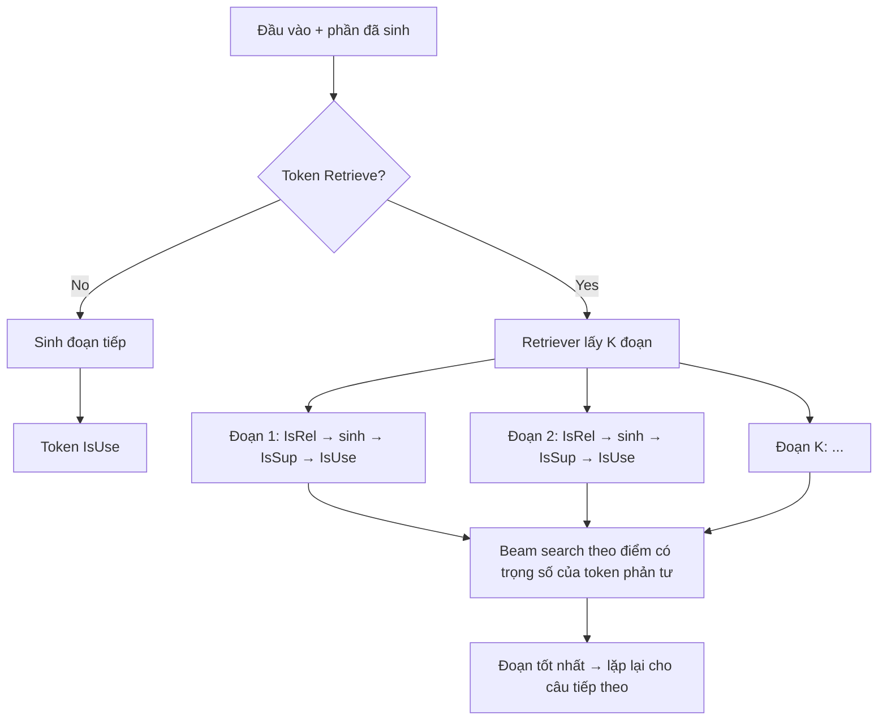

# Paper 11 Summary — SelfRAG2024

Nhóm khuôn B2: **model / phương pháp AI**. Kiểm chứng 25/10/2026: các con số trong tệp đã đối chiếu với PDF trong docs/research paper. Phần nội dung bài gốc chép từ tóm tắt cũ (docs/research paper/paper_summaries/paper_14.md); hai mục cuối viết lại cho bài 1.

## Citation

Tên bài: Self-RAG: Learning to Retrieve, Generate, and Critique through Self-Reflection
Tác giả: Akari Asai, Zeqiu Wu, Yizhong Wang, Avirup Sil, Hannaneh Hajishirzi (University of Washington; Allen Institute for AI; IBM Research AI)
Năm: 2024 (preprint 10/2023)
Nguồn: The Twelfth International Conference on Learning Representations (ICLR 2024), báo cáo oral — hội nghị hàng đầu, có bình duyệt (OpenReview)
DOI/Link: https://proceedings.iclr.cc/paper_files/paper/2024/hash/25f7be9694d7b32d5cc670927b8091e1-Abstract-Conference.html (bản mở: https://arxiv.org/abs/2310.11511)

## Problem

**Tóm tắt tổng quan.** Self-RAG huấn luyện một LLM duy nhất vừa sinh văn bản vừa sinh *token phản tư* (reflection tokens) để tự quyết định khi nào cần truy xuất, đánh giá đoạn văn truy xuất có liên quan không, câu trả lời có được đoạn văn hỗ trợ không, và câu trả lời có hữu ích không. Với Llama2 7B/13B, Self-RAG vượt các LLM và mô hình RAG mã nguồn mở trên sáu tác vụ, và vượt ChatGPT ở PubHealth, PopQA, sinh tiểu sử và ở độ chính xác trích dẫn (citation precision) trên ASQA.

**Bối cảnh và động lực.** RAG thông thường luôn truy xuất một số đoạn cố định bất kể có cần hay không và bất kể đoạn đó có liên quan, có thể làm giảm chất lượng; đồng thời mô hình không được huấn luyện để bám theo bằng chứng nên câu trả lời không chắc nhất quán với đoạn truy xuất. Các phương pháp tự tinh chỉnh bằng prompt lặp (như CoVe) lại tốn thời gian suy luận. Bài báo đặt mục tiêu: truy xuất theo nhu cầu và tự phản tư, nhưng không làm mất tính linh hoạt của LLM.

## Method

1. **Bốn loại token phản tư:** *Retrieve* {yes, no, continue}; *IsRel* {relevant, irrelevant}; *IsSup* {fully, partially, no support}; *IsUse* {1–5}.
2. **Huấn luyện mô hình phê bình (critic):** dùng GPT-4 sinh nhãn token phản tư (4K–20K mẫu mỗi loại), chưng cất vào critic Llama2-7B; critic đạt hơn 90% đồng thuận với GPT-4 ở phần lớn loại token.
3. **Huấn luyện mô hình sinh:** chạy critic và retriever (Contriever-MS MARCO) ngoại tuyến để chèn token phản tư và đoạn truy xuất vào 150K cặp chỉ dẫn–đầu ra; huấn luyện bằng mục tiêu dự đoán token kế tiếp với từ vựng mở rộng (che phần đoạn truy xuất khi tính loss). Không cần critic khi suy luận — chi phí thấp hơn RLHF/PPO.
4. **Suy luận có kiểm soát:** truy xuất khi xác suất Retrieve=yes vượt ngưỡng; xử lý song song nhiều đoạn; beam search theo đoạn với điểm = xác suất sinh + tổng có trọng số của IsRel, IsSup, IsUse (mặc định 1,0; 1,0; 0,5). Có thể đặt ràng buộc cứng, ví dụ loại đoạn có IsSup = no support.

## Dataset

Huấn luyện: 150K cặp chỉ dẫn–đầu ra từ Open-Instruct và các bộ cần tri thức. Đánh giá (zero-shot): PubHealth (kiểm chứng sự thật về y tế công cộng), ARC-Challenge, PopQA (tập đuôi dài gồm 1.399 truy vấn thực thể hiếm), TriviaQA-unfiltered (11.313 câu), sinh tiểu sử (FactScore), ALCE-ASQA (QA dài có trích dẫn).

## Evaluation

Accuracy (PubHealth, ARC, PopQA, TriviaQA — tính đúng nếu đáp án vàng có trong câu trả lời); FactScore; với ASQA: str-em, ROUGE, MAUVE (độ trôi chảy), citation precision và recall. Baseline: Llama2, Alpaca, Llama2-chat, ChatGPT (có/không truy xuất), Perplexity.ai, CoVE65B, Toolformer, SAIL, Llama2-FT.

## Results

- **Self-RAG 13B:** PopQA 55,8; TriviaQA 69,3; PubHealth 74,5; ARC 73,1; FactScore 80,2; ASQA em 31,7, citation precision 70,3, recall 71,3.
- **Self-RAG 7B:** PopQA 54,9; PubHealth 72,4; FactScore 81,2; ASQA citation precision 66,9.
- **So sánh:** ChatGPT không truy xuất đạt PopQA 29,3, PubHealth 70,1, FactScore 71,8; Ret-ChatGPT đạt citation precision 65,1 (Self-RAG 13B: 70,3). ChatGPT vẫn tốt hơn ở ARC (75,3), TriviaQA (74,3) và ASQA em (35,3–40,7). Llama2 13B kèm truy xuất chỉ đạt citation precision 2,3.
- **Llama2-FT7B** (cùng dữ liệu nhưng không có token phản tư) kém Self-RAG, cho thấy lợi ích không chỉ đến từ dữ liệu.
- **Ablation (bản 7B, 50K mẫu):** bỏ retriever hoặc bỏ critic khi huấn luyện làm giảm mạnh kết quả; luôn dùng top-1 như RAG truyền thống làm giảm mạnh trên PopQA và ASQA; bỏ IsSup làm giảm ASQA.
- Tăng trọng số IsSup làm tăng citation precision nhưng giảm MAUVE; ngưỡng truy xuất cho phép đánh đổi tần suất truy xuất với độ chính xác. Đánh giá người trên 50 mẫu cho thấy IsRel/IsSup khớp phần lớn với nhận định của người.

**Điểm mạnh.**

- Gộp truy xuất theo nhu cầu, tự đánh giá mức hỗ trợ và trích dẫn vào một mô hình duy nhất; điều chỉnh hành vi lúc suy luận mà không cần huấn luyện lại.
- Đánh giá rộng (6 tác vụ, nhiều chỉ số), ablation cả huấn luyện lẫn suy luận, có kiểm tra người.
- Công bố mã và mô hình.

## Limitations

**(a) Bài báo thừa nhận:** vẫn có thể sinh nội dung không được trích dẫn hỗ trợ đầy đủ; dữ liệu huấn luyện giới hạn ở 150K và chưa khai thác hết hiệu ứng tăng dữ liệu.

**(b) Quan sát:** cần huấn luyện lại LLM với từ vựng mở rộng — không áp dụng được trực tiếp cho mô hình có sẵn; nhãn critic chưng cất từ GPT-4; đánh giá người chỉ 50 mẫu; một số baseline lấy số từ bài khác; bản 7B đôi khi tốt hơn 13B về độ chính xác sự kiện do câu trả lời ngắn hơn. Bài **không** báo cáo độ trễ suy luận dù có beam search trên nhiều đoạn, và chỉ đánh giá tiếng Anh.

## Relevance to our topic

Self-RAG để model tự quyết khi nào truy hồi và tự phê bình đầu ra, tức là 'model quyết định'. Bài 1 so sánh đúng câu hỏi này trên câu hỏi thật: để luật quyết định (A), để điểm reranker quyết định (B), hay để LLM đọc câu hỏi (C, baseline RAG).

## Possible improvement

- Thử một biến thể 'LLM tự phê bình' làm baseline thêm, nếu còn thời gian và tài nguyên (bài 1 chưa làm).
