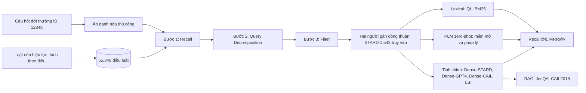

# Paper 12 Summary

## Citation

Tên bài: STARD: A Chinese Statute Retrieval Dataset Derived from Real-life Queries by Non-professionals
Tác giả: Weihang Su, Yiran Hu, Anzhe Xie, Qingyao Ai, Zibing Que, Ning Zheng, Yun Liu, Weixing Shen, Yiqun Liu (Đại học Thanh Hoa; Đại học Bắc Kinh)
Năm: 2024
Nguồn: Findings of the Association for Computational Linguistics: EMNLP 2024, trang 10658–10671 — hội nghị hàng đầu về NLP, có bình duyệt
DOI/Link: https://aclanthology.org/2024.findings-emnlp.625/ (DOI: 10.18653/v1/2024.findings-emnlp.625)

## Problem

**Tóm tắt tổng quan.** Bài báo giới thiệu STARD — bộ dữ liệu truy xuất điều luật tiếng Trung gồm 1.543 câu hỏi thật từ tư vấn pháp luật của người dân (không chuyên) và 55.348 điều luật ứng viên. Tác giả đề xuất quy trình gán nhãn ba bước (Recall, Query Decomposition, Filter), đánh giá nhiều nhóm baseline truy xuất, và thử dùng STARD làm kho tri thức cho RAG. Kết quả tốt nhất chỉ đạt Recall@100 = 0,9065 (Dense-STARD), cho thấy các phương pháp hiện có chưa đáp ứng tốt câu hỏi đời thường.

**Bối cảnh và động lực.** Các benchmark truy xuất điều luật trước đó (COLIEE từ đề thi luật sư Nhật; AILA từ bản án Tòa án Tối cao Ấn Độ; CAIL2018 từ phần “Court's Findings” của bản án) dùng truy vấn chính thức, chuyên nghiệp. Người dân thường mô tả sự việc bằng ngôn ngữ đời thường, thiếu thuật ngữ pháp lý và tham chiếu mơ hồ (ví dụ “bị thú cưng của người khác cắn”), trong khi điều luật dùng thuật ngữ chuyên ngành và tiêu chí liên quan dựa trên suy luận pháp lý chứ không chỉ tương đồng văn bản.

## Method

1. **Định nghĩa bài toán:** cho truy vấn q và kho điều luật S, mỗi điều si có biến Bernoulli ri cho biết có liên quan hay không; mục tiêu là lấy đủ tập điều luật liên quan.
2. **Quy trình gán nhãn ba bước** mô phỏng tam đoạn luận pháp lý: (i) *Recall* — khoanh vùng từ trên xuống: ngành luật → phân ngành → chương liên quan; (ii) *Query Decomposition* — chuyển mô tả đời thường thành các “sự kiện pháp lý” (tiểu đề); (iii) *Filter* — phương pháp “subsumption”: SGolden = (SF1 ∪ SF2 ∪ SF3) ∩ S.
3. **Gán nhãn:** 16 sinh viên các trường luật lớn; mỗi câu hỏi do hai người gán, chỉ giữ khi hai người thống nhất cùng tập điều luật; cấm dùng mô hình sinh (ChatGPT).
4. **Baseline:** lexical (QL, BM25); PLM miền mở (Chinese-RoBERTa-WWM, SEED, coCondenser); PLM pháp lý (Lawformer, SAILER) — đều zero-shot; mô hình tinh chỉnh: Dense-CAIL, Dense-STARD (5-fold), Dense-GPT4 (GPT-4 sinh câu hỏi từ điều luật để huấn luyện contrastive), LSI-STARD (phân loại, mỗi điều luật là một nhãn).
5. **Thực nghiệm RAG:** lấy top-10 điều luật bằng BM25 hoặc Dense-STARD đưa vào prompt cho Baichuan, ChatGLM, ChatGPT.

## Dataset

STARD: 1.543 truy vấn (độ dài trung bình 27,3 từ) và 55.348 điều luật ứng viên (trung bình khoảng 120 từ) lấy từ các văn bản pháp luật và giải thích tư pháp còn hiệu lực của Trung Quốc; 1.445 điều luật liên quan ít nhất một truy vấn, tổng 2.717 lượt xuất hiện, trung bình 1,76 điều liên quan mỗi truy vấn. 843/1.543 truy vấn chỉ có một điều liên quan; 45% cần nhiều điều. Độ đồng thuận giữa hai người gán: Cohen's Kappa = 0,5312 (mức vừa phải). Giấy phép MIT.

## Evaluation

Recall@k (k = 5…200) và MRR@k (k = 3, 5, 10). RAG: độ chính xác trên JecQA (26.365 câu trắc nghiệm nhiều lựa chọn, hai nhóm KD và CA) và tác vụ dự đoán tội danh của CAIL2018.

## Results

- **Zero-shot:** BM25 R@100 = 0,6493, QL 0,6515; các PLM pháp lý zero-shot thấp hơn (SAILER R@100 = 0,5674, Lawformer 0,5478). Tác giả kết luận lexical vẫn là baseline rất mạnh so với PLM zero-shot.
- **Tinh chỉnh:** Dense-STARD R@100 = 0,9065, R@200 = 0,9531, MRR@10 = 0,4724; Dense-GPT4 R@100 = 0,7984; Dense-CAIL chỉ 0,3281 và LSI-STARD 0,3410.
- **RAG:** dùng điều luật truy xuất giúp LLM trên JecQA (ví dụ Baichuan JQA-KD 0,266 → 0,291 với Dense-STARD; ChatGLM 0,194 → 0,237); với ChatGPT, BM25 lại tốt hơn Dense-STARD ở JQA-KD (0,293 so với 0,252), cho thấy mỗi LLM ưa một kiểu retriever. Trên CAIL2018, Baichuan không RAG đạt 0,850, cao hơn khi có RAG — tác giả cho rằng do mô hình đã thấy dữ liệu này khi tiền huấn luyện.

**Điểm mạnh.**

- Truy vấn thật của người dân, khác biệt rõ với benchmark chính thức: mô hình tinh chỉnh trên CAIL2018 gần như không chuyển sang được.
- Quy trình gán nhãn ba bước có cơ sở lập luận pháp lý và được mô tả đủ để tái sử dụng; dữ liệu, mô hình, mã công khai.
- Phân tích baseline rộng, kết luận rõ: lexical là baseline mạnh; mô hình huấn luyện trong miền vượt trội.

## Limitations

**(a) Bài báo thừa nhận:** bộ dữ liệu gắn với hệ thống pháp luật Trung Quốc nên không áp dụng trực tiếp cho hệ thống khác; muốn mở rộng phải xây và gán nhãn bộ dữ liệu mới; tác giả cam kết cập nhật định kỳ vì luật thay đổi.

**(b) Quan sát:** Kappa 0,53 chỉ ở mức vừa phải và các câu hỏi bất đồng bị loại, nên tập dữ liệu thiên về các ca có đồng thuận cao; Dense-STARD chỉ huấn luyện trên hơn một nghìn cặp nên Recall vẫn dưới 1; thực nghiệm RAG gồm các LLM đời cũ và chưa kiểm tra chất lượng trích dẫn điều luật trong câu trả lời; đánh giá chỉ trên hai tập ngoài miền (JecQA, CAIL2018).

## Relevance to our topic

Đây là bài sát nhất với bài toán của Sys_3_4: câu hỏi đời thường của người dân → điều luật trong hệ thống luật thành văn (civil law), đơn vị truy xuất là “điều”. Kết quả “lexical mạnh hơn PLM zero-shot, còn mô hình dense tinh chỉnh trong miền vượt xa” ủng hộ kiến trúc kép: truy hồi từ vựng có trọng số cho Strict Engine và embedding được tinh chỉnh cho Friendly Engine. Bước Query Decomposition (từ sự việc đời thường sang “sự kiện pháp lý”) tương ứng với bước chuẩn hóa/làm rõ câu hỏi trước khi khớp thủ tục. Phát hiện “mỗi LLM ưa một retriever khác nhau” cho thấy cần đánh giá retriever cùng với bộ sinh thay vì tách rời.

**Kết luận.** STARD chứng minh truy xuất điều luật từ câu hỏi không chuyên vẫn là bài toán chưa giải xong (Recall@100 tối đa 0,9065) và cung cấp quy trình gán nhãn có thể áp dụng cho các hệ thống civil law khác. Nhóm có thể mượn quy trình này để xây bộ đánh giá cho thủ tục hành chính Việt Nam.

## Possible improvement

- Xây bộ đánh giá kiểu STARD cho 1.350 thủ tục hành chính: câu hỏi người dân ẩn danh, gán nhãn thủ tục/điều khoản liên quan theo ba bước, hai người gán và báo cáo Kappa.
- Báo cáo Recall@k và MRR@k cho cả Strict (IDF âm tiết) và Friendly (dense + RRF + reranker), kèm baseline BM25 để so sánh công bằng.
- Dùng dữ liệu tổng hợp từ LLM (như Dense-GPT4) để tinh chỉnh embedding khi thiếu nhãn người, sau đó kiểm chứng trên tập nhãn tay.
