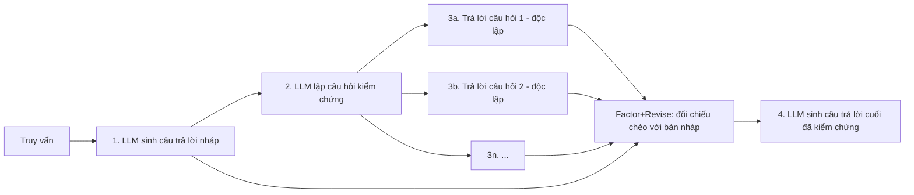

# Paper 13 Summary

## Citation

Tên bài: Chain-of-Verification Reduces Hallucination in Large Language Models (CoVe)
Tác giả: Shehzaad Dhuliawala, Mojtaba Komeili, Jing Xu, Roberta Raileanu, Xian Li, Asli Celikyilmaz, Jason Weston (Meta AI; ETH Zürich)
Năm: 2024 (preprint 9/2023)
Nguồn: Findings of the Association for Computational Linguistics: ACL 2024 — hội nghị có bình duyệt, ACL Anthology
DOI/Link: https://aclanthology.org/2024.findings-acl.212/ (bản mở: https://arxiv.org/abs/2309.11495)

## Problem

**Tóm tắt tổng quan.** Bài báo đề xuất Chain-of-Verification (CoVe): LLM (1) soạn câu trả lời nháp, (2) tự lập danh sách câu hỏi kiểm chứng, (3) trả lời các câu hỏi đó một cách độc lập để không bị câu trả lời nháp chi phối, và (4) sinh câu trả lời cuối đã kiểm chứng. Trên Llama 65B, CoVe tăng gấp đôi precision ở câu hỏi dạng danh sách Wikidata (0,17 → 0,36), tăng F1 trên MultiSpanQA từ 0,39 lên 0,48 và tăng FactScore khi sinh tiểu sử từ 55,9 lên 71,4.

**Bối cảnh và động lực.** Ngay cả LLM lớn vẫn ảo giác, đặc biệt với các sự kiện ít xuất hiện (phần “đuôi” của phân phối), và văn bản dài làm ảo giác trầm trọng hơn. Các hướng giảm ảo giác gồm: sửa ở thời điểm huấn luyện, sửa ở thời điểm sinh (dựa vào xác suất token, lấy mẫu nhiều lần, tranh luận giữa nhiều LLM), và dùng công cụ ngoài (RAG, fact-checking). CoVe thuộc nhóm thứ hai: chỉ dùng chính LLM để tự suy xét, không cần công cụ hay nhiều tác tử.

## Method

Các bước đều thực hiện bằng prompt few-shot trên cùng một LLM:
1. **Câu trả lời cơ sở:** sinh bình thường — đồng thời là baseline để so sánh.
2. **Lập kế hoạch kiểm chứng:** dựa trên truy vấn và câu trả lời nháp, sinh các câu hỏi kiểm chứng tự do (không theo mẫu).
3. **Thực thi kiểm chứng**, bốn biến thể:
   - *Joint:* lập kế hoạch và trả lời trong một prompt (dễ lặp lại ảo giác).
   - *2-Step:* tách lập kế hoạch và trả lời; prompt trả lời chỉ chứa câu hỏi, không chứa câu trả lời nháp.
   - *Factored:* mỗi câu hỏi trả lời trong một prompt riêng (chạy song song được).
   - *Factor+Revise:* thêm prompt đối chiếu chéo từng cặp hỏi–đáp với câu trả lời nháp để phát hiện mâu thuẫn.
4. **Câu trả lời cuối:** sinh lại dựa trên câu trả lời nháp, các cặp hỏi–đáp kiểm chứng và kết quả đối chiếu.

Bài **không** dùng truy xuất hay công cụ trong bước kiểm chứng.

## Dataset

Wikidata (56 câu hỏi dạng “Kể tên [nghề] sinh ra ở [thành phố]”, mỗi câu khoảng 600 thực thể đúng); Wiki-Category list từ QUEST (55 câu hỏi, khoảng 8 đáp án mỗi câu); MultiSpanQA sách đóng (418 câu hỏi); sinh tiểu sử dạng dài theo benchmark FactScore.

## Evaluation

Precision (micro) kèm số thực thể đúng/sai trung bình cho câu hỏi danh sách; F1, precision, recall cho MultiSpanQA; FactScore (kiểm chứng tự động bằng Instruct-Llama có truy xuất) cho văn bản dài. Baseline: Llama 65B few-shot, Llama 2 70B Chat zero-shot và CoT; với tiểu sử thêm InstructGPT, ChatGPT, PerplexityAI (số liệu lấy từ công trình trước).

## Results

- **Wikidata:** precision 0,17 (few-shot) → 0,29 (joint), 0,36 (2-step), 0,32 (factored); số thực thể sai giảm từ 2,95 xuống 0,68, số thực thể đúng giảm nhẹ từ 0,59 xuống 0,38.
- **Wiki-Category:** 0,12 → 0,22 (factored).
- **MultiSpanQA:** F1 0,39 → 0,48 (factored), tăng cả precision (0,40 → 0,50) và recall (0,38 → 0,46).
- **Tiểu sử:** FactScore 55,9 (few-shot) → 60,8 (joint) → 63,7 (factored) → 71,4 (factor+revise), vượt ChatGPT (58,7) và PerplexityAI (61,6). Số sự kiện trung bình giảm từ 16,6 xuống 12,3. Với các sự kiện rất hiếm, PerplexityAI (có truy xuất) vẫn tốt hơn.
- **Llama 2 Chat** (tinh chỉnh chỉ dẫn) và **CoT** không giảm ảo giác — kém hơn Llama 65B few-shot ở mọi tác vụ.
- **Ablation (Bảng 4, Wiki-Category):** câu hỏi kiểm chứng do LLM sinh tốt hơn câu hỏi theo luật (0,22 so với 0,16 với factored); câu hỏi mở tốt hơn câu hỏi có/không (0,22 so với 0,19), vì mô hình có xu hướng đồng ý với câu hỏi có/không.
- **Phát hiện then chốt:** chỉ khoảng 17% thực thể trong câu trả lời danh sách là đúng, nhưng khi hỏi riêng từng thực thể thì khoảng 70% được trả lời đúng.

**Điểm mạnh.**

- Phương pháp đơn giản, không cần huấn luyện, áp dụng được cho mọi LLM tuân theo prompt.
- Ablation rõ ràng giữa các biến thể, chứng minh nguyên lý “câu hỏi kiểm chứng không được nhìn thấy câu trả lời nháp”.
- Đánh giá trên nhiều dạng tác vụ, từ danh sách, QA đến văn bản dài.

## Limitations

**(a) Bài báo thừa nhận:** không loại bỏ hoàn toàn ảo giác; chỉ xử lý ảo giác dạng phát biểu sự kiện sai, chưa xét lỗi suy luận hay ý kiến; tăng chi phí tính toán do sinh thêm nhiều token; trần cải thiện bị giới hạn bởi năng lực của chính mô hình; chưa kết hợp công cụ hay truy xuất.

**(b) Quan sát:** precision tăng nhưng số câu trả lời đúng giảm (đánh đổi recall ở tác vụ danh sách); số lượng câu hỏi đánh giá nhỏ (55–56 câu cho tác vụ danh sách); FactScore là thước đo tự động; bài **không** báo cáo độ trễ hay số lần gọi LLM cụ thể của từng biến thể.

## Relevance to our topic

CoVe là đại diện tiêu biểu của hướng “LLM tự kiểm chứng” mà Sys_3_4 nêu trong khoảng trống nghiên cứu số 4: hiệu quả nhưng cần nhiều lần gọi LLM, làm tăng chi phí và độ trễ. Hai nguyên lý của CoVe vẫn có giá trị cho nhóm: tách câu trả lời thành các mệnh đề nhỏ để kiểm từng mệnh đề, và kiểm chứng độc lập với bản nháp.

**Kết luận.** CoVe cho thấy LLM có thể giảm đáng kể ảo giác bằng cách tự đặt và trả lời độc lập các câu hỏi kiểm chứng, với biến thể factor+revise hiệu quả nhất. Phương pháp không loại bỏ hoàn toàn ảo giác và tốn thêm tính toán. Hướng mở rộng tự nhiên tác giả nêu: kết hợp công cụ, đặc biệt là truy xuất, trong bước kiểm chứng.

## Possible improvement

- Sys_3_4 thay bước “trả lời câu hỏi kiểm chứng bằng LLM” bằng tra cứu tất định vào cơ sở dữ liệu thủ tục (số tiền, thời hạn, hồ sơ) — tức CoVe dạng factored nhưng nguồn kiểm chứng là dữ liệu chuẩn thay vì trí nhớ của mô hình.
- Đo đối chứng: tỷ lệ lỗi số liệu và độ trễ giữa verifier tất định và một biến thể CoVe chạy trên Qwen cục bộ.
