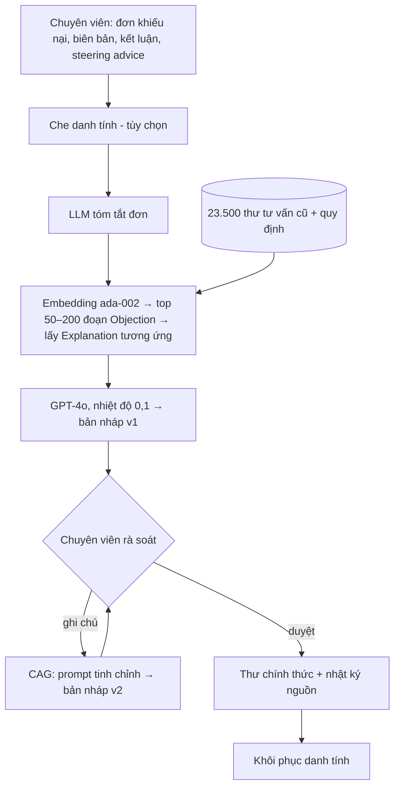

# Paper 14 Summary — LegalCheck2026

Nhóm khuôn B2: **lĩnh vực ứng dụng**. Kiểm chứng 25/10/2026: các con số trong tệp đã đối chiếu với PDF trong docs/research paper. Phần nội dung bài gốc chép từ tóm tắt cũ (docs/research paper/paper_summaries/paper_07.md); hai mục cuối viết lại cho bài 1.

## Citation

Tên bài: LegalCheck: Retrieval- and Context-Augmented Generation for Drafting Municipal Legal Advice Letters
Tác giả: Virgill van der Meer (Municipality of Amsterdam), Julien Rossi (University of Amsterdam)
Năm: 2026
Nguồn: Proceedings of the 21st International Conference on Artificial Intelligence and Law (ICAIL 2026), Singapore, 8–12/6/2026 — short paper, hội nghị có bình duyệt (ACM/IAAIL). Trang arXiv ghi “Accepted at ICAIL 2026 as Short Paper”.
DOI/Link: https://arxiv.org/abs/2605.12012 (bản PDF trong repo vẫn để DOI ACM dạng “XXXXXXX”, chưa có DOI chính thức tại thời điểm kiểm tra)

## Problem

**Tóm tắt tổng quan.** LegalCheck là hệ thống soạn thảo thư tư vấn pháp lý cho các đơn khiếu nại (bezwaar) của công dân tại phòng pháp chế thành phố Amsterdam. Hệ thống kết hợp RAG (truy xuất thư tư vấn cũ và văn bản quy phạm) với CAG (Context-Augmented Generation): đưa hồ sơ vụ việc, kết luận dự kiến do chuyên viên chọn và phản hồi của chuyên viên vào nhiều vòng sinh. Trong thí điểm 6 tháng, 81% nội dung bản nháp AI được giữ nguyên trong thư cuối cùng, và tổng thời gian xử lý giảm 50–70% với các vụ đơn giản.

**Bối cảnh và động lực.** Phòng pháp chế đô thị thiếu nhân sự, trong khi khối lượng khiếu nại hành chính và môi trường tăng 35% trong năm năm. Thư tư vấn là văn bản rủi ro cao: phải dẫn đúng luật và tiền lệ, khớp sự kiện, giữ giọng văn chuyên nghiệp nhưng thân thiện với công dân. Theo tác giả, các nghiên cứu NLP pháp lý trước chủ yếu phân loại hoặc dự đoán phán quyết; các nghiên cứu sinh văn bản pháp lý chỉ dừng ở thử nghiệm phòng lab. Chưa có công trình triển khai LLM soạn văn bản pháp lý chính thức trong quy trình thật của khu vực công.

## Method

1. **Đầu vào của chuyên viên:** đơn khiếu nại, biên bản của cán bộ thực thi, kết luận dự kiến (chấp nhận/bác bỏ), và tùy chọn “steering advice”. Có bước tùy chọn che danh tính (tên, địa chỉ, số định danh, biển số) và khôi phục danh tính sau khi duyệt.
2. **RAG:** một lệnh gọi LLM tóm tắt đơn khiếu nại; nhúng bằng text-embedding-ada-002 (1.536 chiều); tìm 50–200 đoạn “Objection” tương tự bằng cosine, rồi lấy đoạn “Explanation” tương ứng của cùng vụ. Truy xuất trong bộ nhớ, không cần CSDL vector, độ trễ mức mili-giây ở quy mô 14.000 vụ.
3. **Sinh bản nháp:** GPT-4o (Azure OpenAI), nhiệt độ 0,1, theo mẫu prompt quy định cấu trúc và văn phong chính thức của thành phố; mất khoảng 20–25 giây.
4. **CAG tinh chỉnh:** chuyên viên ghi chú lỗi hoặc thiếu sót; hệ thống tạo prompt mới gồm bản nháp v1, hồ sơ, ghi chú và (tùy chọn) truy xuất lại → sinh bản v2. Thường chỉ cần 0–1 vòng.
5. **Kiểm soát:** chuyên viên luôn là người duyệt cuối; lưu nhật ký nguồn và prompt để kiểm toán.

## Dataset

Thư tư vấn pháp lý 2022–2025 của thành phố Amsterdam thuộc các lĩnh vực phạt rác thải và cẩu kéo xe đạp, ô tô, tàu thuyền: khoảng 23.500 thư, mỗi lĩnh vực từ khoảng 150 đến 14.000 vụ. Thư được cắt theo mục (Case Details, Objection, Hearing, Explanation, Conclusion) và ẩn danh theo GDPR. Dữ liệu là bí mật, không công bố.

## Evaluation

Đánh giá hỗn hợp trong 6 tháng triển khai: tỷ lệ giữ lại (phần nội dung AI được giữ nguyên sau khi chỉnh sửa), Recall/Precision/F1 về nội dung so với thư do người viết, tỷ lệ tiết kiệm thời gian (khoảng 20 chuyên viên tự ghi thời gian, so với ước tính lịch sử 3/6/16 giờ mỗi vụ), mức giữ lại các sự kiện chính trên khoảng 250 vụ, cùng khảo sát và phỏng vấn người dùng. Bài **không** có baseline hệ thống khác (ví dụ RAG một vòng không có CAG, hoặc LLM không truy xuất).

## Results

- Bảng 1: Recall 93%, Precision 91%, F1 92%; tỷ lệ giữ lại 81% (chuyên viên chỉ thêm khoảng 8% nội dung mới); tiết kiệm 92% thời gian ở khâu soạn thảo; giảm 50–70% tổng thời gian xử lý (vụ 6 giờ còn 2–3 giờ).
- Hơn 99% bản nháp chứa đủ các sự kiện chính (ngày vi phạm, loại vi phạm, địa điểm). Có 68% thư AI dài hơn thư người viết, trung bình nhiều hơn 41% nội dung.
- Ngoại suy: với 5.800 khiếu nại/năm, tiết kiệm 12.000–17.000 giờ (≈10–14 nhân sự, ≈1,2–1,7 triệu euro). Tác giả nêu rõ đây là ước tính giả định triển khai đầy đủ.
- Định tính: chuyên viên ban đầu hoài nghi, sau tăng mức tin tưởng; mọi lần dùng chức năng tinh chỉnh đều cho bản nháp “thỏa đáng”.
- Không có ablation RAG so với RAG + CAG; tác giả đưa việc so sánh mù này vào hướng nghiên cứu tiếp theo.

**Điểm mạnh.**

- Nghiên cứu triển khai thật trong cơ quan hành chính, có quy trình con người duyệt cuối, nhật ký kiểm toán, che/khôi phục danh tính và phân loại rủi ro theo EU AI Act.
- Thiết kế truy xuất theo cặp mục Objection → Explanation khai thác cấu trúc văn bản hành chính một cách khéo léo.
- Đánh giá đa chiều: chất lượng văn bản, thời gian, độ chấp nhận của người dùng.

## Limitations

**(a) Bài báo thừa nhận:** chỉ một cơ quan, bốn lĩnh vực thực thi, nhóm người dùng nhỏ; phụ thuộc LLM bên thứ ba; chưa nghiên cứu tác động dài hạn tới việc làm và cảm nhận công bằng của công dân; dữ liệu bí mật nên khó tái lập; rủi ro tái tạo thiên kiến từ quyết định cũ (đã kiểm tra mẫu, chưa phát hiện vấn đề).

**(b) Quan sát:** cách tính Recall/Precision/F1 so với thư người viết không được mô tả chi tiết; thời gian “trước” là ước tính lịch sử chứ không phải đo song song; không có kiểm định thống kê hay nhóm đối chứng. Bài **không** đo tỷ lệ ảo giác hay lỗi dẫn chiếu sai một cách hệ thống, và dữ liệu được gửi lên đám mây (Azure) dù đã giảm thiểu.

## Relevance to our topic

AI hỗ trợ cơ quan địa phương (cấp thành phố) trả lời công dân, có người duyệt cuối. Cùng bối cảnh 'cơ quan cấp cơ sở' với bài 1 (cấp xã/phường), nhưng LegalCheck soạn thư cho cán bộ duyệt, còn bài 1 quyết định trả lời / hỏi lại / từ chối cho câu hỏi gửi trực tiếp.

## Possible improvement

- Bài 1 có thể đề xuất chuyển câu bị từ chối cho cán bộ, như vòng duyệt của LegalCheck (chưa triển khai).
