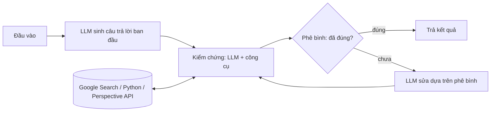

# Paper 15 Summary

## Citation

Tên bài: CRITIC: Large Language Models Can Self-Correct with Tool-Interactive Critiquing
Tác giả: Zhibin Gou, Zhihong Shao, Yeyun Gong, Yelong Shen, Yujiu Yang, Nan Duan, Weizhu Chen (Tsinghua University; Microsoft Research Asia; Microsoft Azure AI)
Năm: 2024
Nguồn: The Twelfth International Conference on Learning Representations (ICLR 2024) — hội nghị hàng đầu, có bình duyệt (bản PDF ghi “Published as a conference paper at ICLR 2024”)
DOI/Link: https://proceedings.iclr.cc/paper_files/paper/2024/hash/fef126561bbf9d4467dbb8d27334b8fe-Abstract-Conference.html (bản mở: https://arxiv.org/abs/2305.11738)

## Problem

**Tóm tắt tổng quan.** CRITIC là khung “kiểm chứng rồi sửa” cho LLM hộp đen: từ câu trả lời ban đầu, LLM tương tác với công cụ ngoài (Google Search, trình thông dịch Python, Perspective API) để sinh lời phê bình, sau đó sửa câu trả lời dựa trên phê bình và lặp lại đến khi đạt điều kiện dừng. Không cần huấn luyện thêm, chỉ cần prompt few-shot. Với ChatGPT, CRITIC tăng trung bình 7,7 F1 trên ba bộ QA, tăng 7,0% tuyệt đối trên ba bộ toán, và giảm 79,2% xác suất sinh nội dung độc hại. Phát hiện then chốt: LLM tự sửa mà không có phản hồi từ bên ngoài chỉ cải thiện ít, thậm chí làm kết quả xấu đi.

**Bối cảnh và động lực.** LLM vẫn ảo giác, sinh mã lỗi và nội dung độc hại. Các cách khắc phục bằng huấn luyện (behavior cloning, RL, self-training) cần nhiều dữ liệu gán nhãn. Nghiên cứu trước cũng cho thấy LLM tự đánh giá tính đúng không đáng tin. Bài báo lấy cảm hứng từ cách con người dùng công cụ (công cụ tìm kiếm, trình biên dịch) để kiểm tra và sửa bản nháp.

## Method

1. **Khởi tạo:** LLM sinh câu trả lời ban đầu (CoT cho QA, Program-of-Thought cho toán).
2. **Kiểm chứng qua công cụ:** LLM tạo phê bình theo prompt “Câu trả lời trên có vấn đề gì?”, đánh giá *tính hợp lý* và *tính đúng*. Các công cụ được bọc thành API văn bản–văn bản: với QA là Google Search (lấy trang top-1, trích tối đa 400 ký tự, tối đa 7 lần tương tác); với toán là trình thông dịch Python (thông báo lỗi và giá trị biến `answer`); với giảm độc hại là Perspective API.
3. **Sửa:** sinh câu trả lời mới dựa trên đầu vào, câu trả lời trước và phê bình.
4. **Lặp:** tối đa n vòng (3 với QA, 4 với toán), dừng sớm nếu kết quả không đổi qua hai lần sửa liên tiếp.

## Dataset

QA dạng tự do: AmbigNQ, TriviaQA, HotpotQA — mỗi bộ lấy ngẫu nhiên 500 mẫu từ tập validation do giới hạn ngân sách. Toán: GSM8k, SVAMP, TabMWP. Giảm độc hại: RealToxicityPrompts. Mô hình: text-davinci-003, gpt-3.5-turbo, LLaMA-2 7B/13B/70B.

## Evaluation

EM và F1 (QA); tỷ lệ giải đúng (toán); độc hại tối đa trên 25 lần sinh và xác suất độc hại > 50%, perplexity (độ trôi chảy), dist-2/dist-3 (độ đa dạng). Baseline: Vanilla, CoT, Self-Consistency, ReAct, ReAct → CRITIC, CRITIC không dùng công cụ, rejection sampling, các phương pháp có giám sát tốt nhất; với độc hại thêm PPLM, GeDi, DExpert, DAPT, PPO, Quark, Self-Correct. CRITIC* là cấu hình oracle chỉ sửa các mẫu sai.

## Results

- **QA (ChatGPT, F1):** AmbigNQ 64,3 (CoT) → 74,9 (CRITIC); TriviaQA 79,2 → 81,7; HotpotQA 42,8 → 52,9. CRITIC không dùng công cụ chỉ đạt 67,3 / 79,9 / 46,1. CRITIC vượt ReAct trung bình 5,1 F1 (text-davinci-003) và 8,2 F1 (ChatGPT).
- **Toán (ChatGPT, GSM8k):** PoT 72,5 → CRITIC 78,2; TabMWP 75,0 → 89,0. Với text-davinci-003, CRITIC không dùng công cụ làm giảm GSM8k từ 70,1 xuống 68,3 và SVAMP từ 84,0 xuống 80,7.
- **Giảm độc hại (ChatGPT):** độc hại tối đa 0,325 → 0,173; xác suất độc hại 0,192 → 0,040, tương đương các phương pháp có huấn luyện, trong khi perplexity tăng nhẹ (14,54 → 15,66).
- **Ablation:** bỏ công cụ làm mất phần lớn lợi ích (tự phê bình chỉ thay đổi −0,03 và +2,33 F1 với hai LLM). 2–3 vòng sửa mang lại phần lớn cải thiện. Sửa dựa trên phê bình tốt hơn rejection sampling 4,5 và 3,3 EM.

**Điểm mạnh.**

- Khung tổng quát, “cắm vào là chạy” với LLM hộp đen, áp dụng được cho ba loại tác vụ rất khác nhau.
- Ablation trực tiếp chứng minh vai trò quyết định của phản hồi bên ngoài so với tự phê bình.
- Lưu cache kết quả tìm kiếm để đảm bảo tái lập.

## Limitations

**(a) Bài báo thừa nhận:** độ trễ tăng tuyến tính theo số vòng (sửa hai lần tốn khoảng gấp đôi thời gian PoT); phụ thuộc vào ví dụ minh họa trong prompt thủ công; hiệu quả trên tác vụ/LLM khác chưa chắc chắn; chỉ ở dạng văn bản.

**(b) Quan sát:** đánh giá QA chỉ trên 500 mẫu mỗi bộ; Google Search là nguồn kiểm chứng không có thẩm quyền pháp lý và thay đổi theo thời gian; mức cải thiện phụ thuộc mô hình (LLM mạnh hơn hưởng lợi nhiều hơn). Bài **không** xét miền pháp lý hay ngôn ngữ ngoài tiếng Anh.

## Relevance to our topic

CRITIC cung cấp bằng chứng định lượng cho nguyên tắc cốt lõi của verifier trong Sys_3_4: **kiểm chứng phải dựa vào nguồn bên ngoài đáng tin, không dựa vào việc LLM tự đánh giá**. Thay vì Google Search, Sys_3_4 dùng cơ sở dữ liệu thủ tục chính thức làm “công cụ” kiểm chứng; thay vì để LLM tự sửa nhiều vòng, Sys_3_4 giữ phương án trả lời bằng code khi kiểm chứng thất bại, giúp tránh chi phí độ trễ tăng tuyến tính.

**Kết luận.** CRITIC cho thấy LLM có thể tự kiểm chứng và sửa lỗi hiệu quả khi được tương tác với công cụ bên ngoài, trên QA, toán và giảm độc hại, mà không cần huấn luyện. Ngược lại, tự sửa không có phản hồi ngoài là không đáng tin. Hướng mở rộng tác giả nêu: thêm công cụ (từ điển, WolframAlpha), đa ngôn ngữ, đa phương thức và giảm phụ thuộc vào prompt thủ công.

## Possible improvement

- Đo đối chứng hai cấu hình trên tập HOLDOUT: (a) verifier tất định, (b) một vòng CRITIC dùng cơ sở dữ liệu thủ tục làm công cụ — so sánh tỷ lệ lỗi số liệu và độ trễ p50/p95.
- Bổ sung phân loại lỗi dạng phê bình (sai số tiền, sai thời hạn, sai hồ sơ) vào trace để phục vụ phân tích lỗi.
