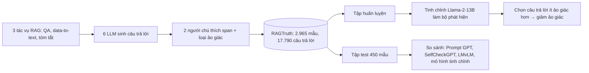

# Paper 16 Summary

## Citation

Tên bài: RAGTruth: A Hallucination Corpus for Developing Trustworthy Retrieval-Augmented Language Models
Tác giả: Cheng Niu, Yuanhao Wu, Juno Zhu, Siliang Xu, Kashun Shum, Randy Zhong, Juntong Song, Tong Zhang (NewsBreak; University of Illinois Urbana-Champaign)
Năm: 2024
Nguồn: Proceedings of the 62nd Annual Meeting of the Association for Computational Linguistics (ACL 2024), Volume 1: Long Papers, trang 10862–10878 — hội nghị hàng đầu, có bình duyệt
DOI/Link: https://aclanthology.org/2024.acl-long.585/ (DOI: 10.18653/v1/2024.acl-long.585)

## Problem

**Tóm tắt tổng quan.** Bài báo xây dựng RAGTruth — kho dữ liệu khoảng 18.000 câu trả lời sinh tự nhiên bởi 6 LLM trong bối cảnh RAG, được người chú thích ảo giác ở mức câu trả lời và mức từ/đoạn (span), phân thành 4 loại. Tác giả đo tần suất ảo giác của các LLM, đánh giá các phương pháp phát hiện ảo giác hiện có, và cho thấy Llama-2-13B tinh chỉnh trên RAGTruth đạt F1 phát hiện mức câu trả lời 78,7% — cao hơn prompt GPT-4-turbo (63,4%).

**Bối cảnh và động lực.** Dù có RAG, LLM vẫn sinh khẳng định không có căn cứ hoặc mâu thuẫn với tài liệu truy xuất. Các bộ dữ liệu ảo giác hiện có phần lớn là tổng hợp (cố ý kích hoạt ảo giác) nên khác ảo giác tự nhiên; các bộ chú thích thủ công thì nhỏ và không tập trung vào RAG. Do tỷ lệ ảo giác trong RAG tương đối thấp, cần nhiều công chú thích để có dữ liệu đủ lớn.

## Method

1. **Phân loại ảo giác trong RAG:** *Evident Conflict* (mâu thuẫn rõ: sai số, sai tên); *Subtle Conflict* (lệch nghĩa tinh vi, thay thuật ngữ); *Evident Baseless Info* (thêm thông tin bịa không có trong ngữ cảnh); *Subtle Baseless Info* (thêm suy diễn, cảm nhận không kiểm chứng được).
2. **Sinh câu trả lời:** ba tác vụ — hỏi đáp (MS MARCO, 3 đoạn truy xuất/câu), viết từ dữ liệu (Yelp, dữ liệu JSON + đánh giá), tóm tắt tin tức (CNN/Daily Mail + tin mới) — với 6 mô hình: GPT-3.5-turbo, GPT-4, Mistral-7B-Instruct, Llama-2-7B/13B/70B-chat.
3. **Chú thích:** mỗi câu trả lời do hai người độc lập đánh dấu span ảo giác; đồng thuận 91,8% ở mức câu trả lời và 78,8% ở mức span; người thứ ba xử lý khác biệt lớn. Thêm nhãn phụ `implicit_true` (thông tin có thể đúng nhưng không có trong ngữ cảnh — vẫn tính là ảo giác) và `due_to_null`.
4. **Phát hiện ảo giác:** so sánh prompt GPT-3.5/GPT-4-turbo, SelfCheckGPT, LMvLM và Llama-2-13B tinh chỉnh toàn phần (1 epoch, 4 GPU A100) để sinh ra các span ảo giác.
5. **Giảm ảo giác:** dùng bộ phát hiện để chọn giữa hai câu trả lời của hai mô hình.

## Dataset

2.965 mẫu (989 QA, 1.033 data-to-text, 943 tóm tắt), 17.790 câu trả lời; 43,1% câu trả lời có ảo giác; tổng 14.289 span ảo giác. Tập test: 450 mẫu (150 mỗi tác vụ). Công bố trên GitHub.

## Evaluation

Precision, Recall, F1 ở mức câu trả lời và mức span (tính chồng lấn ký tự); mật độ ảo giác (số span ảo giác trên 100 từ); tỷ lệ ảo giác sau khi chọn lọc câu trả lời.

## Results

- **Theo tác vụ:** data-to-text có tỷ lệ câu trả lời ảo giác cao nhất (68,6%), QA 29,1%, tóm tắt CNN/DM 30,9%.
- **Theo mô hình:** GPT-4-0613 thấp nhất (48 span trong QA, mật độ 0,06); Mistral-7B-Instruct có nhiều câu trả lời ảo giác nhất; với Llama-2, mô hình lớn hơn có mật độ ảo giác thấp hơn (trừ data-to-text).
- Loại “thông tin không có căn cứ” phổ biến hơn loại “mâu thuẫn”; ảo giác tăng theo độ dài câu trả lời và thường nằm ở cuối câu trả lời trong QA và tóm tắt.
- **Phát hiện mức câu trả lời (F1 tổng):** Prompt GPT-3.5 52,9%; Prompt GPT-4-turbo 63,4%; SelfCheckGPT 58,8%; LMvLM 49,4%; Llama-2-13B tinh chỉnh 78,7%.
- **Phát hiện mức span (F1 tổng):** GPT-4-turbo 28,3% (precision chỉ 18,4%); mô hình tinh chỉnh 52,7%. Ảo giác “rõ ràng” dễ phát hiện hơn ảo giác “tinh vi”.
- **Giảm ảo giác:** với Llama-2-7B và Mistral-7B, chọn câu trả lời không có span bị phát hiện giảm tỷ lệ ảo giác 63,2% (52,4 → 19,3); với GPT-3.5 và GPT-4 giảm 51,0% (9,8 → 4,8).

**Điểm mạnh.**

- Kho dữ liệu lớn, ảo giác tự nhiên, chú thích hai người ở mức span có báo cáo độ đồng thuận.
- Phân loại ảo giác riêng cho RAG, phân biệt mâu thuẫn và thông tin không căn cứ.
- Cho thấy mô hình nhỏ tinh chỉnh chuyên biệt có thể vượt GPT-4 dùng prompt trong phát hiện ảo giác.

## Limitations

**(a) Bài báo thừa nhận:** cần đánh giá khả năng tổng quát của bộ phát hiện trên dữ liệu và ngữ cảnh khác; chưa so sánh hiệu quả giữa chú thích thủ công và dữ liệu tổng hợp.

**(b) Quan sát:** chỉ tiếng Anh và ba tác vụ đời thường (không có pháp lý); phát hiện mức span vẫn thấp (F1 ~53%); chiến lược giảm ảo giác cần sinh nhiều câu trả lời, làm tăng chi phí; định nghĩa nghiêm ngặt coi mọi thông tin ngoài ngữ cảnh là ảo giác. Bài **không** đo độ trễ của bộ phát hiện.

## Relevance to our topic

Định nghĩa ảo giác của RAGTruth — mọi thông tin không có trong ngữ cảnh truy xuất đều là ảo giác, kể cả khi có thể đúng — trùng với nguyên tắc của Sys_3_4 với các trường số liệu (lệ phí, thời hạn). Kết quả “Evident Conflict thường là sai số, sai tên” và “data-to-text từ JSON có tỷ lệ ảo giác cao nhất (68,6%)” rất sát với Friendly Engine: diễn giải dữ liệu thủ tục có cấu trúc thành văn bản chính là kịch bản data-to-text.

**Kết luận.** RAGTruth cung cấp benchmark ảo giác tự nhiên quy mô lớn cho RAG, cho thấy ảo giác vẫn phổ biến (43,1% câu trả lời) và việc phát hiện, nhất là ở mức span, còn khó. Mô hình nhỏ tinh chỉnh trên dữ liệu chất lượng cao vượt các phương pháp dựa trên prompt và có thể dùng để giảm ảo giác. Hướng tiếp theo: đánh giá khả năng tổng quát và kết hợp dữ liệu thủ công với dữ liệu tổng hợp.

## Possible improvement

- Dùng bốn loại ảo giác của RAGTruth làm nhãn khi phân tích lỗi trên tập HOLDOUT của nhóm.
- Lưu ý xử lý giá trị rỗng (null) trong dữ liệu thủ tục — RAGTruth cho thấy LLM hay diễn giải null thành “không/false”.
- Khi mở rộng, có thể tinh chỉnh một mô hình nhỏ làm bộ phát hiện ảo giác tiếng Việt, bổ sung cho verifier luật.
