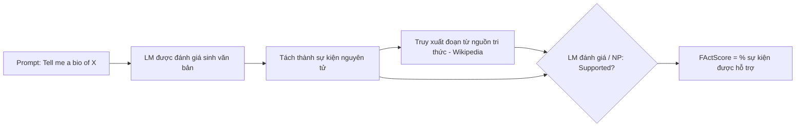

# Paper 17 Summary

## Citation

Tên bài: FActScore: Fine-grained Atomic Evaluation of Factual Precision in Long Form Text Generation
Tác giả: Sewon Min, Kalpesh Krishna, Xinxi Lyu, Mike Lewis, Wen-tau Yih, Pang Wei Koh, Mohit Iyyer, Luke Zettlemoyer, Hannaneh Hajishirzi (University of Washington; UMass Amherst; Allen Institute for AI; Meta AI)
Năm: 2023
Nguồn: Proceedings of the 2023 Conference on Empirical Methods in Natural Language Processing (EMNLP 2023), trang 12076–12100 — hội nghị hàng đầu, có bình duyệt
DOI/Link: https://aclanthology.org/2023.emnlp-main.741/ (DOI: 10.18653/v1/2023.emnlp-main.741)

## Problem

**Tóm tắt tổng quan.** Bài báo đề xuất FActScore — thước đo độ chính xác sự kiện của văn bản dài, bằng cách tách văn bản thành các *sự kiện nguyên tử* (atomic facts) và tính tỷ lệ sự kiện được một nguồn tri thức đáng tin hỗ trợ. Đánh giá thủ công cho thấy InstructGPT, ChatGPT và PerplexityAI (có tìm kiếm) chỉ đạt lần lượt 42,5%, 58,3% và 71,5%. Tác giả xây dựng bộ ước lượng tự động có sai số dưới 2% so với người, và dùng nó đánh giá 6.500 văn bản của 13 đối tượng (chi phí tương đương 26.000 USD nếu thuê người chấm).

**Bối cảnh và động lực.** Văn bản dài trộn lẫn thông tin đúng và sai (theo bài, mỗi câu của ChatGPT trung bình có 4,4 mẩu thông tin, 40% câu chứa cả phần được hỗ trợ lẫn không), nên đánh giá nhị phân đúng/sai là không đủ, còn đánh giá thủ công thì đắt. Các nghiên cứu trước tập trung vào câu trả lời ngắn, mô hình chuyên tác vụ, hoặc chỉ kiểm tra trích dẫn.

## Method

1. **Định nghĩa:** f(y) = tỷ lệ sự kiện nguyên tử trong câu trả lời y được nguồn tri thức C hỗ trợ; FActScore của mô hình là trung bình trên các câu trả lời (bỏ qua trường hợp từ chối trả lời). Tính đúng được định nghĩa *tương đối theo nguồn tri thức* chứ không phải “chân lý toàn cục”. Giả định: việc được hỗ trợ là không tranh cãi; các sự kiện có trọng số như nhau; nguồn tri thức không tự mâu thuẫn.
2. **Đánh giá thủ công:** sinh tiểu sử cho 183 người lấy từ Wikidata (phân tầng theo độ hiếm); InstructGPT đề xuất danh sách sự kiện nguyên tử, người chú thích chỉnh sửa; nhóm khác gán nhãn Supported / Not-supported / Irrelevant dựa trên Wikipedia tiếng Anh; chi phí khoảng 4 USD mỗi văn bản.
3. **Bộ ước lượng tự động:** tách sự kiện bằng InstructGPT, rồi kiểm từng sự kiện bằng LM đánh giá (Inst-LLaMA 7B hoặc ChatGPT) theo bốn biến thể: không ngữ cảnh; truy xuất → LM (GTR lấy đoạn Wikipedia); xác suất phi tham số (NP); và kết hợp truy xuất → LM + NP.

## Dataset

Đánh giá thủ công: tiểu sử của 183 người. Đánh giá tự động: 500 người khác (không trùng) × 12 LM + tiểu sử do người viết (DBPedia). Nguồn tri thức: Wikipedia tiếng Anh.

## Evaluation

FActScore; tỷ lệ trả lời (không từ chối); số sự kiện trung bình mỗi câu trả lời; với bộ ước lượng: Error Rate (chênh lệch so với FActScore của người) và việc bảo toàn thứ hạng giữa các mô hình. Độ đồng thuận giữa người chú thích (trên 10% dữ liệu): 96%, 90%, 88% cho ba mô hình.

## Results

- **FActScore thủ công:** InstructGPT 42,5%; ChatGPT 58,3%; PerplexityAI 71,5%. Trung bình 26,3 / 34,7 / 40,8 sự kiện mỗi câu trả lời.
- Độ chính xác giảm mạnh khi thực thể hiếm hơn (ChatGPT khoảng 80% → 16%); sự kiện ở phần sau của văn bản sai nhiều hơn.
- Với PerplexityAI, trích dẫn có rất ít tương quan với độ chính xác: 36,0% câu được hỗ trợ và 37,6% câu không được hỗ trợ có trích dẫn. Phân tích 30 lỗi: 33,3% mâu thuẫn trong một câu (số, ngày, thực thể), 23,3% mâu thuẫn ở mức trang, 16,7% nội dung chủ quan.
- **Bộ ước lượng:** truy xuất giúp rõ rệt; Inst-LLaMA truy xuất → LM + NP có Error Rate 1,4 (InstructGPT) và 0,4 (ChatGPT); ChatGPT làm bộ đánh giá có xu hướng đánh giá quá cao (gán Supported cho sự kiện không được hỗ trợ). Hai bộ ước lượng tốt nhất tương quan Pearson r = 0,99 trên 13 đối tượng.
- **13 đối tượng:** mọi LM đều kém con người; GPT-4 và ChatGPT tương đương nhau và tốt hơn các mô hình mở; trong cùng họ, mô hình lớn hơn chính xác hơn.

**Điểm mạnh.**

- Đơn vị đánh giá chi tiết (sự kiện nguyên tử) khắc phục nhược điểm của đánh giá nhị phân theo câu.
- Định nghĩa tính đúng tương đối theo nguồn tri thức đáng tin — phù hợp các miền có nguồn chuẩn.
- Có cả đánh giá thủ công chất lượng cao lẫn bộ ước lượng tự động đã được kiểm định; công bố công cụ (`pip install factscore`).

## Limitations

**(a) Bài báo thừa nhận:** chỉ thử nghiệm trên tiểu sử và Wikipedia; không áp dụng cho nội dung mang tính sắc thái, gây tranh cãi, hoặc khi nguồn tri thức tự mâu thuẫn; bộ ước lượng chưa hoàn hảo ở từng phán đoán riêng lẻ; chỉ đo độ chính xác (precision), không đo độ bao phủ (recall) — mô hình từ chối nhiều hoặc nói ít có thể được điểm cao.

**(b) Quan sát:** bước tách sự kiện phụ thuộc LLM (InstructGPT); mọi sự kiện được coi quan trọng như nhau; chỉ tiếng Anh. Bài **không** đánh giá văn bản có cấu trúc số liệu (bảng phí, thời hạn) hay miền pháp lý.

## Relevance to our topic

Nguyên lý “tách câu trả lời thành mệnh đề nguyên tử rồi kiểm từng mệnh đề với nguồn chuẩn” chính là nguyên lý của verifier trong Sys_3_4: mỗi ý về lệ phí, thời hạn, hồ sơ được đối chiếu với bản ghi thủ tục. Hai phát hiện hỗ trợ trực tiếp thiết kế của nhóm: (1) trích dẫn không đảm bảo đúng (PerplexityAI), nên phải kiểm nội dung chứ không chỉ gắn nguồn; (2) cần báo cáo kèm tỷ lệ từ chối, vì precision có thể bị “làm đẹp” bằng cách nói ít.

**Kết luận.** FActScore cung cấp cách đánh giá độ chính xác sự kiện chi tiết và có thể tự động hóa, cho thấy ngay cả LLM thương mại có tìm kiếm vẫn mắc nhiều lỗi sự kiện, đặc biệt với thông tin hiếm. Hướng tiếp theo tác giả đề xuất: đo recall, cải thiện bộ ước lượng và dùng FActScore để sửa lỗi văn bản sinh ra.

## Possible improvement

- Xây dựng “FActScore cho thủ tục hành chính”: nguồn tri thức là cơ sở dữ liệu thủ tục, sự kiện nguyên tử là các trường (phí, thời hạn, cơ quan, hồ sơ), báo cáo kèm tỷ lệ từ chối/hỏi lại.
- Bổ sung đo recall (câu trả lời có bỏ sót thông tin bắt buộc không) — hạn chế mà bài nêu.
- Gán trọng số cao hơn cho sự kiện số liệu vì lỗi số tiền nghiêm trọng hơn lỗi diễn đạt.
