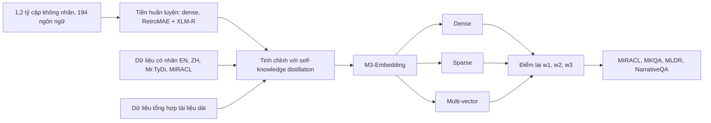

# Paper 19 Summary

## Citation

Tên bài: M3-Embedding: Multi-Linguality, Multi-Functionality, Multi-Granularity Text Embeddings Through Self-Knowledge Distillation
Tác giả: Jianlv Chen, Shitao Xiao, Peitian Zhang, Kun Luo, Defu Lian, Zheng Liu (BAAI; Đại học Khoa học và Công nghệ Trung Quốc)
Năm: 2024
Nguồn: Findings of the Association for Computational Linguistics: ACL 2024, trang 2318–2335 — hội nghị hàng đầu về NLP, có bình duyệt
DOI/Link: https://aclanthology.org/2024.findings-acl.137/ (DOI: 10.18653/v1/2024.findings-acl.137)

## Problem

**Tóm tắt tổng quan.** Bài báo giới thiệu M3-Embedding (mô hình BGE-M3), một mô hình embedding đa ngôn ngữ (hơn 100 ngôn ngữ), đa chức năng (dense, sparse/lexical và multi-vector trong cùng một mô hình) và đa độ dài (từ câu đến tài liệu 8.192 token). Đóng góp kỹ thuật: chưng cất tri thức tự thân (self-knowledge distillation), chiến lược batching hiệu quả và bộ dữ liệu huấn luyện được tuyển chọn. Mô hình đạt kết quả tốt nhất lúc công bố trên MIRACL, MKQA và truy xuất tài liệu dài.

**Bối cảnh và động lực.** Tác giả nêu ba hạn chế của embedding hiện có: phần lớn chỉ dành cho tiếng Anh; thường chỉ huấn luyện cho một kiểu truy xuất, trong khi hệ thống IR thực tế kết hợp nhiều phương pháp; và khó huấn luyện bộ truy xuất tài liệu dài do chi phí cao nên đa số mô hình chỉ hỗ trợ đầu vào ngắn.

## Method

1. **Ba kiểu truy xuất từ cùng một bộ mã hóa:** dense dùng embedding chuẩn hóa của token [CLS] (tích vô hướng); lexical/sparse tính trọng số từng token qua Relu(Wlex^T H), điểm là tổng tích trọng số các token trùng nhau; multi-vector theo kiểu ColBERT (late-interaction) trên toàn bộ vector đầu ra.
2. **Truy xuất lai:** điểm xếp hạng srank = w1·sdense + w2·slex + w3·smul; trọng số tùy bài toán (ví dụ w1=1, w2=0,3, w3=0 cho Dense+Sparse trên MIRACL).
3. **Self-knowledge distillation:** điểm tích hợp sinter = w1·sdense + w2·slex + w3·smul làm “giáo viên” cho từng kiểu truy xuất; hàm mất mát cuối là tổ hợp tuyến tính của InfoNCE và mất mát chưng cất, nhằm giảm xung đột giữa các mục tiêu.
4. **Huấn luyện nhiều giai đoạn:** XLM-RoBERTa điều chỉnh bằng RetroMAE; tiền huấn luyện trên 1,2 tỷ cặp văn bản không nhãn (194 ngôn ngữ, 2.655 tương ứng đa ngôn ngữ) chỉ cho dense; sau đó tinh chỉnh với dữ liệu có nhãn (tiếng Anh, tiếng Trung, Mr.TyDi/MIRACL) và dữ liệu tổng hợp tài liệu dài (GPT-3.5 sinh câu hỏi), có hard negative theo ANCE.
5. **Efficient batching:** nhóm dữ liệu theo độ dài, chia lô con kèm gradient checkpointing, broadcast embedding giữa các GPU; với văn bản 8.192 token, kích thước batch tăng hơn 20 lần.
6. **MCLS:** chèn nhiều token [CLS] vào tài liệu dài khi suy luận và lấy trung bình, không cần huấn luyện thêm.

## Dataset

Huấn luyện: 1,2 tỷ cặp không nhãn (Wikipedia, S2ORC, xP3, mC4, CC-News, MTP và câu song song NLLB, CCMatrix); dữ liệu có nhãn gồm 8 bộ tiếng Anh (HotpotQA, TriviaQA, NQ, MS MARCO, COLIEE, PubMedQA, SQuAD, NLI), 7 bộ tiếng Trung (trong đó có LawGPT, LeCaRDv2), cùng Mr.TyDi và MIRACL; dữ liệu tổng hợp MultiLongDoc. Đánh giá: MIRACL (18 ngôn ngữ), MKQA (25 ngôn ngữ không phải tiếng Anh, truy xuất trên Wikipedia tiếng Anh), MLDR (tài liệu dài đa ngôn ngữ) và NarrativeQA (tiếng Anh).

## Evaluation

nDCG@10 cho MIRACL, MLDR và NarrativeQA (Recall@100 phụ); Recall@100 cho MKQA. Baseline: BM25 (dùng cùng tokenizer XLM-R), mDPR, mContriever, mE5-large, E5-mistral-7b, OpenAI text-embedding-3-large và ada-002, jina-embeddings-v2-base-en. Multi-vector dùng để rerank top-200 từ dense.

## Results

- **MIRACL (nDCG@10, trung bình):** BM25 31,9; mE5-large 66,6; M3 Dense 69,2, Sparse 53,9, Multi-vec 70,5, Dense+Sparse 70,4, All 71,5.
- **MKQA (Recall@100, trung bình):** BM25 39,9; mE5-large 70,9; M3 Dense 75,1, All 75,5. Với tiếng Việt: BM25 46,6, mE5-large 75,4, M3 Dense 76,6, All 76,9. Sparse yếu hơn ở bài toán xuyên ngôn ngữ vì truy vấn và đoạn văn khác ngôn ngữ nên ít từ trùng.
- **MLDR (nDCG@10, trung bình):** Dense 52,5; Sparse 62,2; Multi-vec 57,6; Dense+Sparse 64,8; All 65,0 — sparse tốt hơn dense khoảng 10 điểm. NarrativeQA: Dense 48,7, Sparse 57,5, All 61,7.
- **Ablation (MIRACL dev):** bỏ self-knowledge distillation làm sparse giảm từ 53,9 xuống 36,7 (dense 69,2 → 68,7; multi-vec 70,5 → 69,3). Huấn luyện nhiều giai đoạn: chỉ fine-tune 60,5; RetroMAE + fine-tune 66,1; RetroMAE + dữ liệu không nhãn + fine-tune 69,2. MCLS nâng dense không tinh chỉnh tài liệu dài từ 41,2 lên 45,0.

**Điểm mạnh.**

- Một mô hình phục vụ đồng thời dense, sparse và multi-vector, nên truy xuất lai không cần nhiều mô hình riêng; công bố mô hình, mã và dữ liệu.
- Phân tích rõ đóng góp của từng chức năng (sparse mạnh ở tài liệu dài, dense mạnh ở đa ngôn ngữ, kết hợp tốt nhất) và từng thành phần huấn luyện bằng ablation.
- Có kết quả riêng cho tiếng Việt trong MKQA và hỗ trợ đầu vào 8.192 token, phù hợp văn bản quy phạm dài.

## Limitations

**(a) Bài báo thừa nhận:** khả năng tổng quát hóa sang tập dữ liệu và tình huống thực tế khác ngoài MIRACL/MKQA cần được kiểm chứng thêm; xử lý tài liệu cực dài (gần hoặc vượt 8.192 token) tốn tài nguyên và chưa được nghiên cứu đủ; tuyên bố hỗ trợ hơn 100 ngôn ngữ nhưng chưa phân tích kỹ chênh lệch hiệu năng giữa các ngôn ngữ; dữ liệu phân bố không đều nên hiệu năng có thể khác nhau giữa các ngôn ngữ.

**(b) Quan sát:** không đánh giá trên văn bản pháp lý hay hành chính (chỉ MIRACL, MKQA, MLDR, NarrativeQA); trọng số w1–w3 chọn thủ công theo từng benchmark; multi-vector chi phí cao nên chỉ dùng rerank top-200; không đo độ trễ và chi phí lưu trữ cho từng chế độ.

## Relevance to our topic

M3-Embedding chính là nền tảng embedding mà Friendly Engine của Sys_3_4 sử dụng (BGE-M3). Bài cho thấy kết hợp dense + sparse + multi-vector tốt hơn từng kiểu riêng (MIRACL 71,5 so với 69,2 của dense) và có kết quả tốt trên tiếng Việt, hỗ trợ lựa chọn truy hồi lai và reranker của nhóm. Đầu vào 8.192 token cho phép mã hóa nguyên một thủ tục hành chính dài. Quan sát “sparse mạnh hơn dense ở tài liệu dài” gợi ý giữ nhánh từ vựng trong cả hai engine. Do không đánh giá trên văn bản pháp lý, nhóm vẫn phải tự đo trên tập thủ tục của mình.

**Kết luận.** M3-Embedding cho thấy một mô hình duy nhất có thể cung cấp ba kiểu truy xuất, và kết hợp chúng cho chất lượng tốt nhất trên các benchmark đa ngôn ngữ, xuyên ngôn ngữ và tài liệu dài. Với dự án, đây là cơ sở để chọn BGE-M3 và thiết kế điểm lai, nhưng cần kiểm chứng trong miền thủ tục hành chính tiếng Việt.

## Possible improvement

- Thử trực tiếp ba chế độ (dense, sparse, multi-vector) và điểm lai trên tập thủ tục Việt Nam, so sánh với pipeline RRF + reranker hiện tại bằng Recall@k, MRR và độ trễ.
- Tinh chỉnh trọng số w1–w3 theo loại câu hỏi (tra cứu thủ tục ngắn so với văn bản dài) bằng tập validation riêng thay vì chọn tay.
- Tinh chỉnh BGE-M3 bằng câu hỏi tổng hợp từ LLM trên văn bản thủ tục (kết hợp ý tưởng của STARD) và kiểm tra bằng ablation giống bài.
