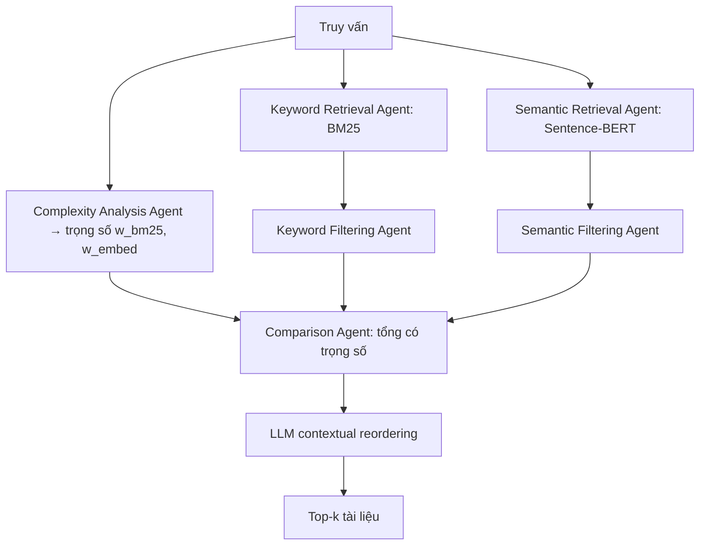

# Paper 20 Summary

## Citation

Tên bài: Optimizing Retrieval-Augmented Generation with Multi-Agent Hybrid Retrieval
Tác giả: Hediyeh Baban, Sai Abhishek Pidaparthi, Samaksh Gulati, Aashutosh Nema (Dell Technologies)
Năm: 2025
Nguồn: Workshop GenAIRecP 2025 (Generative AI for Recommendation and Personalization) tổ chức cùng ACM SIGKDD 2025 (KDD ’25, Toronto) — workshop có bình duyệt. Bản PDF dùng mẫu ACM KDD ’25; DOI in trên PDF (10.1145/3690624) là DOI chung của kỷ yếu mẫu, không phải DOI riêng của bài.
DOI/Link: https://genai-personalization.github.io/assets/papers/GenAIRecP2025/11_Baban.pdf

## Problem

**Tóm tắt tổng quan.** Bài báo đề xuất một quy trình RAG lai “agentic” trên LangGraph: hai nhánh truy xuất song song (BM25 và embedding Sentence-BERT), mỗi nhánh có tác tử truy xuất và tác tử lọc; một tác tử phân tích độ phức tạp gán trọng số cho hai nhánh; tác tử so sánh hợp nhất điểm theo trọng số; cuối cùng LLM sắp xếp lại theo ngữ cảnh. Trên kho 100.000 tài liệu và 500 truy vấn, hệ thống giảm thời gian truy xuất trung bình từ 43 giây xuống 11 giây (nhanh gấp 4 lần) và tăng Top-10 accuracy từ 85% lên 92% so với baseline lai tĩnh.

**Bối cảnh và động lực.** Truy xuất từ khóa (BM25) mạnh với khớp chính xác và truy vấn ngắn nhưng bỏ lỡ ngữ nghĩa; truy xuất embedding nắm ngữ nghĩa nhưng có thể bỏ qua khớp chính xác và thuật ngữ chuyên ngành. Các hệ lai hiện có thường kết hợp tĩnh, chưa điều chỉnh theo loại truy vấn và chưa tối ưu độ trễ.

## Method

1. **Truy xuất lai:** BM25 cho khớp chính xác; Sentence-BERT (all-mpnet-base-v2) cho ngữ nghĩa; hợp nhất có trọng số (mặc định 30% BM25 / 70% embedding, chọn theo độ chính xác trên tập kiểm định).
2. **Kiến trúc tác tử (DAG trên LangGraph):** Keyword Retrieval Agent + Keyword Filtering Agent (TF-IDF và heuristic miền); Semantic Retrieval Agent + Semantic Filtering Agent (ngưỡng cosine, kiểm tra mật độ chủ đề); Complexity Analysis Agent đánh giá cấu trúc ngôn ngữ và số chủ đề của truy vấn để gán trọng số (truy vấn đơn giản nghiêng về BM25 để giảm độ trễ); Comparison Agent hợp nhất điểm.
3. **Sắp xếp lại theo ngữ cảnh:** LLM (LangChain contextual reordering) xử lý top-1.000 tài liệu.
4. **Giao thức truyền thông điệp:** điểm số từng phần, cờ ngữ cảnh, tín hiệu lỗi/thử lại, chạy bất đồng bộ song song.

## Dataset

Kho 100.000 tài liệu (trung bình 400 token) gồm tài liệu kỹ thuật nội bộ doanh nghiệp, bài báo arXiv (khoa học máy tính, AI, hệ thống dữ liệu) và bài hướng dẫn xử lý sự cố IT công khai. 500 truy vấn chú thích thủ công: đơn giản 30%, trung bình 40%, phức tạp 30%; nhãn liên quan top-10 do ba người gán, lấy theo đa số. Dữ liệu thật không công bố; tác giả hứa phát hành bản tổng hợp mô phỏng.

## Evaluation

Top-10 Accuracy (tỷ lệ truy vấn có ít nhất một tài liệu đúng trong top-10), F1 trên top-10, độ trễ trung bình mỗi truy vấn (gồm điều phối và rerank); kiểm định t ghép cặp hai phía (α = 0,05). Baseline: chỉ BM25, chỉ embedding, lai tĩnh 50/50 không có tác tử và không sắp xếp lại.

## Results

- **Top-10 accuracy:** lai tĩnh 85% → agentic 92% (+7 điểm).
- **Độ trễ:** 43 giây → 11 giây mỗi truy vấn (nhanh gấp 4 lần).
- **Kiểm định t:** so với cả ba baseline, cải thiện Top-10 accuracy và F1 đều có ý nghĩa (p < 0,001; t từ 5,47 đến 9,27).
- **Ablation trọng số:** 30/70 (BM25/embedding) → accuracy 92%, F1 0,89; 50/50 → 88%, 0,85; 70/30 → 83%, 0,81.
- Phân tích mở rộng quy mô chỉ ở mức sơ bộ, trình bày bằng biểu đồ.

**Điểm mạnh.**

- Kiến trúc mô-đun rõ ràng, có giao thức xử lý lỗi và thử lại giữa các tác tử.
- Có kiểm định thống kê ghép cặp và ablation về trọng số hợp nhất.
- Đề cập trực tiếp đánh đổi độ trễ – độ chính xác trong bối cảnh doanh nghiệp.

## Limitations

**(a) Bài báo thừa nhận:** phụ thuộc chất lượng embedding tiền huấn luyện; cần tối ưu thêm cho triển khai thời gian thực quy mô lớn; chi phí điều phối giữa nhiều tác tử.

**(b) Quan sát:** không có ablation riêng cho từng tác tử hay cho bước LLM sắp xếp lại, nên không rõ cải thiện đến từ đâu; độ trễ tuyệt đối (11–43 giây mỗi truy vấn) rất cao so với truy xuất thông thường và nguyên nhân không được giải thích; chỉ một baseline lai tĩnh, không so với rerank cross-encoder hay RRF; dữ liệu là tài liệu IT nội bộ, không công bố. Bản PDF còn lỗi biên tập (tham chiếu “Section ??”, đánh số dòng của bản nộp). Đây là bài workshop ngắn.

## Relevance to our topic

Kết quả “trọng số nghiêng về embedding cho tốt nhất trên truy vấn phức tạp, còn truy vấn đơn giản nên nghiêng về BM25 để giảm độ trễ” tương ứng trực tiếp với thiết kế định tuyến của Sys_3_4: câu tra cứu một thủ tục → Strict Engine (từ vựng, nhanh); câu hội thoại/so sánh → Friendly Engine (dense + RRF). Bài là tham chiếu cho việc gán trọng số và phân loại độ phức tạp truy vấn.

**Kết luận.** Bài báo cho thấy kết hợp BM25 và embedding với trọng số thích ứng theo độ phức tạp, điều phối song song bằng tác tử và LLM sắp xếp lại có thể tăng độ chính xác top-10 và giảm độ trễ so với lai tĩnh trên kho tài liệu doanh nghiệp. Do thiếu ablation từng thành phần và dữ liệu không công khai, kết quả nên được xem là bằng chứng sơ bộ. Hướng tiếp theo: điều chỉnh trọng số động và tối ưu triển khai quy mô lớn.

## Possible improvement

- Sys_3_4 có thể báo cáo một ablation trọng số tương tự cho bước hợp nhất của Friendly Engine (RRF so với tổng có trọng số).
- Giữ bộ định tuyến bằng luật thay vì nhiều tác tử LLM để tránh chi phí điều phối và độ trễ lớn như bài báo ghi nhận.
- Bổ sung ablation từng thành phần — điều bài báo còn thiếu.
