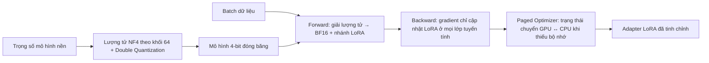

# Paper 21 Summary

## Citation

Tên bài: QLoRA: Efficient Finetuning of Quantized LLMs
Tác giả: Tim Dettmers, Artidoro Pagnoni, Ari Holtzman, Luke Zettlemoyer (University of Washington)
Năm: 2023
Nguồn: Advances in Neural Information Processing Systems 36 (NeurIPS 2023) — hội nghị hàng đầu, có bình duyệt
DOI/Link: https://proceedings.neurips.cc/paper_files/paper/2023/hash/1feb87871436031bdc0f2beaa62a049b-Abstract-Conference.html (bản mở: https://arxiv.org/abs/2305.14314)

## Problem

**Tóm tắt tổng quan.** QLoRA cho phép tinh chỉnh LLM 65B tham số trên một GPU 48GB mà vẫn giữ hiệu năng như tinh chỉnh đầy đủ 16-bit. Cơ chế: lan truyền gradient qua mô hình nền đã đóng băng và lượng tử 4-bit vào các adapter hạng thấp (LoRA). Ba đổi mới chính: kiểu dữ liệu 4-bit NormalFloat (NF4), lượng tử kép (Double Quantization) và Paged Optimizers. Họ mô hình Guanaco tinh chỉnh bằng QLoRA đạt 99,3% hiệu năng của ChatGPT trên Vicuna benchmark (theo GPT-4 chấm) sau 24 giờ trên một GPU.

**Bối cảnh và động lực.** Tinh chỉnh 16-bit thông thường LLaMA 65B cần hơn 780GB bộ nhớ GPU. Các phương pháp lượng tử hóa trước đó chỉ dùng được khi suy luận và hỏng khi huấn luyện. Theo bài báo, đây là lần đầu chứng minh có thể tinh chỉnh mô hình lượng tử 4-bit mà không giảm hiệu năng.

## Method

1. **NF4:** kiểu dữ liệu 4-bit tối ưu về lý thuyết thông tin cho trọng số phân phối chuẩn quanh 0 — mỗi khoảng lượng tử chứa số giá trị kỳ vọng bằng nhau, có biểu diễn chính xác cho số 0.
2. **Double Quantization:** lượng tử tiếp các hằng số lượng tử (FP8, kích thước khối 256), giảm từ 0,5 xuống 0,127 bit mỗi tham số (tiết kiệm khoảng 3GB với mô hình 65B).
3. **Paged Optimizers:** dùng bộ nhớ hợp nhất của NVIDIA để chuyển trạng thái optimizer sang RAM CPU khi GPU hết bộ nhớ, tránh lỗi do đột biến bộ nhớ khi gradient checkpointing.
4. **QLoRA:** trọng số lưu ở NF4, giải lượng tử về BF16 khi tính toán; chỉ tính gradient cho tham số LoRA. Phát hiện quan trọng: phải đặt LoRA ở **mọi lớp tuyến tính** mới đạt hiệu năng 16-bit; hạng r ít ảnh hưởng.

## Dataset

So sánh với tinh chỉnh 16-bit: GLUE (RoBERTa-large), Super-NaturalInstructions (T5 80M–11B), MMLU 5-shot sau khi tinh chỉnh LLaMA 7B–65B trên Alpaca và FLAN v2; perplexity Pile Common Crawl. Nghiên cứu tinh chỉnh chỉ dẫn với 8 bộ: OASST1, HH-RLHF, Alpaca, self-instruct, unnatural-instructions, FLAN v2, Chip2, Longform. Đánh giá chatbot: Vicuna (80 prompt) và OA benchmark (953 truy vấn). Tổng cộng hơn 1.000 mô hình được tinh chỉnh.

## Evaluation

Accuracy (GLUE, MMLU 5-shot), RougeL (Super-NaturalInstructions), perplexity; điểm tương đối so với ChatGPT do GPT-4 chấm; Elo từ so sánh cặp do người (Amazon Mechanical Turk) và GPT-4 đánh giá, lặp 10.000 lần với thứ tự ngẫu nhiên.

## Results

- **Kiểu dữ liệu 4-bit (perplexity trung bình):** Int4 34,34; Float4 31,07 / 29,48; NF4 + DQ 27,41 (thấp nhất).
- **Tái tạo hiệu năng 16-bit:** GLUE — BF16 88,6, QLoRA NF4 + DQ 88,6; MMLU trung bình (LLaMA 7B–65B) — BF16 53,0, NF4 + DQ 53,1, FP4 52,2 (FP4 thua khoảng 1 điểm).
- **Bộ nhớ:** Guanaco 7B cần 5GB, 13B 10GB, 33B 21GB, 65B 41GB.
- **Vicuna benchmark (so với ChatGPT, GPT-4 chấm):** Guanaco 65B 99,3%, 33B 97,8%, 13B 90,4%, 7B 87,0%; Vicuna 13B (16-bit, 26GB) 94,9%. Khoảng tin cậy rộng (±4–5%).
- **Elo (người chấm, Vicuna):** GPT-4 1176; Guanaco-65B 1023; Guanaco-7B 1010; Guanaco-33B 1009; ChatGPT-3.5 916.
- **Chất lượng dữ liệu quan trọng hơn kích thước:** OASST1 (khoảng 9K mẫu) cho chatbot tốt hơn FLAN v2 (450K mẫu lấy mẫu con), nhưng FLAN v2 lại tốt nhất trên MMLU — tức hiệu năng MMLU và hiệu năng chatbot không đi cùng nhau.
- **Đồng thuận đánh giá:** GPT-4 và người đồng thuận vừa ở mức hệ thống (Kendall τ = 0,43; Spearman r = 0,55), yếu ở mức từng mẫu (Fleiss κ = 0,25); GPT-4 có thiên lệch thứ tự.
- **Phân tích định tính:** Guanaco tự tin trả lời sai với câu hỏi sự kiện hiếm, yếu toán, và bị lộ “từ khóa bí mật” chỉ với một mẹo chèn lệnh đơn giản.

**Điểm mạnh.**

- Đột phá về khả năng tiếp cận: tinh chỉnh mô hình lớn trên phần cứng đơn lẻ, kèm mã nguồn và CUDA kernel tích hợp vào Hugging Face.
- Thực nghiệm quy mô rất lớn (hơn 1.000 mô hình), có ablation về kiểu dữ liệu và vị trí đặt LoRA.
- Phân tích thẳng thắn về độ tin cậy của benchmark và của GPT-4 khi làm giám khảo.

## Limitations

**(a) Bài báo thừa nhận:** chưa chứng minh QLoRA bằng tinh chỉnh đầy đủ 16-bit ở quy mô 33B/65B; chưa đánh giá trên BigBench, RAFT, HELM; đánh giá AI có trách nhiệm (thiên kiến) còn hạn chế; chưa thử độ chính xác bit khác (ví dụ 3-bit) hay phương pháp PEFT khác.

**(b) Quan sát:** đánh giá chatbot phụ thuộc nhiều vào GPT-4 với độ đồng thuận mức mẫu thấp; Vicuna chỉ 80 prompt; không đo tốc độ suy luận của mô hình 4-bit khi triển khai; không có đánh giá tiếng Việt hay miền pháp lý.

## Relevance to our topic

Sys_3_4 triển khai hoàn toàn cục bộ (Ollama/vLLM), phần cứng hạn chế. QLoRA là cơ sở kỹ thuật cho hai hướng của nhóm: (1) chạy mô hình lượng tử 4-bit với bộ nhớ thấp (7B ≈ 5GB); (2) nếu cần tinh chỉnh Qwen trên dữ liệu thủ tục, có thể làm trên một GPU. Phát hiện “mô hình 4-bit vẫn tự tin trả lời sai sự kiện hiếm và dễ bị chèn lệnh” củng cố lý do Sys_3_4 không để LLM tự trả lời số liệu và có tầng chống chèn lệnh.

**Kết luận.** QLoRA chứng minh tinh chỉnh 4-bit với NF4, lượng tử kép và paged optimizer có thể tái tạo hiệu năng 16-bit trong khi giảm mạnh bộ nhớ, mở đường cho tinh chỉnh mô hình lớn trên phần cứng phổ thông. Bài cũng cảnh báo các benchmark chatbot và việc dùng GPT-4 làm giám khảo còn nhiều bất định. Hướng tiếp theo: kiểm chứng ở quy mô lớn hơn, độ chính xác bit thấp hơn và phương pháp adapter khác.

## Possible improvement

- Nếu tinh chỉnh, đặt LoRA ở mọi lớp tuyến tính và dùng dữ liệu nhỏ nhưng chất lượng cao (hỏi-đáp thủ tục đã kiểm duyệt) theo bài học “chất lượng hơn số lượng”.
- Đánh giá mô hình tinh chỉnh bằng benchmark sát nhiệm vụ (bộ câu hỏi thủ tục), không chỉ benchmark tổng quát như MMLU.
- Đo riêng độ trễ và chất lượng giữa các mức lượng tử (4-bit so với 8-bit) trên máy chủ của nhóm.
