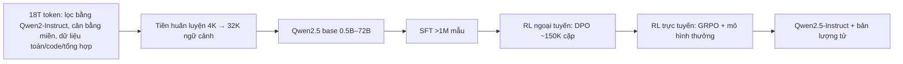

# Paper 22 Summary

## Citation

Tên bài: Qwen2.5 Technical Report
Tác giả: Qwen Team (Alibaba Group) — An Yang, Baosong Yang, Beichen Zhang và cộng sự
Năm: 2024 (bản v2: 1/2025)
Nguồn: Báo cáo kỹ thuật trên arXiv (arXiv:2412.15115) — **không phải bài hội nghị/tạp chí có bình duyệt**. Nhóm giữ lại vì đây là tài liệu chính thức, duy nhất mô tả mô hình nền Qwen2.5 mà hệ thống Sys_3_4 sử dụng; trọng số mô hình công khai và được cộng đồng kiểm chứng độc lập rộng rãi.
DOI/Link: https://arxiv.org/abs/2412.15115 (DOI arXiv: 10.48550/arXiv.2412.15115)

## Problem

**Tóm tắt tổng quan.** Báo cáo giới thiệu dòng LLM Qwen2.5 gồm bảy kích thước trọng số mở (0.5B, 1.5B, 3B, 7B, 14B, 32B, 72B — bản base và instruct, kèm bản lượng tử) và hai mô hình MoE độc quyền (Qwen2.5-Turbo, Qwen2.5-Plus). Cải tiến chính: dữ liệu tiền huấn luyện tăng từ 7 lên 18 nghìn tỷ token; hậu huấn luyện với hơn 1 triệu mẫu SFT cùng RL nhiều giai đoạn (DPO ngoại tuyến, GRPO trực tuyến). Theo báo cáo, Qwen2.5-72B-Instruct cạnh tranh với Llama-3-405B-Instruct dù nhỏ hơn khoảng 5 lần, và Qwen2.5-7B-Instruct vượt Gemma2-9B-IT và Llama3.1-8B-Instruct ở hầu hết tác vụ, trừ IFEval.

**Bối cảnh và động lực.** Mô hình trọng số mở đang giúp phổ cập LLM nhưng các kích thước trung bình (3B, 14B, 32B) phù hợp môi trường tài nguyên hạn chế còn ít. Qwen2 có hạn chế về độ dài sinh (2K token), hỗ trợ dữ liệu có cấu trúc và dùng công cụ. Qwen2.5 nhắm cải thiện theo ba hướng: kích thước, dữ liệu và khả năng sử dụng.

## Method

1. **Kiến trúc:** Transformer decoder với Grouped Query Attention, SwiGLU, RoPE, QKV bias, RMSNorm; tokenizer byte-level BPE 151.643 token, mở rộng control token từ 3 lên 22 (thêm token cho công cụ). Bản 7B: 28 lớp, 28/4 head (Q/KV), ngữ cảnh 128K, sinh tối đa 8K token, giấy phép Apache 2.0.
2. **Tiền huấn luyện:** dùng Qwen2-Instruct lọc và chấm chất lượng dữ liệu đa ngôn ngữ; tích hợp dữ liệu toán và lập trình; dữ liệu tổng hợp được lọc bằng mô hình thưởng; giảm tỷ trọng miền dư thừa (thương mại điện tử, mạng xã hội), tăng miền giá trị cao; xây luật tỷ lệ (scaling law) cho siêu tham số; mở rộng ngữ cảnh 4K → 32K, sau đó dùng YARN và DCA để xử lý tới 131K token.
3. **Hậu huấn luyện:** SFT hơn 1 triệu mẫu (sinh văn bản dài, toán, code, tuân thủ chỉ dẫn có kiểm chứng bằng code, hiểu dữ liệu có cấu trúc, 70.000 câu hỏi suy luận logic, chuyển giao đa ngôn ngữ bằng dịch, system prompt đa dạng, lọc phản hồi bằng nhiều bộ chấm); DPO ngoại tuyến khoảng 150.000 cặp; GRPO trực tuyến với mô hình thưởng theo các tiêu chí trung thực, hữu ích, ngắn gọn, liên quan, vô hại, không thiên kiến.
4. **Chống rò rỉ dữ liệu kiểm tra:** loại chuỗi huấn luyện có chuỗi con chung dài nhất với dữ liệu test từ 13 token trở lên và từ 60% độ dài trở lên.

## Dataset

Dữ liệu tiền huấn luyện và hậu huấn luyện **không được công bố** chi tiết. Đánh giá trên benchmark mở (MMLU, MMLU-Pro, MMLU-redux, GPQA, MATH, GSM8K, HumanEval, MBPP, LiveCodeBench, IFEval, Arena-Hard, MT-Bench, RULER…) và bộ đánh giá nội bộ tiếng Anh, tiếng Trung. Đánh giá đa ngôn ngữ: IFEval đa ngôn ngữ, AMMLU, JMMLU, KMMLU, IndoMMLU, TurkishMMLU, okapi MMLU, MGSM8K mở rộng (có tiếng Việt), BLEnD (sắc thái văn hóa).

## Evaluation

Accuracy/điểm chuẩn của từng benchmark; so sánh với các mô hình cùng cỡ (Llama 3.1, Gemma2, Mistral, Phi3.5, MiniCPM3, GPT-4o-mini, GPT-4o, Claude 3.5 Sonnet); đánh giá mô hình thưởng; đánh giá ngữ cảnh dài.

## Results

- **Qwen2.5-7B-Instruct:** vượt Gemma2-9B-IT và Llama3.1-8B-Instruct trên mọi tác vụ trừ IFEval; nổi bật MATH 75,5 và HumanEval 84,8.
- **Đa ngôn ngữ (bản 7B):** IFEval đa ngôn ngữ 74,87, so với 51,43 của Qwen2-7B và 77,47 của Gemma2-9B.
- **Thang mô hình:** Qwen2.5-14B-Instruct cạnh tranh GPT-4o-mini; Qwen2.5-3B vượt Phi3.5-mini và MiniCPM3-4B về toán và lập trình.
- **Sắc thái văn hóa (BLEnD):** cải thiện so với Qwen2 nhưng báo cáo thừa nhận còn dư địa cải thiện.
- Báo cáo **không** có ablation tách riêng tác động của từng thay đổi dữ liệu hay giai đoạn RL.

**Điểm mạnh.**

- Dải kích thước rộng, trọng số mở, giấy phép Apache 2.0 cho phần lớn mô hình (bản 3B dùng giấy phép Qwen Research), có sẵn bản lượng tử — thuận lợi cho triển khai cục bộ.
- Mô tả tương đối chi tiết quy trình dữ liệu, hậu huấn luyện và biện pháp chống rò rỉ dữ liệu kiểm tra.
- Cải thiện rõ khả năng sinh văn bản dài (8K), xử lý dữ liệu có cấu trúc (bảng, JSON) và tuân thủ system prompt.

## Limitations

**(a) Báo cáo thừa nhận:** khả năng nắm bắt sắc thái văn hóa còn hạn chế; hướng tương lai là dữ liệu đa dạng hơn, đa phương thức và tăng năng lực suy luận.

**(b) Quan sát:** là báo cáo kỹ thuật của chính nhà phát triển, chưa qua bình duyệt độc lập; dữ liệu huấn luyện và nhiều bộ đánh giá nội bộ không công bố nên khó tái lập; không có mục hạn chế riêng và không có ablation. Không có benchmark riêng cho tiếng Việt ngoài MGSM8K mở rộng, không đánh giá tỷ lệ ảo giác trong RAG hay miền pháp lý, và không báo cáo độ trễ suy luận của các bản lượng tử.

## Relevance to our topic

Qwen2.5 là mô hình sinh của Friendly Engine trong Sys_3_4 (Qwen2.5-7B qua Ollama/vLLM). Báo cáo cung cấp thông số kỹ thuật (ngữ cảnh 128K, sinh 8K, giấy phép Apache 2.0, bản lượng tử) và bằng chứng hiệu năng ở cỡ 7B để biện minh cho lựa chọn này. Khả năng xử lý JSON và dữ liệu có cấu trúc là điểm phù hợp khi nhóm đưa bản ghi thủ tục có cấu trúc vào prompt.

**Kết luận.** Qwen2.5 cải thiện mạnh so với Qwen2 nhờ tăng dữ liệu tiền huấn luyện lên 18T token và hậu huấn luyện nhiều giai đoạn, cung cấp dải mô hình mở đa dạng có hiệu năng cạnh tranh ở từng cỡ. Tuy vậy, đây là báo cáo tự đánh giá của nhà phát triển, nên các con số cần được kiểm chứng trên bài toán cụ thể. Hướng tiếp theo nhóm phát triển nêu: dữ liệu tốt hơn, đa phương thức và tăng suy luận.

## Possible improvement

- Bổ sung đánh giá riêng của nhóm về Qwen2.5-7B trên câu hỏi thủ tục tiếng Việt (độ chính xác, tỷ lệ ảo giác số liệu, độ trễ) — phần báo cáo không cung cấp.
- So sánh các cỡ 3B, 7B, 14B và các mức lượng tử để chọn điểm cân bằng tốt nhất giữa độ trễ và chất lượng trên phần cứng của cơ quan.
