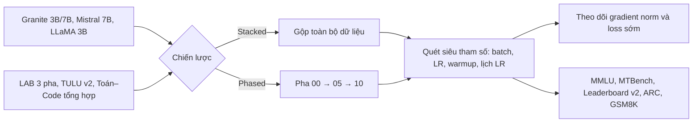

# Paper 23 Summary

## Citation

Tên bài: Unveiling the Secret Recipe: A Guide for Supervised Fine-Tuning Small LLMs
Tác giả: Aldo Pareja, Nikhil Shivakumar Nayak, Hao Wang, Krishnateja Killamsetty, Shivchander Sudalairaj, Wenlong Zhao, Seungwook Han, Abhishek Bhandwaldar, Guangxuan Xu, Kai Xu, Ligong Han, Luke Inglis, Akash Srivastava (Red Hat AI Innovation; MIT-IBM Watson AI Lab; IBM Research; MIT; UMass Amherst)
Năm: 2025 (preprint 12/2024)
Nguồn: The Thirteenth International Conference on Learning Representations (ICLR 2025), poster — hội nghị hàng đầu, có bình duyệt
DOI/Link: https://iclr.cc/virtual/2025/poster/28940 (bản mở: https://arxiv.org/abs/2412.13337)

## Problem

**Tóm tắt tổng quan.** Bài báo là nghiên cứu thực nghiệm có hệ thống về tinh chỉnh có giám sát (SFT) cho LLM cỡ nhỏ (3B–7B) trên dữ liệu chỉ dẫn về tri thức và kỹ năng, với bốn mô hình mở. Phát hiện chính: (i) batch size lớn kết hợp learning rate thấp cho kết quả tốt hơn trên MMLU, MTBench và Open LLM Leaderboard; (ii) động lực huấn luyện giai đoạn đầu (gradient norm thấp, loss cao) dự báo tốt hiệu năng cuối, cho phép dừng sớm các lần chạy kém; (iii) bỏ warmup và dùng learning rate hằng số không làm giảm hiệu năng; (iv) huấn luyện “gộp” (stacked) ngang hoặc hơn huấn luyện “theo pha” (phased) mà hiệu quả mẫu hơn.

**Bối cảnh và động lực.** Phòng thí nghiệm lớn có tài nguyên để tinh chỉnh LLM, còn cá nhân và tổ chức nhỏ thì không đủ điều kiện dò không gian siêu tham số. Mô hình 3B–7B rẻ, có thể chạy trên máy phổ thông và giúp tổ chức giữ toàn quyền kiểm soát dữ liệu (giảm rủi ro vi phạm quy định như GDPR). Tuy nhiên các báo cáo hiện có hiếm khi công bố đầy đủ siêu tham số hay các cấu hình thất bại; các khuyến nghị phổ biến (TULU, huấn luyện theo pha của Orca) chưa được kiểm chứng kỹ cho mô hình nhỏ.

## Method

1. **Mô hình:** Granite 3B, Granite 7B (IBM), Mistral 7B, LLaMA 3.2 3B.
2. **Dữ liệu:** bộ dữ liệu LAB chia ba pha — tuân thủ chỉ dẫn (308.343 mẫu), tri thức nền (231.178 mẫu), kỹ năng phức tạp (285.966 mẫu); thêm TULU mixture v2 và bộ toán–suy luận–lập trình tổng hợp.
3. **Chiến lược:** huấn luyện theo pha (lần lượt từng pha, chọn checkpoint tốt nhất rồi chuyển pha) so với huấn luyện gộp (trộn toàn bộ dữ liệu).
4. **Siêu tham số khảo sát:** batch size hiệu dụng 128 / 3.840 / 7.680; learning rate từ 1×10⁻⁶ đến 1×10⁻⁴; warmup 0 / 25 / 100 bước; lịch learning rate hằng số so với cosine decay; ba cấu hình TULU, TULU++ và LAB.
5. **Theo dõi động lực huấn luyện:** gradient norm và loss theo số mẫu đã xử lý.

## Dataset

Như trên; phần lớn là dữ liệu tri thức/kỹ năng tổng hợp theo phân loại (taxonomy) của LAB. Bài **không** dùng dữ liệu chuyên ngành pháp lý hay tiếng Việt.

## Evaluation

MMLU, MTBench, Open LLM Leaderboard v2 (MMLU-Pro, GPQA, MuSR, MATH, IFEval, BBH), ARC, GSM8K; với TULU dùng MMLU, GSM8K, BBH, ToxiGen, TruthfulQA. Hiệu quả đo bằng số mẫu cần để đạt hiệu năng đỉnh.

## Results

- **Stacked so với phased (Granite 7B):** MMLU 0,53 so với 0,52; MTBench 6,77 so với 6,76; GSM8K 0,39 so với 0,37. Stacked chỉ cần khoảng 3,69 triệu mẫu để đạt đỉnh, so với khoảng 7,86 triệu của phased.
- **Batch size (stacked):** MMLU 0,516 (128) → 0,526 (3.840) → 0,529 (7.680); MTBench 6,406 → 6,768 → 6,831. Batch nhỏ đạt hiệu năng nhanh hơn theo số mẫu nhưng chững sớm.
- **Lịch learning rate:** hằng số so với cosine — MMLU 0,5242 so với 0,5251; MTBench 6,7562 so với 6,6813.
- **TULU dataset:** batch 4K tốt hơn batch 128 trên MMLU (0,50 so với 0,48), BBH (0,44 so với 0,40), GSM8K (0,28 so với 0,25), ToxiGen; riêng TruthfulQA thấp hơn (0,44 so với 0,45).
- **Learning rate:** 2×10⁻⁵ tốt nhất cho Granite (MTBench 6,76, giảm dần tới 6,47 ở 1×10⁻⁴); với Mistral, 1×10⁻⁶ tốt nhất.
- **Warmup:** không warmup cho MMLU tốt hơn và MTBench tương đương.
- Gradient norm thấp và loss cao ở giai đoạn đầu tương quan với hiệu năng cuối tốt hơn.

**Điểm mạnh.**

- Khảo sát rộng và có hệ thống, công bố đầy đủ cấu hình, kể cả cấu hình kém — hiếm thấy trong tài liệu SFT.
- Kiểm chứng trên nhiều mô hình, kích thước và bộ dữ liệu; đưa ra hướng dẫn thực hành cụ thể.
- Chỉ ra tín hiệu dừng sớm giúp tiết kiệm tài nguyên tính toán.

## Limitations

**(a) Bài báo thừa nhận:** chỉ mô hình 3B–7B và hai kiến trúc (Granite/Llama, Mistral); không xét tinh chỉnh tham số hiệu quả (LoRA), các mục tiêu tiền huấn luyện, tokenizer hay optimizer khác ngoài Adam; dữ liệu chủ yếu là dữ liệu tổng hợp; mỗi cấu hình chỉ chạy một seed.

**(b) Quan sát:** nhiều khác biệt rất nhỏ (ví dụ MMLU chênh 0,01) và không có khoảng tin cậy, nên khó khẳng định ý nghĩa thống kê; batch size rất lớn đòi hỏi nhiều GPU hoặc tích lũy gradient lâu — mâu thuẫn một phần với mục tiêu “cho tổ chức ít tài nguyên”. Chỉ đánh giá bằng benchmark tổng quát; không có đánh giá trong miền hẹp hay ngôn ngữ ngoài tiếng Anh.

## Relevance to our topic

Nếu Sys_3_4 tinh chỉnh mô hình nhỏ (Qwen 3B/7B) cho văn phong hành chính hoặc kỹ năng diễn giải thủ tục, bài này cung cấp điểm khởi đầu siêu tham số có căn cứ (learning rate thấp, batch lớn, gộp dữ liệu, không cần warmup/decay phức tạp) và tín hiệu dừng sớm để tiết kiệm GPU. Bài cũng củng cố lập luận của nhóm về lợi ích bảo mật dữ liệu khi dùng mô hình nhỏ chạy tại chỗ.

**Kết luận.** Bài báo đưa ra hướng dẫn thực nghiệm cho SFT mô hình nhỏ: batch lớn, learning rate thấp, huấn luyện gộp, có thể bỏ warmup và cosine decay, và dùng động lực huấn luyện sớm để dừng các lần chạy kém. Các kết luận cần được kiểm chứng thêm ở mô hình lớn hơn, với phương pháp PEFT và trên dữ liệu chuyên ngành.

## Possible improvement

- Kết hợp khuyến nghị của bài với QLoRA (Paper 21) — tổ hợp mà bài báo chưa thử — để tinh chỉnh trên một GPU.
- Đánh giá mô hình tinh chỉnh bằng bộ câu hỏi thủ tục tiếng Việt thay vì chỉ benchmark tổng quát, chạy nhiều seed để có khoảng tin cậy.
