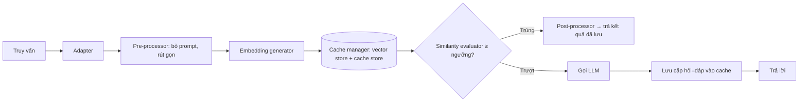

# Paper 24 Summary

## Citation

Tên bài: GPTCache: An Open-Source Semantic Cache for LLM Applications Enabling Faster Answers and Cost Savings
Tác giả: Bang Fu, Di Feng (Zilliz Inc.)
Năm: 2023
Nguồn: Proceedings of the 3rd Workshop for Natural Language Processing Open Source Software (NLP-OSS 2023, tổ chức cùng EMNLP 2023), trang 212–218 — workshop có bình duyệt, ACL Anthology
DOI/Link: https://aclanthology.org/2023.nlposs-1.24/ (DOI: 10.18653/v1/2023.nlposs-1.24)

## Problem

**Tóm tắt tổng quan.** GPTCache là bộ nhớ đệm ngữ nghĩa mã nguồn mở cho ứng dụng LLM: truy vấn được nhúng thành vector và so khớp với các câu hỏi đã lưu; nếu đủ tương đồng thì trả về câu trả lời đã lưu mà không gọi LLM. Theo tác giả, khi trúng cache, tốc độ phản hồi nhanh gấp 2–10 lần (khoảng 0,3 giây so với trung bình 3 giây của ChatGPT) và không tốn token.

**Bối cảnh và động lực.** Gọi API LLM tốn chi phí theo token, có độ trễ cao và bị giới hạn tần suất vào giờ cao điểm; tự triển khai mô hình thì tốn tài nguyên tính toán. Cache truyền thống (Redis, Memcache) chỉ khớp chính xác chuỗi, không nhận ra hai câu hỏi khác cách diễn đạt nhưng cùng nghĩa.

## Method

Kiến trúc gồm sáu thành phần:
1. **Adapter:** giao diện với LLM (OpenAI ChatGPT, LangChain), chuyển yêu cầu thành giao thức cache.
2. **Pre-processor:** chuẩn hóa khóa cache — bỏ phần prompt hệ thống, nén input, chỉ giữ phần cuối văn bản dài hoặc lượt cuối của hội thoại nhiều lượt.
3. **Embedding generator:** dịch vụ đám mây (OpenAI, Hugging Face, Cohere) hoặc mô hình cục bộ.
4. **Cache manager:** lưu cặp yêu cầu–phản hồi (cache storage), lưu và truy vấn vector (vector storage, ví dụ Milvus), quản lý loại bỏ dữ liệu (LRU/FIFO).
5. **Similarity evaluator:** lấy top-K và đánh giá mức tương đồng bằng mô hình ALBERT tinh chỉnh.
6. **Post-processor:** trả câu trả lời gần nhất hoặc điều chỉnh độ ngẫu nhiên theo temperature; nếu không trúng, gọi LLM rồi lưu kết quả vào cache.

## Dataset

Tự xây dựng: thu thập ngẫu nhiên thông tin từ web rồi dùng ChatGPT sinh cặp câu ba loại — tương đồng, “đối lập” (liên quan nhưng khác nghĩa), không liên quan. Lưu 30.000 khóa của cặp dương. Bài **không** dùng benchmark công khai.

## Evaluation

Cache Hit, Cache Miss, Positive Hits (trúng đúng), Negative Hits (trúng sai), Hit Latency (thời gian tiền xử lý, tìm kiếm, tính tương đồng, hậu xử lý). Nhãn đúng/sai của lần trúng dựa trên điểm tương đồng do ChatGPT chấm (ngưỡng 0,7). Thử nghiệm trên máy Mac i7 4 CPU, 32GB RAM, embedding paraphrase-albert-small-v2 chạy ONNX.

## Results

- **Thí nghiệm 1** (1.000 truy vấn là câu tương đồng của các khóa đã lưu, ngưỡng 0,7): 876 trúng (837 đúng, 39 sai), 124 trượt; độ trễ khi trúng 0,20 giây.
- **Thí nghiệm 2** (1.160 truy vấn, 50% dương, 50% không liên quan): 570 trúng (549 đúng, 21 sai), 590 trượt; độ trễ khi trúng 0,17 giây.
- **Thí nghiệm 3:** khi lưu cả các cặp “đối lập” và truy vấn bằng câu cặp của chúng, không lần nào trúng cache dù ChatGPT chấm một số cặp có độ tương đồng trên 0,9.
- Thử các thuật toán tương đồng khác không làm thay đổi kết quả, nên dùng cosine.
- Theo tác giả, ngay cả với embedding tốt nhất hiện có, tỷ lệ trúng cache không vượt 90%; trúng sai (negative hits) là đáng kể và không chấp nhận được trong sản xuất.

**Điểm mạnh.**

- Thiết kế mô-đun rõ ràng, dễ tích hợp, mã nguồn mở; phân tích thẳng thắn các thách thức còn tồn tại.
- Chỉ ra đúng điểm khác biệt giữa “tìm kiếm” và “cache”: kết quả có cấu trúc tương tự nhưng ngữ nghĩa ngược có thể chấp nhận trong tìm kiếm, nhưng không thể chấp nhận trong cache.

## Limitations

**(a) Bài báo thừa nhận:** hiệu quả phụ thuộc mạnh vào mô hình embedding; trúng sai rõ rệt và khó đạt độ đúng cỡ 99% mà không giảm tỷ lệ trúng; các bộ đánh giá tương đồng hiện có (khoảng cách vector, Cohere rerank, cross-encoder SBERT) chưa phân biệt đủ tốt; văn bản/hội thoại dài khó tạo vector đại diện, tóm tắt làm cache kém ổn định; cần đánh giá chặt chẽ hơn trên dữ liệu lớn và đa dạng.

**(b) Quan sát:** dữ liệu đánh giá do ChatGPT sinh và nhãn đúng/sai cũng do ChatGPT chấm; không công bố chi tiết bộ dữ liệu; mô hình đánh giá tương đồng được tinh chỉnh trên chính dữ liệu này (nguy cơ quá khớp); không so sánh với phương pháp cache khác. Đây là bài workshop hệ thống mã nguồn mở, mức độ thực nghiệm sơ bộ. Bài **không** xét rủi ro trả câu trả lời cũ khi dữ liệu nguồn (ví dụ quy định, mức phí) thay đổi.

## Relevance to our topic

Phân tích của bài là cảnh báo quan trọng cho Sys_3_4: trong miền thủ tục hành chính, hai câu hỏi gần giống nhau (“cấp mới” và “cấp đổi” hộ chiếu) có thể cần câu trả lời khác nhau. Cache ngữ nghĩa có tỷ lệ trúng sai vài phần trăm (39/876 trong thí nghiệm 1) là không chấp nhận được với số liệu lệ phí. Điều này ủng hộ lựa chọn của nhóm: Strict Engine trả lời tất định từ cơ sở dữ liệu (rất nhanh, không cần cache LLM), còn cache chỉ nên khóa theo mã thủ tục đã xác định, không theo độ tương đồng câu hỏi.

**Kết luận.** GPTCache cho thấy cache ngữ nghĩa có thể giảm mạnh độ trễ và chi phí cho truy vấn lặp lại, nhưng tỷ lệ trúng sai và sự phụ thuộc vào embedding khiến nó chưa đủ tin cậy cho ứng dụng đòi hỏi độ chính xác cao. Hướng tiếp theo tác giả nêu: embedding chuyên cho cache, bộ đánh giá tương đồng tốt hơn (chưng cất từ LLM lớn), xử lý văn bản dài và các phương án khớp không dùng vector.

## Possible improvement

- Nếu thêm cache cho Friendly Engine, dùng khóa tất định (mã thủ tục + loại câu hỏi đã chuẩn hóa) thay vì tương đồng embedding — đúng hướng “chuẩn hóa văn bản rồi khớp chuỗi” mà bài nêu ở phần thách thức.
- Gắn phiên bản dữ liệu thủ tục vào khóa cache để tự động vô hiệu hóa khi quy định thay đổi.
