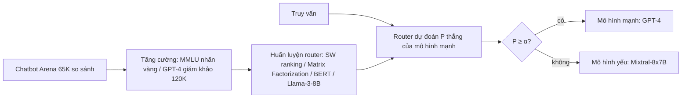

# Paper 25 Summary

## Citation

Tên bài: RouteLLM: Learning to Route LLMs with Preference Data
Tác giả: Isaac Ong, Amjad Almahairi, Vincent Wu, Wei-Lin Chiang, Tianhao Wu, Joseph E. Gonzalez, M Waleed Kadous, Ion Stoica (UC Berkeley; Anyscale; Canva)
Năm: 2025 (preprint 6/2024)
Nguồn: The Thirteenth International Conference on Learning Representations (ICLR 2025) — hội nghị hàng đầu, có bình duyệt (bản PDF ghi “Published as a conference paper at ICLR 2025”)
DOI/Link: https://proceedings.iclr.cc/paper_files/paper/2025/hash/5503a7c69d48a2f86fc00b3dc09de686-Abstract-Conference.html (bản arXiv: https://arxiv.org/abs/2406.18665). Lưu ý: tên chính thức trong kỷ yếu ICLR 2025 là “RouteLLM: Learning to Route LLMs **from** Preference Data”; bản arXiv/PDF tham chiếu dùng “…with Preference Data”.

## Problem

**Tóm tắt tổng quan.** RouteLLM là khung học bộ định tuyến (router) chọn giữa một LLM mạnh nhưng đắt (GPT-4) và một LLM yếu nhưng rẻ (Mixtral-8x7B) cho từng truy vấn, học từ dữ liệu sở thích của người dùng (Chatbot Arena) kèm tăng cường dữ liệu. Kết quả: giảm chi phí hơn 2 lần mà không giảm đáng kể chất lượng (tới 3,66 lần trên MT Bench ở mức 95% chất lượng GPT-4), và router tổng quát được sang cặp mô hình không có trong dữ liệu huấn luyện.

**Bối cảnh và động lực.** Mô hình lớn tốt hơn nhưng đắt (ví dụ Claude 3 Opus đắt hơn Haiku khoảng 60 lần trên mỗi triệu token đầu ra); gửi mọi truy vấn tới mô hình lớn là lãng phí, còn gửi hết tới mô hình nhỏ thì chất lượng giảm. Các phương pháp trước (LLM-Blender, FrugalGPT, AutoMix) gọi nhiều LLM cho mỗi truy vấn, làm tăng độ trễ; Hybrid-LLM và Zooter dùng nhãn tổng hợp hoặc nhãn từ mô hình thưởng và chưa chứng minh tổng quát ngoài miền. Bộ định tuyến lý tưởng cần: gọi đúng một LLM mỗi truy vấn, tổng quát ngoài miền, và dùng được với LLM mới mà không cần huấn luyện lại.

## Method

1. **Bài toán:** học mô hình dự đoán xác suất mô hình mạnh thắng P(win_strong | q); với ngưỡng chi phí α, nếu P < α thì gửi tới mô hình yếu, ngược lại gửi tới mô hình mạnh.
2. **Dữ liệu:** 80K cuộc đối đầu trên Chatbot Arena (sau khi lọc còn 65K so sánh giữa 64 mô hình, 81% tiếng Anh); gom mô hình thành 10 bậc theo bảng xếp hạng để giảm độ thưa nhãn; chỉ giữ thông tin bên thắng.
3. **Tăng cường dữ liệu:** (a) dữ liệu có nhãn vàng — khoảng 1.500 câu MMLU validation, so đáp án hai mô hình với đáp án đúng; (b) dữ liệu do GPT-4 làm giám khảo — khoảng 120K mẫu từ Nectar, chi phí khoảng 700 USD.
4. **Bốn kiến trúc router:** xếp hạng có trọng số theo độ tương đồng (Bradley-Terry, không cần huấn luyện); phân rã ma trận (matrix factorization); bộ phân loại BERT-base; bộ phân loại LLM nhân quả (Llama 3 8B).
5. **Chỉ số:** tỷ lệ gọi mô hình mạnh; PGR (phần khoảng cách hiệu năng được lấy lại); APGR (PGR trung bình trên các mức chi phí); CPT(x%) (tỷ lệ gọi mô hình mạnh tối thiểu để đạt PGR x%).

## Dataset

Huấn luyện như trên. Đánh giá ngoài miền: MMLU (14.042 câu, 57 lĩnh vực), MT Bench (160 câu hỏi mở, LLM chấm), GSM8K (hơn 1.000 bài toán); có kiểm tra nhiễm chéo giữa dữ liệu huấn luyện và đánh giá. Baseline: router ngẫu nhiên với cùng ràng buộc chi phí.

## Evaluation

CPT(50%), CPT(80%), APGR; tỷ lệ tiết kiệm chi phí so với dùng toàn GPT-4; chi phí và thông lượng của bản thân router; điểm tương đồng giữa benchmark và dữ liệu huấn luyện.

## Results

- **MT Bench (huấn luyện Arena + GPT-4 giám khảo):** matrix factorization APGR 0,802 (+60,4% so với ngẫu nhiên), CPT(50%) 13,40% so với 49,03% của ngẫu nhiên. Chỉ với dữ liệu Arena, BERT kém hơn ngẫu nhiên (APGR 0,391).
- **MMLU:** chỉ dữ liệu Arena thì mọi router xấp xỉ ngẫu nhiên; thêm khoảng 1.500 mẫu nhãn vàng (dưới 2% dữ liệu) thì APGR lên 0,572–0,603.
- **GSM8K (Arena + GPT-4 giám khảo):** router Llama 3 8B tốt nhất, APGR 0,622 (+25,3%).
- **Tổng quát sang cặp mô hình mới (không huấn luyện lại):** Claude 3 Opus/Sonnet — SW ranking APGR 0,772; Llama 3.1 70B/8B — 0,767.
- **Tiết kiệm chi phí:** 3,66 lần (MT Bench, 95% chất lượng GPT-4), 1,41 lần (MMLU, 92%), 1,49 lần (GSM8K, 87%).
- **Chi phí của router:** từ 3,19 đến 39,26 USD mỗi triệu yêu cầu; router đắt nhất cộng thêm dưới 0,4% so với chi phí sinh của GPT-4.
- Hiệu năng router tương quan với mức tương đồng giữa dữ liệu huấn luyện và benchmark.

**Điểm mạnh.**

- Bài toán được hình thức hóa rõ ràng, có chỉ số mới (APGR, CPT) cho đánh đổi chi phí – chất lượng.
- Gọi đúng một LLM mỗi truy vấn nên không tăng độ trễ; chi phí router không đáng kể.
- Chứng minh tổng quát sang cặp mô hình mới; công bố mã nguồn.

## Limitations

**(a) Bài báo thừa nhận:** phân phối truy vấn thực tế có thể khác benchmark (cần thu thập ít dữ liệu trong miền để tăng cường); chỉ xét định tuyến hai mô hình; không có router tốt nhất cho mọi trường hợp; hiệu năng giữa các router dao động lớn mà chưa giải thích được.

**(b) Quan sát:** kết quả phụ thuộc mạnh vào tăng cường dữ liệu (chỉ dùng Arena thì gần như ngẫu nhiên trên MMLU/GSM8K); dữ liệu tăng cường dùng GPT-4 làm giám khảo; chất lượng đo bằng benchmark học thuật, không đo tính đúng của số liệu hay rủi ro ảo giác. Bài **không** xét định tuyến giữa hệ tất định (không dùng LLM) và LLM.

## Relevance to our topic

Bộ định tuyến Strict/Friendly của Sys_3_4 là một dạng định tuyến: truy vấn tra cứu một mục → engine tất định (rẻ, nhanh, không ảo giác); truy vấn hội thoại/so sánh → LLM. RouteLLM cung cấp khung hình thức và chỉ số (tỷ lệ gọi engine đắt, PGR/APGR) để đánh giá bộ định tuyến này, đồng thời cho thấy chỉ cần một lượng nhỏ dữ liệu trong miền là đủ cải thiện router rõ rệt.

**Kết luận.** RouteLLM cho thấy router học từ dữ liệu sở thích kết hợp tăng cường dữ liệu có thể giảm chi phí LLM 2–3,7 lần mà giữ chất lượng, và tổng quát sang mô hình mới. Hướng tiếp theo: định tuyến nhiều mô hình, chọn router theo yêu cầu độ trễ/chi phí, và tận dụng mức tương đồng giữa dữ liệu và truy vấn thực.

## Possible improvement

- Báo cáo tỷ lệ truy vấn đi vào Friendly Engine và chất lượng tương ứng — tương tự “tỷ lệ gọi mô hình mạnh so với PGR”.
- Thu thập vài trăm truy vấn có nhãn “cần LLM / không cần LLM” để huấn luyện một router nhẹ (ví dụ matrix factorization) bổ sung cho router luật hiện có.
