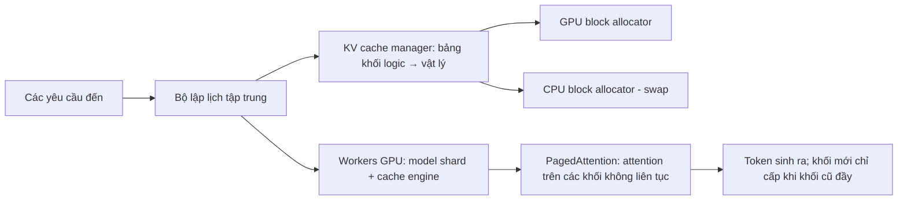

# Paper 26 Summary

## Citation

Tên bài: Efficient Memory Management for Large Language Model Serving with PagedAttention (vLLM)
Tác giả: Woosuk Kwon, Zhuohan Li, Siyuan Zhuang, Ying Sheng, Lianmin Zheng, Cody Hao Yu, Joseph E. Gonzalez, Hao Zhang, Ion Stoica (UC Berkeley; Stanford; UC San Diego)
Năm: 2023
Nguồn: Proceedings of the 29th ACM Symposium on Operating Systems Principles (SOSP ’23), Koblenz, Đức — hội nghị hàng đầu về hệ điều hành/hệ thống, có bình duyệt
DOI/Link: https://doi.org/10.1145/3600006.3613165 (bản mở: https://arxiv.org/abs/2309.06180)

## Problem

**Tóm tắt tổng quan.** Bài báo đề xuất PagedAttention — thuật toán attention lấy cảm hứng từ bộ nhớ ảo và phân trang của hệ điều hành — và xây dựng vLLM, hệ thống phục vụ LLM đạt mức lãng phí bộ nhớ KV cache gần bằng 0 và chia sẻ KV cache linh hoạt trong và giữa các yêu cầu. Theo đánh giá, vLLM tăng thông lượng 2–4 lần so với FasterTransformer và Orca ở cùng mức độ trễ; lợi ích lớn hơn với chuỗi dài, mô hình lớn và thuật toán giải mã phức tạp.

**Bối cảnh và động lực.** Sinh văn bản tự hồi quy là tác vụ bị giới hạn bởi bộ nhớ; muốn thông lượng cao phải gộp (batch) nhiều yêu cầu, nhưng KV cache của mỗi yêu cầu rất lớn (ví dụ OPT-13B cần 800KB mỗi token, tới 1,6GB mỗi yêu cầu) và thay đổi kích thước động. Các hệ thống trước lưu KV cache trong vùng nhớ liên tục, cấp phát sẵn theo độ dài tối đa, gây lãng phí do giữ chỗ, phân mảnh trong và phân mảnh ngoài — theo đo đạc của tác giả, chỉ 20,4%–38,2% bộ nhớ KV cache thực sự chứa trạng thái token. Chúng cũng không chia sẻ được KV cache giữa các chuỗi (lấy mẫu song song, beam search).

## Method

1. **PagedAttention:** chia KV cache của mỗi chuỗi thành các khối (block) chứa khóa/giá trị của một số token cố định; các khối không cần liên tục trong bộ nhớ vật lý; kernel attention tính theo từng khối.
2. **KV cache manager:** tương tự bộ nhớ ảo — mỗi yêu cầu có bảng ánh xạ khối logic sang khối vật lý; chỉ cấp khối mới khi khối trước đã đầy, nên lãng phí tối đa nằm trong một khối.
3. **Chia sẻ và copy-on-write:** đếm tham chiếu khối, cho phép lấy mẫu song song, beam search và tiền tố dùng chung (system prompt) chia sẻ KV cache.
4. **Lập lịch:** ưu tiên đến trước phục vụ trước; khi thiếu bộ nhớ thì loại toàn bộ khối của một chuỗi, khôi phục bằng hoán đổi sang CPU (swapping) hoặc tính lại (recomputation).
5. **Phân tán:** song song hóa mô hình kiểu Megatron-LM với bộ lập lịch tập trung; các worker GPU dùng chung bảng khối.

## Dataset

Không phải nghiên cứu học máy theo dữ liệu nhãn. Tải công việc tổng hợp từ độ dài đầu vào/đầu ra của ShareGPT (hội thoại thật với ChatGPT; đầu vào dài hơn Alpaca 8,4 lần, đầu ra dài hơn 5,8 lần) và Alpaca; thời điểm đến theo phân phối Poisson; WMT16 Anh–Đức cho thí nghiệm tiền tố dùng chung. Mô hình: OPT 13B/66B/175B và LLaMA 13B trên GPU A100 (Google Cloud).

## Evaluation

Độ trễ chuẩn hóa (độ trễ đầu-cuối trung bình chia cho độ dài đầu ra, giây/token) theo tốc độ yêu cầu; số yêu cầu được gộp đồng thời; tỷ lệ bộ nhớ tiết kiệm nhờ chia sẻ. Baseline: FasterTransformer, và Orca tự cài đặt lại theo ba biến thể (Oracle — biết trước độ dài đầu ra, Pow2, Max).

## Results

- **Lấy mẫu cơ bản (ShareGPT):** vLLM chịu được tốc độ yêu cầu cao hơn 1,7–2,7 lần so với Orca (Oracle), 2,7–8 lần so với Orca (Max), và tới 22 lần so với FasterTransformer, ở cùng độ trễ.
- **Số yêu cầu gộp (OPT-13B, ShareGPT):** vLLM 30,42 so với 13,62 của Orca (Oracle) và 7,00 của Orca (Max).
- **Chia sẻ bộ nhớ (Alpaca):** tiết kiệm 6,1%–9,8% với lấy mẫu song song và 37,6%–55,2% với beam search; trên ShareGPT là 16,2%–30,5% và 44,3%–66,3%. Lợi thế so với Orca (Oracle) tăng từ 1,3 lần (lấy mẫu cơ bản) lên 2,3 lần (beam search rộng 6).
- **Tiền tố dùng chung:** thông lượng cao hơn Orca (Oracle) 1,67 lần (1-shot) và 3,58 lần (5-shot).
- **Chatbot:** chịu được tốc độ yêu cầu cao hơn 2 lần so với ba biến thể Orca.
- **Ablation:** kernel attention chậm hơn FasterTransformer 20–26% do truy bảng khối, nhưng hiệu năng đầu-cuối vẫn vượt trội; kích thước khối 16 là mặc định cân bằng; tính lại hiệu quả hơn với khối nhỏ, hoán đổi hiệu quả hơn với khối lớn.
- Ngoại lệ: OPT-175B với Alpaca (chuỗi ngắn, bộ nhớ dư) — lợi thế nhỏ hơn vì hệ thống chuyển sang bị giới hạn bởi tính toán.

**Điểm mạnh.**

- Ý tưởng đơn giản, có nền tảng hệ điều hành, giải quyết đúng nút thắt bộ nhớ; ablation thiết kế đầy đủ.
- Đánh giá trên nhiều mô hình, tải công việc và thuật toán giải mã; mã nguồn mở và trở thành hạ tầng phục vụ LLM phổ biến.

## Limitations

**(a) Bài báo thừa nhận:** PagedAttention làm kernel attention chậm hơn 20–26%; kỹ thuật chỉ có lợi khi tải công việc bị giới hạn bởi bộ nhớ — khi đã bị giới hạn bởi tính toán (ví dụ chuỗi ngắn, bộ nhớ dư) thì lợi ích giảm; hoán đổi tốn chi phí lớn khi khối nhỏ do băng thông PCIe.

**(b) Quan sát:** Orca được tác giả tự cài đặt lại vì không công khai, nên so sánh phụ thuộc vào cách cài đặt; tải công việc tổng hợp (thời điểm đến Poisson) chứ không phải lưu lượng thực; chỉ đánh giá thông lượng/độ trễ, không đánh giá chất lượng câu trả lời (tác giả khẳng định không ảnh hưởng độ chính xác mô hình). Thí nghiệm trên GPU A100 trung tâm dữ liệu, không xét máy chủ cấu hình thấp.

## Relevance to our topic

Sys_3_4 phục vụ Qwen2.5 cục bộ qua Ollama/vLLM. Bài cung cấp cơ sở kỹ thuật cho lựa chọn vLLM khi cần phục vụ nhiều công dân đồng thời trên ít GPU: (1) tăng số yêu cầu gộp nhờ quản lý KV cache; (2) chia sẻ tiền tố — system prompt và hướng dẫn dùng chung của Friendly Engine là đúng kịch bản “shared prefix” được bài chứng minh tăng thông lượng tới 3,58 lần.

**Kết luận.** PagedAttention và vLLM cho thấy áp dụng phân trang kiểu hệ điều hành cho KV cache gần như loại bỏ lãng phí bộ nhớ, cho phép gộp nhiều yêu cầu hơn và chia sẻ bộ nhớ, từ đó tăng thông lượng phục vụ LLM 2–4 lần ở cùng độ trễ. Kỹ thuật phát huy tác dụng nhất khi hệ thống bị giới hạn bởi bộ nhớ.

## Possible improvement

- Đo độ trễ p50/p95 và thông lượng của Friendly Engine giữa Ollama và vLLM trên cùng phần cứng, theo phương pháp “độ trễ chuẩn hóa theo tốc độ yêu cầu” của bài.
- Thiết kế prompt sao cho phần cố định (system prompt, quy tắc trích dẫn) nằm ở đầu để tận dụng chia sẻ tiền tố.
