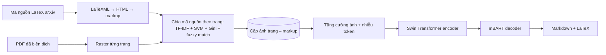

# Paper 27 Summary

## Citation

Tên bài: Nougat: Neural Optical Understanding for Academic Documents
Tác giả: Lukas Blecher, Guillem Cucurull, Thomas Scialom, Robert Stojnic (Meta AI)
Năm: 2024 (preprint 8/2023)
Nguồn: The Twelfth International Conference on Learning Representations (ICLR 2024) — hội nghị hàng đầu, có bình duyệt (OpenReview)
DOI/Link: https://proceedings.iclr.cc/paper_files/paper/2024/hash/a39a9aceda771cded859ae7560530e09-Abstract-Conference.html (bản mở: https://arxiv.org/abs/2308.13418)

## Problem

**Tóm tắt tổng quan.** Nougat là mô hình Transformer mã hóa–giải mã chuyển ảnh trang tài liệu khoa học thành văn bản markup (Markdown có LaTeX cho công thức và bảng) mà không cần bộ OCR bên ngoài hay văn bản nhúng trong PDF. Trên tập test arXiv, Nougat base (350M tham số) đạt edit distance 0,071, BLEU 89,1, F1 93,1 — vượt xa văn bản nhúng trong PDF (F1 79,2) và GROBID + LaTeX-OCR (F1 73,0).

**Bối cảnh và động lực.** Tri thức khoa học chủ yếu nằm trong PDF, nhưng định dạng này làm mất thông tin ngữ nghĩa, đặc biệt là công thức toán. Các bộ OCR như Tesseract nhận dạng ký tự theo dòng nên không nắm được quan hệ không gian (chỉ số trên/dưới, phân số, ma trận). GROBID và pdf2htmlEX không khôi phục được ngữ nghĩa công thức. Chưa có bộ dữ liệu ghép cặp trang PDF với mã nguồn.

## Method

1. **Kiến trúc (theo Donut):** bộ mã hóa ảnh Swin Transformer (ảnh 896×672 ở 96 DPI, cắt lề và thêm padding) → bộ giải mã mBART 10 lớp có cross-attention, độ dài chuỗi tối đa 4.096 token, tokenizer của Galactica; tổng 350M tham số (bản nhỏ 250M, 4 lớp giải mã). Giải mã tham lam (greedy).
2. **Dữ liệu tự xây dựng:** 1.748.201 bài arXiv (mã nguồn LaTeX → HTML bằng LaTeXML → markup nhẹ), một phần PubMed Central và Industry Documents Library (chỉ dùng khi tiền huấn luyện).
3. **Chia trang:** loại hình/bảng bằng pdffigures2; mô hình Bag-of-Words TF-IDF + SVM tuyến tính dự đoán trang cho từng đoạn mã nguồn; tìm điểm cắt bằng tiêu chí Gini; tinh chỉnh bằng so khớp mờ (fuzzy matching); chỉ giữ trang có điểm khớp trung bình ≥ 0,9 (khoảng 47% số trang được chấp nhận).
4. **Tăng cường dữ liệu:** mô phỏng tài liệu scan (erosion, dilation, nhiễu Gauss, làm mờ, nén ảnh, biến dạng lưới/đàn hồi…); thay ngẫu nhiên token trong nhãn để giảm hiện tượng lặp.
5. **Phát hiện lặp khi suy luận:** dựa trên phương sai của logit lớn nhất theo cửa sổ trượt.

## Dataset

arXiv (khoảng 1,75 triệu bài, nguồn chính), PubMed Central (chỉ tiền huấn luyện), Industry Documents Library (OCR cơ bản cho tài liệu scan). Gần như toàn bộ là tiếng Anh. Tập test lấy từ arXiv.

## Evaluation

Edit distance chuẩn hóa (Levenshtein), BLEU, METEOR, Precision, Recall, F1; đánh giá riêng theo loại nội dung: văn bản thường, công thức toán, bảng. Baseline: văn bản nhúng trong PDF và GROBID + LaTeX-OCR.

## Results

- **Toàn bộ:** Nougat base — edit distance 0,071, BLEU 89,1, METEOR 93,0, F1 93,1; Nougat small — 0,073, 88,9, 92,8, F1 92,9 (tương đương bản lớn). Văn bản nhúng PDF: 0,255 / 65,8 / 82,1 / F1 79,2.
- **Theo loại (Nougat base):** văn bản thường F1 95,7; bảng F1 78,0; công thức F1 76,5 — so với GROBID + LaTeX-OCR chỉ đạt F1 9,7 với công thức.
- **Hiện tượng lặp:** xảy ra ở 1,5% trang test, tăng với tài liệu ngoài miền; tăng cường bằng nhiễu token giảm 32% số trang chuyển đổi thất bại với tài liệu ngoài miền.
- **Tốc độ:** trên GPU A10G 24GB, xử lý song song 6 trang, trung bình 19,5 giây mỗi lô (khoảng 1.400 token mỗi trang) — chậm hơn nhiều so với GROBID (10,6 PDF/giây).

**Điểm mạnh.**

- Mô hình đầu-cuối chỉ cần ảnh trang, áp dụng được cho tài liệu scan; khôi phục công thức toán vượt trội.
- Quy trình tạo dữ liệu tự động quy mô lớn, không cần gán nhãn thủ công; công bố mã và mô hình.
- Phân tích lỗi thẳng thắn (lặp, mơ hồ LaTeX) và đề xuất cách giảm thiểu.

## Limitations

**(a) Bài báo thừa nhận:** mô hình có thể rơi vào vòng lặp lặp lại; hoạt động tốt nhất với tài liệu có cấu trúc giống bài báo khoa học; dữ liệu gần như toàn tiếng Anh — ngôn ngữ Latin khác cho kết quả “chấp nhận được” nhưng **ký tự đặc biệt bị thay bằng ký tự Latin gần nhất**, còn chữ viết không phải Latin gây lặp ngay lập tức; tốc độ chậm; xử lý từng trang độc lập nên thiếu nhất quán trong toàn tài liệu (ví dụ tài liệu tham khảo, đánh số mục có thể bị bỏ sót hoặc ảo giác).

**(b) Quan sát:** nhãn đúng có nhiễu do LaTeXML và thuật toán chia trang; đánh giá chỉ trên tập test arXiv cùng phân phối với dữ liệu huấn luyện; không đánh giá trên văn bản hành chính hay biểu mẫu.

## Relevance to our topic

Sys_3_4 có hướng mở rộng nhập (import) văn bản thủ tục từ PDF. Bài cho thấy OCR thần kinh có thể khôi phục cấu trúc bảng và công thức tốt hơn công cụ truyền thống, nhưng cũng đưa ra cảnh báo trực tiếp cho tiếng Việt: Nougat **thay ký tự đặc biệt bằng ký tự Latin gần nhất**, tức có nguy cơ làm mất dấu thanh — điều đặc biệt nghiêm trọng với cơ chế phạt lệch dấu của Strict Engine. Nougat cũng có thể ảo giác nội dung khi lặp, nên không phù hợp cho số liệu lệ phí nếu không kiểm tra lại.

**Kết luận.** Nougat chứng minh mô hình Transformer thị giác đầu-cuối có thể chuyển trang tài liệu khoa học sang markup với độ chính xác cao, đặc biệt cho công thức toán, chỉ từ ảnh trang. Hạn chế chính là hiện tượng lặp, tốc độ chậm và phạm vi ngôn ngữ hẹp (chủ yếu tiếng Anh). Hướng tiếp theo tác giả nêu: xử lý nhất quán toàn tài liệu và giải quyết vòng lặp.

## Possible improvement

- Nếu dùng OCR thần kinh cho văn bản tiếng Việt, cần tinh chỉnh trên dữ liệu tiếng Việt có dấu, hoặc ưu tiên trích văn bản nhúng trong PDF khi văn bản là bản số hóa gốc.
- Đối chiếu số liệu trích từ OCR với nguồn dữ liệu có cấu trúc (cổng dịch vụ công) trước khi đưa vào cơ sở dữ liệu thủ tục; áp dụng phát hiện lặp như bài đề xuất.
