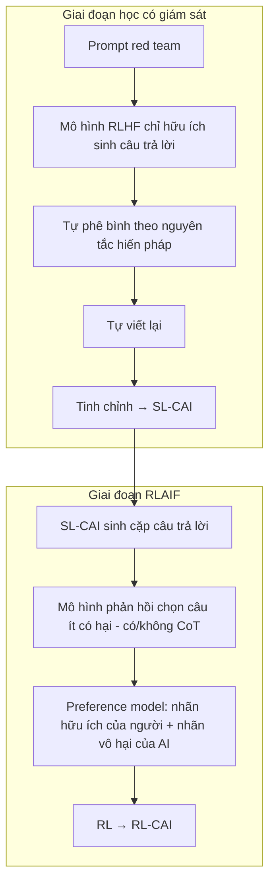

# Paper 28 Summary

## Citation

Tên bài: Constitutional AI: Harmlessness from AI Feedback
Tác giả: Yuntao Bai, Saurav Kadavath, Sandipan Kundu, Amanda Askell, … , Jared Kaplan (Anthropic; 51 tác giả)
Năm: 2022
Nguồn: arXiv preprint arXiv:2212.08073 (báo cáo nghiên cứu của Anthropic) — **không phải bài hội nghị/tạp chí có bình duyệt**. Nhóm giữ lại vì đây là công trình gốc của phương pháp “Constitutional AI / RLAIF”, được trích dẫn và áp dụng rất rộng rãi trong nghiên cứu căn chỉnh (alignment) LLM.
DOI/Link: https://arxiv.org/abs/2212.08073 (DOI arXiv: 10.48550/arXiv.2212.08073)

## Problem

**Tóm tắt tổng quan.** Bài báo đề xuất Constitutional AI (CAI): huấn luyện trợ lý AI vô hại mà **không dùng nhãn của con người về tính có hại**; giám sát của con người chỉ được cung cấp qua một danh sách ngắn các nguyên tắc bằng ngôn ngữ tự nhiên (“hiến pháp”, 16 nguyên tắc). Quy trình gồm giai đoạn học có giám sát (tự phê bình → tự sửa → tinh chỉnh) và giai đoạn học tăng cường từ phản hồi AI (RLAIF). Kết quả: mô hình RL-CAI vô hại hơn nhưng ít né tránh hơn — giải thích lý do khi từ chối thay vì chỉ từ chối — và được người đánh giá ưa chuộng hơn so với mô hình huấn luyện bằng nhãn có hại của con người.

**Bối cảnh và động lực.** RLHF cần hàng chục nghìn nhãn ưu tiên của con người, khó hiểu tổng thể mục tiêu huấn luyện; mô hình được huấn luyện vô hại bằng RLHF trước đó thường né tránh, gây căng thẳng giữa hữu ích và vô hại. Tác giả muốn: (1) mở rộng khả năng giám sát bằng AI; (2) giảm né tránh; (3) làm nguyên tắc chi phối hành vi AI minh bạch hơn; (4) rút ngắn vòng lặp khi thay đổi mục tiêu.

## Method

1. **Giai đoạn học có giám sát (SL-CAI):** mô hình RLHF chỉ-hữu-ích trả lời các prompt “red team” (thường tạo câu trả lời có hại) → được yêu cầu tự phê bình theo một nguyên tắc chọn ngẫu nhiên → tự viết lại câu trả lời; lặp nhiều vòng; tinh chỉnh mô hình tiền huấn luyện trên các câu trả lời đã sửa cùng các mẫu hữu ích.
2. **Giai đoạn RL (RL-CAI / RLAIF):** mô hình SL-CAI sinh cặp câu trả lời; mô hình phản hồi chọn câu trả lời ít có hại hơn dưới dạng câu hỏi trắc nghiệm theo một nguyên tắc ngẫu nhiên; xác suất được dùng làm nhãn mềm; huấn luyện mô hình ưu tiên (preference model) trên hỗn hợp nhãn hữu ích của con người và nhãn vô hại do AI tạo; sau đó RL như RLHF.
3. **Chain-of-thought:** dùng mô hình RLHF suy luận từng bước để gán nhãn; kẹp xác suất trong khoảng 40–60% để tránh nhãn quá tự tin.

## Dataset

Prompt red team: 42.496 do người viết + 140.335 do mô hình sinh (tổng 182.831), mỗi prompt 4 cặp phê bình–sửa. Prompt hữu ích: 135.296 do người viết. Dữ liệu cho mô hình ưu tiên: 135.296 so sánh hữu ích của người và 182.831 so sánh vô hại do AI tạo. Thêm 491.142 prompt red team và 474.300 prompt hữu ích cho RL. Đánh giá năng lực giám sát của AI trên 438 câu hỏi so sánh nhị phân về hữu ích – trung thực – vô hại (HHH).

## Evaluation

Elo về hữu ích và vô hại dựa trên so sánh cặp của người đánh giá (10.274 so sánh hữu ích và 8.135 so sánh vô hại cho 24 snapshot); điểm của mô hình ưu tiên huấn luyện bằng nhãn người; độ chính xác của LLM khi đánh giá HHH; hiệu chỉnh (calibration) của nhãn AI.

## Results

- Mô hình RL-CAI (52B) **vô hại hơn ở cùng mức hữu ích** so với HH-RLHF dùng nhãn người — tức đạt cải thiện Pareto; RL-CAI có CoT tốt nhất về vô hại.
- SL-CAI hữu ích và vô hại hơn mô hình tiền huấn luyện; vô hại hơn RLHF chỉ-hữu-ích nhưng kém HH-RLHF.
- Số vòng sửa tăng thì điểm vô hại tăng đơn điệu nhưng điểm hữu ích thuần giảm; số nguyên tắc không làm thay đổi đáng kể điểm vô hại nhưng tăng đa dạng câu trả lời.
- Bước phê bình giúp mô hình nhỏ đáng kể, còn với mô hình lớn khác biệt không rõ; phê bình đôi khi không chính xác hoặc phóng đại.
- Năng lực nhận diện tác hại của LLM tăng theo kích thước; CoT cải thiện đáng kể và xu hướng cho thấy mô hình lớn hơn 52B có thể cạnh tranh với mô hình ưu tiên huấn luyện bằng nhãn người.
- Quá huấn luyện gây hiện tượng Goodhart: phản hồi quá gay gắt hoặc chèn câu khuôn mẫu (“you are valid, valued, and cared for”).

**Điểm mạnh.**

- Giảm mạnh phụ thuộc vào nhãn người về tính có hại; mục tiêu huấn luyện được mã hóa minh bạch bằng nguyên tắc ngôn ngữ tự nhiên.
- Giải quyết một phần mâu thuẫn hữu ích–vô hại bằng cách huấn luyện mô hình không né tránh, giải thích lý do từ chối.
- Phân tích theo quy mô mô hình, số nguyên tắc, số vòng sửa; công bố prompt và nguyên tắc.

## Limitations

**(a) Bài báo thừa nhận:** vẫn cần nhãn người cho tính hữu ích; các nguyên tắc được chọn tùy biến cho mục đích nghiên cứu, cần được xây dựng lại bởi nhiều bên liên quan và điều chỉnh theo bối cảnh triển khai; điểm của mô hình ưu tiên kém hiệu chỉnh ở giá trị cao; hiện tượng Goodhart khi quá huấn luyện; tác động lưỡng dụng (dễ huấn luyện hệ thống có hại hơn).

**(b) Quan sát:** chưa qua bình duyệt; mô hình và dữ liệu nội bộ không công bố nên khó tái lập; đánh giá chủ yếu bằng Elo từ so sánh cặp của người, chỉ tập trung vào tính vô hại — không đánh giá tính đúng sự kiện hay ảo giác. Chỉ tiếng Anh.

## Relevance to our topic

Sys_3_4 áp dụng tinh thần “nguyên tắc minh bạch thay cho hành vi ngầm định” ở tầng policy: chống chèn lệnh, che PII, giới hạn phạm vi, hỏi lại khi mơ hồ — tất cả được mã hóa thành luật rõ ràng có thể kiểm toán. Hướng “không né tránh mà giải thích lý do” của CAI phù hợp với cách Friendly Engine nên phản hồi khi câu hỏi ngoài phạm vi: giải thích vì sao không trả lời và gợi ý cơ quan có thẩm quyền, thay vì chỉ từ chối.

**Kết luận.** Constitutional AI cho thấy có thể huấn luyện trợ lý vô hại và ít né tránh chỉ với một bộ nguyên tắc ngôn ngữ tự nhiên cùng phản hồi do AI tạo, đạt cải thiện Pareto so với RLHF dùng nhãn người cho tính vô hại. Hướng tiếp theo tác giả nêu: giảm tiếp phụ thuộc vào nhãn người cho tính hữu ích, mở rộng red teaming tự động và huấn luyện trực tuyến với phản hồi AI.

## Possible improvement

- Soạn “hiến pháp” ngắn cho Friendly Engine (ví dụ: không suy đoán số liệu; luôn dẫn nguồn thủ tục; từ chối có giải thích khi ngoài phạm vi) và dùng làm checklist tự phê bình trong prompt.
- Nếu tinh chỉnh mô hình, cân nhắc tạo nhãn ưu tiên bằng AI theo nguyên tắc cho các tình huống nhạy cảm, đồng thời theo dõi dấu hiệu Goodhart (câu khuôn mẫu lặp lại).
