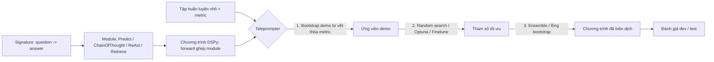

# Paper 29 Summary

## Citation

Tên bài: DSPy: Compiling Declarative Language Model Calls into Self-Improving Pipelines
Tác giả: Omar Khattab, Arnav Singhvi, Paridhi Maheshwari, Zhiyuan Zhang, Keshav Santhanam, Sri Vardhamanan, Saiful Haq, Ashutosh Sharma, Thomas T. Joshi, Hanna Moazam, Heather Miller, Matei Zaharia, Christopher Potts
Năm: 2024 (bản arXiv v1: 10/2023)
Nguồn: The Twelfth International Conference on Learning Representations (ICLR 2024) — hội nghị có bình duyệt (Spotlight). Lưu ý: tên chính thức trong kỷ yếu ICLR là “DSPy: Compiling Declarative Language Model Calls into **State-of-the-Art** Pipelines”; bản arXiv/PDF tham chiếu dùng tên “…Self-Improving Pipelines”.
DOI/Link: https://proceedings.iclr.cc/paper_files/paper/2024/hash/f1cf02ce09757f57c3b93c0db83181e0-Abstract-Conference.html (bản arXiv: https://arxiv.org/abs/2310.03714, DOI 10.48550/arXiv.2310.03714)

## Problem

**Tóm tắt tổng quan.** Bài báo giới thiệu DSPy, một mô hình lập trình coi pipeline LLM là “đồ thị biến đổi văn bản” (text transformation graph): các lời gọi LM được khai báo bằng *signature* (mô tả vào/ra bằng ngôn ngữ tự nhiên), cài đặt bằng *module* có tham số, và được *teleprompter* (bộ tối ưu) tự động biên dịch thành prompt/demo hoặc trọng số tinh chỉnh dựa trên một metric. Trên GSM8K và HotPotQA, chương trình DSPy vài dòng, sau vài phút biên dịch, giúp GPT-3.5 và llama2-13b-chat vượt few-shot chuẩn lần lượt hơn 25% và 65%, và vượt pipeline dùng demo chuyên gia lần lượt 5–46% và 16–40%.

**Bối cảnh và động lực.** Các pipeline LM hiện tại thường dựa vào “prompt template” dài, viết thủ công qua thử–sai; chúng dễ gãy khi đổi mô hình, đổi dữ liệu hay đổi pipeline. Tác giả muốn chuyển việc xây dựng pipeline từ thao tác chuỗi prompt sang lập trình hệ thống, tương tự cách thư viện mạng nơ-ron trừu tượng hóa các lớp và bộ tối ưu.

## Method

1. **Signature:** khai báo hành vi như `"question -> answer"` hoặc `"context, question -> search_query"`; trình biên dịch tự suy luận cách prompt/tinh chỉnh.
2. **Module có tham số:** `Predict`, `ChainOfThought`, `ReAct`, `MultiChainComparison`, `Retrieve`…; tham số gồm LM sử dụng, chỉ dẫn và các demo. Module được ghép tự do trong phương thức `forward` kiểu define-by-run.
3. **Teleprompter / trình biên dịch (3 giai đoạn):** (i) sinh ứng viên — chạy chương trình (có thể dùng chương trình “thầy”) trên tập huấn luyện, giữ các vết (trace) thỏa metric làm demo; (ii) tối ưu tham số — random search hoặc Optuna trên tập validation, hoặc `BootstrapFinetune` để tinh chỉnh trọng số; (iii) tối ưu bậc cao — ví dụ `Ensemble` kết hợp nhiều chương trình bằng biểu quyết đa số.
4. **Nhãn tối thiểu:** chỉ cần nhãn cho đầu ra cuối (hoặc thậm chí chỉ đầu vào); không cần nhãn cho bước trung gian.

## Dataset

- **GSM8K:** lấy 200 cặp hỏi–đáp làm train và 300 làm dev từ tập huấn luyện chính thức; đánh giá cuối trên 1,3 nghìn mẫu test chính thức.
- **HotPotQA (fullwiki):** chỉ mục Wikipedia 2017 “abstracts”, truy hồi bằng ColBERTv2; vì test bị ẩn nên dùng 1000 mẫu từ tập validation chính thức làm test; train/dev lần lượt 200/300 mẫu “hard”.
- Mô hình: GPT-3.5 (gpt-3.5-turbo), llama2-13b-chat, và T5-Large (770M) cho tinh chỉnh.

## Evaluation

GSM8K: độ chính xác của giá trị số cuối cùng trong đầu ra. HotPotQA: Exact Match câu trả lời (Ans) và độ chính xác truy hồi cặp đoạn (Psg). So sánh các chiến lược biên dịch: none (zero-shot), fewshot (LabeledFewShot k=8, trung bình 3–5 lần chạy), bootstrap, bootstrap×2, ensemble, và +human CoT (dùng chuỗi suy luận của người).

## Results

- **GSM8K – GPT-3.5:** chương trình vanilla tăng từ 24,0% (none) lên 64,7% (bootstrap×2, dev); CoT đạt 80,3% với bootstrap và 88,3% dev / 81,6% test với ensemble; chương trình reflection đạt 83,0% (bootstrap) và 86,7% (ensemble). Bootstrap đạt hoặc vượt +human CoT.
- **GSM8K – llama2-13b-chat:** tăng từ 7,0% lên 49,0%; nhìn chung các chương trình tăng từ khoảng 4–20% lên 49–88%.
- **HotPotQA – GPT-3.5:** multihop bootstrap đạt 48,7% Ans / 47,0% Psg (dev), ensemble 54,7% Ans; trên test 45,6% (đánh dấu * vì chỉ đánh giá trên 50% tập test do chi phí).
- **HotPotQA – llama2-13b-chat:** multihop ensemble 50,0% dev và 41,0% test — cạnh tranh với GPT-3.5.
- **Tinh chỉnh T5-Large:** 39,3% EM và 46,0% Psg trên dev, chỉ dùng 200 đầu vào có nhãn và 800 không nhãn.
- Thời gian biên dịch: từ vài phút đến vài chục phút (ví dụ 10–20 lượt thử trên 150–300 mẫu validation).

**Điểm mạnh.**

- Trừu tượng hóa rõ ràng (signature–module–teleprompter), giúp tách logic pipeline khỏi chuỗi prompt cụ thể; dễ đổi LM.
- Tiết kiệm nhãn: chỉ cần nhãn đầu ra cuối, tập huấn luyện vài trăm mẫu.
- Thực nghiệm cho thấy mô hình mở 13B có thể cạnh tranh với GPT-3.5 nhờ biên dịch; có cả hướng tinh chỉnh sang mô hình nhỏ (770M).
- Mã nguồn mở, các chương trình trong bài chỉ vài dòng nên dễ tái lập.

## Limitations

**(a) Bài báo thừa nhận:** chỉ báo cáo hai case study; các tác vụ khác (trích xuất thông tin, sinh dữ liệu tổng hợp…) được để lại cho nghiên cứu sau. Một số kết quả HotPotQA chỉ đánh giá trên 50% tập test vì chi phí. Việc so sánh với các công trình khác chỉ mang tính “không chính thức” (informal) do khác thiết lập.

**(b) Quan sát:** bài báo không có mục hạn chế riêng; không đề cập chi phí token/tiền khi biên dịch so với lợi ích, độ ổn định của random search giữa các lần chạy (ngoài fewshot), hay rủi ro quá khớp vào tập dev 300 mẫu. Metric được giả định là đáng tin cậy — nếu metric chỉ đo khớp chuỗi thì chương trình có thể tối ưu “lách” metric (chính bài ghi nhận vanilla tận dụng trường answer để suy luận). Không có thử nghiệm đa ngôn ngữ hay miền chuyên ngành như pháp lý.

## Relevance to our topic

Friendly Engine của Sys_3_4 là một pipeline nhiều bước (viết lại truy vấn → truy hồi lai → rerank → sinh câu trả lời với Qwen2.5-7B → verifier). DSPy gợi ý cách tách các bước này thành module có signature rõ ràng và tối ưu demo tự động thay vì chỉnh prompt thủ công mỗi khi đổi mô hình (Ollama ↔ vLLM, đổi kích thước Qwen). Kết quả llama2-13b cạnh tranh với GPT-3.5 cũng ủng hộ lựa chọn mô hình mở chạy on-prem nếu pipeline được tối ưu tốt.

**Kết luận.** DSPy đưa việc xây dựng pipeline LLM từ “nghệ thuật viết prompt” sang lập trình có thể biên dịch và tối ưu theo metric. Hai case study cho thấy mức tăng lớn với chi phí nhãn thấp và cho phép mô hình mở nhỏ cạnh tranh với mô hình thương mại. Giá trị thực tế phụ thuộc mạnh vào chất lượng metric và cần thêm bằng chứng ở các miền khác — điều tác giả để lại cho nghiên cứu tiếp theo.

## Possible improvement

- Viết metric tùy biến cho thủ tục hành chính: câu trả lời phải khớp mã thủ tục, lệ phí, thời hạn trong ngữ cảnh truy hồi (tương tự kiểm tra của `verify_point`), rồi dùng BootstrapFewShot để chọn demo cho bước sinh câu trả lời.
- Giữ JSON Schema cho đầu ra để kiểm soát định dạng, nhưng để DSPy tối ưu phần chỉ dẫn/demo bên trong; theo dõi riêng tập test để tránh quá khớp vào dev.
