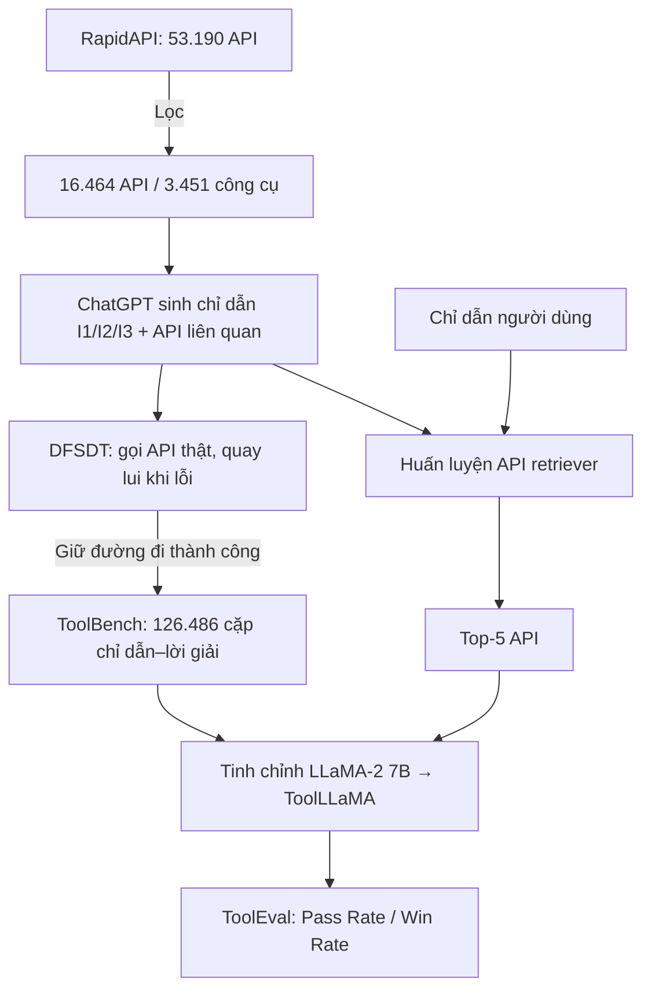

# Paper 30 Summary

## Citation

Tên bài: ToolLLM: Facilitating Large Language Models to Master 16000+ Real-world APIs
Tác giả: Yujia Qin, Shihao Liang, Yining Ye, Kunlun Zhu, Lan Yan, Yaxi Lu, Yankai Lin, Xin Cong, Xiangru Tang, Bill Qian, Sihan Zhao, Lauren Hong, Runchu Tian, Ruobing Xie, Jie Zhou, Mark Gerstein, Dahai Li, Zhiyuan Liu, Maosong Sun (Tsinghua University, Yale, Renmin University, Tencent WeChat AI…)
Năm: 2024 (bản arXiv v2: 10/2023)
Nguồn: The Twelfth International Conference on Learning Representations (ICLR 2024) — hội nghị có bình duyệt
DOI/Link: https://proceedings.iclr.cc/paper_files/paper/2024/hash/28e50ee5b72e90b50e7196fde8ea260e-Abstract-Conference.html (bản arXiv: https://arxiv.org/abs/2307.16789, DOI 10.48550/arXiv.2307.16789)

## Problem

**Tóm tắt tổng quan.** Bài báo đề xuất ToolLLM, một khung tổng quát cho năng lực dùng công cụ (API) của LLM mã nguồn mở, gồm: bộ dữ liệu tinh chỉnh chỉ dẫn ToolBench (16.464 REST API thật từ RapidAPI, 49 danh mục), thuật toán suy luận cây quyết định tìm kiếm theo chiều sâu (DFSDT), bộ đánh giá tự động ToolEval, bộ truy hồi API dạng dense, và mô hình ToolLLaMA (LLaMA-2 7B tinh chỉnh). ToolLLaMA đạt hiệu năng gần với ChatGPT (mô hình “thầy”) và tổng quát hóa sang API chưa thấy cũng như sang bộ dữ liệu ngoài phân phối APIBench.

**Bối cảnh và động lực.** LLM mở như LLaMA dù đã tinh chỉnh chỉ dẫn vẫn yếu khi phải gọi API để thực hiện yêu cầu, do dữ liệu chỉ dẫn hiện có tập trung vào tác vụ ngôn ngữ cơ bản. Các bộ dữ liệu công cụ trước đó có ba hạn chế: (1) API ít, kém đa dạng hoặc không phải API thật; (2) chỉ một công cụ, và giả định người dùng chỉ định sẵn tập API; (3) suy luận bằng CoT/ReACT dễ lan truyền lỗi và khám phá hạn chế; một số còn không thực thi API thật.

## Method

1. **Thu thập API:** thu 10.853 công cụ (53.190 API) từ RapidAPI, lọc nghiêm ngặt còn 3.451 công cụ (16.464 API), lưu tài liệu: mô tả, tham số bắt buộc/tùy chọn, đoạn mã gọi, ví dụ phản hồi.
2. **Sinh chỉ dẫn:** lấy mẫu tập API và nhờ ChatGPT (gpt-3.5-turbo-16k) sinh chỉ dẫn kèm API liên quan, dùng 12/36 ví dụ mẫu do người viết cho bối cảnh một/đa công cụ. Ba loại: một công cụ (I1), đa công cụ cùng danh mục (I2), đa công cụ cùng collection (I3); lọc chỉ dẫn có API “ảo giác”.
3. **Gán đường đi lời giải bằng DFSDT:** ChatGPT gọi API thật qua function-call; mỗi nút có thể tiếp tục hoặc “Finish by Giving Up” để quay lui và mở nút mới khác biệt; dùng DFS (thay BFS) để tiết kiệm lời gọi; chỉ giữ đường đi thành công.
4. **Huấn luyện:** tinh chỉnh LLaMA-2 7B, mở rộng ngữ cảnh 4096 → 8192 bằng positional interpolation; huấn luyện bộ truy hồi API Sentence-BERT (BERT-base) bằng học tương phản.
5. **ToolEval:** dùng ChatGPT chấm Pass Rate (hoàn thành trong ngân sách giới hạn) và Win Rate (so sánh với ChatGPT-ReACT).

## Dataset

ToolBench: 16.464 API, 3.451 công cụ, gần 200 nghìn cặp (chỉ dẫn, API liên quan) — 87.413 (I1), 84.815 (I2), 25.251 (I3); 126.486 cặp (chỉ dẫn, đường đi lời giải); 469.585 lời gọi API thật; trung bình 4,0 vết suy luận. Kiểm thử tổng quát ở ba mức: chỉ dẫn mới (Inst.), công cụ mới cùng danh mục (Tool), danh mục mới (Cat.). Ngoài phân phối: APIBench (TorchHub, TensorHub, HuggingFace).

## Evaluation

Pass Rate và Win Rate qua ToolEval (ChatGPT làm giám khảo, chạy nhiều lần lấy trung bình); NDCG@1/@5 cho truy hồi API; AST accuracy và tỷ lệ ảo giác cho APIBench. Baseline: Vicuna, Alpaca, ChatGPT, Text-Davinci-003, Claude-2, GPT-4 (mỗi mô hình với ReACT và DFSDT); BM25 và text-embedding-ada-002 cho truy hồi; Gorilla cho APIBench.

## Results

- **ToolEval** đồng thuận với người chú thích 87,1% (pass rate) và 80,3% (win rate).
- **Truy hồi API** (NDCG trung bình @1/@5): BM25 18,5/17,0; Ada 49,6/45,4; bộ truy hồi của tác giả 78,0/84,9.
- **DFSDT vs ReACT** (pass rate trung bình với ChatGPT): ReACT 35,3; ReACT@N (cùng chi phí) 44,5; DFSDT 63,8 — cải thiện rõ hơn ở chỉ dẫn khó (I2, I3).
- **Kết quả chính (trung bình Pass/Win):** ChatGPT-DFSDT 64,8/64,3; GPT-4-DFSDT 71,1/70,4; Claude-2-DFSDT 22,6/43,5; Text-Davinci-003-DFSDT 43,1/46,3; Vicuna và Alpaca 0/0; ToolLLaMA-ReACT 29,0/47,0; ToolLLaMA-DFSDT 66,7/60,0; ToolLLaMA-DFSDT kèm bộ truy hồi 67,3/63,1 — dùng API truy hồi còn tốt hơn dùng API chuẩn (oracle).
- **APIBench (OOD):** với bộ truy hồi riêng, ToolLLaMA đạt AST 16,77 (HuggingFace) và 51,16 (TorchHub), vượt Gorilla + BM25 ở cả hai thiết lập ZS/RS trên hai miền này; với oracle, ToolLLaMA luôn vượt Gorilla-ZS.

**Điểm mạnh.**

- Quy mô API thật lớn, có cả kịch bản đa công cụ và bước truy hồi API — gần thực tế hơn các bộ dữ liệu trước (so sánh trực tiếp trong Bảng 1).
- DFSDT là chiến lược quyết định tổng quát, được so sánh công bằng với ReACT@N cùng ngân sách.
- Đánh giá tổng quát hóa nhiều mức (chỉ dẫn, công cụ, danh mục) và ngoài phân phối; công bố mã, mô hình và demo.

## Limitations

**(a) Bài báo thừa nhận:** API trên RapidAPI thay đổi theo thời gian nên không thể gán một đường đi chuẩn cố định — lý do phải dùng bộ chấm tự động; DFSDT tốn nhiều lời gọi OpenAI hơn ReACT, cần cân bằng hiệu quả và chi phí (phụ lục); Gorilla không áp dụng được cho ToolBench nên so sánh chỉ một chiều.

**(b) Quan sát:** dữ liệu và giám khảo đều dựa trên ChatGPT nên có rủi ro thiên lệch về phía “thầy” và về mô hình cùng họ; win rate so với ChatGPT-ReACT là thước đo tương đối. Bài không phân tích an toàn khi LLM tự gọi API thật (quyền hạn, tác dụng phụ, chèn lệnh qua phản hồi API), cũng không đo độ trễ suy luận của DFSDT. Kết quả APIBench không đồng nhất: Gorilla-RS + BM25 vẫn tốt hơn ở TensorHub và có tỷ lệ ảo giác thấp hơn. Chỉ tiếng Anh.

## Relevance to our topic

Sys_3_4 không cho LLM tự gọi API tùy ý, nhưng có các bước tương tự “chọn công cụ”: định tuyến giữa Strict Engine và Friendly Engine, tra cứu thủ tục theo mã, và hỏi lại khi thiếu thông tin. Kết quả bộ truy hồi API dense vượt BM25 rõ rệt gợi ý cách chọn đúng “thủ tục/công cụ” từ kho 1.350 thủ tục. Đồng thời, rủi ro LLM gọi API thật củng cố lựa chọn của nhóm: giữ đường đi tất định cho tác vụ tra cứu chính xác và chỉ cho LLM hoạt động trong không gian hành động hẹp.

**Kết luận.** ToolLLM cho thấy dữ liệu tinh chỉnh chỉ dẫn quy mô lớn trên API thật, kết hợp chiến lược tìm kiếm DFSDT và bộ truy hồi API, giúp một LLM mở 7B đạt năng lực dùng công cụ gần ChatGPT và tổng quát hóa sang API mới. Đóng góp chủ yếu nằm ở dữ liệu và quy trình; độ tin cậy của đánh giá vẫn gắn với ChatGPT và các vấn đề an toàn khi gọi API thật còn để ngỏ.

## Possible improvement

- Nếu mở rộng sang tác vụ có hành động (tra trạng thái hồ sơ, đặt lịch), mô tả mỗi hành động như một API có tài liệu và dùng chiến lược quay lui kiểu DFSDT với ngân sách thời gian chặt (ràng buộc 7 giây).
- Xây bộ đánh giá kiểu ToolEval nhưng có người kiểm tra mẫu, để tránh phụ thuộc hoàn toàn vào LLM giám khảo.
