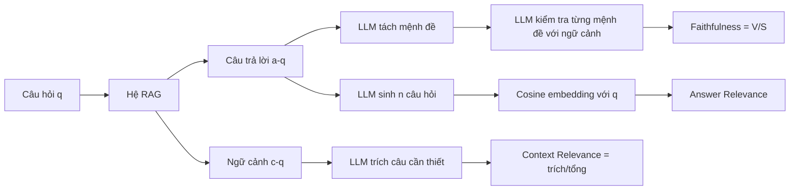

# Paper 31 Summary

## Citation

Tên bài: RAGAS: Automated Evaluation of Retrieval Augmented Generation
Tác giả: Shahul Es, Jithin James (Exploding Gradients), Luis Espinosa-Anke, Steven Schockaert (CardiffNLP, Cardiff University; AMPLYFI)
Năm: 2024
Nguồn: Proceedings of the 18th Conference of the European Chapter of the Association for Computational Linguistics (EACL 2024): System Demonstrations, tr. 150–158 — hội nghị có bình duyệt (track demo)
DOI/Link: https://aclanthology.org/2024.eacl-demo.16/ (bản arXiv: https://arxiv.org/abs/2309.15217)

## Problem

**Tóm tắt tổng quan.** Bài báo giới thiệu RAGAS (Retrieval Augmented Generation Assessment), một khung đánh giá **không cần tham chiếu** (reference-free) cho pipeline RAG, gồm ba thước đo tính bằng cách prompt LLM: Faithfulness (câu trả lời có dựa trên ngữ cảnh truy hồi), Answer Relevance (câu trả lời có đáp đúng câu hỏi) và Context Relevance (ngữ cảnh có tập trung, ít thông tin thừa). Tác giả xây bộ dữ liệu WikiEval có nhãn người để kiểm tra mức đồng thuận, và cho thấy RAGAS khớp với đánh giá của người tốt hơn hai baseline dùng ChatGPT chấm trực tiếp.

**Bối cảnh và động lực.** Hiệu năng RAG phụ thuộc vào bộ truy hồi, kho dữ liệu, LLM và cách viết prompt, nên cần đánh giá tự động để tinh chỉnh nhanh. Các cách phổ biến có hạn chế: perplexity không phản ánh hiệu năng tác vụ và không truy cập được với mô hình đóng; bộ QA thường chỉ có câu trả lời trích xuất ngắn; trong thực tế thường không có câu trả lời tham chiếu do người gán nhãn.

## Method

1. **Faithfulness:** LLM tách câu trả lời thành các mệnh đề ngắn S; với mỗi mệnh đề, LLM xác định có suy ra được từ ngữ cảnh hay không (giải thích trước rồi kết luận Yes/No). Điểm F = |V| / |S| (số mệnh đề được hỗ trợ / tổng số mệnh đề).
2. **Answer Relevance:** LLM sinh n câu hỏi từ câu trả lời; tính cosine giữa embedding (text-embedding-ada-002) của câu hỏi gốc và từng câu hỏi sinh ra; AR là trung bình. Thước đo không xét tính đúng sự kiện, mà phạt câu trả lời thiếu hoặc thừa.
3. **Context Relevance:** LLM trích các câu cần thiết trong ngữ cảnh (không được sửa câu; trả “Insufficient Information” nếu không có); CR = số câu trích / tổng số câu.
4. Tất cả prompt chạy trên gpt-3.5-turbo-16k; yêu cầu đầu ra JSON để tăng ổn định; tích hợp llama-index và LangChain, có Python API.

## Dataset

WikiEval (do tác giả tạo): 50 trang Wikipedia về các sự kiện từ đầu năm 2022 (sau mốc dữ liệu huấn luyện của mô hình), ưu tiên trang mới chỉnh sửa. ChatGPT sinh câu hỏi từ phần mở đầu và trả lời dựa trên phần đó. Tạo cặp đối chứng: câu trả lời không có ngữ cảnh (cho faithfulness), câu trả lời “không đầy đủ” (cho answer relevance), và ngữ cảnh bổ sung câu ít liên quan từ back-link hoặc do ChatGPT viết thêm (cho context relevance). Hai người chú thích đồng thuận khoảng 95% (faithfulness, context relevance) và khoảng 90% (answer relevance).

## Evaluation

Mỗi mẫu WikiEval yêu cầu chọn giữa hai câu trả lời/ngữ cảnh; đo độ chính xác (tỷ lệ trùng với lựa chọn của người). Baseline: GPT Score (ChatGPT chấm 0–10, hòa thì chọn ngẫu nhiên) và GPT Ranking (ChatGPT chọn câu tốt hơn). Thêm phân tích tính tái lập: tương quan điểm giữa hai lần chạy có và không có định dạng JSON.

## Results

- **Bảng 4 (độ chính xác so với người):** RAGAS 0,95 (Faithfulness), 0,78 (Answer Relevance), 0,70 (Context Relevance); GPT Score lần lượt 0,72 / 0,52 / 0,63; GPT Ranking 0,54 / 0,40 / 0,52.
- Faithfulness được ước lượng rất chính xác; Answer Relevance thấp hơn do hai câu trả lời ứng viên thường khác nhau rất tinh tế; Context Relevance khó nhất — ChatGPT thường gặp khó khi chọn câu quan trọng trong ngữ cảnh dài.
- Định dạng JSON làm điểm giữa các lần chạy nhất quán rõ rệt hơn (Hình 1; bài chỉ trình bày bằng biểu đồ, không có số cụ thể).

**Điểm mạnh.**

- Không cần câu trả lời tham chiếu, phù hợp giai đoạn phát triển khi chưa có dữ liệu gán nhãn; tách riêng chất lượng truy hồi và chất lượng sinh.
- Faithfulness dựa trên phân rã mệnh đề và kiểm tra từng mệnh đề — dễ diễn giải hơn chấm điểm tổng thể.
- Có bộ dữ liệu WikiEval công khai, mã nguồn mở, tích hợp sẵn với framework RAG phổ biến; nêu vấn đề tái lập khi dùng LLM.

## Limitations

**(a) Bài báo thừa nhận:** khung đánh giá phụ thuộc mạnh vào năng lực của LLM dùng để đánh giá; cần xem xét kỹ tính phù hợp của LLM, ưu tiên mô hình mở thay vì sản phẩm trả phí; kết quả có thể khác nhau giữa các lần chạy do thay đổi API hoặc tính ngẫu nhiên; Context Relevance khó ước lượng với ngữ cảnh dài.

**(b) Quan sát:** WikiEval rất nhỏ (50 câu hỏi), một miền (Wikipedia tiếng Anh), và phần lớn dữ liệu (câu hỏi, câu trả lời, ngữ cảnh nhiễu) do chính ChatGPT tạo, trong khi đánh giá cũng dùng ChatGPT — có thể làm tăng mức đồng thuận. Đánh giá chỉ là so sánh cặp với các cặp được tạo nhân tạo, không đo tương quan với điểm tuyệt đối. Answer Relevance phụ thuộc mô hình embedding; bài không thử LLM đánh giá khác, không báo cáo chi phí/độ trễ. Không đánh giá tính đúng sự kiện so với nguồn chuẩn (một câu trả lời trung thành với ngữ cảnh sai vẫn được điểm cao).

## Relevance to our topic

RAGAS cung cấp bộ thước đo trực tiếp cho Friendly Engine của Sys_3_4: Faithfulness tương ứng với mục tiêu “không ảo giác” của RQ3, Context Relevance phản ánh chất lượng truy hồi lai BGE-M3 + RRF + reranker (RQ1). Cơ chế tách mệnh đề rồi kiểm tra từng mệnh đề cũng gần với cách `verify_point` kiểm chứng từng điểm (lệ phí, thời hạn, cơ quan) trong câu trả lời.

**Kết luận.** RAGAS đề xuất ba thước đo không cần tham chiếu cho RAG, tính bằng prompt LLM, và cho thấy chúng khớp với đánh giá của người tốt hơn cách để ChatGPT chấm trực tiếp, nhất là với Faithfulness. Đây là công cụ thực dụng cho chu kỳ phát triển nhanh, nhưng bằng chứng thực nghiệm còn hẹp (50 câu hỏi, một miền, một LLM đánh giá), nên cần kiểm định lại trên miền và ngôn ngữ đích trước khi dùng làm thước đo chính.

## Possible improvement

- Dùng RAGAS với LLM đánh giá chạy cục bộ (Qwen2.5) để giữ dữ liệu on-prem, nhưng hiệu chỉnh bằng một tập nhỏ có nhãn người tiếng Việt, vì độ đồng thuận trên WikiEval tiếng Anh không đảm bảo chuyển sang tiếng Việt.
- Bổ sung kiểm tra tất định cho các trường số (lệ phí, thời hạn) thay vì chỉ dựa vào phán đoán của LLM, và báo cáo song song Faithfulness với tỷ lệ sai số liệu.
