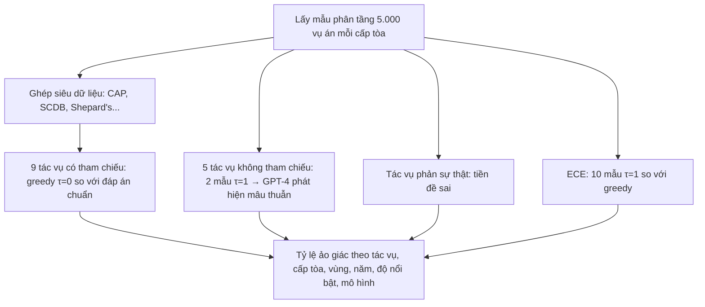

# Paper 32 Summary

## Citation

Tên bài: Large Legal Fictions: Profiling Legal Hallucinations in Large Language Models
Tác giả: Matthew Dahl (Yale), Varun Magesh, Mirac Suzgun, Daniel E. Ho (Stanford University, RegLab)
Năm: 2024
Nguồn: Journal of Legal Analysis, Vol. 16, No. 1, tr. 64–93 (Oxford University Press; truy cập mở, xuất bản trực tuyến 26/06/2024) — tạp chí có bình duyệt (bài cảm ơn ba người phản biện ẩn danh)
DOI/Link: https://doi.org/10.1093/jla/laae003

## Problem

**Tóm tắt tổng quan.** Bài báo là nghiên cứu thực nghiệm có hệ thống đầu tiên về “ảo giác pháp lý” (legal hallucination) của LLM công khai, dùng 14 tác vụ truy vấn kiến thức án lệ liên bang Hoa Kỳ ở ba cấp tòa (Tòa Tối cao – SCOTUS, Tòa Phúc thẩm – USCOA, Tòa Quận – USDC). Với câu hỏi trực tiếp, kiểm chứng được về một vụ án chọn ngẫu nhiên, các LLM ảo giác từ 58% (ChatGPT 4) đến 88% (Llama 2). Ngoài ra, LLM thường chấp nhận tiền đề pháp lý sai của người dùng và đánh giá kém mức độ chắc chắn của chính mình. Bài đề xuất một phân loại ảo giác pháp lý.

**Bối cảnh và động lực.** LLM đang được dùng trong giáo dục, nghiên cứu và hành nghề luật, và được kỳ vọng mở rộng tiếp cận công lý cho người tự tố tụng (pro se) hoặc thiếu nguồn lực. Tuy nhiên, các bằng chứng về ảo giác (luật sư bị xử phạt vì trích dẫn án bịa…) chủ yếu mang tính giai thoại. Tác giả muốn đo tần suất, tính chất và các yếu tố tương quan của ảo giác theo cấp tòa, vùng tài phán, thời gian và mức nổi bật của vụ án — đồng thời cảnh báo nguy cơ “độc canh pháp lý” (legal monoculture).

## Method

1. **Phân loại ảo giác:** (i) không nhất quán với prompt (closed-domain); (ii) không nhất quán với dữ liệu huấn luyện; (iii) không nhất quán với sự thật của thế giới — bài chỉ nghiên cứu loại (iii), loại luật sư không thể chấp nhận. Tác giả chỉ ra các loại này có thể xung đột (trung thành với prompt sai dẫn tới sai sự thật).
2. **14 tác vụ theo 3 mức độ phức tạp:** thấp (Existence, Court, Citation, Author); trung bình (Disposition, Quotation, Authority, Overruling year); cao (Doctrinal agreement, Factual background, Procedural posture, Subsequent history, Core legal question, Central holding).
3. **Truy vấn có tham chiếu** (9 tác vụ đầu): so câu trả lời greedy (nhiệt độ 0) với siêu dữ liệu chuẩn; câu từ chối trả lời được tính là không ảo giác.
4. **Truy vấn không tham chiếu** (5 tác vụ cuối): lấy hai câu trả lời ở nhiệt độ 1, nhờ GPT-4 phát hiện mâu thuẫn; mâu thuẫn chắc chắn là ảo giác nên chỉ cho **cận dưới** của tỷ lệ ảo giác. Độ tin cậy của GPT-4 được kiểm tra bằng gán nhãn thủ công (Phụ lục trực tuyến).
5. **Thiên lệch phản sự thật:** hỏi về ý kiến bất đồng không tồn tại và năm bị bác bỏ của án chưa từng bị bác bỏ.
6. **Hiệu chỉnh:** ước lượng ECE bằng cách lấy 10 mẫu ở nhiệt độ 1 và đo mức đồng ý với câu trả lời greedy.

## Dataset

Lấy mẫu ngẫu nhiên phân tầng (theo năm với SCOTUS, theo circuit–năm với USCOA, theo bang–năm với USDC), 5.000 vụ án mỗi cấp; siêu dữ liệu từ Caselaw Access Project, Supreme Court Database, Appeals Courts Database, Library of Congress và Shepard's Citations. Doctrinal agreement: 2.839 cặp “đồng ý” và 2.161 cặp “không đồng ý” (chỉ SCOTUS). Overruling year: 279 án SCOTUS từng bị bác bỏ. Tác vụ phức tạp cao: 100 vụ mỗi cấp; tác vụ phản sự thật: 1.000 mỗi cấp. Mô hình: gpt-4-1106-preview, gpt-3.5-turbo-0613, PaLM 2 (text-bison-001), Llama-2-13b-chat-hf; zero-shot và three-shot. Tổng cộng hơn 800.000 truy vấn. Dữ liệu tái lập công bố trên Harvard Dataverse và HuggingFace.

## Evaluation

Tỷ lệ ảo giác ước lượng (kèm sai số chuẩn) theo tác vụ và cấp tòa; tương quan với vùng tài phán, độ nổi bật (PageRank percentile), năm quyết định và mô hình; tỷ lệ chấp nhận tiền đề sai; sai số hiệu chỉnh kỳ vọng (ECE).

## Results

- **Tổng quát:** với câu hỏi trực tiếp, kiểm chứng được, tỷ lệ ảo giác từ 58% (ChatGPT 4) đến 88% (Llama 2); thứ tự tốt nhất: GPT-4 > GPT-3.5 > PaLM 2 > Llama 2. Zero-shot và few-shot không khác biệt đáng kể.
- **Theo độ phức tạp:** ảo giác tăng theo độ phức tạp. Existence tốt nhất một phần vì mô hình có xu hướng luôn trả lời “có”. Doctrinal agreement có tỷ lệ gần 0,5 — không hơn đoán ngẫu nhiên. Cận dưới với Factual background và Procedural posture là ít nhất 49%; Core legal question ít nhất 59%; Central holding ít nhất 63% (so với khoảng 14,3% của GPT-3.5 trên QA tổng quát trong một nghiên cứu trước dùng cùng cách tự mâu thuẫn).
- **Theo cấp tòa và vùng:** ảo giác thấp nhất ở SCOTUS, cao nhất ở USDC; tốt nhất ở các Circuit 2, 3, 9 và 1, nhưng — trái trực giác — kém nhất ở D.C. Circuit.
- **Theo độ nổi bật và thời gian:** ảo giác giảm mạnh khi độ nổi bật vượt bách phân vị 90; quan hệ phi tuyến với năm — cao nhất ở án rất cũ và rất mới, thấp nhất ở thời kỳ Warren Court (1953–1969).
- **Thiên lệch quy nạp:** mô hình gán quá nhiều án cho một số thẩm phán nổi tiếng (ví dụ Llama 2 ưu tiên Justice Story, PaLM 2 ưu tiên Justice McLean).
- **Phản sự thật:** LLM thường trả lời như thể tiền đề sai là đúng, tệ hơn ở cấp tòa thấp và với câu hỏi năm bị bác bỏ; Llama 2 ít ảo giác loại này nhưng vì thường bác bỏ luôn sự tồn tại của vụ án/thẩm phán.
- **Hiệu chỉnh (ECE gộp):** PaLM 2 0,057; GPT-3.5 0,099; GPT-4 0,190; Llama 2 0,421. Tất cả đều tự tin quá mức; GPT-4 tuy ít ảo giác nhất nhưng kém hiệu chỉnh hơn GPT-3.5 và PaLM 2.

**Điểm mạnh.**

- Quy mô lớn (hơn 800 nghìn truy vấn), lấy mẫu phân tầng cho phép suy luận thống kê theo nhiều chiều; có sai số chuẩn.
- Kết hợp phương pháp có tham chiếu và không tham chiếu, nói rõ cận dưới khi không có đáp án chuẩn.
- Phân loại ảo giác giúp làm rõ đánh đổi giữa trung thành với prompt, với dữ liệu huấn luyện và với sự thật.
- Công bố dữ liệu và lời gọi API thô để tái lập; thảo luận cả khía cạnh chuẩn tắc và công bằng tiếp cận công lý.

## Limitations

**(a) Bài báo thừa nhận:** phương pháp không tham chiếu chỉ cho cận dưới và không bắt được câu trả lời sai lặp lại nhất quán (ví dụ Subsequent history của GPT-4 ở SCOTUS có thể bị đánh giá thấp hơn thực tế); phụ thuộc GPT-4 để phát hiện mâu thuẫn; chỉ nghiên cứu loại ảo giác thứ ba; các giải pháp như RAG, prompt nâng cao, tinh chỉnh hay kiểm tra cơ sở dữ liệu đều có hạn chế riêng (phụ thuộc chất lượng truy hồi, dữ liệu mâu thuẫn hoặc lỗi thời, thước đo đánh giá không hoàn hảo).

**(b) Quan sát:** chỉ đánh giá LLM đa dụng không có truy hồi — kết quả không trực tiếp áp dụng cho hệ RAG; các phiên bản mô hình đã cũ (2023). Chỉ án lệ liên bang Hoa Kỳ (hệ thống thông luật), không có văn bản quy phạm hay thủ tục hành chính, không có ngôn ngữ khác tiếng Anh. Nhiều chi tiết (prompt, kiểm tra độ tin cậy, hiệu chỉnh sau) nằm ở Phụ lục trực tuyến, không có trong bản PDF chính.

## Relevance to our topic

Bài cung cấp bằng chứng định lượng cho giả định nền của Sys_3_4: không thể để LLM tự trả lời từ kiến thức tham số trong miền pháp lý. Kết quả “ảo giác cao hơn với thông tin địa phương, ít nổi bật” tương ứng trực tiếp với thủ tục hành chính cấp xã/huyện ở Việt Nam. Hiện tượng chấp nhận tiền đề sai củng cố nhu cầu bước hỏi lại (clarify) và kiểm chứng tiền đề; việc LLM tự tin quá mức cho thấy không nên dùng độ tự tin của mô hình thay cho bộ kiểm chứng tất định `verify_point`.

**Kết luận.** Bài báo cho thấy ảo giác pháp lý ở LLM đa dụng là phổ biến, tăng theo độ phức tạp, nghiêng về các tòa và vụ án nổi bật, đi kèm thiên lệch chấp nhận tiền đề sai và tự tin quá mức. Tác giả kết luận rủi ro cao nhất rơi vào những người được kỳ vọng hưởng lợi nhiều nhất (người tự tố tụng, ít nguồn lực), và nhà phát triển cần minh bạch về loại ảo giác mà hệ thống ưu tiên giảm thiểu.

## Possible improvement

- Xây bộ kiểm thử tiếng Việt theo cách của bài: câu hỏi có đáp án tra được (mã thủ tục, lệ phí, cơ quan, thời hạn) và câu hỏi có tiền đề sai (“thủ tục X đã bị bãi bỏ năm nào?”), đo riêng tỷ lệ chấp nhận tiền đề sai.
- Phân tầng đánh giá theo cấp hành chính và độ phổ biến của thủ tục để phát hiện thiên lệch với thủ tục ít gặp.
