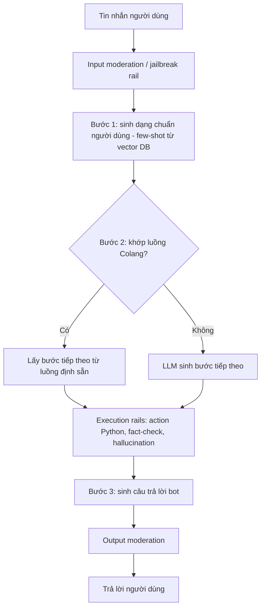

# Paper 33 Summary

## Citation

Tên bài: NeMo Guardrails: A Toolkit for Controllable and Safe LLM Applications with Programmable Rails
Tác giả: Traian Rebedea, Razvan Dinu, Makesh Sreedhar, Christopher Parisien, Jonathan Cohen (NVIDIA)
Năm: 2023
Nguồn: Proceedings of the 2023 Conference on Empirical Methods in Natural Language Processing: System Demonstrations (EMNLP 2023 Demo), tr. 431–445 — hội nghị có bình duyệt (track demo)
DOI/Link: https://aclanthology.org/2023.emnlp-demo.40/ (DOI 10.18653/v1/2023.emnlp-demo.40)

## Problem

**Tóm tắt tổng quan.** Bài báo giới thiệu NeMo Guardrails, bộ công cụ mã nguồn mở (Apache 2.0) để thêm các “rail” (hàng rào) có thể lập trình vào ứng dụng hội thoại dùng LLM. Khác với rail “nhúng” vào mô hình qua căn chỉnh (alignment) khi huấn luyện, rail lập trình được định nghĩa lúc chạy bằng ngôn ngữ mô hình hóa Colang, độc lập với LLM nền và có thể diễn giải. Runtime đóng vai trò proxy giữa người dùng và LLM, giống một bộ quản lý hội thoại. Kết quả ban đầu cho thấy cách tiếp cận dùng được với nhiều nhà cung cấp LLM, kể cả mô hình mở cỡ nhỏ.

**Bối cảnh và động lực.** Để triển khai thực tế, LLM cần bám chủ đề qua nhiều lượt, tránh ảo giác và chống tấn công chèn lệnh/jailbreak. Căn chỉnh mô hình cần nhiều dữ liệu gán nhãn và khó thay đổi lúc chạy; prompt/CoT đơn thuần khó kiểm soát; hệ hội thoại truyền thống (NLU + quản lý hội thoại như Rasa) thì cứng nhắc và tốn công thiết kế. Tác giả muốn kết hợp tính kiểm soát của quản lý hội thoại với khả năng tổng quát của LLM.

## Method

1. **Colang và dạng chuẩn (canonical form):** kịch bản gồm dạng chuẩn của người dùng, luồng hội thoại và dạng chuẩn của bot; tất cả được đánh chỉ mục trong cơ sở dữ liệu vector (Annoy, FAISS) để chọn ví dụ few-shot theo độ tương đồng.
2. **Topical rails – runtime 3 bước:** (i) sinh dạng chuẩn cho câu người dùng bằng few-shot; (ii) quyết định bước tiếp theo — theo luồng định sẵn nếu khớp, nếu không thì để LLM sinh luồng tương tự; (iii) sinh câu trả lời của bot theo bước đó (ví dụ “bot inform cannot answer” để né câu hỏi chính trị).
3. **Execution rails:** hành động tùy biến viết bằng Python, gọi từ Colang bằng từ khóa `execute`, gồm:
   - *Fact-checking rail:* coi là bài toán suy diễn (entailment) — LLM trả lời yes/no câu trả lời có được hỗ trợ bởi bằng chứng truy hồi không;
   - *Hallucination rail:* tự nhất quán kiểu SelfCheckGPT — lấy n mẫu, ghép n−1 làm ngữ cảnh và kiểm tra mẫu thứ n;
   - *Moderation rails:* kiểm duyệt đầu vào (jailbreak rail) và đầu ra bằng một LLM được căn chỉnh tốt.

## Dataset

- Topical rails: bộ NLU Banking (Casanueva et al., 2022) chuyển thành ứng dụng Colang; tập kiểm thử cân bằng 231 mẫu, 77 intent (tối đa 3 mẫu/intent); thêm bộ dữ liệu khác ở Phụ lục G.
- Moderation: Anthropic Red-Teaming (prompt có điểm có hại cao nhất) và Helpful, lấy mẫu cân bằng.
- Fact-checking: MS MARCO; câu trả lời âm “khó” được tạo bằng cách nhờ text-davinci-003 viết lại câu trả lời đúng.
- Hallucination: 20 câu hỏi có tiền đề sai (không có câu trả lời đúng).

## Evaluation

Topical rails: độ chính xác của dạng chuẩn, bước tiếp theo và câu trả lời bot qua từng bước. Moderation: tỷ lệ prompt có hại bị chặn và tỷ lệ prompt hữu ích được cho qua. Fact-checking: độ chính xác phân loại entailment. Hallucination: tỷ lệ câu hỏi tiền đề sai được né/chặn (mọi câu trả lời khác né tránh đều tính là thất bại). Mô hình: text-davinci-003, gpt-3.5-turbo, falcon-7b-instruct, llama2-13b-chat…

## Results

- **Topical rails:** dùng được với cả mô hình mở nhỏ (falcon-7b-instruct, llama2-13b-chat); mỗi bước trong quy trình 3 bước đều cải thiện hiệu năng; cần ít nhất k = 3 mẫu mỗi dạng chuẩn trong vector DB; với mô hình sinh dạng chuẩn đa dạng (gpt-3.5-turbo) nên dùng khớp tương đồng thay vì khớp chính xác. Bài chỉ trình bày bằng biểu đồ (Hình 5), không nêu số cụ thể trong phần chính.
- **Moderation:** dùng cả rail đầu vào và đầu ra bền vững hơn hẳn dùng riêng một rail; với gpt-3.5-turbo chặn gần 99% prompt có hại (so với 93% khi không có rail) và chỉ chặn 2% prompt hữu ích.
- **Fact-checking:** text-davinci-003 và gpt-3.5-turbo đạt độ chính xác tổng thể khoảng 80%.
- **Hallucination:** text-davinci-003 tự nó không né được câu hỏi tiền đề sai, rail chặn được 70%; gpt-3.5-turbo tự né hoặc cảnh báo ở 65% trường hợp, có rail tăng lên 95%.

**Điểm mạnh.**

- Tách chính sách hành vi khỏi mô hình: rail tường minh, có thể diễn giải, độc lập với LLM và thay đổi lúc chạy.
- Kết hợp quản lý hội thoại có cấu trúc với khả năng tổng quát của LLM (LLM sinh luồng mới khi chưa định nghĩa).
- Cung cấp sẵn rail an toàn (kiểm chứng, ảo giác, kiểm duyệt) và công cụ đánh giá; mã nguồn mở, có ví dụ.

## Limitations

**(a) Bài báo thừa nhận:** rail lập trình bằng prompt và Colang không phải giải pháp hoàn hảo; không nên dùng đơn lẻ, đặc biệt với rail an toàn — cần kết hợp với rail nhúng trong mô hình. Ba lời gọi CoT nối tiếp không thể gộp batch, làm độ trễ và chi phí tăng khoảng 3 lần so với một lời gọi thông thường; prompt phức tạp hơn cũng tăng chi phí. Rail cần được kiểm thử kỹ trước khi đưa vào sản xuất.

**(b) Quan sát:** là bài demo nên đánh giá còn nhỏ và chủ yếu bằng biểu đồ (20 câu hỏi tiền đề sai cho hallucination rail; 231 mẫu cho topical rails); nhiều số liệu nằm ở phụ lục. Các rail an toàn đều dựa vào chính LLM để phán xét, nên không có đảm bảo tất định; không đánh giá trước các tấn công chèn lệnh gián tiếp hay thích nghi. Chỉ tiếng Anh; độ trễ không được đo trực tiếp ngoài ước lượng “khoảng 3 lần”.

## Relevance to our topic

NeMo Guardrails là tham chiếu gần nhất với tầng policy của Sys_3_4: chống chèn lệnh ở đầu vào, che PII, giới hạn chủ đề hành chính công và hỏi lại khi mơ hồ đều là “rail” tường minh nằm ngoài mô hình. Fact-checking rail dạng entailment tương ứng với ý tưởng của `verify_point`, nhưng Sys_3_4 dùng kiểm tra tất định cho số liệu thay vì để LLM phán xét. Hạn chế về độ trễ gấp ~3 lần của bài là lý do quan trọng để nhóm không đặt nhiều lời gọi LLM nối tiếp trong ngân sách 7 giây.

**Kết luận.** NeMo Guardrails đưa ra cách thêm hàng rào kiểm soát và an toàn vào ứng dụng LLM mà không cần huấn luyện lại, thông qua ngôn ngữ Colang và một runtime đóng vai trò quản lý hội thoại. Kết quả ban đầu khả quan cho kiểm duyệt và chống ảo giác, nhưng bằng chứng còn ở quy mô demo, phụ thuộc LLM để phán xét và tăng đáng kể độ trễ — tác giả khuyến nghị dùng như lớp bổ sung chứ không phải giải pháp độc lập.

## Possible improvement

- Mô tả các luật policy của Sys_3_4 theo dạng luồng (giống Colang) để dễ kiểm toán và kiểm thử từng luật.
- Đo tỷ lệ chặn câu có hại/cho qua câu hợp lệ theo cách của bài trên một bộ câu hỏi hành chính tiếng Việt, kể cả câu chèn lệnh và câu có tiền đề sai.
- Ưu tiên rail tất định (regex, danh mục chủ đề, khớp số liệu) và chỉ dùng rail dựa trên LLM khi còn dư ngân sách độ trễ.
