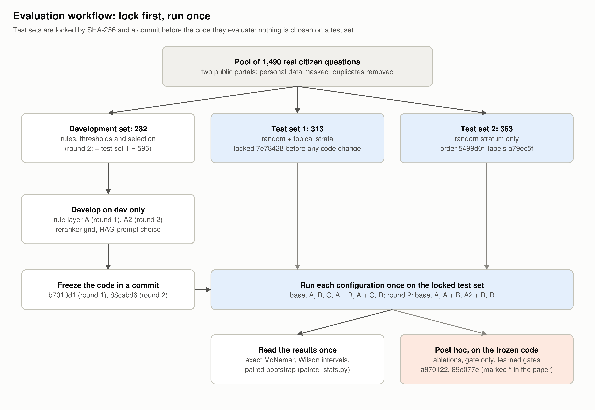

# Data Flow (khuôn bước 7)

## Luồng một câu hỏi

1. **Nhận câu hỏi.** `POST /chat` đưa câu hỏi vào hàng đợi; một worker xử lý.
2. **Nạp ngữ cảnh.** Orchestrator nạp trạng thái hội thoại: các thủ tục đã nói tới và thẻ hỏi lại đang chờ trả lời.
3. **Chuẩn hoá câu.**
   - Bỏ phần chào hỏi.
   - Tách câu thành các đoạn, mỗi đoạn ứng với một yêu cầu.
   - Đổi từ ngữ người dân dùng và chữ viết tắt sang tên chính thức.
   - Nhận ra mục người hỏi cần: giấy tờ, lệ phí, thời hạn…
4. **Xếp hạng thủ tục.**
   - Dùng IDF theo âm tiết; chữ lệch dấu bị phạt (×0,35).
   - Ngưỡng nhận: điểm ≥ 0,55 và độ phủ ≥ 0,5.
   - Tuỳ chọn B: reranker chấm lại.
   - Tuỳ chọn C: model 4B đọc ý định.
5. **Kiểm chính sách.** Thứ tự kiểm:
   - cổng ý định ngoài phạm vi;
   - mã thủ tục có thật trong dữ liệu;
   - thủ tục thuộc cấp xã;
   - thủ tục có bản theo tỉnh thì hỏi lại tỉnh;
   - tối đa 3 thủ tục.

   Kết quả là một trong ba hành vi: answer, clarify hoặc refuse.
6. **Ghép câu trả lời.** Code lấy đúng các mục được hỏi trong bản ghi thủ tục và kèm nguồn. Bước viết lại câu chữ bằng LLM tắt trong mọi thí nghiệm; model chỉ được dùng ở phương án C và baseline R, để đọc câu hỏi hoặc để quyết định.
7. **Lưu.** Lưu tin nhắn, kế hoạch (plan) và nhật ký (trace) vào `system3.db`, rồi trả JSON cho giao diện.

## Luồng đánh giá




Thí nghiệm không đi qua HTTP mà gọi thẳng `answer_adapter` cho từng câu:

```text
cases_*.json (câu + nhãn) -> eval/hard/dev.py hoặc rag4b.py -> eval/results/<tên>.json -> eval/hard/metrics.py
```

- **Dev:** chạy bao nhiêu lần cũng được.
- **Test:** khoá bằng sha256 và một commit trước khi sửa code; mỗi cấu hình chạy một lần với cờ `--final`.

## Luồng dữ liệu thủ tục

```text
Cổng DVC Quốc gia (trang công khai, 13/10/2026, 2 yêu cầu/giây)
  -> chuẩn hoá
  -> 3-423eff02f8.db (chỉ đọc)
```

Bản ghi thủ tục không chứa dữ liệu cá nhân.
