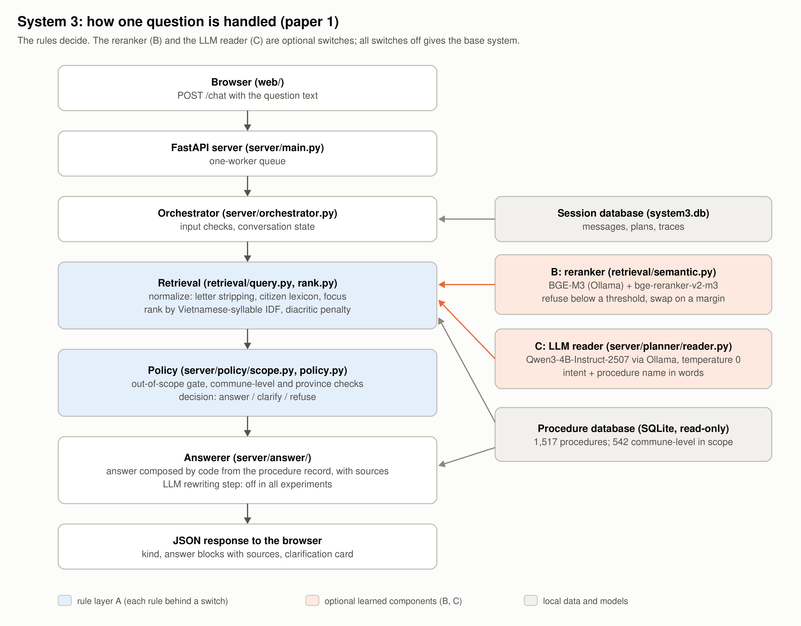

# System Architecture (khuôn bước 7)




```text
Trình duyệt (web/: HTML + JS)
    |  POST /chat {text, conversation_id?, reply_to?}
FastAPI (server/main.py), hàng đợi 1 worker
    |
Orchestrator (server/orchestrator.py): kiểm tra đầu vào, nạp trạng thái hội thoại
    |
Planner (server/planner/)  ->  Retrieval (retrieval/: query.py, rank.py)
    |                              - chuẩn hoá: bỏ phần chào hỏi, từ điển từ dân dùng, viết tắt
    |                              - xếp hạng IDF theo âm tiết, phạt lệch dấu
    |                              - [B] semantic.py: BGE-M3 + bge-reranker-v2-m3 (tuỳ chọn)
    |                              - [C] planner/reader.py: model 4B đọc ý định và tên thủ tục (tuỳ chọn)
Policy (server/policy/: policy.py, scope.py): cổng ý định ngoài phạm vi, kiểm mã thủ tục, phạm vi cấp xã, bản theo tỉnh
    |
Answerer (server/answer/answerer.py): ghép câu trả lời bằng code từ bản ghi + nguồn
    |  [tuỳ chọn, TẮT trong mọi thí nghiệm] llm_answer.py + verifier.py: viết lại câu chữ, kiểm mọi con số có trong nguồn
SQLite
  - data/runtime/knowledge/3-423eff02f8.db: dữ liệu thủ tục, chỉ đọc
  - server/runtime/system3.db: hội thoại, trạng thái, nhật ký (trace)
Ollama (tại máy): qwen3:4b-instruct-2507-q4_K_M, chỉ dùng khi bật C, bật baseline RAG, hoặc bật bước viết lại
```

## Các thành phần

| Tầng | Thành phần | Ghi chú |
|---|---|---|
| Frontend | `web/` | Giao diện chat. Thẻ hỏi lại có các nút chọn. Có nút xem bảng đủ 12 mục của thủ tục |
| Backend | `server/main.py` (FastAPI) | `/chat`, `/health`, `/procedure/{id}/table`, `/conversations…`. Hàng đợi một worker |
| Quyết định | `server/planner`, `server/policy` | Luật và cờ của lớp A. Phần ngoài phạm vi nằm ở `scope.py` |
| Truy hồi | `retrieval/` | `query.py` chuẩn hoá câu, `rank.py` xếp hạng, `semantic.py` cho phương án B |
| Trả lời | `server/answer` | Ghép bằng code; bước viết lại bằng LLM tắt trong mọi thí nghiệm |
| Dữ liệu | SQLite | Một tệp DB thủ tục chỉ đọc, một DB cho phiên làm việc |
| Model | Ollama tại máy | Không gọi API bên ngoài |

## Cờ của lớp luật A

Tất cả mặc định bật. Tắt hết thì kết quả bằng bản gốc.

| Cờ | Luật |
|---|---|
| `S3_LETTER_STRIP` | Bỏ phần chào hỏi, tên cơ quan được gửi tới, lời giới thiệu bản thân và lời cảm ơn |
| `S3_LEXICON2` | Từ điển đổi từ ngữ người dân dùng sang tên chính thức hiện hành |
| `S3_WEAK_NAME` | Đoạn câu chỉ trùng vài chữ với một tên thủ tục rất dài thì không tính là đã gọi tên thủ tục đó |
| `S3_SCOPE_GATE` / `S3_SCOPE_A6` | Cổng chặn ý định ngoài phạm vi: tình trạng hồ sơ, khiếu nại, luật và mức phạt, nội bộ ngành công an, chủ đề không có trong dữ liệu |
| `S3_FOCUS` | Với thư dài, chỉ giữ các đoạn có câu hỏi |
| `S3_ORG_DEFAULT` | Không nói rõ là tổ chức thì ưu tiên bản dành cho cá nhân hoặc hộ gia đình |
| `S3_R2` (vòng 2, mặc định tắt) | Từ điển chấp nhận chữ chen giữa; yêu cầu thủ tục mà từ điển nhận ra thắng thủ tục suy ra từ câu chuyện kể; thêm mẫu ngoài phạm vi (hỏi tình trạng hồ sơ bằng lời thường, cán bộ công an hỏi chế độ của mình, tranh chấp riêng); thủ tục có bản chung cho mọi tỉnh thì trả lời bản chung thay vì hỏi tỉnh |

Kết quả của `S3_R2` chỉ được báo trên bộ test thứ hai (real_v4), đã khoá trước khi sửa code (D12).
