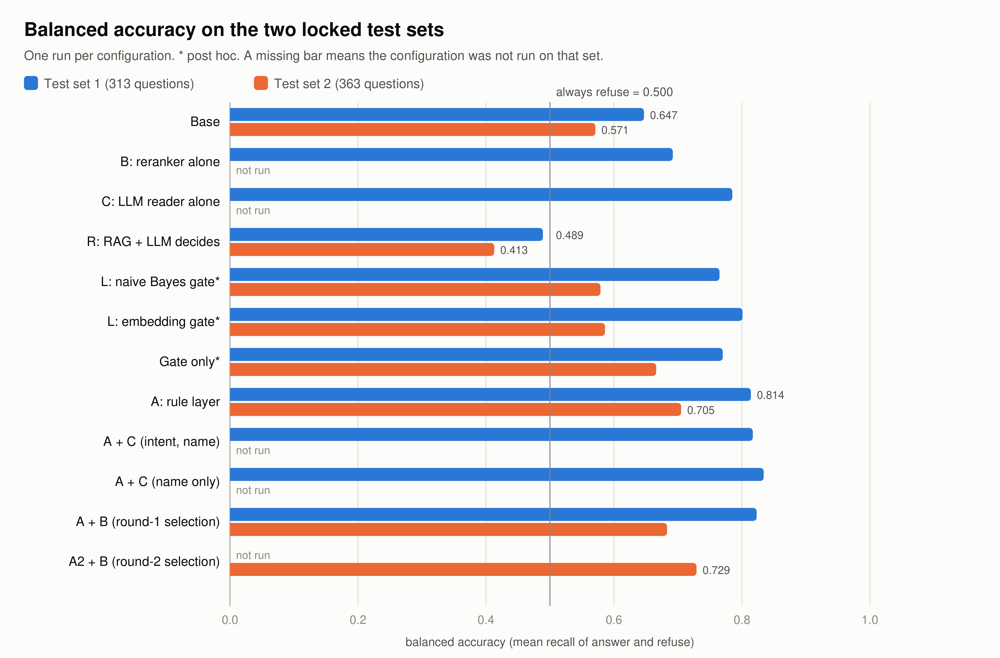

# Results (tóm tắt; bảng đầy đủ ở `07_paper_draft/latex/sections/results.tex`, Bảng 1)

Bảng tách riêng: `tables/summary_table.md`, `tables/paired_tests.md`.

Nguồn số: `eval/hard/results/` của repo code (kết quả từng câu), và `eval/hard/results/paired_stats.json` (McNemar, bootstrap). Cấu hình đánh dấu * là phân tích sau (*post hoc*).

## 1. Bộ nhóm tự viết so với câu hỏi thật (cùng bản gốc đã đóng băng)

| Chỉ số | Bộ tự viết (518) | Dev thật (282) | Test 1 thật (313) |
|---|---|---|---|
| Hành vi đúng | 77,2% (73–81%) | 56,0% (50–62%) | 56,5% (51–62%) |
| Cân bằng | 0,852 | 0,636 | 0,647 |
| Top-1 (câu answer) | 274/381 (71,9%) | 7/55 (12,7%) | 20/59 (33,9%) |
| Tỉ lệ câu phải từ chối | 11% | 78% | 79% |

Lớp luật không đổi gì trên bộ tự viết: hành vi +4/−4, 400/518 cả hai. Một bộ tự viết sẽ không cho thấy vấn đề, cũng không cho thấy cách sửa.

## 2. Hai bộ test đã khoá (mỗi cấu hình chạy một lần)

Test 1: real_v2, 313 câu (59 trả lời, 6 hỏi lại, 248 từ chối). Test 2: real_v4, 363 câu (21 / 7 / 335).

| Cấu hình | T1 cân bằng | T1 từ chối đúng | T1 đúng trọn | T1 chính xác câu trả lời (%) | T2 cân bằng | T2 từ chối đúng | T2 đúng trọn | T2 chính xác câu trả lời (%) |
|---|---|---|---|---|---|---|---|---|
| Luôn từ chối | 0,500 | 248 | 0 | – | 0,500 | 335 | 0 | – |
| Bản gốc | 0,647 | 132 | 19 | 11,7 | 0,571 | 175 | 5 | 3,0 |
| B: reranker một mình | 0,692 | 175 | 21 | 17,9 | – | – | – | – |
| C: model 4B đọc câu một mình | 0,785 | 213 | 25 | 30,9 | – | – | – | – |
| R: RAG + model 4B tự quyết | 0,489 | 104 | 28 | 43,8 | 0,413 | 197 | 4 | 10,5 |
| L: cổng naive Bayes* | 0,765 | 224 | 14 | 21,9 | 0,579 | 308 | 2 | 6,9 |
| L: cổng embedding* | 0,801 | 225 | 17 | 25,4 | 0,586 | 313 | 2 | 8,0 |
| Chỉ cổng (gate only)* | 0,770 | 218 | 15 | 20,8 | 0,666 | 287 | 5 | 9,1 |
| A: lớp luật | 0,814 | 219 | 35 | 45,5 | 0,705 | 297 | 9 | 19,6 |
| A + C (ý định, tên) | 0,817 | 237 | 32 | 58,2 | – | – | – | – |
| A + C (chỉ tên) | 0,834 | 216 | 39 | 47,0 | – | – | – | – |
| A + B (chọn vòng 1) | 0,823 | 219 | 36 | 46,2 | 0,683 | 298 | 8 | 17,4 |
| A2 + B (chọn vòng 2) | – | – | – | – | 0,729 | 297 | 10 | 20,0 |

A2 + B không chạy trên test 1, vì A2 được viết dựa trên chính các câu đó.

## 3. So sánh cặp (McNemar chính xác; khoảng bootstrap 95% của hiệu cân bằng)

| So sánh | Bộ | Hiệu cân bằng [95%] | Hành vi +/− (p) | Đúng trọn +/− (p) |
|---|---|---|---|---|
| Bản gốc → A | T1 | +0,167 [0,095; 0,240] | +96/−10 (≈ 9·10⁻¹⁹) | +22/−6 (0,004) |
| A → A + B | T1 | +0,009 [0,000; 0,029] | +1/−0 (1) | +1/−0 (1) |
| A → C | T1 | −0,029 [−0,098; 0,038] | +28/−35 (0,45) | +7/−17 (0,064) |
| A → A + C (ý định) | T1 | +0,002 [−0,054; 0,057] | +25/−10 (0,017) | +8/−11 (0,65) |
| A → A + C (chỉ tên) | T1 | +0,019 [−0,006; 0,051] | +4/−3 (1) | +8/−4 (0,39) |
| A → R | T1 | −0,325 [−0,416; −0,236] | +16/−141 (≈ 4·10⁻²⁶) | +9/−16 (0,23) |
| Bản gốc → A | T2 | +0,134 [0,033; 0,228] | +125/−5 (≈ 4·10⁻³¹) | +4/−0 (0,12) |
| A + B → A2 + B (so sánh chính) | T2 | +0,046 [−0,048; 0,143] | +3/−3 (1) | +3/−1 (0,62) |
| Bản gốc → A2 + B (so sánh chính) | T2 | +0,158 [0,009; 0,304] | +129/−9 (≈ 2·10⁻²⁸) | +7/−2 (0,18) |
| A2 + B → R (so sánh chính) | T2 | −0,316 [−0,427; −0,211] | +19/−122 (≈ 10⁻¹⁹) | +1/−7 (0,07) |

## 4. Phân tích sau (*post hoc*)

- **Bỏ từng luật của A.** Bỏ cổng ngoài phạm vi thì mất 70 câu từ chối đúng (test 1) và 62 câu (test 2), nhưng thêm 4 và 2 câu đúng trọn. Bỏ từ điển dân dùng thì mất 17 câu đúng trọn ở test 1. Bỏ phần tập trung đoạn hỏi thì mất 7 câu. Mỗi luật còn lại đổi nhiều nhất một câu.
- **Cổng học:** xem `05_methodology/baseline.md` mục 4.
- **Theo tầng và theo cổng thông tin (bản gốc → A, test 1).** Tầng ngẫu nhiên (102 câu, 11 answer): 0,512 → 0,859. Cổng Bộ Công an: 0,618 → 0,875. Cổng Bình Định: 0,649 → 0,751. Trên test 2: 0,614 → 0,753 và 0,573 → 0,652.
- **Độ chính xác câu trả lời trên câu ngẫu nhiên.** Không cấu hình nào có số câu trả lời đúng nhiều hơn số câu sai. Cao nhất là A + C, 7/15 câu trả lời đúng (tầng ngẫu nhiên test 1), và A2 + B, 10/50 (test 2).
- **Nhãn lượt hai (100 câu test 1).** Kết luận không đổi: bản gốc → A được +24/−1 trên 91 câu.

## 5. Kết luận chính (đúng như bài viết)

1. Lớp luật A lặp lại kết quả trên câu hỏi mới. Phần cải thiện chủ yếu đến từ việc từ chối đúng (cổng), còn câu trả lời đúng đến từ từ điển dân dùng.
2. Vòng 2 (A2) không lặp lại về hành vi. Trên dev, A2 được 25 câu và không mất câu nào; trên test 2, A2 + B hoà A + B (+3/−3). Có thể vì các luật mới khớp với cách viết riêng của câu dev. Lớp answer nhỏ và nhãn do model khác đề xuất có thể cũng góp phần. Về cân bằng, khoảng tin cậy rộng (đến khoảng +0,14).
3. Reranker, model 4B và các cổng học không cải thiện có ý nghĩa về cân bằng hay đúng trọn. Baseline RAG để model tự quyết không hơn luôn từ chối về cân bằng.
4. Câu trả lời vẫn chưa đáng tin trên câu ngẫu nhiên. Trợ lý nên để cán bộ xác nhận câu trả lời, hoặc chỉ trả lời khi đủ tin cậy.
