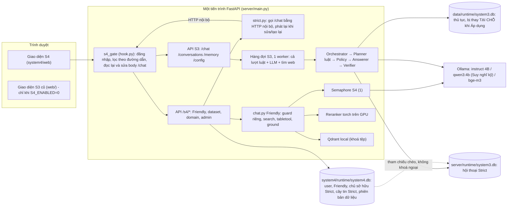
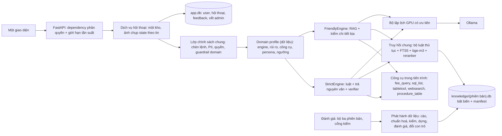
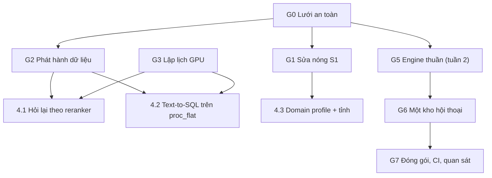

# Duyệt kiến trúc System 3 + System 4 — 2026-10-15

**Vai trò:** người duyệt kiến trúc độc lập. **Trạng thái:** Đề xuất — chờ trưởng nhóm duyệt trước khi thực thi.
**Người đọc:** trưởng nhóm (quyết định), dev và Claude (thực thi). **Đi kèm:** [AUDIT_2026-10-15.md](AUDIT_2026-10-15.md) (phát hiện F1–F10 và bằng chứng chi tiết). Tài liệu này **mở rộng và thay thế mục 4 (kế hoạch tuần)** của bản audit.
**Cách làm:**
- Đọc code. Đối chiếu với hai ảnh kiến trúc mục tiêu của nhóm lớn (`Kiến trúc AI.jpg`, `Kiến trúc triển khai.jpg`).
- Dùng lại các số đo của bản audit.
- Lần duyệt này thêm 5 phép kiểm mới (đánh dấu 🆕, cách tái tạo ở Phụ lục).
- Máy đo: RTX 4050 Laptop 6 GB · Ollama 0.40.4 · FastAPI 0.142.2 · Starlette 1.7.0 · Python 3.12.

---

## 0. Kết luận cho người quyết định

**Phán quyết chung: "Giữ lõi, sửa mối nối."**
- Ba lựa chọn cốt lõi **đúng và có số đo bảo vệ**: luật chọn thủ tục, trả lời nguyên văn kèm nguồn, AI chỉ diễn đạt và bị kiểm.
- Ba lựa chọn hạ tầng cũng **đúng với quy mô hiện tại**: chạy tại máy, model 4B, SQLite.
- Điểm yếu nằm ở **chỗ nối** giữa các phần:
  - dữ liệu thủ tục được đưa vào hệ thống không qua kiểm;
  - System 4 bọc System 3 lúc chạy;
  - các chính sách dùng chung (an toàn, quyền riêng tư, cấu hình) bị viết hai lần;
  - bộ đánh giá không gắn với phiên bản dữ liệu và model.
- Hầu hết lỗi nghiêm trọng tìm được đều sinh ra ở các mối nối này.

| ID | Quyết định | Phán quyết | Lý do một dòng | Khi nào |
|---|---|---|---|---|
| ADR-01 | Lõi Strict "luật trước, trả nguyên văn, LLM chỉ diễn đạt" | **GIỮ** (đóng băng việc thêm luật tay) | Trên cùng 313 câu bộ mù một lượt: bộ luật 77% top-1, bộ tìm lai không chỉnh 68%; LLM planner từng làm kém hơn (Phase 19) | — |
| ADR-02 | Cách ghép System 3 ↔ System 4 | **ĐỔI dần** → monolith có module, giao diện `Engine` | Middleware sửa body + HTTP nội bộ + phát lại hội thoại sinh ra lỗi F2, F5, F6 | Tuần 2–4 |
| ADR-03 | Lưu trữ SQLite | **GIỮ SQLite**; tách DB tri thức bất biến theo phiên bản và DB ứng dụng | 1 máy, ghi ít; FTS5 xử lý tiếng Việt có/không dấu; bất biến giúp quay lui và ghim đánh giá | Tuần 1 (tri thức), tuần 2–4 (ứng dụng) |
| ADR-04 | Dữ liệu thủ tục | **ĐỔI (ưu tiên 1)** → "bản phát hành dữ liệu" có chuẩn hoá, kiểm, đánh giá, quay lui | Sai lệ phí, đổi mã, link hỏng, số đo lệch đều do dữ liệu vào thẳng | Tuần 1 |
| ADR-05 | Hai bộ máy truy hồi | **GIỮ bộ luật cho top-1; DÙNG reranker làm tín hiệu "không chắc" và đường lùi** | Nhóm có độ chênh < 1,0 chứa 33/50 câu chọn sai | Tuần 1 |
| ADR-06 | Hàng đợi / GPU | **ĐỔI** → một bộ lập lịch GPU chung có ưu tiên; phần luật không xếp hàng | VRAM 94% 🆕; lượt chỉ-luật đang xếp sau lượt LLM/tìm web | Tuần 1 |
| ADR-07 | Cấu hình theo lĩnh vực | **ĐỔI** → "domain profile" là dữ liệu; **không** cho mỗi lĩnh vực một model | VRAM không còn chỗ cho model thứ tư 🆕 | Tuần 1 (v1) |
| ADR-08 | An toàn, quyền riêng tư, phân quyền | **ĐỔI** → một lớp chính sách dùng chung cho mọi engine | Friendly chặn chèn lệnh 4/11 so với 11/11 của Strict 🆕; xoá tài khoản còn sót dữ liệu 🆕 | Tuần 1 (sửa nóng); tuần 2–4 (phân quyền theo dependency, vết admin) |
| ADR-09 | Liệt kê / đếm | **CHẤP NHẬN** text-to-SQL trên một bảng phẳng (quyết định của trưởng nhóm) kèm hộp cát | 12% đúng lĩnh vực hiện nay; 4B viết tốt SELECT một bảng | Tuần 1 |
| ADR-10 | Đánh giá | **ĐỔI** → mọi kết quả gắn "bộ ba phiên bản" (code, dữ liệu, model+cài đặt); có cổng kiểm | 73% (dữ liệu cũ) và 63–68% (dữ liệu đang chạy) cùng một code | Tuần 1 |
| ADR-11 | Cấu hình, đóng gói, vận hành | **ĐỔI nhẹ** → một nguồn cài đặt, gói Python thật, hồ sơ triển khai GPU/CPU, nhật ký | 4–5 nguồn cài đặt; 2 cách import; ở chế độ CPU bước AI gần như chắc chờ hết 7 s 🆕 | Tuần 1 (hồ sơ CPU), tuần 2–4 (phần còn lại) |
| ADR-12 | MCP, LLM gateway, PostgreSQL, Redis/Kafka, vLLM, K8s, router tự động, LlamaIndex | **HOÃN** (có điều kiện kích hoạt cụ thể) | Ở 1 máy, 1 GPU 6 GB, không thứ nào tăng được tiêu chí nào | Khi đạt điều kiện |

**Thay đổi so với kế hoạch tuần trong bản audit:**
- Thêm **Giai đoạn 0 "lưới an toàn"** (khoảng ba phần tư ngày): mọi thay đổi sau đó phải chứng minh không làm đổi câu trả lời ngoài ý muốn.
- Chuyển **bộ lập lịch GPU lên trước** các tính năng dùng GPU (hỏi lại bằng reranker, text-to-SQL).
- Các việc tái cấu trúc lớn (ADR-02, ADR-03 phần ứng dụng, đóng gói) **dời sang tuần 2–4**, sau khi đã sửa xong các lỗi S1.
- Thêm các việc trước đây bị sót: sửa hồi quy `p23_input_test`, làm sạch lại công cụ kiểm tài liệu của nhóm (đang báo 17 lỗi), thay bộ dữ liệu tên trẻ em thật, sửa tài liệu và slide cho khớp code (mục 7, mục 10).

**Cách đọc các con số top-1 trong tài liệu này:**
- **73%** = toàn bộ 406 câu bộ mù có chấm top-1 (gồm cả câu nhiều lượt), trên DB snapshot. Đây là số trên slide.
- **77%** = tập con 313 câu bộ mù **một lượt, một thủ tục**, dùng cho phép thử truy hồi. Trên cùng tập này, bộ tìm lai không chỉnh đạt **68%**.
- **63% / 68%** = toàn bộ 406 câu, nhưng trên DB đang chạy (bản 2). 63% là chấm theo mã cũ; 68% là sau khi ghép lại mã theo tên.
- Con số **68%** xuất hiện ở hai phép đo khác nhau. Hai lần trùng nhau chỉ là ngẫu nhiên.

---

## 1. Bối cảnh, ràng buộc, thuộc tính chất lượng

### 1.1 Ràng buộc cứng
| Ràng buộc | Giá trị | Nguồn |
|---|---|---|
| Model | ≤ 4B, chạy tại máy | PDF mục tiêu |
| GPU | 6 GB. Khi nạp đủ 3 model, dùng **5.738–5.760 / 6.141 MiB (94%)**: model trả lời 3,53 GB (num_ctx 8192), bge-m3 0,62 GB, reranker fp16 1,07 GB, phần còn lại ~0,7 GB là màn hình/ứng dụng khác. Nạp model trả lời mất 5,5 s | 🆕 đo bằng `nvidia-smi` + `ollama ps` |
| Tiến trình | **Một** tiến trình. Trạng thái nằm trong bộ nhớ: hàng đợi S3, semaphore S4, `_turns`, bộ đệm cài đặt, `os.environ["S3_USE_LLM"]`, chỉ mục planner, cache websearch/tabletool, việc nền (procs, ingest) | code |
| Nền tảng | Windows, cài bằng `.bat` + junction `pyroot_merge/system3` | `Set up first time.bat` |
| Đội | 3 thực tập sinh, demo hằng tuần, bài báo IC3K | PDF |
| Repo | Công khai | `docs/SYSTEM4_SU_THAT.md` |

### 1.2 Thuộc tính chất lượng, xếp theo thứ tự ưu tiên khi phải đánh đổi
1. **Đúng và có căn cứ** cho thông tin thủ tục (sai phí hay sai giấy tờ là hại người dân).
2. **Quyền riêng tư** (CCCD, SĐT, dữ liệu trẻ em).
3. **Đo được và tái tạo được** (báo cáo mentor, bài báo).
4. **Dễ bảo trì** cho đội nhỏ.
5. **Độ trễ** chấp nhận được.
6. **Mở rộng sang lĩnh vực mới**.
7. **Chịu tải lớn** (thấp nhất ở giai đoạn này).

Đây là căn cứ để chọn giữa các phương án trong các ADR. Ví dụ: ADR-01 giữ bộ luật (thuộc tính 1) dù bảo trì nặng (thuộc tính 4).

### 1.3 Giả định tải (cần trưởng nhóm xác nhận — mục 9, câu 1)
- **Đề xuất:** thí điểm ≤ 20 người dùng hoạt động cùng lúc (demo nội bộ hoặc một xã).
- **Thông lượng Friendly:** mỗi lượt cần GPU khoảng 1,4–4,9 s (trung vị NV5). Với 1 khe GPU, hệ thống phục vụ được khoảng **12–40 lượt/phút**. Nếu mỗi người gửi 1 tin/phút thì vừa đủ cho khoảng 12–40 người.
- **Strict:** khoảng 90% lượt chỉ dùng luật (~0,1 s, chỉ CPU). Những lượt này **không cần GPU**, nên càng không được xếp hàng chung với lượt cần GPU (P13).
- **Kết luận:** quy mô này **không** cần cân bằng tải, Redis hay nhiều worker. Cần lập lịch GPU đúng cách.

---

## 2. Kiến trúc hiện tại

### 2.1 Sơ đồ


### 2.2 Ba luồng cần nhớ
- **Một câu hỏi Strict từ giao diện mới:** `/s4/strict/chat` → `strict.py` → HTTP nội bộ `POST /chat` → `s4_gate` (kiểm chủ, đọc lại body) → hàng đợi S3 (1 worker) → `handle_turn` (ghi `conv_state`, `shown_procedures`, `proc_stats` ngay trong engine) → `s4_gate` gắn chủ sở hữu vào `system4.db` → `strict.py` thêm nút vào cây tin.
- **Sửa câu thứ k:** tạo hội thoại "nhánh" mới và **phát lại k-1 câu trước** qua đúng luồng trên, rồi mới gửi câu đã sửa.
- **Áp dụng dữ liệu:**
  - dựng DB tạm từ JSONL;
  - kiểm duy nhất **số lượng** thủ tục;
  - chép đè từng trang vào DB đang mở;
  - xoá chỉ mục của planner bằng cách gán biến của module khác;
  - ghi `proc_active` vào `system4.db`.
  - Không có bước nào kiểm chất lượng.

### 2.3 Những thứ đang làm hai lần
| Mối quan tâm | Bản S3 | Bản S4 | Hệ quả đã thấy |
|---|---|---|---|
| Chặn chèn lệnh | `policy._INJECTION` (regex) | `GUARDRAILS` (cụm từ) | Bộ ca của nhóm: **11/11 so với 4/11** 🆕 |
| Che PII | `mask_pii` (chỉ trace + tên hội thoại) | không có | Lưu nguyên văn ở 6 nơi (F9) |
| Kho hội thoại | `server/runtime/system3.db` | `system4.db` + bảng phản chiếu | Mồ côi, quét toàn bộ (F6) |
| Truy hồi | luật IDF (`retrieval/`) | FTS5 + bge-m3 + reranker | Chưa từng so trước lần duyệt này |
| Hàng đợi GPU | `core/queue.py` | `llm.Turn` | Vị trí xếp hàng sai; tranh nhau (P13) |
| Client LLM | `server/core/llm.py` (keep_alive 30m) | `system4/server/llm.py` (keep_alive -1) | Thời gian giữ model phụ thuộc lượt gọi cuối |
| Cài đặt | biến môi trường + `.env` | `config.py` (bị ghi đè lúc chạy) + `settings.json` | 4 nơi khai model mặc định khác nhau |
| Bộ nhớ người dùng | hồ sơ theo `X-Client-Id` | `memories` theo tài khoản | Lẫn hồ sơ giữa tài khoản (F2) |
| Giao diện | `web/` | `system4/web/` | Hồ sơ S3 chỉ có ở giao diện cũ |
| Xuất hội thoại | `server/conv_export.py` | `system4/server/export.py` | — |
| Bỏ dấu tiếng Việt | `data/textutil.fold` | `ground.fold`, `lang.normalize` (+ 2 bản chép `textutil.py`) | Khớp chữ khác nhau giữa hai chế độ |

---

## 3. Bảng điểm theo thuộc tính chất lượng
| Thuộc tính | Hiện trạng | Bằng chứng | Điểm | Rủi ro chính |
|---|---|---|---|---|
| Đúng & có căn cứ | Trả nguyên văn kèm nguồn; verifier giữ số đúng với nguồn | bịa số 0,2% (dev); top-1 bộ mù 73% (406 câu, snapshot) | **Khá** | Nguồn sai thì trả sai (F1); mã đổi (F3) |
| Quyền riêng tư | Che PII ở 2 chỗ; xoá chưa sạch | F2, F9, P04 🆕 | **Yếu** | Lộ CCCD, lẫn hồ sơ |
| An toàn trước chèn lệnh | Strict mạnh, Friendly yếu; chưa thử chèn gián tiếp qua tệp | 11/11 so với 4/11 🆕 | **Trung bình** | Friendly + tệp tải lên |
| Đo được / tái tạo được | Bộ đo lớn, có CI-95%, MRR | Cùng code: 73% hoặc 63–68% tuỳ DB | **Yếu** | Báo số không còn đúng |
| Dễ bảo trì | Code gọn, comment tốt; nhưng ~2.800 dòng luật, hai hệ ghép, nhiều cài đặt | 40 hằng số chỉnh tay; 24 tệp test tự chèn `sys.path` | **Trung bình** | Một người hiểu, người khác sửa hỏng |
| Độ trễ | Luật p95 ~0,2 s; LLM Strict p50 1,5–3,2 s; Friendly trung vị 1,4–4,9 s (GPU) | số đo nhóm + hôm nay | **Tốt (GPU) / Kém (CPU)** | Tìm web chặn hàng; đổi model 7 s |
| Mở rộng lĩnh vực | Có domain cứng/mềm, dataset theo domain | `domains.py` | **Trung bình** | "Cấu hình riêng" mới có tên + lời dặn |
| Chịu tải | 1 tiến trình, 1 khe GPU | thiết kế | **Đủ cho thí điểm** | Không chạy được nhiều tiến trình |
| Vận hành | Có `/health`, inspector cho dev | không nhật ký tệp, không vết admin, migration tay 🆕 | **Yếu** | Lỗi trên máy thật không lần ra |

---

## 4. Các quyết định kiến trúc

### ADR-01: Lõi Strict "luật trước, trả nguyên văn, LLM chỉ diễn đạt" — GIỮ
**Bối cảnh.**
- Sai thông tin thủ tục gây hại thật. Model 4B dễ bịa số.
- Nhóm đã đo: Planner lai luật + LLM 4B **không** cải thiện, còn kém luật 2 câu trên HOLDOUT-4 (`eval/P19_REPORT.md`).
- Lần duyệt này đo trên cùng 313 câu bộ mù một lượt: bộ tìm lai không chỉnh đạt 68% top-1, bộ luật đạt 77% (AUDIT F7). Trên toàn bộ 406 câu (gồm câu nhiều lượt), bộ luật đạt 73%.

**Phương án.**
- (A) Giữ.
- (B) Dùng RAG + LLM sinh tự do như Friendly cho thủ tục.
- (C) Thay bộ luật bằng bộ tìm lai.

**Quyết định: A**, kèm ba điều kiện:
- **Đóng băng việc thêm luật tay.** Luật mới chỉ được thêm khi đi kèm test và số đo trên một bộ chưa dùng để chỉnh.
- Các quyết định "không chắc" (hỏi lại hay trả lời) chuyển sang **tín hiệu học được** (ADR-05).
- Các bảng từ vựng trong code chuyển ra **dữ liệu** sửa được ở trang quản trị: từ đồng nghĩa, sự kiện đời sống, `_SITUATION`.

**Lý do.**
- Thuộc tính 1 đứng trên thuộc tính 4.
- B mất đúng thứ làm hệ thống khác biệt: con số luôn lấy từ dữ liệu.
- C kém 9 điểm.

**Hệ quả.**
- Tốt: vẫn chính xác, giải thích được.
- Còn lại: chi phí bảo trì luật; cần bộ mù mới định kỳ.
- Lõi này chỉ đúng khi dữ liệu đúng → ADR-04 là điều kiện cần.

### ADR-02: Cách ghép System 3 ↔ System 4 — ĐỔI dần sang monolith có module
**Bối cảnh.**
- System 4 bọc System 3 lúc chạy:
  - middleware lọc theo đường dẫn, đọc lại và ghi đè body JSON của `/chat` (`hook.py` 103–118);
  - cầu nối gọi HTTP nội bộ (`strict.py::s3`);
  - sửa/tạo lại bằng cách phát lại cả hội thoại (`strict.py::replay`);
  - cây tin nhắn phản chiếu trong DB khác.
- `handle_turn` có tác dụng phụ (ghi `conv_state`, `shown_procedures`, `proc_stats`, `session_facts`), nên không thể "quay về trạng thái ở câu k-1" mà không phát lại.
- Lỗi F2 sinh ra đúng ở mối nối: cầu nối không truyền danh tính, nên mọi người dùng hồ sơ `'default'`.

**Phương án.**
| | (A) Giữ nguyên | (B) Tách S3 thành dịch vụ riêng | (C) Monolith có module | (D) Viết lại một hệ |
|---|---|---|---|---|
| Độ phức tạp | Cao, tăng dần | Cao (mạng, auth giữa dịch vụ, triển khai 2 thứ) | Trung bình | Rất cao |
| Rủi ro đổi hành vi | 0 | Trung bình | Thấp (kiểm bằng so khớp đầu ra) | Cao |
| Công sức | 0 | 1–2 tuần | 6–8 ngày, chia nhỏ | 3+ tuần |
| Giải quyết F2/F5/F6 | Không | Một phần | Có | Có |
| Hợp với 1 máy | Có | Không cần thiết | Có | Có |

**Quyết định: C**, làm theo kiểu "cây si" (thay từng phần, hệ vẫn chạy):
1. **Engine thuần:** `StrictEngine.answer(ctx) -> TurnResult{blocks, clarify, state_after, effects}`. Engine không tự ghi DB. Dịch vụ hội thoại ghi `effects`, và lưu **ảnh chụp state sau mỗi tin** (JSON ~1 KB).
2. Sửa/tạo lại = nạp ảnh chụp của tin k-1, chạy **một** lượt. Bỏ phát lại và bỏ `strict_branch`.
3. Cầu nối gọi hàm trực tiếp, bỏ HTTP nội bộ và bỏ việc sửa body trong middleware.
4. Một kho hội thoại cho cả hai engine (ADR-03). Bỏ `strict_owner/legacy/nodes/threads/branch`.
5. Bỏ giao diện cũ `web/` và các endpoint S3 không còn dùng.

**Lý do.**
- B thêm chi phí phân tán mà không được lợi gì khi chỉ có 1 máy.
- D quá rủi ro cho đội 3 người.
- C giữ nguyên phần chạy tốt (planner, policy, answerer), chỉ đổi chỗ nối. Mỗi bước kiểm được bằng "so khớp đầu ra" trên 1.352 ca (Giai đoạn 0).

**Hệ quả.**
- Dễ hơn: sửa/tạo lại tức thì, phân quyền một chỗ, hết lỗi kiểu F2.
- Khó hơn: phải chuyển dữ liệu hội thoại cũ một lần.
- Cần xem lại sau: hành vi "cái thứ hai" (đọc danh sách đánh số từ tin trước) phải lấy từ ảnh chụp, không lấy từ chữ.

### ADR-03: Lưu trữ — GIỮ SQLite; tách "tri thức bất biến theo phiên bản" khỏi "dữ liệu ứng dụng"
**Bối cảnh.**
- Có 3 tệp SQLite, trong đó hai tệp cùng tên `system3.db`.
- DB thủ tục bị **thay tại chỗ** khi Áp dụng (`procs._swap` chép đè từng trang vào tệp đang mở).
- `eval/run_all.py` dựng đè chính tệp đó.
- Migration là các câu `ALTER TABLE` rải rác (`store.init_db`, `db._migrate`), không có số phiên bản schema 🆕.

**Phương án.**
- (A) Giữ như cũ.
- (B) Chuyển sang PostgreSQL.
- (C) SQLite gồm:
  - `knowledge/<version>.db` **chỉ đọc, không bao giờ sửa**, kèm `manifest.json`;
  - một `app.db` (user, hội thoại, feedback, vết admin);
  - một con trỏ `active_version`;
  - migration đánh số bằng `PRAGMA user_version`.

**Quyết định: C.**

**Lý do.**
- Một máy, ghi ít. WAL của SQLite đủ dùng. FTS5 `unicode61 remove_diacritics` đã tìm được tiếng Việt có/không dấu.
- DB tri thức bất biến cho ba lợi ích:
  - quay lui tức thì (đổi con trỏ);
  - đánh giá ghim theo đúng tệp;
  - không còn rủi ro thay tệp đang mở.
- Về PostgreSQL: lý do trên slide ("không xử lý được tiếng Việt có dấu") **không đúng**. PostgreSQL không có từ điển tiếng Việt dựng sẵn, nhưng `simple` + `unaccent` + `pg_trgm` vẫn tìm được. Lý do đúng là **chưa cần**.

**Điều kiện chuyển sang PostgreSQL:**
- chạy từ 2 tiến trình/máy ghi cùng lúc trở lên; hoặc
- ghi liên tục trên khoảng 50 lần/giây; hoặc
- cần sao chép (replica).

### ADR-04: Dữ liệu thủ tục là một "bản phát hành" có kiểm — ĐỔI (ưu tiên số 1)
**Bối cảnh.** Bốn lỗi lớn có chung một gốc: dữ liệu đi thẳng từ Cổng vào hệ thống mà không qua chuẩn hoá hay kiểm.
- F1: phí sai do đọc sai hàng nghìn và bỏ qua đơn vị tiền tệ.
- F3: Cổng cấp mã mới cho thủ tục cũ; 193 mã mới; 61/491 ca bộ mù trỏ tới mã không còn.
- F4: link Cổng dạng hỏng.
- P08: thống kê, golden, `conv_state` lưu mã không ổn định.

**Quyết định: một đường ống phát hành.**

```
cào → chuẩn hoá → kiểm bất biến → dựng knowledge/<v>.db + manifest → đánh giá → duyệt → đổi con trỏ (quay lui = đổi lại)
```

- **Chuẩn hoá:**
  - phí: `currency` (map `currency_id` → VND/USD/không rõ), `amount_vnd` (sửa hàng nghìn bằng đối chiếu `amount_text`), `amount_ok`;
  - `portal_url` dựng từ `source_id` (UUID);
  - cắt khoảng trắng.
- **Kiểm bất biến** (ra báo cáo; lỗi nặng thì chặn):
  - phí dạng số < 1.000 VND mà không có chữ xác nhận;
  - đơn vị tiền lạ;
  - link sai dạng;
  - mã trùng;
  - trường bắt buộc rỗng;
  - tỉ lệ thủ tục "biến mất" so với bản đang dùng.
- **Lineage:** bảng `proc_lineage(old_id, new_id, method: same_source_id | same_name_province | manual)`. Golden, thống kê và state cũ đều đi qua bảng này.
- **Đánh giá:** chạy `run_golden` trên DB mới (golden đã ghép mã), so với bản đang dùng; chặn nếu top-1 hoặc hành vi bộ mù tụt quá 3 điểm.
- **Một nguồn sự thật:** mọi nơi đọc `active_version` qua cùng một hàm. Cache khoá theo phiên bản (`subject_catalog`, chỉ mục planner, tabletool…).

**Hệ quả.**
- Mỗi lần cập nhật dữ liệu có hồ sơ: kiểm gì, điểm bao nhiêu, ai duyệt.
- Sẽ cần người duyệt danh sách mã chưa ghép tự động được (lần đầu: 138 tham chiếu).

### ADR-05: Truy hồi — GIỮ bộ luật cho top-1; dùng reranker làm tín hiệu "không chắc" và đường lùi
**Bằng chứng** (snapshot, 313 câu bộ mù một lượt, một thủ tục; chỉ số tổng hợp):

| Cách | Top-1 | Top-3 |
|---|---|---|
| Bộ luật hiện tại | **77%** | 83% |
| BM25 trên tên | 61% | 73% |
| bge-m3 trên tên | 46% | 58% |
| RRF + reranker, không chỉnh | 68% | **83%** |
| Top-5 của luật, sắp lại bằng reranker | 73% | 81% |

(Các tỷ lệ trong bảng này tính trên 313 câu, nên không so trực tiếp với 73% của toàn bộ 406 câu ở các mục khác.)

Lấy độ chênh điểm reranker (hạng 1 trừ hạng 2) trên top-5 của luật, xét 277 ca có câu trả lời (50 ca chọn sai):
- chênh < 1,0: 73 ca, trong đó **33 ca sai (45%)**;
- chênh ≥ 1,0: chỉ sai 17/204 (8%).

**Phương án.**
- (A) Thay bộ luật bằng bộ tìm lai — loại: kém 9 điểm.
- (B) Sắp lại bằng reranker — loại: kém 4 điểm.
- (C) **Giữ luật để chọn, dùng reranker để biết khi nào không chắc**, kèm đường lùi.

**Quyết định: C.**
- Hỏi lại khi chênh < ngưỡng **và** các ứng viên khác họ thủ tục.
- Ngưỡng **chọn trên dev** (+ `cases_p30`). Số ở trên lấy từ bộ mù, không được dùng để chỉnh.
- Khi luật không tìm thấy gì (câu chỉ có chữ chung): thay vì xin lỗi, đưa 3–4 ứng viên đầu của bộ tìm lai thành thẻ hỏi lại.
- Một module truy hồi dùng chung (tổng quát hoá `system4/server/search.py`) đánh chỉ mục cả thủ tục.

**Mục tiêu và cách đo:**
- **Mục tiêu:** hỏi lại đúng ≥ 60% (hiện 47%), hành vi đúng chung không tụt quá 1 điểm.
- **Tuần 1:** đo kiểm **một lần** trên bộ mù hiện có, qua người điều phối. Báo kèm ghi chú "bộ này đã bị xem số tổng hợp".
- **Nghiệm thu chính thức:** trên bộ mù mới HOLDOUT-7 (tuần 2–4, sau thí điểm).

**Tiêu chí dừng:**
- Bỏ cách này nếu hỏi lại đúng tăng chưa tới 10 điểm (dưới 57%), **hoặc** hành vi đúng chung tụt quá 1 điểm.
- Về lâu dài: thêm bí danh và từ đồng nghĩa vào chỉ mục lai rồi đo lại. Nếu bằng bộ luật thì có cơ sở thay khoảng 2.800 dòng luật.

### ADR-06: GPU là tài nguyên chung — một bộ lập lịch có ưu tiên
**Bối cảnh.**
- VRAM đầy 94% 🆕.
- Hàng đợi S3 bọc **cả lượt**: luật (~0,1 s, không cần GPU), bước LLM, và tìm web. Riêng tìm web có thể giữ worker khoảng 60–76 s (`core/websearch.web_block`: tìm 2 lần × 8 s, rồi chờ LLM tới 60 s).
- Trong dự án đang ghi **hai yêu cầu ngược nhau** về chuyện này: `server/core/queue.py` ghi "Mentor yêu cầu xử lý 1-1", còn `docs/PLAN_TUAN_TOI.md` mục 2b ghi "thầy không chịu tuần tự".
- Hết `QUEUE_JOB_TIMEOUT` thì luồng cũ vẫn chạy tiếp, vì `wait_for(to_thread)` không huỷ được luồng.
- S4 có semaphore riêng; việc nền (bộ nhớ, tóm tắt) và nạp tệp (bge-m3, LLM kiểm tiêu đề) cũng dùng GPU.
- "Suy nghĩ kỹ" dùng `qwen3:4b`. Mỗi lần bật, model chung bị đẩy ra; người kế tiếp ở **mọi** chế độ chờ thêm khoảng 7 s.

**Phương án.**
- (A) Giữ hai hàng đợi.
- (B) **Một bộ lập lịch GPU**, có ưu tiên:
  - P0: câu trả lời đang có người chờ (Friendly stream, bước LLM của Strict);
  - P1: phụ trợ tương tác (lập kế hoạch tabletool, text-to-SQL, lọc nút gợi ý);
  - P2: việc nền (bộ nhớ, tóm tắt);
  - P3: nạp tệp.
  
  Phần luật và CPU **không** xếp hàng. Tìm web chạy ngoài hàng, tối đa 15 s.
- (C) Chạy song song (`OLLAMA_NUM_PARALLEL` > 1). Loại: nhóm đã đo thấy chậm hơn trên 6 GB, và VRAM không còn chỗ cho KV cache nhân lên.

**Quyết định: B.**
- Vị trí xếp hàng báo cho người dùng tính cả hai chế độ.
- Lượt chạy luật song song vẫn đi qua khoá `_PLAN_LOCK` hiện có, vì Planner dùng chung một kết nối SQLite.
- **Cách B dung hoà được hai yêu cầu ngược nhau ở trên:**
  - phần **không cần GPU chạy song song** (đáp ứng "không chịu tuần tự");
  - phần **GPU tuần tự trên card 6 GB**, vì đo thấy chạy song song chậm hơn;
  - trên card lớn hơn chỉ cần bật hai công tắc đã có: `S3_QUEUE_CONCURRENCY`/`S4_CONCURRENCY` cùng `OLLAMA_NUM_PARALLEL`.
  - Cần mentor xác nhận cách hiểu này (mục 9, câu 12).

**Về "Suy nghĩ kỹ" khi nhiều người dùng:** chỉ cho dev/cán bộ, hoặc dùng chính model Instruct kèm lời dặn suy luận (cần trưởng nhóm quyết — mục 9).

### ADR-07: Cấu hình theo lĩnh vực là dữ liệu ("domain profile"), giới hạn bởi VRAM
**Bối cảnh.**
- Tiêu chí 2 và ô "Domain Config & Policy Registry" trong kiến trúc nhóm lớn đòi cấu hình riêng cho từng lĩnh vực.
- Hiện mỗi lĩnh vực chỉ có: tên, guardrail, khoá, quyền tải.
- VRAM 94% nên **không thể** cho mỗi lĩnh vực một model riêng.

**Quyết định.** Bảng `domain_profiles` (JSON, sửa ở trang Quản trị), gồm:
- `engine` (strict/friendly) và `risk` (cao/thường);
- `answer_mode`: `verbatim` / `grounded` / `free`;
- `require_citation`;
- `clarify`: số lần tối đa, ngưỡng chênh;
- `retrieval`: top_k, số ứng viên, ngưỡng reranker;
- `tools` được phép: `fee_query`, `sql_list`, `tabletool`, `websearch`, `procedure_table`;
- `persona`, `guardrail`;
- `web_allowed`;
- `province_scoping`;
- `golden_set` và ngưỡng đạt.

Model là cấu hình **toàn hệ thống**.

**Lý do.**
- Đáp ứng tiêu chí 2 mà không thêm hạ tầng.
- "Mức rủi ro theo lĩnh vực" đúng tinh thần sơ đồ nhóm lớn (Strict/Friendly theo domain).
- Lĩnh vực cứng khác "Thủ tục" có thể chọn `grounded` + `require_citation`: tận dụng tìm lai, kiểm chi tiết bịa và câu "không có trong dữ liệu" đã có sẵn. Không cần viết engine mới.

### ADR-08: Một lớp chính sách dùng chung cho mọi engine
**Bối cảnh.**
- Chèn lệnh: 11/11 so với 4/11 🆕.
- PII chỉ che ở 2 chỗ (F9).
- Xoá tài khoản để sót `feedback_log` (còn câu có số CCCD) và `traces`, vì hai bảng không có khoá ngoại 🆕.
- Phân quyền dựa trên so khớp đường dẫn trong middleware; route `/memory*` bị sót (F2).
- Không giới hạn đăng nhập sai. Đăng ký mở. Người đăng ký đầu tiên thành dev.
- Không lưu vết thao tác admin 🆕.

**Quyết định.** Module `policy/` dùng chung:
- `check_input(text, profile)`: một bộ dò chèn lệnh duy nhất (`_INJECTION` của S3 + luật `block` của S4), lá chắn từ chối đóng vai.
- `mask(text)`: gọi ở **mọi** điểm ghi (hai DB hội thoại, `feedback_log`, `traces`, tiêu đề, `session_facts`) và **trước mọi lời gọi ra ngoài** (tìm web).
- `check_output(answer, evidence, profile)`: verifier số liệu (S3) + kiểm chi tiết bịa (S4) dùng chung, theo `answer_mode`.
- **Phân quyền** bằng dependency của FastAPI gắn theo router (`Depends(require_user)`, `require_role("dev")`, `require_owner(conv)`), không dùng regex đường dẫn. Mặc định chặn, mở từng route.
- **Xoá theo người:**
  - **Tuần 1:** `delete_user` xoá tường minh các dòng `feedback_log`, `traces` của người đó (SQLite không thêm được khoá ngoại vào bảng có sẵn nếu không dựng lại bảng); dọn vector Qdrant và tệp; có test.
  - **Khi gộp kho (G6):** khoá ngoại `ON DELETE CASCADE` trong schema mới có migration đánh số.
- **Giới hạn tần suất:** đăng nhập (theo tài khoản + IP, khoá tạm), `/chat` và `/s4/chat` (theo người).
- **Khởi tạo dev đầu tiên** bằng lệnh dòng lệnh (không qua web). Đăng ký mặc định tắt khi đã có dev.
- **Vết admin:** bảng `admin_audit(actor, action, target, at, detail)` cho đổi quyền, khoá, xoá, Áp dụng/cào dữ liệu, đổi cài đặt.
- **Hạn lưu (đề xuất, chờ quyết ở mục 9, câu 10):** `traces` 30 ngày; `feedback_log` theo quyết định nhóm.

**Lý do.** Một chính sách viết một lần thì không thể lệch giữa hai chế độ. Phân quyền theo dependency thì route mới mặc định bị chặn.

### ADR-09: Liệt kê / đếm — CHẤP NHẬN text-to-SQL trên một bảng phẳng
**Bối cảnh.**
- "Liệt kê" hiện trả 10 tên gần nhất, chỉ 12% đúng lĩnh vực.
- Đếm theo phí đã có SQL thật (`fee_query.py`).
- Trưởng nhóm đã chọn hướng text-to-SQL trên **một** bảng phẳng, vì 4B viết SELECT một bảng tốt, nhưng JOIN thì không.

**Phương án đã cân nhắc.**
| | (A) Text-to-SQL trên `proc_flat` (chọn) | (B) LLM sinh bộ lọc JSON rồi code dịch ra SQL (kiểu `tabletool`) | (C) Mở rộng luật kiểu `fee_query` |
|---|---|---|---|
| Linh hoạt | Cao: mọi tổ hợp điều kiện | Trung bình: chỉ phép lọc đã định nghĩa | Thấp |
| An toàn | Cần hộp cát | An toàn sẵn | An toàn |
| Công sức | 1–1,5 ngày | 1 ngày | Tăng theo từng kiểu câu |

**Quyết định: A, kèm hộp cát bắt buộc.**
- `proc_flat` dựng lúc phát hành dữ liệu (ADR-04): mỗi thủ tục một dòng. Các cột: tên, tên bỏ dấu, lĩnh vực, cấp, tỉnh, cờ phạm vi, `fee_min_vnd`/`fee_max_vnd`/`fee_currency`, số ngày giải quyết, trực tuyến, đối tượng.
- LLM trả JSON `{"sql": ...}` (Ollama `format`), có schema bảng và danh sách giá trị lĩnh vực trong lời dặn.
- Chạy trên kết nối `mode=ro` + `PRAGMA query_only=1` + `set_authorizer` (chỉ `SELECT`/`READ` trên `proc_flat`) + ép `LIMIT 200` + hạn thời gian (`progress_handler`).
- Lỗi hai lần thì lùi về `fee_query` hoặc danh sách gần đúng.
- **Code** viết câu trả lời từ kết quả (đếm chính xác + 10 dòng đầu + "và N thủ tục khác"). LLM không tự viết số.
- **Bộ đo riêng** 60–100 câu liệt kê/đếm, đáp án do code tính trên `proc_flat`.
- **Mục tiêu (hai chỉ số, đều phải đạt):**
  - trên bộ khuôn có sẵn (loại "list"), đúng lĩnh vực ≥ 80% — so trực tiếp được với mức 12% hiện nay;
  - trên bộ đo riêng, đúng tập kết quả ≥ 85%;
  - mọi câu tiêm SQL (`;`, `DROP`, `ATTACH`, `PRAGMA`) đều bị chặn.

### ADR-10: Đánh giá là một phần của kiến trúc — gắn "bộ ba phiên bản", có cổng kiểm
**Bối cảnh.**
- Cùng một code, số đo là 73% hay 63–68% tuỳ DB.
- Đổi model ở ⚙ của Friendly âm thầm đổi luôn model của bước LLM Strict (`MODEL_PROVIDER`), không có đánh giá đi kèm.
- Số đo độ trễ ngày 15/10 có dấu hiệu bị nhiễu 🆕:
  - ở chế độ GPU có 3 lượt mất 7,2–7,4 s, sát hạn 7 s (tức là hết giờ chứ không phải sinh chữ);
  - cấu hình đo ghi `qwen3:4b`, khác model Instruct mà `Launch web.bat` dùng thật;
  - nguyên nhân hết giờ chưa xác định, nhiều khả năng do phải nạp hoặc đổi model.
- Mẹo đặt tên trường JSON `a_plan…` dựa vào hành vi riêng của Ollama 0.40.

**Quyết định.**
- **Mọi kết quả đo ghi bộ ba:**
  - commit git;
  - `data_version` + hash manifest;
  - model (tên + digest từ `ollama list`) + hash cài đặt + phiên bản lời dặn.
- **Hai loại kiểm:**
  - *hồi quy hành vi* trên DB snapshot cố định (test đơn vị, chạy trên CPU, không phụ thuộc máy);
  - *nghiệm thu dữ liệu đang chạy* (golden đã ghép mã qua lineage).
- **Cổng kiểm** cho: Áp dụng dữ liệu (ADR-04), đổi model hoặc lời dặn (chạy golden + safety + composer), thêm luật (ADR-01).
- **Kiểm "so khớp đầu ra"** (golden-equality): ghi (hành vi, mã thủ tục, hash nội dung trả lời) của 1.352 ca trên snapshot. Mọi tái cấu trúc phải ra y hệt, trừ chỗ cố ý đổi.
- **Test hợp đồng với Ollama:** JSON giữ đúng thứ tự trường; `format` hoạt động; model có trên GPU.
- **Đo độ trễ đúng cách:** khởi động nóng; dùng đúng model đang chạy thật; tách "chờ hàng", "nạp model" và "sinh chữ".
- **Bộ mù mới:** sau thí điểm với người thật (HOLDOUT-7). Bộ cũ đã bị nhìn số tổng hợp nhiều lần.

### ADR-11: Cấu hình, đóng gói, vận hành — ĐỔI nhẹ
- **Một nguồn cài đặt** (bảng trong `app.db` hoặc `settings.json`) cho cả hai hệ:
  - bỏ việc ghi đè mã nguồn `config.py` lúc chạy;
  - biến môi trường chỉ dùng cho đường dẫn, cổng, bí mật;
  - các ràng buộc như "cùng `num_ctx`", "cùng `keep_alive`" do code đảm bảo, không để người nhớ.
- **Hồ sơ triển khai:**
  - *GPU đầy đủ*;
  - *CPU chỉ Strict-luật*: tự phát hiện model không nằm trên GPU (`ollama ps` cho `size_vram`) → tắt bước LLM của Strict, ẩn Friendly.
  - Số đo hôm nay: ở chế độ CPU, 5/5 lượt cần LLM mất 7,2–7,5 s, đúng bằng hạn 7 s. Gần như chắc là bước AI hết giờ rồi rơi về bản code. Slide đang đọc con số này thành "AI viết mất ~7 s" — nên sửa.
- **Đóng gói:**
  - `pyproject.toml` + `pip install -e .` (gói `system3` trỏ thư mục gốc);
  - bỏ junction và việc 24 tệp test tự chèn `sys.path`;
  - module của `server/` import bằng tên đầy đủ (`system3.server.config` thay cho `config`), tránh trùng tên chung (`config`, `db`, `core`, `policy`).
- **CI:** GitHub Actions chạy test trên CPU với DB snapshot. Chuyển test sang pytest dần dần.
- **Quan sát:** log có cấu trúc ra tệp xoay vòng; trang quản trị có bảng số tổng hợp từ `traces` (p50/p95 từng bước, tỉ lệ lỗi, tỉ lệ hết giờ LLM, độ sâu hàng đợi); `/health` báo model nào đang nằm trên GPU.
- **Sao lưu** `app.db` hằng đêm. DB tri thức đã bất biến nên chỉ cần giữ tệp.

### ADR-12: Những thứ KHÔNG làm bây giờ
| Thành phần (trong ảnh nhóm lớn) | Vì sao chưa cần | Làm khi nào (điều kiện kích hoạt) | Thay thế nhẹ đang dùng |
|---|---|---|---|
| MCP client/server, tool registry dạng dịch vụ/giao thức riêng | Không có client ngoài nào cần gọi công cụ; MCP thêm một ranh giới tiến trình và giao thức | Khi công cụ phải chia cho agent/tiến trình khác, hoặc dùng tool server bên thứ ba | Danh sách công cụ trong tiến trình, mỗi công cụ có JSON schema + danh sách cho phép theo domain (ADR-07). Schema dạng MCP để sau bọc lại rẻ |
| LLM gateway | Chỉ một nhà cung cấp, một máy | Từ 2 endpoint/nhà cung cấp trở lên, hoặc cần hạn mức và chi phí | Một client LLM dùng chung có timeout, ngắt mạch, lập lịch (ADR-06) |
| PostgreSQL | Xem ADR-03 | Xem ADR-03 | SQLite + FTS5 |
| Redis cache / Kafka / RQ | 1 tiến trình; câu trả lời luật đã ~0,1 s | Từ 2 tiến trình/GPU trở lên, hoặc đo thấy câu lặp lại nhiều trong khi GPU đã bão hoà | Hàng đợi trong tiến trình + lập lịch GPU |
| vLLM | Không chạy trên Windows; 6 GB không đủ chỗ cho batching | Máy Linux có GPU ≥ 24 GB và cần nhiều lượt sinh song song | Ollama |
| Kubernetes, autoscale, load balancer, CDN | Một máy | Triển khai nhiều node | systemd/Windows service + nginx khi lên máy chủ |
| Router domain / phân loại rủi ro tự động | Người dùng chọn lĩnh vực trên thanh; ít lĩnh vực | Trên khoảng 8 lĩnh vực, hoặc đo thấy người dùng hay hỏi nhầm lĩnh vực | Thanh chọn lĩnh vực + `risk` trong domain profile |
| LlamaIndex + LLM parsing | Bộ đọc tệp hiện tại (v4) đã xử lý bảng hai tầng, nhiều bảng, chọn dòng tiêu đề | Cần OCR / PDF bố cục phức tạp | `ingest.py` |
| Fine-tune | Chưa có dữ liệu thật đủ lớn | Có vài nghìn cặp 👍/👎 đã che PII và đã duyệt | Lời dặn + luật |

---

## 5. Kiến trúc đích

### 5.1 Sơ đồ


### 5.2 Đối chiếu với kiến trúc AI của nhóm lớn
| Ô trong "Kiến trúc AI" | Hiện tại | Đích (bản nhẹ) |
|---|---|---|
| Domain Config & Policy Registry | tên + guardrail + khoá | `domain_profiles` (ADR-07) |
| Domain Onboarding (ETL, chuẩn hoá, embedding, lưu trữ) | `ingest.py` cho dataset; thủ tục qua scraper + build | giữ; thủ tục đi qua phát hành dữ liệu (ADR-04) |
| Quản lý phiên bản & re-index | có phiên bản, không kiểm | manifest + cổng kiểm + quay lui |
| Bộ đánh giá theo domain | chỉ có Thủ tục | `golden_set` trong profile; thêm bộ cho Friendly |
| Input guardrails / Context manager | hai bản, lệch nhau | lớp chính sách chung + dịch vụ hội thoại |
| Domain router + risk classifier | chọn tay | giữ chọn tay; `risk` trong profile |
| Pipeline Strict (phân tích, hỏi lại, kế hoạch, truy hồi, rerank, bằng chứng, sinh, kiểm, persona) | có đủ, phần lớn bằng luật | giữ; hỏi lại dùng tín hiệu reranker |
| Pipeline Friendly | có | giữ; dùng chính sách chung |
| MCP & Tool Registry | các công cụ rời rạc | danh sách công cụ trong tiến trình có schema |
| Đánh giá & cải thiện liên tục | bộ đo lớn, chưa gắn phiên bản | ADR-10 |

### 5.3 Đối chiếu với kiến trúc triển khai
| Ô | Hiện tại | Đích cho thí điểm |
|---|---|---|
| API Gateway (xác thực, phân quyền, giới hạn tần suất) | cookie + middleware; không giới hạn | dependency + giới hạn tần suất; nginx khi lên máy chủ |
| Cache | không | không (ADR-12) |
| Hàng đợi | hai hàng | một bộ lập lịch GPU |
| AI Service | Ollama riêng + reranker trong tiến trình web | giữ (cân nhắc tách reranker sau, vì crash khi tắt — `test_nv3` mã 139) |
| Vector DB | Qdrant local | giữ (khoá tệp → chỉ 1 tiến trình) |
| Ingestion workers | luồng nền tranh GPU | luồng nền ưu tiên thấp nhất (P3) |
| Resilience | timeout, rơi về bản code | + ngắt mạch Ollama (bỏ qua LLM 60 s sau 3 lỗi liên tiếp), hồ sơ CPU |
| Giám sát & log | không tệp log, không vết admin | ADR-11 |
| Bảo mật (PII, rate limit, audit) | thiếu | ADR-08 |
| DevOps (Docker, CI/CD) | không | CI trước; Docker khi lên Linux |

### 5.4 Mục tiêu hiệu năng (SLO) đề xuất cho thí điểm (GPU)
| Đường đi | Mục tiêu | Hiện đo được (15/10) | Đo tải 18/10 (G3.4), 10 người, model thật nóng, RTX 4050 6 GB — **thực tế** (nghỉ 20–40 s) / **dồn dập** (nghỉ 1–3 s) |
|---|---|---|---|
| Strict, chỉ luật (người dùng chờ) | p95 ≤ 0,5 s, **không xếp hàng GPU** | p95 ~0,19 s (1 người) | p50 0,31 / p95 1,18 s · dồn dập p50 0,95 / p95 1,47 s — không chờ GPU nữa (G3.1), nhưng **chưa đạt 0,5 s khi 10 người**: CPU dùng chung với Ollama + reranker |
| Strict, có bước LLM | p50 ≤ 2 s, p95 ≤ 8 s | p50 1,5 s; p95 7,4 s (là hết giờ 7 s) | p50 2,88 / p95 4,01 s · dồn dập p50 3,61 / p95 4,33 s ✔. Tách: chờ GPU p95 3,0 s (trần `S3_STRICT_GPU_WAIT`), nạp 0,01 s, đọc lời dặn ≤ 0,3 s, sinh chữ p95 1,8 s. 7/20 lượt hết 3 s chờ -> bản code |
| Friendly, chữ đầu tiên | p50 ≤ 2 s, p95 ≤ 4 s | 1,25–1,7 s (1 người) | p50 6,2 / p95 15,2 s · dồn dập p50 26,7 / p95 41,6 s — gần hết là **chờ hàng** |
| Friendly, cả câu (sự kiện done) | p95 ≤ 8 s | p90 4,9 s (1 người) | p50 11,2 / p95 21,3 s · dồn dập p50 31,7 / p95 45,5 s |
| Chờ hàng khi có 10 người hoạt động | p95 ≤ 10 s | chưa đo | p50 5,3 / p95 **13,6 s ✘** · dồn dập p95 40,7 s ✘ |
| Hồ sơ CPU | Friendly không cung cấp; Strict chỉ luật, p95 ≤ 0,5 s | chữ đầu tiên của Friendly 7,6–39 s | G3.3: Strict bỏ bước LLM, trả bản code (test: < 0,5 s); Friendly có cảnh báo + công tắc "Chỉ trả lời bằng luật" |

Kết luận đo tải (G3.4): một GPU 6 GB, một chỗ, **không đạt** mục tiêu chờ hàng của Friendly với 10 người cùng hoạt động — mỗi câu Friendly giữ GPU 1,4–14 s (câu dài). Đã đưa ba hướng: (a) `OLLAMA_NUM_PARALLEL=2` + `S4_CONCURRENCY=2`, (b) trần câu trả lời ngắn hơn, (c) chấp nhận ~15 s. **Trưởng nhóm chọn (c)** (18/10), kèm **dùng lại câu trả lời đã 👍** khi người khác hỏi y chang (trả ngay, không xếp hàng GPU — `system4/server/answer_cache.py`). Lệnh: `python run_server.py system4/eval/load_test.py --db <DB bản 3> --pause 20,40 --name real`; kết quả: `system4/eval/results/load_10users_{real,stress}.json`. Test hợp đồng Ollama: `system4/eval/ollama_contract.py` (đạt 18/10; thấy model đôi khi lặp chữ không dừng -> thêm trần `FRIENDLY_NUM_PREDICT`).

---

## 6. Sổ vấn đề
Mức: **S1** = sai thông tin / lộ dữ liệu · **S2** = sai số liệu hoặc chặn triển khai · **S3** = bảo trì / vận hành. "Đã kiểm" = chạy thật; "code" = đọc code.

| ID | Vấn đề | Mức | Bằng chứng | Sửa bởi |
|---|---|---|---|---|
| P01 | Phí sai: "20.000" thành 20; USD hiển thị thành "đồng" ("chứng thực bản sao 10 đồng/bản") | S1 | đã kiểm (AUDIT F1) | ADR-04 |
| P02 | Hồ sơ Strict dùng chung giữa các tài khoản; A xoá hồ sơ của B | S1 | đã kiểm (F2) | ADR-08, ADR-02 |
| P03 | CCCD/SĐT lưu nguyên văn ở 6 nơi; câu hỏi gửi nguyên văn lên DuckDuckGo | S1 | code (F9) | ADR-08 |
| P04 🆕 | Xoá tài khoản: tin nhắn mất, nhưng `feedback_log` (còn số CCCD) và `traces` vẫn còn | S1 | đã kiểm | ADR-08 |
| P05 🆕 | Friendly chặn chèn lệnh 4/11 ca của nhóm (Strict 11/11); lọt: lộ system prompt, developer mode, jailbreak, quên vai trò, viết hoa không dấu… | S1 | đã kiểm | ADR-08 |
| P06 | Dữ liệu đang chạy (1.509) ≠ dữ liệu đánh giá (1.350): top-1 bộ mù 73% → 63–68% | S2 | đã kiểm (F3) | ADR-04, ADR-10 |
| P07 | "Áp dụng" không có cổng kiểm; `run_all.py` dựng đè DB; hai nguồn sự thật về phiên bản đang dùng | S2 | đã kiểm | ADR-04 |
| P08 | Mã thủ tục không ổn định (Cổng cấp lại mã); không có lineage → golden, thống kê, `conv_state` hỏng | S2 | đã kiểm | ADR-04 |
| P09 | Link Cổng dạng hỏng ở bản đang chạy | S2 | theo commit của nhóm (F4) | ADR-04 |
| P10 | 7/8 test trượt chỉ vì dữ liệu; 1 hồi quy thật (`p23_input_test`) | S2 | đã kiểm | ADR-10 |
| P11 | Hỏi lại khi mơ hồ 47% | S2 | đo | ADR-05 |
| P12 | Liệt kê đúng lĩnh vực 12% | S2 | đo | ADR-09 |
| P13 | Lượt chỉ-luật xếp hàng sau lượt LLM/tìm web; tìm web giữ worker khoảng 60–76 s; hết giờ không huỷ được luồng | S2 | code | ADR-06 |
| P14 🆕 | VRAM 94% khi đủ 3 model; "Suy nghĩ kỹ" đẩy model chung ra (~7 s cho người kế tiếp) | S2 | đo | ADR-06, ADR-07 |
| P15 🆕 | Chế độ CPU: bước LLM của Strict gần như chắc chờ hết hạn 7 s (5/5 lượt 7,2–7,5 s), rồi rơi về bản code; slide đọc thành "AI viết mất ~7 s" | S2 | số đo hôm nay | ADR-11 |
| P16 🆕 | Số đo độ trễ GPU ngày 15/10 có 3 lượt hết giờ (7,2–7,4 s), và đo bằng `qwen3:4b` thay vì model Instruct chạy thật → chưa dùng được làm số chính thức | S2 | số đo hôm nay | ADR-10 |
| P17 | Middleware đọc lại và sửa body; cầu nối HTTP nội bộ; sửa câu phải phát lại cả hội thoại | S3 | code (F5) | ADR-02 |
| P18 | Hai kho hội thoại tham chiếu chéo, không khoá ngoại; `strict_list` quét toàn bộ | S3 | code (F6) | ADR-02, ADR-03 |
| P19 | `handle_turn` tự ghi DB → không quay về được state cũ | S3 | code | ADR-02 |
| P20 | 11 mối quan tâm làm hai lần (mục 2.3) | S3 | code | ADR-02, 08, 11 |
| P21 | Cài đặt ở 4–5 nguồn; ghi đè `config.py` lúc chạy; `num_ctx`/`keep_alive` phải trùng tay | S3 | code | ADR-11 |
| P22 | Đổi model/cài đặt không có phiên bản, không cổng kiểm; Strict đổi model theo ⚙ của Friendly | S3 | code | ADR-10 |
| P23 | Mẹo tên trường JSON (`a_plan`…) phụ thuộc hành vi Ollama 0.40 | S3 | tài liệu NV5 | ADR-10 (test hợp đồng) |
| P24 | Phân quyền bằng regex đường dẫn → route mới dễ bị sót (như `/memory*`) | S3 | code | ADR-08 |
| P25 | Không chống spam/đăng nhập sai; đăng ký mở; người đầu tiên thành dev | S3 | code | ADR-08 |
| P26 🆕 | Không log ra tệp, không vết admin, không bảng số tổng hợp | S3 | đã kiểm | ADR-11, ADR-08 |
| P27 🆕 | Migration bằng `ALTER TABLE` rải rác, không phiên bản schema | S3 | đã kiểm | ADR-03 |
| P28 🆕 | Hai cách import; tên module chung trên `sys.path`; 24 tệp test tự chèn `sys.path`; junction; không CI; test là script rời | S3 | đã kiểm | ADR-11 |
| P29 | Cấu hình theo lĩnh vực chỉ có tên/guardrail/khoá | S3 | code | ADR-07 |
| P30 | Chưa có: lọc theo tỉnh, tên theo thủ tục, link biểu mẫu, tóm tắt giữ thủ tục đang hỏi | S2 | đã kiểm | ADR-07 + tính năng |
| P31 | Reranker torch trong tiến trình web: phụ thuộc ~2,5 GB, crash khi tắt (`test_nv3` mã 139) | S3 | đã kiểm | để sau |
| P32 | Qdrant local khoá tệp → chỉ chạy được 1 tiến trình | S3 | tài liệu | để sau (ADR-12) |

---

## 7. Kế hoạch mở rộng

### 7.0 Nguyên tắc thứ tự
1. **Lưới an toàn trước:** chưa có kiểm so khớp đầu ra thì chưa tái cấu trúc.
2. **S1 trước tính năng.**
3. **Dữ liệu đúng trước số đo:** số đo trên dữ liệu sai thì vô nghĩa.
4. **Lập lịch GPU trước khi thêm tính năng dùng GPU.**
5. **Tạo mối nối mới trước, chuyển code sau** (kiểu cây si). Mỗi bước để lại hệ thống chạy được, có cờ bật/tắt.
6. Mỗi việc một commit nhỏ trên nhánh riêng. Không push khi trưởng nhóm chưa cho phép. Không chỉnh theo bộ mù.

Ký hiệu: **M** = phải có trong tuần · **S** = nên có · **C** = có thời gian thì làm.

### 7.1 Tuần 19–23/10 (khoảng 7 ngày-người tập trung; phần M khoảng 4)
**Lịch và năng lực:**
- Phần M (G0 + G1 + G2, khoảng 4 ngày-người) chắc chắn vừa trong 5 ngày lịch.
- Toàn bộ khoảng 7 ngày-người cần ít nhất 2 người làm song song. Gợi ý chia: một người G1 (an toàn) trong khi người kia làm G2 (dữ liệu), sau đó G3 và G4.
- Nếu chỉ có 1 người thì phần S (G3, G4) trượt sang tuần 2. Thứ tự ưu tiên giữ nguyên.

**Giai đoạn 0 — Lưới an toàn (0,75 ngày, M)**
| Việc | Xong khi |
|---|---|
| 0.1 Test và eval mặc định đọc DB snapshot cố định (dựng ra thư mục tạm, `S3_DATA_DB`); `test_nv4` lấy bản sao từ snapshot và đọc số thủ tục từ chính tệp nguồn thay vì viết cứng 1350 | Mọi test đạt trừ `p23_input_test` (hồi quy đã biết, sửa ở 4.6) |
| 0.2 Kiểm so khớp đầu ra: ghi (hành vi, mã, hash câu trả lời) của 1.352 ca + công cụ so sánh | Hai lần chạy liên tiếp ra y hệt |
| 0.3 Kết quả đo ghi bộ ba phiên bản | `golden_*.json` có `git`, `data_version`, `model`, `settings_hash` |
| 0.4 `run_all.py` dựng DB ra tệp tạm, không đè DB đang chạy | Chạy xong, `data/runtime/system3.db` không đổi (so hash) |
| 0.5 Làm `eval/check_docs.py` sạch lại: cập nhật số trong README/EVAL theo tệp kết quả đã commit, sửa hoặc bỏ 7 đường dẫn tới tệp không còn, "11 sự kiện" → 12 | `check_docs: ... 0 lỗi` (hiện 17 lỗi, mục 10.2) |

**Giai đoạn 1 — Sửa nóng đúng và an toàn (1,5 ngày, M)**
| Việc | Vấn đề | Xong khi |
|---|---|---|
| 1.1 Chuẩn hoá phí (`currency`, `amount_vnd`, `amount_ok`) lúc dựng; answerer/bảng full/Excel dùng cột mới | P01 | Hai câu chứng thực hiện "10 USD/bản" hoặc nguyên văn Cổng; test mới; `fee_query_test` đạt |
| 1.2 Bộ nhớ Strict khoá theo tài khoản khi bật S4; bỏ `'default'` | P02 | Test hai tài khoản tách biệt |
| 1.3 Lớp chính sách v1: một bộ dò chèn lệnh cho cả hai engine; `mask()` ở mọi điểm ghi và trước tìm web | P03, P05 | Bộ an toàn chạy cả đường Friendly: 11/11; chặn nhầm 0/6; thêm bộ câu thường của Friendly (22 tình huống NV2) để kiểm chặn nhầm |
| 1.4 Xoá theo người (`delete_user` xoá tường minh `feedback_log`, `traces`, vector, tệp; khoá ngoại để G6) + ô "Tài khoản & quyền riêng tư" (đổi mật khẩu, xoá hết hội thoại, xoá bộ nhớ, xoá tài khoản) | P04, tiêu chí 9 | Test: sau khi xoá, không còn dòng nào của người đó ở mọi bảng |
| 1.5 Giới hạn đăng nhập sai; tắt đăng ký mặc định khi đã có dev; khởi tạo dev bằng lệnh dòng lệnh | P25 | Test API; cập nhật `test_nv1`/`test_nv4` (đang giả định người đăng ký đầu tiên thành dev) |
| 1.6 Thay bộ "DS LỚP 1.5" (tên trẻ em thật) bằng bản giả `system4/eval/data/ds_lop_gia.xlsx` trong demo và ảnh slide; xoá khỏi runtime nếu không cần | F9 | Không còn dữ liệu trẻ em thật trong máy demo |

**Giai đoạn 2 — Phát hành dữ liệu v1 (1,5 ngày, M)**
| Việc | Vấn đề | Xong khi |
|---|---|---|
| 2.1 `knowledge/<v>.db` bất biến + `manifest.json` + con trỏ `active_version`; server mở theo con trỏ; cache khoá theo phiên bản; bỏ `_swap` | P07 | Đổi qua lại bản 2 ↔ bản 3 không cần khởi động lại; quay lui được |
| 2.2 Chuẩn hoá lúc dựng (`portal_url` từ `source_id`, phí như 1.1) + kiểm bất biến có báo cáo (phí, đơn vị tiền, link, mã trùng, trường rỗng, tỉ lệ biến mất) | P01, P09 | Báo cáo cho bản 2 và bản 3; mọi link dạng UUID |
| 2.3 `proc_lineage` + ghép mã cho golden, thống kê `proc_stats` và state hội thoại cũ; danh sách cần người duyệt | P06, P08 | 128 tự động + danh sách 138 tham chiếu; số bộ mù báo kèm "số ca loại vì chưa ghép" |
| 2.4 Cổng kiểm trong Áp dụng; áp dụng bản 3 (link UUID) nếu qua | P06, P07, P09 | Số mới ghi vào `PLAN_TUAN_TOI.md` kèm phiên bản dữ liệu |

**Giai đoạn 3 — GPU và độ trễ (1 ngày, S)**
| Việc | Vấn đề | Xong khi |
|---|---|---|
| 3.1 Bộ lập lịch GPU chung có ưu tiên; hàng đợi S3 chỉ bọc lời gọi LLM (lượt luật song song vẫn qua `_PLAN_LOCK`); tìm web ra khỏi hàng (≤ 15 s); huỷ được việc đã hết giờ | P13 | Lượt chỉ-luật p95 ≤ 0,5 s ngay cả khi có lượt tìm web đang chạy (test có LLM giả chạy chậm) |
| 3.2 Bước LLM Strict tự tắt khi model không nằm trên GPU (hồ sơ CPU); ngắt mạch Ollama; áp quyết định về "Suy nghĩ kỹ" (mục 9, câu 5) | P14, P15 | CPU: lượt cần LLM trả bản code < 0,5 s thay vì 7 s |
| 3.3 Đo lại độ trễ đúng cách (nóng, đúng model, tách chờ/nạp/sinh) + test tải 10 người giả + test hợp đồng với Ollama (thứ tự trường JSON, `format`, model trên GPU) | P16, P23 | Điền đủ bảng SLO (5.4); test hợp đồng chạy được trước mỗi lần nâng Ollama |

**Giai đoạn 4 — Tính năng trên nền mới (1,5 ngày, S)**
| Việc | Vấn đề | Xong khi |
|---|---|---|
| 4.1 Hỏi lại theo độ chênh reranker (ngưỡng chọn trên dev) + đường lùi tìm lai cho câu chỉ có chữ chung | P11 | Mục tiêu ≥ 60% hỏi lại đúng, hành vi không tụt > 1 điểm. Dev: đạt. Bộ mù hiện có: đo **một lần** qua người điều phối, có ghi chú. Áp tiêu chí dừng ADR-05 (< 57% thì bỏ). Nghiệm thu chính thức trên HOLDOUT-7 (G8) |
| 4.2 `proc_flat` + text-to-SQL có hộp cát + bộ đo 60–100 câu | P12 | Bộ khuôn "list": đúng lĩnh vực ≥ 80% (đang 12%); bộ đo riêng: đúng tập kết quả ≥ 85%; mọi câu tiêm SQL bị chặn |
| 4.3 `domain_profiles` v1 (Friendly dùng các tham số, guardrail, công cụ, hỏi lại); tỉnh trong hồ sơ tài khoản (34 đơn vị) để ưu tiên bản riêng tỉnh (tuỳ quyết định ở mục 9, câu 3) | P29, P30 | Hai lĩnh vực có cấu hình khác nhau chạy đúng; test tỉnh |
| 4.4 Tên hội thoại theo thủ tục (sau khi trưởng nhóm quyết); lời dặn tóm tắt giữ thủ tục đang hỏi | P30 | Test |
| 4.5 (C) Bảng từ đồng nghĩa sửa được ở trang Quản trị; link biểu mẫu (tuỳ quyết định ở mục 9, câu 7) | P30, tiêu chí 16–17 | — |
| 4.6 Sửa hồi quy `p23_input_test` (câu "Khai tử cần giấy tờ gì, tổ chức tang lễ ở nơi khác thì sao" bị tách >1 ý). Đây là sửa hồi quy, không phải luật mới (ADR-01) | P10 | Test đạt; so khớp đầu ra chỉ đổi ở các ca liên quan |
| 4.7 Sửa tài liệu và slide cho khớp code: README, `FINAL_PRODUCT_CHECKLIST`, `KNOWN_ISSUES`, `SYSTEM4_DEPLOY`, `EVAL.md`; các câu trên slide và kiến trúc trong bài báo (mục 10.2) | mục 10.2 | Mỗi mâu thuẫn ở 10.2 được sửa hoặc ghi rõ "đã biết" |

### 7.2 Tuần 2–4 (sau khi trưởng nhóm duyệt kết quả tuần 1)
| Giai đoạn | Nội dung | Vấn đề | Công sức |
|---|---|---|---|
| 5 | Giao diện `Engine`; `StrictEngine` thuần + ảnh chụp state theo tin → bỏ phát lại và HTTP nội bộ; `check_output` dùng chung (verifier S3 + kiểm chi tiết bịa S4) | P17, P19, P20, tiêu chí 3 | ~3 ngày |
| 6 | Một kho hội thoại (`app.db`) + chuyển dữ liệu cũ + migration đánh số + khoá ngoại CASCADE; phân quyền bằng dependency theo router thay middleware regex; bỏ giao diện và endpoint S3 cũ | P18, P20, P24, P27 | ~3 ngày |
| 7 | `pyproject` + bỏ junction/`sys.path`; CI (cấu hình sẵn, bật khi được phép push); một nguồn cài đặt; log tệp, bảng số, vết admin | P21, P26, P28 | ~3 ngày |
| 8 | Đánh giá trưởng thành: cổng kiểm khi đổi model/lời dặn; bộ golden Friendly; thử chèn lệnh gián tiếp qua tệp tải lên; thí điểm người thật → bộ mù HOLDOUT-7 (nghiệm thu chính thức của 4.1); giám khảo đã kiểm chứng (κ với người chấm) | P22, F9, bộ đo | liên tục |

### 7.3 Phụ thuộc


---

## 8. Rủi ro của chính kế hoạch
| Rủi ro | Giảm thiểu |
|---|---|
| Tái cấu trúc âm thầm đổi câu trả lời | Kiểm so khớp đầu ra 1.352 ca (G0.2); xem diff trước khi nhận |
| Ghép mã thủ tục cần người duyệt (138 tham chiếu) | Ưu tiên ca bộ mù; ca chưa ghép thì loại khỏi mẫu số và **báo số lượng loại** |
| Bộ mù "mòn" (đã nhìn số tổng hợp nhiều lần) | Ngưỡng chọn trên dev; bộ mù cũ chỉ để kiểm một lần; HOLDOUT-7 từ người thật |
| Model 4B viết SQL tiếng Việt kém | Bảng nhỏ, cột tên đã bỏ dấu, ví dụ trong lời dặn, đường lùi, bộ đo riêng |
| Bộ dò chèn lệnh chặt hơn gây chặn nhầm câu Friendly bình thường | Đo trên câu thường của Friendly (NV2/NV5) trước khi bật; có cờ tắt |
| Thêm việc dùng GPU làm chậm Friendly | Lập lịch GPU (G3) làm trước; reranker đã nằm sẵn trong VRAM, không thêm model thứ tư |
| Đội 3 người vừa sửa vừa demo | Phần M bảo vệ được buổi demo; mọi thay đổi có cờ; làm theo nhánh |
| Đổi kiến trúc làm bài báo lệch thêm | Bài báo mô tả kiến trúc đích kèm "đã làm / đang làm"; dùng sơ đồ 5.1 |

---

## 9. Cần trưởng nhóm quyết trước khi thực thi
1. **Mục tiêu triển khai và tải:** chỉ demo nội bộ, thí điểm ở một xã, hay công khai? Bao nhiêu người cùng lúc? Câu trả lời quyết định mức đầu tư bảo mật và vận hành (Giai đoạn 1.5, 7).
2. **Dữ liệu chính thức** cho báo cáo: bản cũ (73%) hay bản đang chạy (63–68%)? Đề xuất: báo cả hai, lấy bản cào làm chính sau khi có lineage.
3. **Thủ tục riêng của tỉnh** có nằm trong phạm vi trả lời không (MERGE_PLAN D5)? Ảnh hưởng tới lọc theo tỉnh và nhãn bộ đo.
4. **Strict cho lĩnh vực cứng khác:** chỉ thủ tục, hay mọi lĩnh vực cứng được chọn `answer_mode=grounded` + bắt buộc trích dẫn?
5. **"Suy nghĩ kỹ"** khi nhiều người dùng: giữ cho mọi người, chỉ dev/cán bộ, hay bỏ?
6. **Tên hội thoại:** theo thủ tục đầu tiên, hay mỗi hội thoại một thủ tục?
7. **Biểu mẫu:** tải tệp về máy, hay chỉ dẫn link về Cổng?
8. **Tìm web:** đồng ý che số giấy tờ trước khi gửi?
9. **Đăng ký tài khoản:** tắt đăng ký tự do khi đưa cho người ngoài?
10. **Hạn lưu dữ liệu:** `traces`, `feedback_log`, tin nhắn giữ bao lâu?
11. **Máy không có GPU:** ẩn chế độ Trò chuyện (chữ đầu tiên chậm 7,6–39 s), hay vẫn cho chạy chậm? Đề xuất của ADR-11 là ẩn.
12. **Yêu cầu xử lý song song của mentor:** trong dự án đang ghi hai yêu cầu ngược nhau ("xử lý 1-1" và "không chịu tuần tự"). Đề xuất ở ADR-06: phần không cần GPU chạy song song, phần GPU tuần tự trên card 6 GB. Cần mentor xác nhận.

---

## 10. Kiểm tra tính nhất quán (dự án và kế hoạch)

### 10.1 Repo và dữ liệu
- `git fsck`: không lỗi (chỉ một commit lơ lửng, bình thường).
- `git status`: ngoài các thay đổi sẵn có của người dùng (`.gitignore`, `docs/MERGE_PLAN.md`), chỉ có ba tài liệu audit mới. Không tệp code nào bị sửa.
- Cơ sở dữ liệu đang chạy không bị đụng tới trong suốt quá trình kiểm tra:

| Tệp | Sửa lần cuối | Ghi chú |
|---|---|---|
| `data/runtime/system3.db` | 12/10 22:47 | 1.509 thủ tục |
| `server/runtime/system3.db` | 14/10 11:07 | Lần lỡ bật máy chủ hôm 15/10 (~16:30) cũng không làm đổi tệp này |
| `system4/runtime/system4.db` | 15/10 13:28 | Trước khi bắt đầu kiểm tra |

- Phiên bản đang dùng trong `system4.db` (`proc_active = 2`) khớp với nội dung DB thủ tục (1.509).
- Mọi phép thử chạy trong thư mục tạm, với `S3_DATA_DB`, `S3_DB_PATH`, `S4_RUNTIME_DIR` riêng.

### 10.2 Mâu thuẫn trong dự án (code ↔ tài liệu ↔ dữ liệu ↔ slide)
| # | Mâu thuẫn | Bằng chứng | Xử lý |
|---|---|---|---|
| I1 | Công cụ kiểm tài liệu của nhóm báo **17 lỗi** (81 khớp), trong khi `CONTRIBUTING.md` yêu cầu phải sạch. Lỗi gồm: số trong README lệch với tệp kết quả đã commit (vd DEV gộp: README 0,2% bịa số, tệp `p23d.json` 0,4%; ctx 89/91 so với 88/91; perturb 99,53% so với 99,44%); 7 đường dẫn tới tệp không còn (gồm `eval/results/composer_sample20.md` — mẫu 20 ca chờ người chấm); tài liệu ghi 11 sự kiện đời sống, code có 12 | `python run_server.py eval/check_docs.py` | 0.5 |
| I2 | Hai yêu cầu ngược nhau về xử lý song song | `server/core/queue.py:3` "Mentor yêu cầu xử lý 1-1" ↔ `docs/PLAN_TUAN_TOI.md:69` "thầy không chịu tuần tự" | ADR-06; mục 9, câu 12 |
| I3 | README ghi chưa có RAG hay import tài liệu, nhưng System 4 đã có cả hai | `README.md:93` ↔ `system4/server/ingest.py`, `search.py`; `knowledge/` vẫn là bản thiết kế cũ | 4.7 |
| I4 | Tài liệu ghi "chưa có đăng nhập" và "Xoá tất cả xoá của mọi người" — chỉ đúng khi `S4_ENABLED=0`; bật S4 thì đã lọc theo người | `FINAL_PRODUCT_CHECKLIST.md:3`, `README.md:92`, `KNOWN_ISSUES.md:18` ↔ `system4/server/hook.py` (lọc `/conversations`) | 4.7 |
| I5 | `KNOWN_ISSUES` coi việc hồ sơ dùng `'default'` khi thiếu header là "có chủ ý". Khi bật S4, điều này thành lẫn hồ sơ giữa tài khoản | `KNOWN_ISSUES.md:24` ↔ F2 (đã kiểm) | 1.2, 4.7 |
| I6 | `MERGE_PLAN.md` (tệp của người dùng, chưa commit) ghi lỗi che số vẫn còn trên nhánh này; thực tế đã vá | `docs/MERGE_PLAN.md:88` ↔ `server/policy/policy.py:39` (`_PII_SEP`), `PLAN_TUAN_TOI.md` mục D' | ghi chú cho người dùng; không sửa tệp của người dùng |
| I7 | Số pseudo_real 2 khác nhau giữa các tài liệu: 19/28 và 22/28 | `docs/EVAL.md:12,104`, `eval/check_docs.py:16` ↔ `PLAN_TUAN_TOI.md:148,156` | 0.5 |
| I8 | Thông tin nhánh git đã cũ | `README.md:9` "nhánh System_3&4" ↔ `SYSTEM4_SU_THAT.md` "System_4" ↔ nhánh hiện tại `Code` | 4.7 |
| I9 | Tài liệu triển khai ghi model trả lời là `qwen3:4b`; thực tế chạy Instruct | `SYSTEM4_DEPLOY.md:16` ↔ `Launch web.bat`, `system4/server/config.py` | 4.7 |
| I10 | Mọi con số đánh giá trong README, PLAN và slide là của snapshot, nhưng không ghi rõ; dữ liệu đang chạy là bản 2 | F3 | 0.3, 2.3, 2.4 |
| I11 | Slide nói khác code: | slide; code; số đo | 4.7 |
| | — "Strict nhớ tối đa 8 thủ tục" | `server/config.py:65` `SHOWN_MAX=2` | |
| | — "có tất cả link tải biểu mẫu" | không có link nào | |
| | — "check trực tiếp dễ dàng" | link dạng mã, mở ra trang trống | |
| | — "tìm theo nghĩa bge-m3/Qdrant" | chỉ System 4 có | |
| | — "PostgreSQL không xử lý tiếng Việt có dấu" | lý do sai | |
| | — "chỉ CPU khoảng 7 giây" | là thời gian chờ hết hạn | |
| I12 | Bài báo mô tả GPTCache/Redis, RouteLLM, vLLM, Nougat, Qwen2.5-7B — hệ thống không dùng | `docs/research_paper.md` | 4.7 (nhóm đã biết) |
| I13 | Model mặc định khai ở 4 nơi, khác nhau | `server/config.py:45` (qwen3:4b), `Launch web.bat` (Instruct), `Set up first time.bat` (qwen3:4b), ⚙ (Instruct) | ADR-11, G7 |
| I14 | Đường dẫn máy tác giả gắn cứng | `eval/_q.py`, `system4/eval/nv2_behavior.py:18`, `data/DATA_NOTES.md`, `data/snapshot/SOURCE.md` | 4.7 |
| I15 | Hai nguồn sự thật về "dữ liệu đang dùng". Hôm nay khớp nhau, nhưng chạy `eval/run_all.py` sẽ làm lệch | `system4.db meta.proc_active` ↔ nội dung `data/runtime/system3.db` | 0.4, 2.1 |

### 10.3 Những chỗ đã sửa trong tài liệu của chính lần audit này
- **"77%" và "73%"** là hai tập câu khác nhau (313 câu một lượt / toàn bộ 406 câu). Đã ghi rõ ở mọi chỗ, thêm phần "cách đọc các con số" ở mục 0. Bảng điểm (mục 3) đổi về 73%.
- **"68%"** có hai nghĩa (dữ liệu đang chạy sau khi ghép mã / bộ tìm lai trên 313 câu). Đã ghi rõ ngữ cảnh.
- **Mục tiêu "hỏi lại khi mơ hồ"**: thống nhất mục tiêu ≥ 60%; dừng nếu dưới 57%; tuần 1 đo một lần trên bộ mù hiện có; nghiệm thu trên HOLDOUT-7.
- **Mục tiêu liệt kê/đếm**: thống nhất hai chỉ số (đúng lĩnh vực ≥ 80% trên bộ khuôn; đúng tập kết quả ≥ 85% trên bộ đo riêng).
- **"Không làm tool registry"** (bản audit) với "danh sách công cụ trong tiến trình" (bản duyệt): làm rõ là chỉ hoãn **dịch vụ/giao thức riêng** (MCP); danh sách công cụ trong tiến trình thì nên có.
- **"(P19)"** ở bảng mục 0 (ý nói Phase 19) trùng mã vấn đề P19 → đổi thành "(Phase 19)".
- **Mốc thời gian** "tuần 2–3" và "tuần 2–4" → thống nhất "tuần 2–4".
- **"11 sự kiện đời sống"** → 12 (theo code).
- **Thời gian tìm web giữ worker**: "tới 60 s" → "khoảng 60–76 s" (2 lần tìm × 8 s + 60 s chờ LLM).
- **Số đo độ trễ GPU**: bỏ khẳng định "do đổi model". Giờ chỉ ghi điều chắc chắn: có 3 lượt hết giờ, đo bằng `qwen3:4b`, nguyên nhân chưa xác định.
- **Xoá theo người**: khoá ngoại không thêm được vào bảng SQLite có sẵn → tuần 1 xoá tường minh, khoá ngoại để G6. Hết mâu thuẫn với "migration đánh số ở G6".
- **Việc bị sót trong kế hoạch**, nay đã thêm:
  - 0.5 làm sạch `check_docs`;
  - 1.6 thay dữ liệu trẻ em thật;
  - 4.6 sửa hồi quy `p23`;
  - 4.7 sửa tài liệu và slide;
  - test hợp đồng Ollama (3.3);
  - cổng kiểm khi đổi model (G8);
  - phân quyền theo dependency (G6);
  - `check_output` chung (G5);
  - ghép mã cho thống kê (2.3);
  - cập nhật test khi đổi cách tạo dev đầu tiên (1.5).
- **Câu hỏi bị sót**, nay đã thêm vào mục 9: máy không GPU (câu 11), yêu cầu song song của mentor (câu 12).
- **Lịch và khối lượng:** khoảng 7 ngày-người không vừa với 5 ngày lịch nếu chỉ một người làm. Đã ghi rõ ở 7.1: phần M chắc chắn xong; phần S cần 2 người làm song song, nếu không sẽ trượt sang tuần 2.
- **Tham chiếu mục sai trong bản audit:** hai chỗ "mục 8" và một chỗ "mục 7" trỏ tới mục không tồn tại → đã sửa.
- **Tệp .docx cho trưởng nhóm** đã cập nhật theo kế hoạch và các con số này.

### 10.4 Truy vết: tiêu chí → việc
| Tiêu chí (bản audit, mục 1) | Trạng thái | Việc trong kế hoạch |
|---|---|---|
| 1 Model ≤ 4B local | ✅ | — |
| 2 Cấu hình riêng từng lĩnh vực | 🟡 | 4.3 |
| 3 Bộ kiểm trước khi trả lời | 🟡 | 1.1, 2.2 (dữ liệu đúng); G5 (`check_output` chung). Kiểm **nghĩa** vẫn chưa có — giới hạn đã biết |
| 4 Đa ý định | ✅ | 4.6 (sửa hồi quy) |
| 5 Nhiều người dùng, không lẫn dữ liệu | 🟡 | 1.2, 3.1 |
| 6 Portal quản lý user | ✅ | — |
| 7 Hỏi lại khi mơ hồ | ❌ | 4.1 |
| 8 Feedback 👍/👎 | ✅ | 1.3 (che PII) |
| 9 Một chỗ quản lý (xoá hội thoại, xoá tài khoản) | 🟡 | 1.4 |
| 10 Theo địa bàn | ❌ | 4.3 (tuỳ mục 9, câu 3) |
| 11 Ngữ cảnh + tóm tắt | 🟡 | 4.4 |
| 12 Xuất theo phiên | ✅ | — |
| 13 Tên theo thủ tục | ❌ | 4.4 (tuỳ mục 9, câu 6) |
| 14 Không dùng từ khoá thuần | 🟡 | 4.1 (tìm lai làm tín hiệu và đường lùi). **Cố ý giữ một phần**: theo ADR-05, bộ luật vẫn chọn top-1 vì đang hơn 9 điểm |
| 15 UI nhập dữ liệu | ✅ | G2 (cổng kiểm, link) |
| 16 Từ đồng nghĩa | 🟡 | 4.5 (C) |
| 17 Biểu mẫu | ❌ | 4.5 (C, tuỳ mục 9, câu 7) |
| 18 Local trước, online khi cho phép | ✅ | 1.3 (che trước khi gửi) |
| 19 Benchmark | 🟡 | 0.3, 2.3, G8 |
| (thêm) Chống spam | ❌ | 1.5 |

**Vấn đề → việc:**
- Mọi mục P01–P30 trong sổ vấn đề (mục 6) đều có ít nhất một việc ở 7.1 hoặc 7.2.
- P31 và P32 cố ý **hoãn** (ADR-12, mục 5.3).

**Việc → lý do:**
- Mọi việc ở 7.1/7.2 đều trỏ về một mục P, một tiêu chí, một mâu thuẫn I, hoặc một rủi ro ở mục 8.
- Riêng 0.2 (so khớp đầu ra) giảm rủi ro "tái cấu trúc âm thầm đổi câu trả lời".

### 10.5 Những điều vẫn chưa chắc (ghi rõ để không bị hiểu thành khẳng định)
- **Link Cổng hỏng:** dựa vào ghi chú trong commit sửa lỗi của nhóm, tôi chưa tự mở link.
- **"CPU 7 s là thời gian chờ hết hạn":** suy ra từ 5/5 lượt nằm sát hạn 7 s, chưa xem nhật ký từng lượt.
- **Ba lượt GPU hết giờ (7,2–7,4 s):** chưa biết nguyên nhân.
- **Độ chính xác thật trên dữ liệu đang chạy:** nằm trong khoảng 63–68%. Còn 138 tham chiếu đáp án chưa ghép được mã nên chưa có con số đúng.
- **Phép thử truy hồi:** chỉ dùng tên thủ tục (chưa có bí danh), nên kết quả 68% của bộ tìm lai có thể còn tăng.

---

## 11. Cập nhật 18/10: lĩnh vực ABI và điều kiện để bắt đầu thực thi
Từ 16/10 repo có thêm lĩnh vực ABI (abi.com.vn): commit `41db0a0`, `b994b9b` và khoảng 25 tệp đang sửa dở (đã stage, chưa commit). Ảnh hưởng tới kế hoạch:

**Ảnh hưởng tới các quyết định kiến trúc**
- **ADR-04 có sẵn mẫu để dùng lại.** `system4/abi/versions.py` đã có các thứ kế hoạch đề xuất cho dữ liệu thủ tục:
  - phiên bản theo nguồn, đúng một bản "đang dùng", đổi bản tức thì;
  - tự dọn (giữ 2 bản mỗi nguồn);
  - không tạo phiên bản khi dữ liệu không đổi.
  - Giai đoạn 2 sẽ **dùng lại mẫu này** cho thủ tục, chỉ thêm phần còn thiếu (chuẩn hoá, kiểm bất biến, lineage, cổng đánh giá) thay vì viết mới. Có thể giảm công của G2.
- **ADR-02 mạnh lý do hơn.** Giờ có ba engine (`strict`, `friendly`, `abi`; `routes.py` đã có nhánh `engine in ("friendly", "abi")`). Giao diện `Engine` chung càng cần.
- **ADR-07:** ABI có nhóm cài đặt riêng trong ⚙. Đây là dạng đầu tiên của "domain profile". Domain profile v1 (4.3) phải gom cả phần này, không tạo nguồn cài đặt thứ sáu.
- **ADR-08:** ABI đã có quy tắc không hiện email/SĐT riêng của cán bộ. Lớp chính sách chung (1.3) giữ nguyên quy tắc này.

**Ràng buộc khi thực thi**
- **Không bao giờ gọi `/rag`** hoặc bất kỳ thứ gì tốn token của chủ abi.com.vn, kể cả khi thử hay đo. Mọi test và eval chạy với `S4_ABI_SYNC=0` và không đặt khoá API.
- **Các tệp đang sửa dở trùng với tệp kế hoạch sẽ sửa:** `system4/server/config.py`, `settings.py`, `routes.py`, `web/static/js/app.js`, `admin.js`, `templates/admin.html`. Cần chốt cách làm việc với phần đang sửa dở này trước khi bắt đầu (câu hỏi kèm theo).
- `keo_bua_bao.rar` (chưa theo dõi) không thuộc kế hoạch. Không mở, không đụng.

---

## 12. Quyết định của trưởng nhóm (18/10) và điều chỉnh kế hoạch
| Câu | Quyết định | Điều chỉnh |
|---|---|---|
| 1 Triển khai | Demo + thí điểm cho app của một xã (**"SOS Tăng Nhơn Phú"**). Backend sẽ thành **API** để nối vào app của xã; giao diện web chỉ giữ để demo. Phần nối app **làm sau**, không làm tuần này | Mọi việc của tuần giữ logic ở phía server (không đặt quy tắc chỉ ở giao diện), để sau này app của xã gọi API là dùng được ngay. Quyền riêng tư (G1) càng phải làm chắc vì người dùng là người dân thật |
| Nhánh | Phần ABI đã xong: commit ABI rồi làm theo kế hoạch | Commit phần đang stage (sau khi trưởng nhóm xác nhận cách chia commit), tạo nhánh làm việc từ đó; commit nhỏ từng việc, không push khi chưa được phép |
| Phạm vi | **Toàn bộ G0–G4.** Khi làm chỉ kiểm bằng **mẫu nhỏ**; chạy bộ eval đầy đủ **tối đa 3 lần**, chỉ ở các bước lớn. Bộ câu hỏi thật (tìm trên web, hoặc dùng lại bộ test uy tín trong bài báo) làm **sau** khi sửa, không làm bây giờ | Xem "Ngân sách đo" bên dưới. G0.2 dùng mẫu thay vì đủ 1.352 ca |
| 2 Dữ liệu | Báo cáo tuần trước đã xong. Lấy **thủ tục bản 3** làm số liệu cuối | G2.4 áp dụng bản 3 qua cổng kiểm; mọi số cuối đo trên bản 3 với golden đã ghép mã |

**Các quyết định còn lại (18/10):**
- tỉnh → hỏi lại người dùng;
- tên hội thoại → thủ tục đầu tiên được trả lời;
- biểu mẫu → link Cổng;
- máy không GPU → vẫn cho dùng, có cảnh báo, kèm công tắc "chỉ luật";
- "Suy nghĩ kỹ" → bỏ hẳn;
- tìm web → che số rồi gửi, có báo;
- đăng ký → giữ nguyên tới khi xã quyết;
- lưu dữ liệu → thống kê và các cặp 👍/👎 đã che số, hội thoại tính vào hạn mức;
- xoá tài khoản → giữ cặp 👍/👎 đã che số nhưng bỏ danh tính;
- lĩnh vực cứng khác → mỗi lĩnh vực tự chọn, mặc định có căn cứ + trích dẫn;
- song song → phần luật song song, phần GPU tuần tự.

**Kế hoạch thực thi đầy đủ theo các quyết định này:** [KE_HOACH_THUC_THI_2026-10-19.md](KE_HOACH_THUC_THI_2026-10-19.md). Kế hoạch này thay mục 7 ở những chỗ khác nhau, ví dụ: bỏ "Suy nghĩ kỹ" thay vì hạn chế; không đổi luồng đăng ký.

**Ngân sách đo (thay cho mọi chỗ nói "chạy đủ bộ" ở mục 7):**
- **Trong lúc làm:**
  - test đơn vị (rẻ, chạy thoải mái);
  - mẫu so khớp đầu ra khoảng 150 ca, phân tầng theo nguồn và loại;
  - mẫu nhỏ 20–40 ca cho từng tính năng.
- **Bộ eval đầy đủ, tối đa 3 lần:**
  - lần 1 sau G2: mốc trên bản 3;
  - lần 2 sau G4.1–4.2: hỏi lại, liệt kê;
  - lần 3: số cuối.
- **Không bật LLM khi đo**, trừ phép đo độ trễ ở G3.3 (đo nhỏ).
- **Không bao giờ gọi ABI `/rag`.**

---

## Phụ lục — Các phép kiểm mới trong lần duyệt này
- **Chèn lệnh (P05):** nạp `INJECTION_CASES` từ `eval/safety/test_pii_injection.py`; so `policy.pre_check` (S3) với `system4.server.guard.check_input` (cài đặt mặc định, `S4_RUNTIME_DIR` tạm).
  - Kết quả: 11/11 so với 4/11; chặn nhầm 0/6 cả hai.
- **VRAM (P14):** nạp lần lượt `qwen3:4b-instruct-2507-q4_K_M` (num_ctx 8192), `bge-m3`, reranker fp16 trên CUDA; đọc `nvidia-smi` và `ollama ps` sau mỗi bước (keep_alive 2 phút).
  - Kết quả: 5.738–5.760/6.141 MiB khi đủ ba; lượt trả lời khi đủ ba mất 0,8 s, không phải nạp lại.
- **Xoá tài khoản (P04):** một `TestClient`, DB tạm; tạo người dùng, ghi một tin có số CCCD giả, một `feedback_log`, một `traces`; dev gọi `DELETE /s4/admin/users/{id}`.
  - Kết quả: còn 0 tin nhắn, nhưng 1 dòng `feedback_log` và 1 dòng `traces`.
- **Độ trễ CPU/GPU (P15, P16):** đọc `eval/results/latency_cpu_s5_llm1.json` và `latency_gpu_s5_llm1.json` (nhóm đo sáng 15/10).
  - Loại `llm` trên CPU: 7.219 / 7.211 / 7.238 / 7.266 / 7.485 ms, sát hạn 7 s.
  - Trên GPU: loại `llm` có lượt 7.383 ms, loại `complex` có lượt 7.351 và 7.223 ms (đều sát hạn 7 s); cấu hình đo ghi `model: qwen3:4b`.
- **Import trùng tên (P28):** `grep` cho thấy module của `server/` được import bằng tên chung (`core`, `policy`, `config`, `db`, `conv_export`) nhờ `sys.path`; riêng `eval/safety` import bản thứ hai `system3.server.policy.policy`.
- **Số đo của bản audit** (F1–F10, truy hồi lai, golden trên hai DB): xem [AUDIT_2026-10-15.md](AUDIT_2026-10-15.md), mục 6.
